# AKS Zero to Hero — Weekend Study Notes

**AKS** = Azure Kubernetes Service. Microsoft's managed Kubernetes offering on Azure.

Written as a single reference. Verified against Microsoft Learn documentation in September 2026. Kubernetes versions, retirement dates, and preview features change often — check the [AKS release notes](https://github.com/Azure/AKS/releases) and [AKS release tracker](https://releases.aks.azure.com/webpage/index.html) for anything time-sensitive.

---

## Table of contents

| # | Section | Read when |
|---|---------|-----------|
| 0 | [How to use this guide](#0-how-to-use-this-guide) | First |
| 1 | [Containers and Kubernetes refresher](#1-containers-and-kubernetes-refresher) | You are new to Kubernetes |
| 2 | [What AKS actually is](#2-what-aks-actually-is) | Core mental model |
| 3 | [Cluster building blocks](#3-cluster-building-blocks) | Node pools, VM sizes, OS |
| 4 | [Lab 1 — build your first cluster](#4-lab-1--build-your-first-cluster) | Hands-on |
| 5 | [Networking](#5-networking) | Biggest design area |
| 6 | [Identity and access](#6-identity-and-access) | Second biggest |
| 7 | [Storage](#7-storage) | Stateful workloads |
| 8 | [Scaling](#8-scaling) | Pods and nodes |
| 9 | [Upgrades and version lifecycle](#9-upgrades-and-version-lifecycle) | Day-2 |
| 10 | [Observability](#10-observability) | Day-2 |
| 11 | [Security and governance](#11-security-and-governance) | Production readiness |
| 12 | [Reliability and business continuity](#12-reliability-and-business-continuity) | Production readiness |
| 13 | [Cost optimization](#13-cost-optimization) | FinOps |
| 14 | [GPU and AI workloads](#14-gpu-and-ai-workloads) | AI platforms |
| 15 | [Day-2 operations and troubleshooting](#15-day-2-operations-and-troubleshooting) | Running it |
| 16 | [Infrastructure as code](#16-infrastructure-as-code) | Bicep and Terraform |
| 17 | [Production baseline architecture](#17-production-baseline-architecture) | Design reviews |
| 18 | [Cheat sheets](#18-cheat-sheets) | Quick lookup |
| 19 | [Gotchas, retirements, and traps](#19-gotchas-retirements-and-traps) | Before you commit a design |
| 20 | [Weekend study plan](#20-weekend-study-plan) | Scheduling |

---

## 0. How to use this guide

Read sections 1 to 4 first. They give you the mental model. Everything after that is a topic you can read in any order.

Every section follows the same shape:

1. **Concept** — what the thing is and why it exists.
2. **Diagram** — where a picture helps. Diagrams are Mermaid or plain text. Mermaid renders in GitHub, VS Code (with the Markdown Preview Mermaid extension), Obsidian, and most modern Markdown viewers.
3. **Code** — commands and YAML you can run.
4. **Decisions** — what a real architect has to choose between.
5. **Traps** — what breaks in production.

**Tools you need before you start:**

```bash
# Azure CLI
curl -sL https://aka.ms/InstallAzureCLIDeb | sudo bash

# kubectl and kubelogin, installed through the Azure CLI
az aks install-cli

# Helm (package manager for Kubernetes)
curl -fsSL https://raw.githubusercontent.com/helm/helm/main/scripts/get-helm-3 | bash

# Useful extras
# k9s     - terminal dashboard for clusters
# kubectx - fast context and namespace switching
# stern   - tail logs from many pods at once
```

Log in and set a subscription:

```bash
az login
az account set --subscription "<subscription-id-or-name>"
az extension add --name aks-preview      # only needed for preview features
az provider register --namespace Microsoft.ContainerService
```

---

## 1. Containers and Kubernetes refresher

Skip this section if you already run Kubernetes. It exists so that the rest of the guide makes sense from zero.

### 1.1 Containers

A container is a process on a Linux or Windows host that runs with its own view of the filesystem, network, and process tree. It is not a virtual machine. There is no guest operating system kernel. The container shares the host kernel.

| Concept | Meaning |
|---------|---------|
| **Image** | A read-only bundle of filesystem layers plus metadata. Built from a Dockerfile. |
| **Registry** | A server that stores images. On Azure this is usually **ACR** (Azure Container Registry). |
| **Container** | A running instance of an image. |
| **Container runtime** | The software that starts and stops containers. AKS uses `containerd`. Docker Engine was removed from Kubernetes in version 1.24. |
| **OCI** | Open Container Initiative. The standard that defines image and runtime formats. |

```dockerfile
# Minimal example Dockerfile
FROM mcr.microsoft.com/dotnet/aspnet:9.0
WORKDIR /app
COPY ./publish .
EXPOSE 8080
USER 1000
ENTRYPOINT ["dotnet", "MyApi.dll"]
```

### 1.2 Why Kubernetes

One container on one host is easy. Hundreds of containers across dozens of hosts is not. You need something that decides where containers run, restarts them when they die, replaces them when a host dies, gives them stable network names, and rolls out new versions without downtime. That is Kubernetes.

Kubernetes is **declarative**. You describe the state you want in YAML. A set of controllers continuously compares actual state to desired state and acts to close the gap. This loop is called **reconciliation**. Almost everything in Kubernetes is a controller running this loop.

### 1.3 Core objects

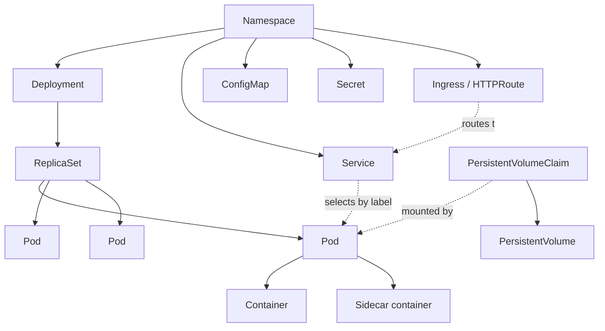

| Object | What it does |
|--------|--------------|
| **Pod** | The smallest deployable unit. One or more containers that share a network namespace and storage volumes. Containers in a pod reach each other on `localhost`. |
| **ReplicaSet** | Keeps a set number of identical pods running. You rarely create one directly. |
| **Deployment** | Manages ReplicaSets. Gives you rolling updates and rollback. Use this for stateless applications. |
| **StatefulSet** | Like a Deployment but gives each pod a stable name, stable network identity, and its own persistent volume. Use for databases and queues. |
| **DaemonSet** | Runs exactly one pod on every node (or every node matching a selector). Use for log agents, monitoring agents, and CSI drivers. |
| **Job** | Runs pods until they complete successfully. |
| **CronJob** | Creates Jobs on a schedule. |
| **Service** | A stable virtual IP address and DNS name in front of a set of pods. Types: `ClusterIP` (internal only, default), `NodePort`, `LoadBalancer` (provisions an Azure Load Balancer), `ExternalName`. |
| **Ingress** | Layer 7 HTTP routing rules. Requires an ingress controller. Being replaced by the Gateway API. |
| **Gateway / HTTPRoute** | The Gateway API. The successor to Ingress. More expressive and has a clear split between infrastructure owner and application owner. |
| **ConfigMap** | Non-secret configuration as key-value pairs. Mounted as files or environment variables. |
| **Secret** | Same idea but for sensitive values. Base64-encoded, not encrypted, unless you turn on encryption at rest. Prefer Azure Key Vault. |
| **Namespace** | A logical partition of the cluster. Used for multi-tenancy, quota, and RBAC scoping. |
| **PersistentVolumeClaim (PVC)** | A request for storage. |
| **PersistentVolume (PV)** | The actual storage resource, usually an Azure Disk or Azure File share. |
| **StorageClass** | A template describing how to create a PV dynamically. |
| **ServiceAccount** | An identity for pods. Used by workload identity. |
| **CRD** | Custom Resource Definition. Extends the Kubernetes API with your own object types. Operators are built on this. |

### 1.4 The four things you will type most

```bash
kubectl get <resource>           # list
kubectl describe <resource> <n>  # detail plus recent events
kubectl logs <pod>               # container logs
kubectl apply -f <file.yaml>     # create or update from a manifest
```

### 1.5 A complete first manifest

```yaml
apiVersion: apps/v1
kind: Deployment
metadata:
  name: web
  namespace: demo
  labels:
    app: web
spec:
  replicas: 3
  selector:
    matchLabels:
      app: web
  template:
    metadata:
      labels:
        app: web
    spec:
      securityContext:
        runAsNonRoot: true
        seccompProfile:
          type: RuntimeDefault
      containers:
        - name: web
          image: mcr.microsoft.com/azuredocs/aks-helloworld:v1
          ports:
            - containerPort: 80
          # Requests decide scheduling. Limits decide throttling and eviction.
          resources:
            requests:
              cpu: 100m         # 100 millicores = 0.1 of a CPU core
              memory: 128Mi
            limits:
              cpu: 500m
              memory: 256Mi
          securityContext:
            allowPrivilegeEscalation: false
            readOnlyRootFilesystem: true
            capabilities:
              drop: ["ALL"]
          # Liveness: restart the container if this fails.
          livenessProbe:
            httpGet: { path: /, port: 80 }
            initialDelaySeconds: 10
            periodSeconds: 20
          # Readiness: stop sending traffic if this fails, but do not restart.
          readinessProbe:
            httpGet: { path: /, port: 80 }
            initialDelaySeconds: 5
            periodSeconds: 5
          # Startup: give slow-booting apps time before liveness kicks in.
          startupProbe:
            httpGet: { path: /, port: 80 }
            failureThreshold: 30
            periodSeconds: 10
---
apiVersion: v1
kind: Service
metadata:
  name: web
  namespace: demo
spec:
  type: ClusterIP
  selector:
    app: web
  ports:
    - port: 80
      targetPort: 80
```

**Requests versus limits — the single most misunderstood thing in Kubernetes:**

- **Requests** are what the scheduler uses to pick a node. They reserve capacity.
- **Limits** are enforced at runtime. CPU over the limit is throttled. Memory over the limit means the container is killed with OOMKilled (out of memory killed).
- If you set no requests, the scheduler assumes zero and will overpack the node.
- A common production pattern is to set CPU requests but no CPU limit, and to set memory request equal to memory limit. That avoids CPU throttling while keeping memory predictable. This is a judgement call, not a rule.

---

## 2. What AKS actually is

### 2.1 The split

AKS gives you a managed Kubernetes **control plane**. You still own the **nodes** that run your workloads, and you own the workloads themselves.

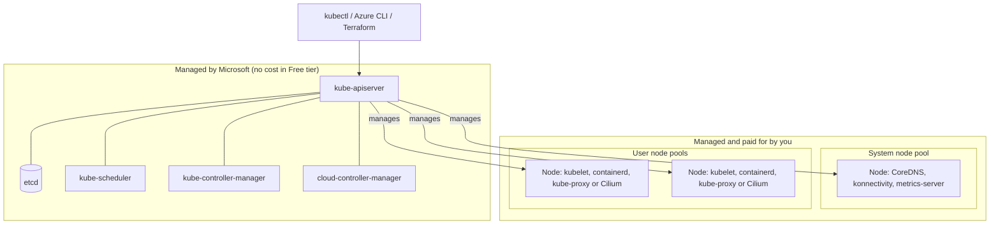

**Control plane components** (Microsoft runs these, you never see the VMs):

| Component | Job |
|-----------|-----|
| `kube-apiserver` | The single front door to the cluster. Every read and write goes through it. |
| `etcd` | Distributed key-value store holding all cluster state. |
| `kube-scheduler` | Assigns pending pods to nodes. |
| `kube-controller-manager` | Runs built-in controllers, such as the node controller and the replication controller. |
| `cloud-controller-manager` | Azure-specific logic — creating load balancers, attaching disks, tagging routes. |

**Node components** (run on every node you pay for):

| Component | Job |
|-----------|-----|
| `kubelet` | The agent. Talks to the API server, starts and stops containers, reports node health. |
| `containerd` | The container runtime. |
| `kube-proxy` or **Cilium** | Implements Service routing. Clusters using Azure CNI powered by Cilium use Cilium instead of `kube-proxy`. |

### 2.2 The two resource groups

This confuses everyone on day one. Creating one AKS cluster produces **two** resource groups.

```
my-rg                                  <- you create this
└── myAKSCluster                       <- the Microsoft.ContainerService/managedClusters resource

MC_my-rg_myAKSCluster_canadacentral    <- AKS creates this automatically ("node resource group")
├── Virtual Machine Scale Sets         <- your nodes
├── Managed disks                      <- persistent volumes
├── Load balancer, public IPs
├── Network security group, route table
└── Managed identities
```

Rules for the node resource group:

- Do not modify resources inside it by hand. AKS reconciles them and will undo your changes or break.
- You can name it yourself at creation time with `--node-resource-group`. You cannot rename it afterwards.
- You can lock it down so nobody can change it, using **node resource group lockdown**. AKS Automatic does this by default.
- Deleting the cluster deletes this resource group and everything in it.

### 2.3 Cluster modes — Automatic versus Standard

This is a newer and important distinction. AKS now has two operating modes.

| | **AKS Automatic** | **AKS Standard** |
|---|---|---|
| Positioning | Microsoft's recommended default for most production workloads | Full control, more manual configuration |
| System node pool | Managed by AKS, hosted in Microsoft's subscription | You create and manage it |
| Node provisioning | Node autoprovisioning (Karpenter) preconfigured | Manual by default; cluster autoscaler or node autoprovisioning optional |
| Scaling | HPA, VPA, and KEDA all enabled | All optional |
| Networking | Azure CNI Overlay powered by Cilium, managed virtual network, managed NAT gateway, LocalDNS | Defaults vary; you choose |
| Ingress | Application routing add-on. From AKS 1.36 new clusters default to the Gateway API implementation | Optional |
| Identity | Azure RBAC for Kubernetes, workload identity, OIDC issuer all preconfigured | Local accounts by default; the rest optional |
| Upgrades | Automatic, `stable` channel, stays at one minor version behind latest | Manual by default |
| Node OS | Azure Linux for system nodes | Ubuntu by default |
| Node resource group | Locked down | Unrestricted by default |
| Tier and SLA | Standard tier, uptime SLA, plus a pod readiness SLA (99.9% of qualifying pod readiness operations complete within 5 minutes) | Free tier by default; Standard and Premium optional |
| Node cap | 5,000 nodes | 1,000 on Free tier, 5,000 on Standard or Premium |

**How to decide:** Start with Automatic unless you have a specific requirement it cannot meet — a custom CNI (Container Network Interface), Windows node pools, very specific node topology, or a regulated environment where you must control every knob. Note that at the time of writing KAITO (the AI toolchain operator) cannot be installed on Automatic clusters.

The rest of this guide mostly explains Standard, because knowing Standard means you understand what Automatic is doing for you.

### 2.4 Pricing tiers

| Tier | Control plane cost | Node cap | Uptime SLA | Long-term support |
|------|-------------------|----------|------------|-------------------|
| **Free** | Free | 1,000 | None (best effort) | No |
| **Standard** | Roughly $0.10 per cluster per hour | 5,000 | Yes, financially backed | No |
| **Premium** | Higher | 5,000 | Yes | Yes — LTS (long-term support) |

The tier only prices the control plane. You always pay for nodes, disks, load balancers, public IP addresses, and egress separately.

**Rule:** Production clusters go on Standard at minimum. Free tier is for development and learning only.

---

## 3. Cluster building blocks

### 3.1 Node pools

A node pool is a group of identically configured nodes. Under the hood it is normally a Virtual Machine Scale Set. AKS also supports **Virtual Machines node pools**, where AKS manages individual VMs instead, which allows mixing VM sizes within one pool.

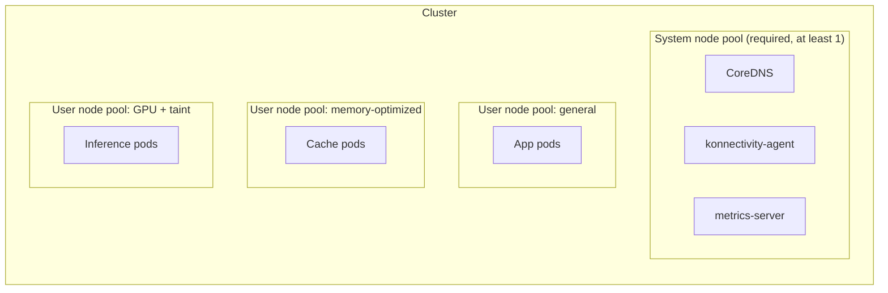

| Type | Purpose | Rules |
|------|---------|-------|
| **System** | Hosts critical `kube-system` pods such as CoreDNS and konnectivity | Every cluster needs at least one. Linux only. Cannot scale to zero. Minimum 2 nodes recommended, 3 for production. |
| **User** | Hosts your application pods | Optional but strongly recommended. Can scale to zero. Can be Linux or Windows. |

**Best practice:** Keep application workloads off the system node pool. Do it by adding the taint `CriticalAddonsOnly=true:NoSchedule` to the system pool.

```bash
# Create a dedicated system pool that only hosts system pods
az aks nodepool add \
  --resource-group my-rg --cluster-name myAKSCluster \
  --name systempool --mode System \
  --node-count 3 --node-vm-size Standard_D4ds_v5 \
  --node-taints CriticalAddonsOnly=true:NoSchedule \
  --zones 1 2 3
```

### 3.2 Node operating systems

| OS | When to use |
|----|-------------|
| **Azure Linux** (formerly CBL-Mariner) | Microsoft's own hardened, minimal Linux. Smaller attack surface, faster boot, Microsoft-maintained packages. Default for AKS Automatic system pools. **Azure Linux 2.0 reached end of support on 30 November 2025** — use Azure Linux 3.0. |
| **Ubuntu** | Default for AKS Standard. Broadest third-party agent and driver compatibility. |
| **Windows Server 2022 / 2025** | Only for Windows containers, such as .NET Framework applications. Higher cost, larger images, slower node operations. |

Set with `--os-sku AzureLinux3`, `--os-sku Ubuntu`, or `--os-type Windows`.

### 3.3 VM sizing

| Family | Use for |
|--------|---------|
| `D`-series (for example `Standard_D4ds_v5`) | General purpose. The sane default. |
| `E`-series | Memory-heavy workloads — caches, in-memory databases, JVM heaps. |
| `F`-series | Compute-heavy workloads. |
| `B`-series | Burstable. Development only. Never production; the CPU credit model causes unpredictable throttling. |
| `NC`, `ND`, `NV` | GPU workloads. See section 14. |
| `L`-series | Local NVMe storage for high input/output workloads. |

**Sizing rules:**

- Do not use tiny VM sizes. Each node loses CPU and memory to the OS, kubelet, and system pods. On a 2 vCPU node that overhead is a large fraction of the machine. Two vCPUs is the practical minimum; four or more is better.
- Do not use one enormous node size either. Losing one node loses a large share of capacity, and upgrade operations become slow.
- Aim for node sizes where your largest pod fits comfortably and you get at least 4 to 8 pods per node.
- Default maximum pods per node is 250 for Azure CNI Overlay. Plan IP address space around this.

### 3.4 Ephemeral OS disks

By default Azure replicates a VM's OS disk to Azure Storage. For nodes this gives little benefit and costs latency. **Ephemeral OS disks** live on the host machine instead.

- Faster node provisioning, faster upgrades, lower read and write latency.
- No extra storage cost — the price is in the VM.
- Requirement: the OS disk must fit in the VM cache. Check the cache size in the VM size documentation.
- AKS defaults to ephemeral OS disks when the node pool configuration allows it.

```bash
az aks nodepool add ... --node-osdisk-type Ephemeral --node-osdisk-size 128
```

### 3.5 Spot node pools

Spot virtual machines use spare Azure capacity at a large discount. Azure can evict them at any time with 30 seconds' notice.

```bash
az aks nodepool add \
  --resource-group my-rg --cluster-name myAKSCluster \
  --name spotpool \
  --priority Spot \
  --eviction-policy Delete \
  --spot-max-price -1 \
  --node-vm-size Standard_D8ds_v5 \
  --enable-cluster-autoscaler --min-count 0 --max-count 10
```

- `--spot-max-price -1` means pay up to the standard on-demand price, so you are only evicted on capacity pressure rather than price.
- AKS automatically applies the label `kubernetes.azure.com/scalesetpriority=spot` and the taint `kubernetes.azure.com/scalesetpriority=spot:NoSchedule`. Your pods must tolerate that taint.
- Use for batch jobs, continuous integration runners, development environments, and stateless workloads with many replicas.
- Never use for a system node pool, a database, or anything with a single replica.

### 3.6 Availability zones

```bash
az aks create ... --zones 1 2 3
```

- Zones are set at node pool creation and cannot be changed afterwards.
- Nodes are spread across the zones you list. Azure balances them on a best-effort basis.
- From Kubernetes 1.29, in multi-zone clusters the built-in storage classes create **zone-redundant storage (ZRS)** managed disks, which replicate synchronously across zones. This costs more than locally redundant storage (LRS). Create a custom storage class with `skuName: Premium_LRS` if you want the cheaper option.
- The cluster autoscaler is **not** zone-aware. Zone placement is handled by the underlying scale set. If you use strict zone topology spread constraints, prefer one node pool per zone and set `--balance-similar-node-groups=true`.

### 3.7 Labels, taints, and scheduling

```bash
# Labels: used by nodeSelector and node affinity
az aks nodepool add ... --labels workload=batch tier=backend

# Taints: repel pods that do not tolerate them
az aks nodepool add ... --node-taints workload=batch:NoSchedule
```

```yaml
# Pod side: land on the batch pool and tolerate its taint
spec:
  nodeSelector:
    workload: batch
  tolerations:
    - key: workload
      operator: Equal
      value: batch
      effect: NoSchedule
```

Taint effects:

| Effect | Meaning |
|--------|---------|
| `NoSchedule` | New pods without a matching toleration are not scheduled here. Existing pods stay. |
| `PreferNoSchedule` | Soft version. The scheduler tries to avoid the node. |
| `NoExecute` | New pods are not scheduled, and existing pods without a toleration are evicted. |

Spread pods across failure domains:

```yaml
spec:
  topologySpreadConstraints:
    - maxSkew: 1
      topologyKey: topology.kubernetes.io/zone
      whenUnsatisfiable: DoNotSchedule    # use ScheduleAnyway for a soft constraint
      labelSelector:
        matchLabels:
          app: web
    - maxSkew: 1
      topologyKey: kubernetes.io/hostname
      whenUnsatisfiable: ScheduleAnyway
      labelSelector:
        matchLabels:
          app: web
```

---

## 4. Lab 1 — build your first cluster

Run this end to end. It takes about 10 minutes and gives you something to experiment with for the rest of the guide.

### 4.1 Create the cluster

```bash
# Variables
RG=aks-learn-rg
LOC=canadacentral
CLUSTER=aks-learn
ACR=aksLearnAcr$RANDOM

# Resource group
az group create --name $RG --location $LOC

# Container registry
az acr create --resource-group $RG --name $ACR --sku Standard

# Cluster — a reasonable, modern Standard-mode starting point
az aks create \
  --resource-group $RG \
  --name $CLUSTER \
  --location $LOC \
  --tier standard \
  --kubernetes-version 1.35 \
  --node-count 3 \
  --node-vm-size Standard_D4ds_v5 \
  --os-sku AzureLinux3 \
  --zones 1 2 3 \
  --network-plugin azure \
  --network-plugin-mode overlay \
  --network-dataplane cilium \
  --enable-managed-identity \
  --enable-oidc-issuer \
  --enable-workload-identity \
  --enable-aad \
  --enable-azure-rbac \
  --disable-local-accounts \
  --attach-acr $ACR \
  --enable-addons monitoring \
  --generate-ssh-keys
```

What each flag does:

| Flag | Why |
|------|-----|
| `--tier standard` | Uptime SLA and 5,000 node ceiling. |
| `--network-plugin azure --network-plugin-mode overlay` | Azure CNI Overlay. Conserves virtual network IP addresses. |
| `--network-dataplane cilium` | eBPF data plane. Replaces `kube-proxy`, faster, and supports network policy natively. |
| `--enable-managed-identity` | No service principal secret to rotate. |
| `--enable-oidc-issuer --enable-workload-identity` | Prerequisites for pod-to-Azure authentication without secrets. |
| `--enable-aad --enable-azure-rbac` | Users authenticate with Microsoft Entra ID and are authorized with Azure RBAC. |
| `--disable-local-accounts` | Removes the static cluster-admin certificate that bypasses Entra ID. |
| `--attach-acr` | Grants the cluster's kubelet identity `AcrPull` on the registry. No `imagePullSecrets` needed. |

> **Note on `--enable-oidc-issuer`:** once enabled it cannot be disabled. Enabling it on an existing cluster causes a brief control plane interruption.

### 4.2 Connect

```bash
# Download credentials into ~/.kube/config
az aks get-credentials --resource-group $RG --name $CLUSTER

# Because local accounts are disabled, you need an Azure RBAC role.
# Grant yourself cluster admin at the cluster scope:
AKS_ID=$(az aks show -g $RG -n $CLUSTER --query id -o tsv)
ME=$(az ad signed-in-user show --query id -o tsv)
az role assignment create \
  --assignee $ME \
  --role "Azure Kubernetes Service RBAC Cluster Admin" \
  --scope $AKS_ID

# First kubectl command triggers a browser login via kubelogin
kubectl get nodes -o wide
kubectl get pods -A
```

### 4.3 Deploy something

```bash
kubectl create namespace demo

cat <<'YAML' | kubectl apply -f -
apiVersion: apps/v1
kind: Deployment
metadata:
  name: hello
  namespace: demo
spec:
  replicas: 3
  selector:
    matchLabels: { app: hello }
  template:
    metadata:
      labels: { app: hello }
    spec:
      containers:
        - name: hello
          image: mcr.microsoft.com/azuredocs/aks-helloworld:v1
          ports: [{ containerPort: 80 }]
          resources:
            requests: { cpu: 50m, memory: 64Mi }
            limits:   { cpu: 200m, memory: 128Mi }
          env:
            - name: TITLE
              value: "Hello from AKS"
---
apiVersion: v1
kind: Service
metadata:
  name: hello
  namespace: demo
spec:
  type: LoadBalancer
  selector: { app: hello }
  ports: [{ port: 80, targetPort: 80 }]
YAML

# Watch the Azure Load Balancer get a public IP
kubectl get svc hello -n demo --watch
```

### 4.4 Build and push your own image

```bash
# ACR Tasks builds in the cloud — no local Docker needed
az acr build --registry $ACR --image myapp:v1 .

# Reference it in a manifest
# image: <acrname>.azurecr.io/myapp:v1
kubectl set image deployment/hello hello=$ACR.azurecr.io/myapp:v1 -n demo
kubectl rollout status deployment/hello -n demo
```

### 4.5 Clean up when done

```bash
az group delete --name $RG --yes --no-wait
```


---

## 5. Networking

This is the largest design area in AKS and the one that causes the most rework. Get it right at creation time — most network settings cannot be changed later.

### 5.1 The two networking models

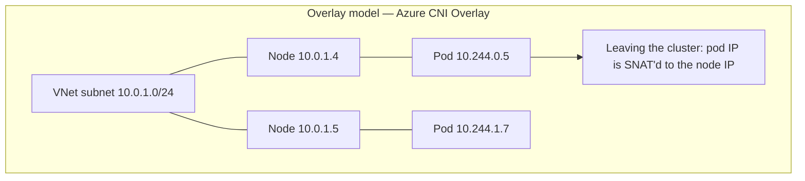

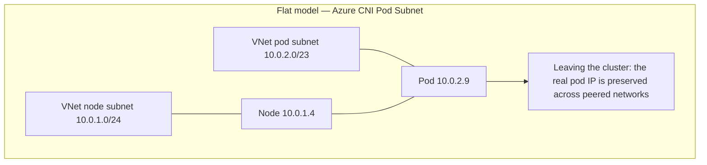

| | **Overlay** | **Flat** |
|---|---|---|
| Pod IP addresses come from | A separate CIDR block that is not part of the virtual network | The virtual network itself |
| Virtual network IP consumption | Low — only nodes consume virtual network addresses | High — every pod consumes one |
| Can on-premises reach a pod directly? | No. Traffic leaving the cluster is source network address translated (SNAT) to the node IP address | Yes |
| Maximum nodes | 5,000 | Depends on the option and subnet size |
| Configuration complexity | Low | Higher |

**CIDR** = Classless Inter-Domain Routing, the `10.0.0.0/16` style notation for IP address ranges.
**SNAT** = Source Network Address Translation, rewriting the source IP address of a packet.

### 5.2 The IP address management options

| Option | Model | CLI | Use when |
|--------|-------|-----|----------|
| **Azure CNI Overlay** | Overlay | `--network-plugin azure --network-plugin-mode overlay` | **Default choice for almost everything.** |
| **Azure CNI Pod Subnet** | Flat | `--network-plugin azure --pod-subnet-id <id>` | Something outside the cluster must connect directly to a pod IP address. |
| **Azure CNI Node Subnet** | Flat | `--network-plugin azure` (legacy) | Legacy. Simple but wasteful and limited in scale. |
| **kubenet** | Overlay | `--network-plugin kubenet` | **Deprecated. Retires 31 March 2028.** Migrate to Azure CNI Overlay. |
| **Bring your own CNI** | Depends | `--network-plugin none` | You run Calico, Cilium, or another CNI yourself and accept the support implications. |

**Default recommendation:** Azure CNI Overlay powered by Cilium. Use a flat network only when direct pod IP reachability is a hard requirement.

### 5.3 The data plane — Cilium

The IP address management option and the data plane are separate choices. The data plane is what actually forwards packets and enforces policy.

| Data plane | Notes |
|------------|-------|
| **Azure CNI powered by Cilium** | Uses eBPF. Replaces `kube-proxy`. Better performance at scale, and network policy is built in. Recommended. |
| Azure iptables data plane | The older default. Network policy comes from Azure Network Policy Manager (NPM) or Calico. |

```bash
az aks create ... \
  --network-plugin azure \
  --network-plugin-mode overlay \
  --network-dataplane cilium \
  --pod-cidr 10.244.0.0/16
```

### 5.4 Address planning

Four address ranges matter. They must not overlap with each other, with peered virtual networks, or with on-premises ranges.

| Range | Default | Notes |
|-------|---------|-------|
| **Node subnet** | You choose | Sized for nodes plus upgrade surge. With overlay, one address per node, not per pod. |
| **Pod CIDR** | `10.244.0.0/16` | Overlay only. Each node gets a `/24` slice by default, giving 250 usable pod addresses per node. |
| **Service CIDR** | `10.0.0.0/16` | Virtual IP addresses for Services. Never routed. Must not overlap anything real. |
| **DNS service IP** | `10.0.0.10` | Must sit inside the service CIDR. |

Worked example for a 100-node cluster with overlay:

```
Node subnet:  10.10.0.0/24    -> 251 usable, enough for 100 nodes plus surge
Pod CIDR:     10.244.0.0/16   -> 256 nodes x 250 pods
Service CIDR: 172.16.0.0/16   -> chosen away from the 10.x space used on-premises
DNS IP:       172.16.0.10
```

**Trap:** Many enterprises advertise `10.0.0.0/8` over ExpressRoute. Put your service CIDR somewhere else, such as `172.16.0.0/16`, or you will get silent routing failures.

### 5.5 Getting traffic in

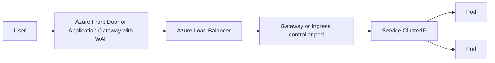

**WAF** = Web Application Firewall.

| Option | What it is | When |
|--------|-----------|------|
| **Service type LoadBalancer** | AKS provisions an Azure Load Balancer rule and public IP per service | Simple, non-HTTP, or one or two services. Does not scale to many services. |
| **Internal load balancer** | Same but with a private IP address | Internal-only applications. Annotation: `service.beta.kubernetes.io/azure-load-balancer-internal: "true"` |
| **Application routing add-on** | AKS-managed ingress. Historically managed NGINX; from AKS 1.36 new clusters default to the Kubernetes Gateway API implementation, which runs a managed Istio control plane behind the scenes | The default HTTP ingress choice for most clusters. Integrates with Azure DNS and Azure Key Vault for certificates. |
| **Istio service mesh add-on ingress gateway** | Full service mesh, supports Gateway API ingress | You already want a mesh, or you need `EnvoyFilter` level control such as rate limiting or body size limits. |
| **Application Gateway for Containers (AGC)** | Azure-managed Layer 7 load balancer that implements the Gateway API and Ingress API | You want the proxy outside the cluster and integrated WAF. Successor to Application Gateway Ingress Controller (AGIC). |
| **Self-managed ingress-nginx, Traefik, Contour** | You install and operate it | You need behaviour the managed options do not give you. |

**Important limitation:** the application routing Gateway API implementation and the Istio service mesh add-on cannot be enabled at the same time. You must disable one before enabling the other, and you must delete the leftover Istio CRDs when moving away from the Istio add-on.

Enable the application routing add-on with the Gateway API:

```bash
az aks approuting enable --resource-group $RG --name $CLUSTER
```

```yaml
# Gateway API example. The Gateway is owned by the platform team.
apiVersion: gateway.networking.k8s.io/v1
kind: Gateway
metadata:
  name: shared-gateway
  namespace: gateway-system
spec:
  gatewayClassName: approuting-istio   # or "istio" with the Istio add-on
  listeners:
    - name: https
      protocol: HTTPS
      port: 443
      hostname: "*.example.com"
      tls:
        mode: Terminate
        certificateRefs:
          - name: example-tls
      allowedRoutes:
        namespaces:
          from: All
---
# The HTTPRoute is owned by the application team, in their own namespace.
apiVersion: gateway.networking.k8s.io/v1
kind: HTTPRoute
metadata:
  name: hello-route
  namespace: demo
spec:
  parentRefs:
    - name: shared-gateway
      namespace: gateway-system
  hostnames: ["hello.example.com"]
  rules:
    - matches:
        - path:
            type: PathPrefix
            value: /
      backendRefs:
        - name: hello
          port: 80
```

The classic Ingress equivalent, for comparison:

```yaml
apiVersion: networking.k8s.io/v1
kind: Ingress
metadata:
  name: hello
  namespace: demo
  annotations:
    cert-manager.io/cluster-issuer: letsencrypt-prod
spec:
  ingressClassName: webapprouting.kubernetes.azure.com
  rules:
    - host: hello.example.com
      http:
        paths:
          - path: /
            pathType: Prefix
            backend:
              service:
                name: hello
                port: { number: 80 }
  tls:
    - hosts: ["hello.example.com"]
      secretName: hello-tls
```

### 5.6 Getting traffic out — outbound types

Every cluster needs outbound internet access for image pulls, Microsoft Entra ID token requests, and AKS control plane communication.

| `--outbound-type` | How it works | When |
|-------------------|--------------|------|
| `loadBalancer` | Default. SNAT through the cluster's Standard Load Balancer public IP addresses. | Simple clusters. |
| `managedNATGateway` | AKS creates and manages an Azure NAT Gateway. | Better SNAT port scaling. Fewer port exhaustion problems. **Preferred for most clusters.** |
| `userAssignedNATGateway` | You bring your own NAT Gateway. | You need to control the egress IP addresses. |
| `userDefinedRouting` (UDR) | All egress goes through your own next hop, normally Azure Firewall or a network virtual appliance. | Enterprise and regulated environments where egress must be inspected and logged. |
| `none` | No outbound configured. | Fully isolated clusters with private endpoints for everything. |

**SNAT port exhaustion** is the classic AKS production incident. The Standard Load Balancer allocates a limited number of SNAT ports per node. A chatty application opening many short-lived outbound connections runs out and starts seeing connection timeouts. Fixes, in order of preference: use a NAT Gateway, increase allocated outbound ports, use connection pooling in the application, and use private endpoints for Azure services so the traffic never leaves the virtual network.

With UDR you must allowlist the required AKS egress FQDNs on the firewall. Azure Firewall has an **AzureKubernetesService** FQDN tag that covers the mandatory ones.

```bash
az aks create ... \
  --outbound-type userDefinedRouting \
  --vnet-subnet-id $SUBNET_ID
# The route table with 0.0.0.0/0 -> Azure Firewall private IP must exist
# and be associated with the node subnet BEFORE cluster creation.
```

### 5.7 Private clusters and API server access

Three ways to restrict who can reach the Kubernetes API server:

| Option | How | Notes |
|--------|-----|-------|
| **Authorized IP ranges** | `--api-server-authorized-ip-ranges` | API server stays public, but only listed source addresses can connect. Simple. Good middle ground. |
| **Private cluster** | `--enable-private-cluster` | API server gets a private endpoint. Requires a private DNS zone. You need a jump box, VPN, ExpressRoute, or a self-hosted agent to run `kubectl`. |
| **API server virtual network integration** | `--enable-apiserver-vnet-integration` | The API server is projected into a delegated subnet in your virtual network. Node-to-API-server traffic stays private with no tunnel or private link. Preconfigured in AKS Automatic. |

```bash
az aks create ... \
  --enable-private-cluster \
  --private-dns-zone /subscriptions/.../privatelink.canadacentral.azmk8s.io \
  --disable-public-fqdn
```

**Trap:** A private cluster does not mean a private workload. Your services can still publish public load balancers. Those are separate settings.

### 5.8 Network policy

Network policy is pod-level firewalling. Without it, every pod can talk to every other pod in the cluster.

| Engine | Notes |
|--------|-------|
| **Cilium** (via Azure CNI powered by Cilium) | Recommended. eBPF-based, efficient, supports the standard Kubernetes NetworkPolicy plus Cilium extensions. |
| **Calico** | Open source, supports its own richer policy API. Support terms come from Tigera. |
| **Azure Network Policy Manager (NPM)** | Azure's iptables-based implementation. Older. |

```yaml
# Deny all ingress in a namespace, then allow only what you need.
apiVersion: networking.k8s.io/v1
kind: NetworkPolicy
metadata:
  name: default-deny-ingress
  namespace: demo
spec:
  podSelector: {}          # all pods in the namespace
  policyTypes: [Ingress]
---
apiVersion: networking.k8s.io/v1
kind: NetworkPolicy
metadata:
  name: allow-frontend-to-api
  namespace: demo
spec:
  podSelector:
    matchLabels: { app: api }
  policyTypes: [Ingress]
  ingress:
    - from:
        - podSelector:
            matchLabels: { app: frontend }
      ports:
        - protocol: TCP
          port: 8080
---
# Egress control: allow DNS and one CIDR only
apiVersion: networking.k8s.io/v1
kind: NetworkPolicy
metadata:
  name: restrict-egress
  namespace: demo
spec:
  podSelector:
    matchLabels: { app: api }
  policyTypes: [Egress]
  egress:
    - to:
        - namespaceSelector:
            matchLabels: { kubernetes.io/metadata.name: kube-system }
      ports:
        - { protocol: UDP, port: 53 }
    - to:
        - ipBlock:
            cidr: 10.20.0.0/16
```

### 5.9 Advanced Container Networking Services (ACNS)

An add-on layer for observability and security on top of Cilium.

| Capability | What it gives you |
|-----------|-------------------|
| **Container network observability** | Hubble-based flow logs and metrics. See which pod talked to which, and what was dropped. |
| **FQDN filtering** | Egress policy by domain name instead of IP address. Much more practical for allowlisting SaaS endpoints. |
| **Layer 7 network policy** | Policy on HTTP methods and paths, not just ports. |
| **WireGuard node-to-node encryption** | Encrypts pod traffic between nodes. |
| **mTLS encryption** | Mutual Transport Layer Security between workloads. |
| **eBPF host routing** | Performance optimization. |

```bash
az aks update --resource-group $RG --name $CLUSTER \
  --enable-acns
```

Requires Cilium. Some features are preview or have operating-system and version requirements — check the feature support table before you design around them.

### 5.10 DNS inside the cluster

- **CoreDNS** runs in `kube-system` and resolves service names. Service DNS format: `<service>.<namespace>.svc.cluster.local`.
- Customize by creating a ConfigMap named `coredns-custom` in `kube-system`. Never edit the `coredns` ConfigMap directly — AKS overwrites it.
- **LocalDNS** is a node-local DNS cache. It reduces CoreDNS load and tail latency. Preconfigured in AKS Automatic.

```yaml
apiVersion: v1
kind: ConfigMap
metadata:
  name: coredns-custom
  namespace: kube-system
data:
  corp.server: |
    corp.internal:53 {
      errors
      cache 30
      forward . 10.20.0.10 10.20.0.11
    }
```

### 5.11 Service mesh

The **Istio-based service mesh add-on** is the Microsoft-supported mesh for AKS.

- Gives you mutual TLS between services, traffic splitting for canary releases, retries, circuit breaking, and detailed telemetry.
- Add-on revisions are named like `asm-1-28`. Minor revision upgrades are **canary upgrades** — you install the new revision alongside the old one, shift workloads, then finalize.
- **The Istio add-on is not upgraded automatically with the cluster.** You must upgrade it yourself, or it will eventually block cluster auto-upgrade.
- Microsoft maintains an allowlist of supported customizations. `EnvoyFilter` is allowed but not supported by Azure support.

```bash
az aks mesh enable --resource-group $RG --name $CLUSTER
kubectl label namespace demo istio.io/rev=asm-1-28
kubectl rollout restart deployment -n demo   # sidecars get injected on restart
```

**Do you need a mesh?** Only if you need mutual TLS everywhere, fine-grained traffic shifting, or per-service Layer 7 telemetry across many services. A mesh adds a sidecar proxy to every pod, CPU and memory overhead, and an upgrade obligation. Start without one.

### 5.12 Open Service Mesh is retiring

The managed Open Service Mesh (OSM) add-on support **ends on 30 September 2027**. Migrate to the Istio add-on.

---

## 6. Identity and access

There are three separate identity problems in AKS. People mix them up constantly. Keep them apart.

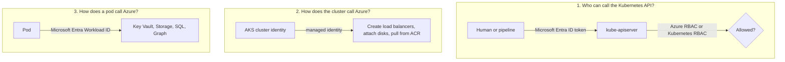

### 6.1 Problem 1 — cluster access

**Authentication** (who are you?) is done by Microsoft Entra ID. **Authorization** (what may you do?) is done by either Azure RBAC or Kubernetes RBAC.

| Mode | Configuration | Notes |
|------|--------------|-------|
| Local accounts | Default on AKS Standard | A static cluster-admin certificate. **Turn this off.** It bypasses Entra ID entirely. |
| Kubernetes RBAC with Entra integration | `--enable-aad` | Entra users and groups are mapped to Kubernetes `Role` and `ClusterRole` bindings. |
| **Azure RBAC for Kubernetes** | `--enable-aad --enable-azure-rbac` | Recommended. Permissions are Azure role assignments. Unified with the rest of Azure governance, auditing, and Privileged Identity Management. |

Built-in Azure roles for Kubernetes authorization:

| Role | Grants |
|------|--------|
| Azure Kubernetes Service RBAC Reader | Read-only on most objects. Cannot read Secrets. |
| Azure Kubernetes Service RBAC Writer | Read and write on most objects, including Secrets. |
| Azure Kubernetes Service RBAC Admin | Writer plus roles and role bindings, scoped to a namespace. |
| Azure Kubernetes Service RBAC Cluster Admin | Full control. |
| Azure Kubernetes Service Cluster User Role | Permission to run `az aks get-credentials`. Needed by everyone. |
| Azure Kubernetes Service Contributor Role | Manage the cluster Azure resource. Does not grant data plane access when Azure RBAC is on. |

```bash
# Namespace-scoped grant: an application team gets write access to one namespace only
GROUP_ID=$(az ad group show --group "app-team-payments" --query id -o tsv)
az role assignment create \
  --assignee $GROUP_ID \
  --role "Azure Kubernetes Service RBAC Writer" \
  --scope "$AKS_ID/namespaces/payments"
```

Kubernetes-native RBAC, for when you need it:

```yaml
apiVersion: rbac.authorization.k8s.io/v1
kind: Role
metadata:
  namespace: payments
  name: pod-reader
rules:
  - apiGroups: [""]
    resources: ["pods", "pods/log"]
    verbs: ["get", "list", "watch"]
---
apiVersion: rbac.authorization.k8s.io/v1
kind: RoleBinding
metadata:
  namespace: payments
  name: pod-reader-binding
subjects:
  - kind: Group
    name: "<entra-group-object-id>"     # the Entra group object ID, not the display name
    apiGroup: rbac.authorization.k8s.io
roleRef:
  kind: Role
  name: pod-reader
  apiGroup: rbac.authorization.k8s.io
```

**Additional controls:** require multi-factor authentication for cluster administrators through Conditional Access, and use Privileged Identity Management for just-in-time elevation to cluster admin.

### 6.2 Problem 2 — the cluster's own identity

AKS needs to create load balancers, attach disks, update route tables, and pull images. Use **managed identities**, never service principals. Managed identities have no secret to leak or rotate.

Two identities exist:

| Identity | Purpose |
|----------|---------|
| **Cluster (control plane) identity** | Used by the AKS control plane to manage Azure resources in the node resource group. |
| **Kubelet identity** | Used by nodes, mainly to pull images from ACR. This is the one `--attach-acr` assigns `AcrPull` to. |

```bash
# Bring your own identities for tighter control
az aks create ... \
  --enable-managed-identity \
  --assign-identity        $CONTROL_PLANE_IDENTITY_ID \
  --assign-kubelet-identity $KUBELET_IDENTITY_ID
```

Minimum permission for the control plane identity on the node subnet is **Network Contributor**, or a custom role with the equivalent subnet, route table, and network security group actions.

### 6.3 Problem 3 — workload identity (the important one)

**Microsoft Entra Workload ID** lets a pod get an Azure token without any stored secret.

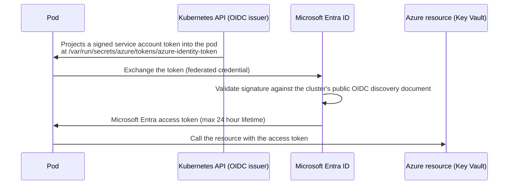

**OIDC** = OpenID Connect, a standard identity layer on top of OAuth 2.0.

Full working setup:

```bash
RG=aks-learn-rg
CLUSTER=aks-learn
KV_NAME=mykv$RANDOM
IDENTITY=payments-workload-identity
NAMESPACE=payments
SERVICE_ACCOUNT=payments-sa

# 1. Make sure the cluster has the OIDC issuer and workload identity enabled
az aks update -g $RG -n $CLUSTER --enable-oidc-issuer --enable-workload-identity

# 2. Get the cluster's OIDC issuer URL
export OIDC_ISSUER=$(az aks show -g $RG -n $CLUSTER \
  --query "oidcIssuerProfile.issuerUrl" -o tsv)

# 3. Create a user-assigned managed identity
az identity create -g $RG -n $IDENTITY
export CLIENT_ID=$(az identity show -g $RG -n $IDENTITY --query clientId -o tsv)
export IDENTITY_PRINCIPAL=$(az identity show -g $RG -n $IDENTITY --query principalId -o tsv)

# 4. Grant it something in Azure
az keyvault create -g $RG -n $KV_NAME --enable-rbac-authorization true
KV_ID=$(az keyvault show -g $RG -n $KV_NAME --query id -o tsv)
az role assignment create \
  --assignee-object-id $IDENTITY_PRINCIPAL --assignee-principal-type ServicePrincipal \
  --role "Key Vault Secrets User" --scope $KV_ID

# 5. Federate the identity with a specific namespace and service account
az identity federated-credential create \
  --name payments-federated \
  --identity-name $IDENTITY \
  --resource-group $RG \
  --issuer $OIDC_ISSUER \
  --subject system:serviceaccount:${NAMESPACE}:${SERVICE_ACCOUNT} \
  --audience api://AzureADTokenExchange
```

```yaml
# 6. Kubernetes side
apiVersion: v1
kind: ServiceAccount
metadata:
  name: payments-sa
  namespace: payments
  annotations:
    azure.workload.identity/client-id: "<CLIENT_ID>"
---
apiVersion: apps/v1
kind: Deployment
metadata:
  name: payments-api
  namespace: payments
spec:
  replicas: 2
  selector:
    matchLabels: { app: payments-api }
  template:
    metadata:
      labels:
        app: payments-api
        azure.workload.identity/use: "true"    # REQUIRED — triggers the mutating webhook
    spec:
      serviceAccountName: payments-sa          # REQUIRED
      containers:
        - name: api
          image: myacr.azurecr.io/payments:v1
          env:
            - name: KEYVAULT_URL
              value: "https://mykv.vault.azure.net/"
```

```python
# 7. Application code. No credentials anywhere.
from azure.identity import DefaultAzureCredential
from azure.keyvault.secrets import SecretClient
import os

# DefaultAzureCredential picks up the projected token automatically.
credential = DefaultAzureCredential()
client = SecretClient(vault_url=os.environ["KEYVAULT_URL"], credential=credential)
secret = client.get_secret("db-password")
```

**Requirements and traps:**

- The pod label `azure.workload.identity/use: "true"` must be on the **pod template**, not on the Deployment metadata. This is the number one reason workload identity "does not work".
- The federated credential `subject` must match `system:serviceaccount:<namespace>:<serviceaccount>` exactly.
- The application must use a recent Azure Identity client library or MSAL (Microsoft Authentication Library). Older SDK versions do not understand the federated file-based token.
- Each user-assigned managed identity supports a maximum of **20 federated identity credentials**. For many clusters sharing one identity, use **identity bindings**, which map multiple clusters through one federated credential.
- Use a separate managed identity per workload, scoped to only what that workload needs.

**Microsoft Entra pod-managed identity (the old AAD Pod Identity add-on) reached end of support in September 2025.** If you find it in an existing cluster, migrating to workload identity is urgent.

### 6.4 Secrets — Azure Key Vault

Kubernetes Secrets are base64-encoded, not encrypted. Three better options:

| Approach | How |
|----------|-----|
| **Key Vault Secrets Store CSI driver** | Mounts Key Vault secrets as files in the pod. Can also sync them into Kubernetes Secrets. |
| **Direct SDK calls with workload identity** | The application calls Key Vault itself. Cleanest, but needs code changes. |
| **External Secrets Operator** | Third-party operator that syncs from Key Vault into Kubernetes Secrets. |

```bash
az aks enable-addons --addons azure-keyvault-secrets-provider \
  -g $RG -n $CLUSTER --enable-secret-rotation
```

```yaml
apiVersion: secrets-store.csi.x-k8s.io/v1
kind: SecretProviderClass
metadata:
  name: kv-payments
  namespace: payments
spec:
  provider: azure
  parameters:
    clientID: "<workload-identity-client-id>"
    keyvaultName: "mykv"
    tenantId: "<tenant-id>"
    objects: |
      array:
        - |
          objectName: db-password
          objectType: secret
  # Optional: also create a Kubernetes Secret from the mounted values
  secretObjects:
    - secretName: payments-db
      type: Opaque
      data:
        - objectName: db-password
          key: password
---
# Mount it in the pod
spec:
  template:
    spec:
      volumes:
        - name: secrets
          csi:
            driver: secrets-store.csi.k8s.io
            readOnly: true
            volumeAttributes:
              secretProviderClass: kv-payments
      containers:
        - name: api
          volumeMounts:
            - name: secrets
              mountPath: /mnt/secrets
              readOnly: true
```

**Note:** The CSI driver only mounts secrets when a pod actually mounts the volume. Secret rotation requires `--enable-secret-rotation` and the application must re-read the file.

### 6.5 Encrypting etcd with your own key

AKS encrypts etcd at rest with a platform-managed key by default. For customer-managed keys, use **KMS** (Key Management Service) etcd encryption backed by Azure Key Vault. Note that the original KMS experience is now designated legacy; for Kubernetes 1.33 and later, review the newer KMS data encryption experience and its migration path.

---

## 7. Storage

### 7.1 Volume types

| Type | Lifetime | Use for |
|------|----------|---------|
| `emptyDir` | Deleted with the pod | Scratch space, caches. Backed by node disk or memory. |
| `configMap`, `secret` | Pod | Configuration files. |
| `projected` | Pod | Service account tokens — this is how workload identity works. |
| `PersistentVolumeClaim` | Independent of the pod | Real data. |

### 7.2 Azure storage options

All are provided through **CSI** (Container Storage Interface) drivers. In-tree drivers were removed — since Kubernetes 1.26 AKS no longer supports creating volumes with `kubernetes.io/azure-disk` or `kubernetes.io/azure-file`. Use `disk.csi.azure.com` and `file.csi.azure.com`.

| Service | Access modes | Notes |
|---------|-------------|-------|
| **Azure Disk** | `ReadWriteOnce` only | One node at a time. Best performance and lowest latency. Default for databases. Zone-pinned unless you use ZRS. |
| **Azure Files** | `ReadWriteOnce`, `ReadOnlyMany`, `ReadWriteMany` | SMB 3.0/3.1 or NFS. Shared across pods and nodes. Higher latency. |
| **Azure Blob Storage** | Shared | Mounted through BlobFuse or NFS v3. For large unstructured datasets, logs, media, and Data Lake content. |
| **Azure NetApp Files** | All | High performance shared file storage. Expensive. For demanding enterprise workloads. |
| **Azure Managed Lustre** | All | High performance computing and large-scale AI training. |
| **Azure Container Storage** | Block | Fully managed block storage orchestration. Version 2 supports local NVMe and Azure Elastic SAN. Version 1 also supports Azure Disks and ephemeral disks. |

**SMB** = Server Message Block. **NFS** = Network File System.

### 7.3 Built-in storage classes

| Storage class | Backing |
|---------------|---------|
| `managed-csi` (the `default` class) | Standard SSD. LRS, or ZRS in multi-zone clusters from Kubernetes 1.29. |
| `managed-csi-premium` | Premium SSD. LRS or ZRS as above. |
| `managed-csi-premium-v2` | Premium SSD v2. Available from Kubernetes 1.35. |
| `azurefile-csi` | Standard Azure Files. |
| `azurefile-csi-premium` | Premium Azure Files. |
| `azureblob-nfs-premium` | Blob container over NFS v3. |
| `azureblob-fuse-premium` | Blob container over BlobFuse. |

### 7.4 Custom storage class and a claim

```yaml
apiVersion: storage.k8s.io/v1
kind: StorageClass
metadata:
  name: premium-retain-zrs
provisioner: disk.csi.azure.com
parameters:
  skuName: Premium_ZRS          # Premium_LRS is cheaper but zone-pinned
  cachingMode: ReadOnly
reclaimPolicy: Retain           # keep the disk when the PVC is deleted
volumeBindingMode: WaitForFirstConsumer   # provision after the pod is scheduled
allowVolumeExpansion: true
---
apiVersion: v1
kind: PersistentVolumeClaim
metadata:
  name: data
  namespace: demo
spec:
  accessModes: [ReadWriteOnce]
  storageClassName: premium-retain-zrs
  resources:
    requests:
      storage: 128Gi
---
apiVersion: apps/v1
kind: StatefulSet
metadata:
  name: postgres
  namespace: demo
spec:
  serviceName: postgres
  replicas: 1
  selector:
    matchLabels: { app: postgres }
  template:
    metadata:
      labels: { app: postgres }
    spec:
      containers:
        - name: postgres
          image: postgres:17
          volumeMounts:
            - name: data
              mountPath: /var/lib/postgresql/data
  # Each replica gets its own disk automatically
  volumeClaimTemplates:
    - metadata:
        name: data
      spec:
        accessModes: [ReadWriteOnce]
        storageClassName: premium-retain-zrs
        resources:
          requests: { storage: 128Gi }
```

**Key settings explained:**

| Setting | Why it matters |
|---------|---------------|
| `volumeBindingMode: WaitForFirstConsumer` | Without this, the disk is created before the pod is scheduled, possibly in the wrong availability zone, and the pod can never start. **Always use this in multi-zone clusters.** |
| `reclaimPolicy: Retain` | `Delete` (the default in built-in classes) destroys the disk when the PVC goes away. For production data, use `Retain`. |
| `allowVolumeExpansion: true` | Lets you grow a volume by editing the PVC. You cannot shrink. |

### 7.5 Backup and snapshots

- **Azure Backup for AKS** is the first-party option. It backs up cluster resources and persistent volumes.
- **Volume snapshots** need the snapshot controller enabled (`--enable-snapshot-controller`), then a `VolumeSnapshotClass` and a `VolumeSnapshot` referencing a PVC.
- **Velero** and **Veeam Kasten** are common third-party options.

```yaml
apiVersion: snapshot.storage.k8s.io/v1
kind: VolumeSnapshot
metadata:
  name: data-snapshot
  namespace: demo
spec:
  volumeSnapshotClassName: csi-azuredisk-vsc
  source:
    persistentVolumeClaimName: data
```

### 7.6 Storage traps

- A `ReadWriteOnce` Azure Disk attaches to **one node**. If you have a Deployment with 3 replicas and one PVC, two pods will be stuck in `Pending` or `ContainerCreating`. Use Azure Files or a StatefulSet with `volumeClaimTemplates`.
- Persistent volumes cannot be shared between Windows and Linux pods.
- Disk attach and detach takes time. A node failure means waiting for the disk to detach before the pod can start elsewhere. Design for it.
- Each VM size has a maximum data disk count. Exceed it and pods stay pending.
- Deleting a namespace deletes PVCs, and with `reclaimPolicy: Delete` that destroys the data.

---

## 8. Scaling

There are two independent axes: scale the **pods**, and scale the **nodes** that hold them.

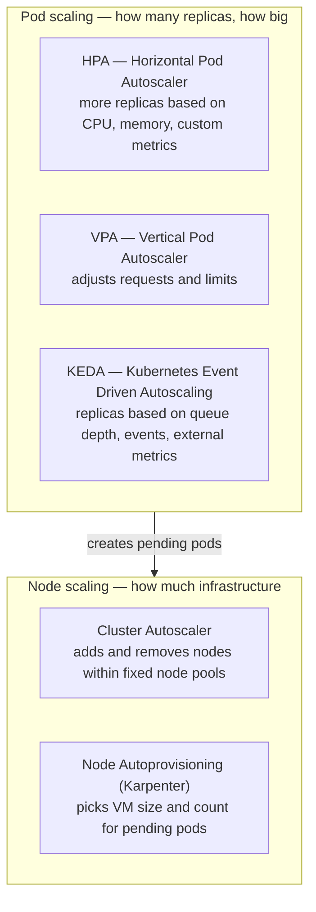

### 8.1 Horizontal Pod Autoscaler (HPA)

Built into Kubernetes. Needs `metrics-server`, which AKS installs by default. Needs pods to have resource **requests** set — without them, CPU-percentage targets are meaningless.

```yaml
apiVersion: autoscaling/v2
kind: HorizontalPodAutoscaler
metadata:
  name: web
  namespace: demo
spec:
  scaleTargetRef:
    apiVersion: apps/v1
    kind: Deployment
    name: web
  minReplicas: 3
  maxReplicas: 50
  metrics:
    - type: Resource
      resource:
        name: cpu
        target:
          type: Utilization
          averageUtilization: 70    # 70% of the CPU *request*, not the limit
    - type: Resource
      resource:
        name: memory
        target:
          type: Utilization
          averageUtilization: 80
  behavior:
    scaleUp:
      stabilizationWindowSeconds: 0
      policies:
        - type: Percent
          value: 100
          periodSeconds: 30
    scaleDown:
      stabilizationWindowSeconds: 300   # wait 5 minutes before scaling down
      policies:
        - type: Percent
          value: 25
          periodSeconds: 60
```

### 8.2 Vertical Pod Autoscaler (VPA)

Adjusts CPU and memory requests based on observed usage. Useful for right-sizing workloads you cannot profile by hand.

```bash
az aks update -g $RG -n $CLUSTER --enable-vpa
```

```yaml
apiVersion: autoscaling.k8s.io/v1
kind: VerticalPodAutoscaler
metadata:
  name: web-vpa
  namespace: demo
spec:
  targetRef:
    apiVersion: apps/v1
    kind: Deployment
    name: web
  updatePolicy:
    updateMode: "Auto"     # "Off" gives recommendations only — start here
  resourcePolicy:
    containerPolicies:
      - containerName: "*"
        minAllowed:  { cpu: 50m,  memory: 64Mi }
        maxAllowed:  { cpu: "4",  memory: 8Gi }
```

**Trap:** Do not run VPA in `Auto` mode and HPA on CPU for the same workload. They fight. Use VPA for memory and HPA for CPU, or run VPA in `Off` mode and apply its recommendations manually.

### 8.3 KEDA — event-driven scaling

**KEDA** = Kubernetes Event Driven Autoscaling. It scales on things that are not CPU — queue length, Kafka lag, Service Bus messages, Prometheus queries, cron schedules. It can scale to **zero**, which HPA cannot.

```bash
az aks update -g $RG -n $CLUSTER --enable-keda
```

```yaml
apiVersion: keda.sh/v1alpha1
kind: TriggerAuthentication
metadata:
  name: sb-auth
  namespace: workers
spec:
  podIdentity:
    provider: azure-workload
    identityId: "<managed-identity-client-id>"
---
apiVersion: keda.sh/v1alpha1
kind: ScaledObject
metadata:
  name: order-worker
  namespace: workers
spec:
  scaleTargetRef:
    name: order-worker
  minReplicaCount: 0          # scale to zero when the queue is empty
  maxReplicaCount: 100
  pollingInterval: 15
  cooldownPeriod: 120
  triggers:
    - type: azure-servicebus
      metadata:
        queueName: orders
        namespace: my-sb-namespace
        messageCount: "20"     # one replica per 20 messages
      authenticationRef:
        name: sb-auth
```

KEDA also supports `ScaledJob` for running a Kubernetes Job per unit of work rather than keeping long-lived pods.

### 8.4 Cluster autoscaler

Adds and removes nodes within an **existing** node pool, between a minimum and maximum count.

```bash
az aks nodepool update \
  -g $RG --cluster-name $CLUSTER -n userpool \
  --enable-cluster-autoscaler --min-count 2 --max-count 20

# Tune the profile at the cluster level
az aks update -g $RG -n $CLUSTER \
  --cluster-autoscaler-profile \
    scale-down-delay-after-add=10m,\
    scale-down-unneeded-time=10m,\
    scale-down-utilization-threshold=0.5,\
    max-graceful-termination-sec=600,\
    balance-similar-node-groups=true,\
    expander=least-waste
```

| Profile setting | What it does |
|-----------------|-------------|
| `scale-down-delay-after-add` | Do not remove nodes for this long after a scale-up. Prevents flapping. |
| `scale-down-unneeded-time` | How long a node must be underused before removal. |
| `scale-down-utilization-threshold` | Utilization below which a node counts as unneeded. |
| `expander` | How to pick which node pool to grow: `random`, `most-pods`, `least-waste`, `priority`. |
| `balance-similar-node-groups` | Keeps equivalent pools balanced. Important for one-pool-per-zone designs. |

**What blocks scale-down** — worth memorizing, this is a common support question:

- Pods without a controller (bare pods).
- Pods with local storage (`emptyDir`, `hostPath`).
- Pods whose PodDisruptionBudget would be violated.
- Pods in `kube-system` without a PodDisruptionBudget.
- Pods with restrictive node selectors or affinity that cannot be satisfied elsewhere.
- Pods with the annotation `cluster-autoscaler.kubernetes.io/safe-to-evict: "false"`.

### 8.5 Node autoprovisioning (NAP)

**NAP** is AKS's managed **Karpenter**. Instead of scaling fixed node pools, it looks at pending pods and provisions right-sized nodes for them, choosing the VM size itself from an allowed set.

```bash
az aks update -g $RG -n $CLUSTER --node-provisioning-mode Auto
```

This creates two custom resource types: `NodePool` (from Karpenter) and `AKSNodeClass` (Azure-specific).

```yaml
apiVersion: karpenter.sh/v1
kind: NodePool
metadata:
  name: general
spec:
  template:
    spec:
      nodeClassRef:
        group: karpenter.azure.com
        kind: AKSNodeClass
        name: default
      requirements:
        - key: kubernetes.io/arch
          operator: In
          values: ["amd64"]
        - key: karpenter.sh/capacity-type
          operator: In
          values: ["on-demand", "spot"]
        - key: karpenter.azure.com/sku-family
          operator: In
          values: ["D", "E", "F"]
        - key: karpenter.azure.com/sku-cpu
          operator: Lt
          values: ["33"]
      expireAfter: Never
  limits:
    cpu: "1000"
    memory: 4000Gi
  disruption:
    consolidationPolicy: WhenEmptyOrUnderutilized
    consolidateAfter: 1m
  weight: 10
---
apiVersion: karpenter.azure.com/v1beta1
kind: AKSNodeClass
metadata:
  name: default
spec:
  imageFamily: AzureLinux
  osDiskSizeGB: 128
  maxPods: 110
```

**NAP versus cluster autoscaler:**

| | Cluster autoscaler | Node autoprovisioning |
|---|---|---|
| Unit of scaling | A node pool with a fixed VM size | Individual nodes, size chosen per workload |
| VM size selection | You decide up front | Karpenter picks from your allowed set |
| Bin packing | Limited | Actively consolidates underused nodes |
| Spot handling | Separate pool | Mixed by capacity-type requirement |
| Complexity | Lower | Higher, but usually cheaper |

You can run both side by side during migration. Separate them with the taint `autoscaling.azure.com/nap-block:NoSchedule` on NAP nodes and matching tolerations on workloads.

AKS still requires a system node pool for system components such as CoreDNS and Karpenter itself. When NAP is enabled, AKS autoscales the system pool.

### 8.6 PodDisruptionBudgets

A **PDB** tells Kubernetes the minimum availability to keep during **voluntary** disruptions — node drains during upgrades, cluster autoscaler scale-down, NAP consolidation. It does not protect against node crashes.

```yaml
apiVersion: policy/v1
kind: PodDisruptionBudget
metadata:
  name: web-pdb
  namespace: demo
spec:
  minAvailable: 2          # or use maxUnavailable: 1
  selector:
    matchLabels: { app: web }
```

**Traps:**

- `minAvailable` equal to the replica count means the pool can never be drained. Upgrades hang. This is a very common outage cause.
- A PDB on a single-replica Deployment with `minAvailable: 1` blocks all node drains.
- Every production workload should have a PDB. Without one, an upgrade can take all your replicas down at once.

### 8.7 Which to reach for

| Symptom | Reach for |
|---------|-----------|
| CPU or memory climbing under load | HPA |
| A queue is backing up | KEDA |
| Workload sits idle most of the time | KEDA with `minReplicaCount: 0` |
| Requests and limits are guesswork | VPA in `Off` mode, read the recommendations |
| Pods pending, no room on nodes | Cluster autoscaler or NAP |
| Nodes half empty and the bill is high | NAP with consolidation, or VPA right-sizing |

---

## 9. Upgrades and version lifecycle

### 9.1 Version support policy

- AKS supports the **three most recent generally available minor versions**.
- Each minor version gets roughly **12 months of community support** from its AKS general availability date.
- **Long-term support (LTS)** adds a second year on top, for a total of about 24 months. LTS requires the **Premium** tier and the `AKSLongTermSupport` support plan.
- LTS supports only the two most recent patch versions of that minor version.

**Release calendar as documented in September 2026:**

| Kubernetes version | AKS general availability | Community end of life | LTS end of life |
|--------------------|-------------------------|----------------------|-----------------|
| 1.32 | Apr 2025 | Mar 2026 | Mar 2027 |
| 1.33 | Jun 2025 | Jul 2026 | Jul 2027 |
| 1.34 | Nov 2025 | Nov 2026 | Nov 2027 |
| 1.35 | Mar 2026 | Mar 2027 | Mar 2028 |
| 1.36 | Jun 2026 | Jun 2027 | Jun 2028 |
| 1.37 | Oct 2026 (planned) | Oct 2027 | Oct 2028 |

Always confirm against the [AKS release tracker](https://releases.aks.azure.com/webpage/index.html) — dates shift.

**Version skew:** from Kubernetes 1.28 the control plane can be up to **three minor versions** ahead of node pools (N-3). You can skip minor versions on the control plane if the skew rule still holds afterwards.

If your cluster is out of support by more than three minor versions and carries security risk, Azure will contact you, and reserves the right to upgrade it for you.

### 9.2 What an upgrade actually does

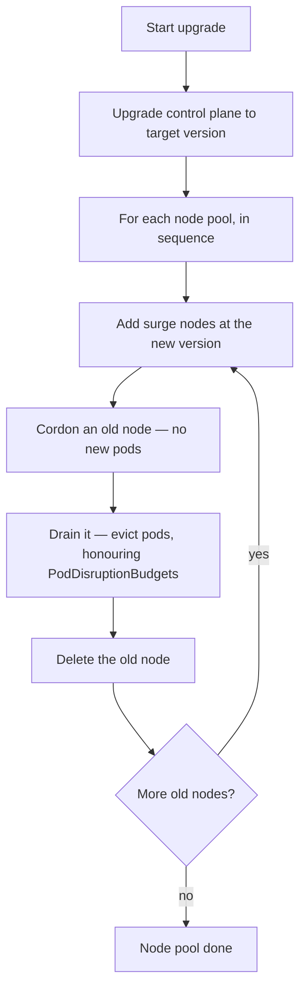

```bash
# See what is available
az aks get-upgrades -g $RG -n $CLUSTER -o table

# Control plane only
az aks upgrade -g $RG -n $CLUSTER --kubernetes-version 1.35.2 --control-plane-only

# A single node pool
az aks nodepool upgrade -g $RG --cluster-name $CLUSTER -n userpool --kubernetes-version 1.35.2

# Everything
az aks upgrade -g $RG -n $CLUSTER --kubernetes-version 1.35.2
```

**Max surge** controls upgrade speed versus capacity impact:

```bash
az aks nodepool update -g $RG --cluster-name $CLUSTER -n userpool --max-surge 33%
```

- Default is one node. Very slow on large pools.
- `33%` is a good production balance.
- `100%` is fastest but doubles node cost during the upgrade and needs the quota and IP address headroom.

### 9.3 Node image upgrades

Separate from Kubernetes version upgrades. Node images carry operating system security patches and are published roughly weekly.

```bash
# Check whether newer images exist
az aks nodepool get-upgrades -g $RG --cluster-name $CLUSTER -n userpool -o table

# Upgrade the image only, keeping the same Kubernetes version
az aks nodepool upgrade -g $RG --cluster-name $CLUSTER -n userpool --node-image-only
```

### 9.4 Automatic upgrade channels

**Cluster (Kubernetes version) channels:**

| Channel | Behaviour |
|---------|-----------|
| `none` | Nothing automatic. Default on Standard. |
| `patch` | Patch upgrades within the current minor version. |
| `stable` | Latest patch of the minor version **one behind** the newest supported (N-1). This is what AKS Automatic uses. |
| `rapid` | Latest patch of the newest supported minor version. |
| `node-image` | Node images only, no Kubernetes version change. |

**Node OS image channels:**

| Channel | Behaviour |
|---------|-----------|
| `None` | No automatic OS updates. |
| `Unmanaged` | The OS applies its own updates. Reboot is your problem. |
| `SecurityPatch` | AKS applies security patches to nodes, reimaging when needed. |
| `NodeImage` | AKS upgrades to the latest node image weekly. What AKS Automatic uses. |

```bash
az aks update -g $RG -n $CLUSTER \
  --auto-upgrade-channel stable \
  --node-os-upgrade-channel NodeImage
```

### 9.5 Planned maintenance windows

Control **when** automatic operations run.

```bash
az aks maintenanceconfiguration add \
  -g $RG --cluster-name $CLUSTER \
  --name aksManagedAutoUpgradeSchedule \
  --schedule-type Weekly --day-of-week Sunday \
  --start-time 02:00 --duration 8 --utc-offset -05:00

az aks maintenanceconfiguration add \
  -g $RG --cluster-name $CLUSTER \
  --name aksManagedNodeOSUpgradeSchedule \
  --schedule-type Weekly --day-of-week Saturday \
  --start-time 02:00 --duration 8 --utc-offset -05:00
```

Three reserved configuration names:

| Name | Controls |
|------|----------|
| `default` | Weekly control plane maintenance by AKS. |
| `aksManagedAutoUpgradeSchedule` | Kubernetes version auto-upgrades. |
| `aksManagedNodeOSUpgradeSchedule` | Node OS image auto-upgrades. |

### 9.6 Safety features

| Feature | What it does |
|---------|-------------|
| **API breaking change detection** | AKS stops an upgrade if it detects your workloads using deprecated Kubernetes APIs that the target version removes. Preconfigured on both Automatic and Standard. |
| **Node auto-repair** | AKS monitors node health and repairs or replaces unhealthy nodes automatically. Preconfigured on both modes. |
| **Undrainable node behaviour** | Configure whether a node that cannot be drained (usually because of a PDB) blocks the upgrade or is skipped and cordoned. |
| **Blue-green node pools** | For the highest-risk upgrades, create a new node pool at the new version, shift workloads with labels and taints, then delete the old pool. Full control, full rollback. |

### 9.7 Upgrade checklist

1. Read the Kubernetes changelog for the target version. Look for removed APIs.
2. Run a tool such as `kubent` or `pluto` to find deprecated API usage in your manifests.
3. Check every add-on and extension for target-version compatibility — Istio, Dapr, Calico, Key Vault CSI, GPU operator.
4. Confirm every production workload has a PDB that allows at least one pod to move.
5. Confirm compute quota and IP address headroom for the surge.
6. Upgrade a non-production cluster first.
7. Upgrade the control plane, verify, then node pools one at a time.
8. Watch pod restarts, error rates, and latency throughout.

---

## 10. Observability

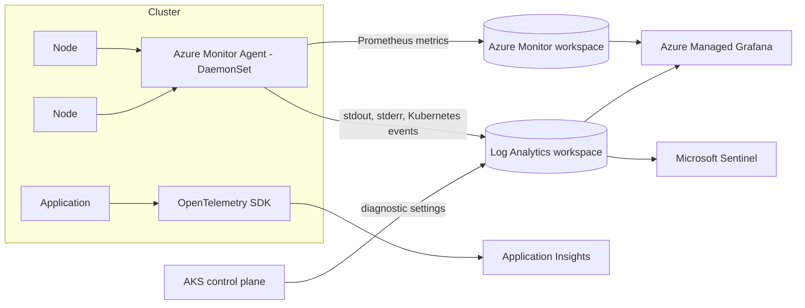

### 10.1 The three data types

| Type | Service | What you get |
|------|---------|--------------|
| **Metrics** | Azure Monitor managed service for Prometheus | Numeric time series. Query with PromQL. Stored in an Azure Monitor workspace. Visualize in Azure Managed Grafana. |
| **Logs** | Container insights | Container `stdout` and `stderr` plus Kubernetes events. Stored in a Log Analytics workspace. Query with KQL (Kusto Query Language). |
| **Control plane logs** | Azure Monitor resource logs, via diagnostic settings | `kube-apiserver`, `kube-audit`, `kube-audit-admin`, `kube-controller-manager`, `kube-scheduler`, `cluster-autoscaler`, `guard`. |

On AKS Automatic, managed Prometheus, Container insights, and Azure Monitor dashboards with Grafana are enabled by default. On Standard you enable them yourself.

### 10.2 Enable it

```bash
# Managed Prometheus plus Managed Grafana
az aks update -g $RG -n $CLUSTER \
  --enable-azure-monitor-metrics \
  --azure-monitor-workspace-resource-id $AMW_ID \
  --grafana-resource-id $GRAFANA_ID

# Container insights (logs)
az aks enable-addons -a monitoring -g $RG -n $CLUSTER \
  --workspace-resource-id $LAW_ID

# Control plane logs
az monitor diagnostic-settings create \
  --name aks-control-plane-logs \
  --resource $AKS_ID \
  --workspace $LAW_ID \
  --logs '[
    {"category":"kube-apiserver","enabled":true},
    {"category":"kube-audit-admin","enabled":true},
    {"category":"kube-controller-manager","enabled":true},
    {"category":"cluster-autoscaler","enabled":true},
    {"category":"guard","enabled":true}
  ]'
```

### 10.3 Cost control for logs — read this before enabling everything

Control plane logs, and `kube-audit` in particular, can cost more than the cluster itself.

- Do not enable `kube-audit` unless you need it. Use **`kube-audit-admin`** instead — it excludes `get` and `list` events, which are the bulk of the volume.
- Use the **ContainerLogV2** schema. It supports the Basic logs tier.
- Put the `AKSAudit` table on the **Basic logs** plan.
- Prefer managed Prometheus for metrics. Metrics in Log Analytics are far more expensive than metrics in an Azure Monitor workspace.
- Use Container insights data collection settings to exclude noisy namespaces.

### 10.4 Useful KQL queries

```kusto
// Pods restarting repeatedly in the last 6 hours
KubePodInventory
| where TimeGenerated > ago(6h)
| where ContainerRestartCount > 0
| summarize MaxRestarts = max(ContainerRestartCount)
    by Name, Namespace, ClusterName
| order by MaxRestarts desc
```

```kusto
// Recent warning events
KubeEvents
| where TimeGenerated > ago(1h)
| where KubeEventType == "Warning"
| project TimeGenerated, Namespace, Name, Reason, Message
| order by TimeGenerated desc
```

```kusto
// Error lines across a namespace
ContainerLogV2
| where TimeGenerated > ago(1h)
| where PodNamespace == "payments"
| where LogMessage contains "error" or LogMessage contains "exception"
| project TimeGenerated, PodName, ContainerName, LogMessage
| order by TimeGenerated desc
```

```kusto
// Who changed what — audit trail for writes
AKSAudit
| where TimeGenerated > ago(24h)
| where Verb in ("create", "update", "patch", "delete")
| project TimeGenerated, User.username, Verb, ObjectRef.resource,
          ObjectRef.namespace, ObjectRef.name, ResponseStatus.code
| order by TimeGenerated desc
```

### 10.5 Useful PromQL queries

```promql
# Node CPU utilization
100 - (avg by(node) (rate(node_cpu_seconds_total{mode="idle"}[5m])) * 100)

# Pods not in Running state
sum by (namespace, phase) (kube_pod_status_phase{phase!="Running"})

# Containers being throttled on CPU
sum by (namespace, pod) (rate(container_cpu_cfs_throttled_seconds_total[5m])) > 0

# Memory usage against the limit — candidates for OOMKilled
sum by (namespace, pod) (container_memory_working_set_bytes)
  / sum by (namespace, pod) (kube_pod_container_resource_limits{resource="memory"}) > 0.9

# Pending pods — capacity problem
sum(kube_pod_status_phase{phase="Pending"})
```

### 10.6 Application-level telemetry

- **Application Insights** for distributed tracing and application performance monitoring. Supports OpenTelemetry.
- Java applications can be instrumented without code changes using auto-instrumentation for AKS.
- Emit structured JSON logs to `stdout`. Do not write log files inside containers.

### 10.7 What to alert on

| Alert | Why |
|-------|-----|
| Node not ready for more than 5 minutes | Node failure or network partition. |
| Pods pending for more than 10 minutes | Capacity, quota, or scheduling constraint problem. |
| Container restart rate rising | Crash loop or out-of-memory kills. |
| Persistent volume more than 85% full | Disk full outage is coming. |
| API server request latency P99 rising | Control plane pressure. |
| Certificate expiring within 30 days | Ingress TLS outage. |
| Kubernetes version approaching end of life | AKS publishes `KubernetesVersionEOLTwoWeeks`, `KubernetesVersionEOLOneWeek`, and `KubernetesVersionOutOfSupport` as scheduled events to Azure Resource Graph. These require no add-on. |

---

## 11. Security and governance

### 11.1 Layers

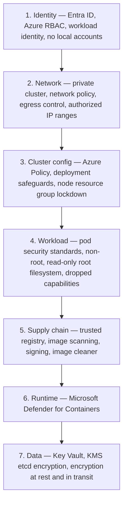

### 11.2 Azure Policy for Kubernetes

Runs Gatekeeper (Open Policy Agent) as a managed add-on. Policies are expressed as Azure Policy definitions and enforced by an admission controller.

```bash
az aks enable-addons --addons azure-policy -g $RG -n $CLUSTER
```

Useful built-in initiatives and policies:

- Kubernetes cluster pod security baseline standards for Linux workloads.
- Kubernetes cluster pod security restricted standards for Linux workloads.
- Allowed container images (regular expression on the registry).
- Containers must not run as root, must not allow privilege escalation, must not use host networking or host ports.
- CPU and memory limits must be set and must not exceed a maximum.
- Services must not use public load balancers (useful in regulated landing zones).
- Clusters must be accessible only over HTTPS.

Effects: `Audit` to observe, `Deny` to block, `Mutate` to fix automatically. Roll out in `Audit` first. Always.

### 11.3 Deployment safeguards

A curated bundle of Azure Policy controls that enforce common Kubernetes best practices — resource limits set, liveness and readiness probes present, no `latest` image tags, PodDisruptionBudgets defined, and more.

```bash
az aks update -g $RG -n $CLUSTER \
  --safeguards-level Warning   # or Enforcement
  --safeguards-excluded-ns kube-system,gatekeeper-system
```

Preconfigured on AKS Automatic.

### 11.4 Pod-level hardening

```yaml
apiVersion: v1
kind: Pod
metadata:
  name: hardened
spec:
  automountServiceAccountToken: false   # unless the pod calls the Kubernetes API
  hostNetwork: false
  hostPID: false
  hostIPC: false
  securityContext:
    runAsNonRoot: true
    runAsUser: 10001
    runAsGroup: 10001
    fsGroup: 10001
    seccompProfile:
      type: RuntimeDefault
  containers:
    - name: app
      image: myacr.azurecr.io/app@sha256:abc123...   # pin by digest, not tag
      securityContext:
        allowPrivilegeEscalation: false
        privileged: false
        readOnlyRootFilesystem: true
        capabilities:
          drop: ["ALL"]
      resources:
        requests: { cpu: 100m, memory: 128Mi }
        limits:   { cpu: 500m, memory: 512Mi }
      volumeMounts:
        - name: tmp
          mountPath: /tmp      # writable scratch since root filesystem is read-only
  volumes:
    - name: tmp
      emptyDir: {}
```

Namespace-level Pod Security Admission:

```bash
kubectl label namespace payments \
  pod-security.kubernetes.io/enforce=restricted \
  pod-security.kubernetes.io/enforce-version=latest \
  pod-security.kubernetes.io/warn=restricted \
  pod-security.kubernetes.io/audit=restricted
```

Three levels: `privileged` (no restrictions), `baseline` (blocks known privilege escalations), `restricted` (heavily hardened). Note that **Pod Security Policy was removed in Kubernetes 1.25** — Pod Security Admission and Azure Policy are the replacements.

### 11.5 Supply chain

| Control | How |
|---------|-----|
| Private registry only | Azure Container Registry with Premium tier, private endpoint, and firewall rules. Enforce with Azure Policy allowed-images. |
| Image scanning | Microsoft Defender for Containers scans images in ACR and running containers. |
| Image signing | Notation with ACR, plus the Ratify admission verifier to block unsigned images. |
| **Image cleaner** | Removes unused images with known vulnerabilities from nodes. Preconfigured in AKS Automatic. `--enable-image-cleaner --image-cleaner-interval-hours 24` |
| Pin by digest | `image: registry/app@sha256:...` instead of `:latest`. Tags are mutable, digests are not. |
| Base image discipline | Use distroless or Azure Linux base images. Fewer packages, fewer vulnerabilities. |

### 11.6 Microsoft Defender for Containers

```bash
az aks update -g $RG -n $CLUSTER --enable-defender --workspace-resource-id $LAW_ID
```

Gives you:

- Vulnerability assessment for images in ACR and for running containers.
- Runtime threat detection — crypto-mining, reverse shells, suspicious `kubectl exec`, web shell activity.
- Kubernetes control plane hardening recommendations.
- Integration with Microsoft Defender for Cloud and Microsoft Sentinel.

### 11.7 Node-level security

| Feature | Use |
|---------|-----|
| **Host encryption** | `--enable-encryption-at-host`. Encrypts the temporary disk and OS/data disk caches on the host. |
| **Confidential VM node pools** | Hardware-based memory encryption. For regulated workloads where data in use must be protected. |
| **Trusted Launch** | Secure Boot and virtual Trusted Platform Module (vTPM). |
| **FIPS-enabled nodes** | `--enable-fips-image`. Required by some government baselines. FIPS = Federal Information Processing Standards. |
| **SSH disabled** | `--ssh-access disabled`. Removes the SSH daemon path onto nodes. Use `kubectl debug node` instead. |
| **Node resource group lockdown** | `--nrg-lockdown-restriction-level ReadOnly`. Stops anyone modifying cluster infrastructure directly. |

### 11.8 Security review checklist

- [ ] Local accounts disabled; Microsoft Entra ID plus Azure RBAC enabled.
- [ ] Cluster admin access granted only through Privileged Identity Management, with MFA enforced.
- [ ] Managed identity, not a service principal.
- [ ] Workload identity in use; no connection strings or keys in manifests.
- [ ] Secrets in Key Vault, not Kubernetes Secrets.
- [ ] API server private or restricted to authorized IP ranges.
- [ ] Default-deny network policy in every application namespace.
- [ ] Egress inspected through Azure Firewall, or restricted by FQDN filtering.
- [ ] Azure Policy in `Deny` mode for the pod security baseline.
- [ ] Deployment safeguards at `Enforcement`.
- [ ] Images only from an approved private registry, pinned by digest, signed and scanned.
- [ ] Defender for Containers enabled.
- [ ] Control plane audit logs (`kube-audit-admin`) flowing to Log Analytics with a defined retention period.
- [ ] Automatic node OS image upgrades enabled.
- [ ] Cluster on a supported Kubernetes version with a documented upgrade plan.

---

## 12. Reliability and business continuity

### 12.1 Shared responsibility

| Microsoft manages | You manage |
|-------------------|-----------|
| The control plane and AKS-managed components | Node pool configuration to meet your reliability targets |
| Node auto-repair | Workload resilience — replicas, probes, disruption budgets |
| Control plane uptime SLA (Standard and Premium tiers) | Everything outside the cluster — databases, storage, caches |

AKS does not manage node pools for reliability. Your workloads must tolerate infrastructure failure.

### 12.2 Levels of resilience

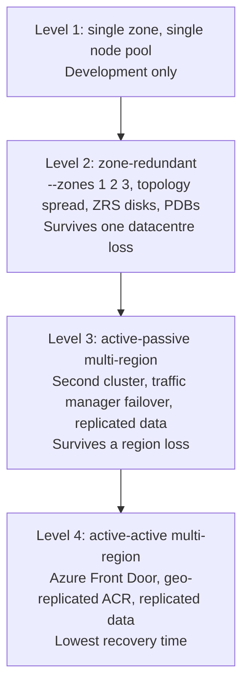

### 12.3 Zone resilience checklist

- [ ] Every node pool spans at least three zones (where the region has them).
- [ ] System node pool has at least three nodes.
- [ ] Every workload has at least three replicas.
- [ ] `topologySpreadConstraints` on `topology.kubernetes.io/zone`.
- [ ] PodDisruptionBudget on every workload, allowing at least one pod to move.
- [ ] Persistent volumes use ZRS, or the application replicates data itself.
- [ ] `podAntiAffinity` so replicas do not land on the same node.
- [ ] Standard tier or higher for the uptime SLA.
- [ ] With the cluster autoscaler: one node pool per zone plus `balance-similar-node-groups=true`.

```yaml
spec:
  template:
    spec:
      affinity:
        podAntiAffinity:
          preferredDuringSchedulingIgnoredDuringExecution:
            - weight: 100
              podAffinityTerm:
                labelSelector:
                  matchLabels: { app: web }
                topologyKey: kubernetes.io/hostname
```

### 12.4 Multi-region

Building blocks:

| Component | Approach |
|-----------|----------|
| Traffic | Azure Front Door (global HTTP, with WAF) or Traffic Manager (DNS-based). |
| Images | ACR Premium with geo-replication. |
| Configuration | Git as the source of truth, applied by GitOps to every cluster. |
| Data | This is the hard part. Azure SQL failover groups, Cosmos DB multi-region writes, Storage GRS. Make the data tier decision first. |
| Fleet management | **Azure Kubernetes Fleet Manager** for coordinating upgrades and propagating workloads across many clusters. |

### 12.5 Azure Kubernetes Fleet Manager

Use when you run more than a handful of clusters.

- Groups clusters into a fleet.
- Orchestrates upgrades in stages — for example development, then staging, then production, with wait times between.
- Propagates Kubernetes resources from a hub cluster to member clusters with placement rules.
- Provides Layer 4 load balancing across clusters.

### 12.6 Backup

- **Azure Backup for AKS** backs up cluster resources and persistent volumes on a schedule, with restore to the same or a different cluster.
- Back up cluster state (manifests) by keeping them in Git. GitOps means a cluster rebuild is a re-sync, not a restore.
- Back up persistent data using the tool that fits the storage type.
- **Test restores.** A backup you have never restored is a hypothesis.

---

## 13. Cost optimization

### 13.1 Where the money goes

| Line item | Notes |
|-----------|-------|
| **Compute (nodes)** | Usually 70–90% of the bill. This is where optimization pays. |
| Control plane | Free tier is free; Standard is about $0.10 per cluster per hour; Premium costs more. |
| Managed disks | Premium SSD and ZRS are notably more expensive than Standard LRS. |
| Load balancers and public IP addresses | One per `LoadBalancer` service adds up. Use shared ingress. |
| Egress bandwidth | Cross-region and internet egress. |
| Log Analytics ingestion | Frequently the second largest line after compute. See section 10.3. |
| ACR | Premium tier for private endpoints and geo-replication. |

### 13.2 The levers, in order of impact

1. **Right-size requests.** Most clusters are 2 to 3 times over-provisioned because requests were guessed. Use VPA in `Off` mode to get recommendations, then apply them.
2. **Node autoprovisioning with consolidation.** Karpenter picks right-sized VMs and packs pods, removing half-empty nodes.
3. **Azure Reservations and Savings Plans** for the steady-state baseline. One-year or three-year commitments on the VM families you always run.
4. **Spot node pools** for anything interruptible — batch jobs, continuous integration runners, development environments.
5. **Scale to zero** with KEDA for workloads that idle, and scale user node pools to zero out of hours.
6. **Stop non-production clusters** overnight: `az aks stop` and `az aks start`. You stop paying for nodes.
7. **Ephemeral OS disks** — no managed disk charge, and faster operations.
8. **Cut log ingestion** — `kube-audit-admin` not `kube-audit`, ContainerLogV2, Basic logs tier.
9. **Shared ingress** rather than a `LoadBalancer` service per application.
10. **Storage class choice** — Standard SSD LRS where performance allows, rather than Premium ZRS by default.

### 13.3 Visibility

- Enable **AKS cost analysis** (`--enable-cost-analysis`) to break costs down by Kubernetes namespace and deployment in Azure Cost Management. Requires the Standard or Premium tier.
- Tag node pools and node resource groups consistently for chargeback.
- **OpenCost** or **Kubecost** for deeper in-cluster allocation.

### 13.4 AKS Automatic and cost

AKS Automatic includes several cost-relevant features preconfigured: node autoprovisioning, HPA, VPA, KEDA, pod bin-packing, automatic upgrades, and node auto-repair. It also includes the uptime SLA at no extra charge. The trade-off is less control over node topology.

---

## 14. GPU and AI workloads

### 14.1 GPU node pools

```bash
# NVIDIA GPU node pool with a taint so only GPU workloads land there
az aks nodepool add \
  -g $RG --cluster-name $CLUSTER -n gpupool \
  --node-vm-size Standard_NC24ads_A100_v4 \
  --node-count 1 \
  --node-taints nvidia.com/gpu=true:NoSchedule \
  --labels workload=gpu \
  --enable-cluster-autoscaler --min-count 0 --max-count 4
```

GPU families:

| Family | For |
|--------|-----|
| `NC` (A100, H100) | Training and heavy inference. |
| `ND` (H100, H200) | Large-scale distributed training, InfiniBand interconnect. |
| `NV` (A10) | Inference, visualization, smaller models. |

**Drivers:** AKS can install the NVIDIA driver automatically on supported GPU VM sizes. For full control use the **NVIDIA GPU Operator** and skip the AKS-installed driver with `--skip-gpu-driver-install`. Do not run both.

```yaml
# Requesting a GPU in a pod
spec:
  tolerations:
    - key: nvidia.com/gpu
      operator: Exists
      effect: NoSchedule
  containers:
    - name: trainer
      image: myacr.azurecr.io/trainer:v1
      resources:
        limits:
          nvidia.com/gpu: 1     # whole GPUs only, unless using MIG or time-slicing
```

GPUs are requested as a limit, are not divisible by default, and cannot be over-committed. **MIG** (Multi-Instance GPU) on A100 and H100 lets you partition one physical GPU into several logical ones.

### 14.2 Ephemeral NVMe for AI workloads

Many GPU VM sizes include local NVMe disks — up to eight disks and 28 TiB depending on the size. Use them for dataset caching, model weights, checkpoints, and scratch space. This stops the GPU idling on input/output.

Data on ephemeral NVMe is lost when the VM is deallocated or redeployed. Use it only for transient data. Azure Container Storage can detect and orchestrate these disks automatically.

### 14.3 KAITO — the AI toolchain operator

**KAITO** (Kubernetes AI Toolchain Operator) is a CNCF Sandbox project, available as an AKS managed add-on. It automates deploying open-source language models.

What it does:

- Provisions right-sized GPU nodes automatically, using Karpenter, based on the model's declared requirements.
- Stands up an inference server as an endpoint. Uses **vLLM** as the default inference engine, which reduces memory and GPU requirements.
- Provides OpenAI-compatible APIs, prompt formatting, streaming responses, tool calling, and Model Context Protocol (MCP) support.
- Applies preset hardware configurations so you do not hand-tune and hit GPU out-of-memory errors.
- Surfaces vLLM metrics through Prometheus and Grafana.
- Supports bring-your-own models from Hugging Face through a custom deployment template.

```bash
az aks update -g $RG -n $CLUSTER --enable-ai-toolchain-operator
```

```yaml
apiVersion: kaito.sh/v1beta1
kind: Workspace
metadata:
  name: workspace-phi-4-mini
resource:
  instanceType: "Standard_NC24ads_A100_v4"
  labelSelector:
    matchLabels:
      apps: phi-4-mini
inference:
  preset:
    name: phi-4-mini-instruct
```

```bash
kubectl apply -f workspace-phi-4-mini.yaml
kubectl get workspace workspace-phi-4-mini --watch

# Call the endpoint from inside the cluster
kubectl run -it --rm curl --image=curlimages/curl -- \
  curl -X POST http://workspace-phi-4-mini/v1/chat/completions \
    -H "Content-Type: application/json" \
    -d '{"model":"phi-4-mini-instruct","messages":[{"role":"user","content":"Hello"}]}'
```

**Notes and limits:**

- KAITO cannot currently be installed on AKS Automatic clusters.
- The managed add-on typically lags one release behind upstream KAITO.
- Check your subscription has GPU quota for the model's instance type before deploying.
- Deleting a workspace does **not** delete the GPU node pool it provisioned. Delete it manually or you keep paying.

### 14.4 Why self-host models on AKS

Common reasons, in the order organizations usually give them: per-token API pricing becomes unpredictable at scale; the ability to fine-tune or customize models; and data residency or regulatory requirements that rule out sending data to a third-party API.

---

## 15. Day-2 operations and troubleshooting

### 15.1 Diagnosing a broken pod

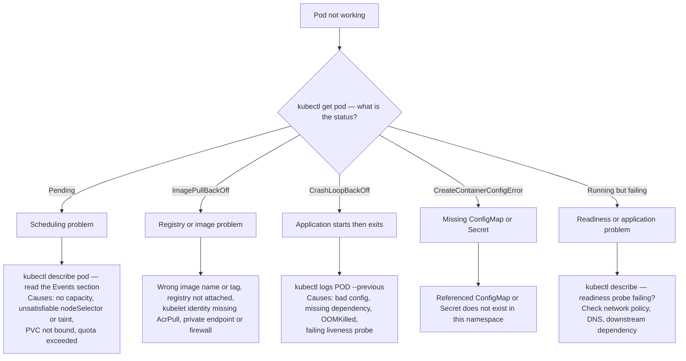

### 15.2 Commands that find the problem

```bash
# The status of everything, and the events that explain it
kubectl get pods -A -o wide
kubectl describe pod <pod> -n <ns>
kubectl get events -n <ns> --sort-by='.lastTimestamp' | tail -40

# Logs, including from the container that just died
kubectl logs <pod> -n <ns> --previous
kubectl logs -f deploy/<name> -n <ns> --all-containers
kubectl logs -l app=web -n <ns> --tail=100

# Resource pressure
kubectl top nodes
kubectl top pods -A --sort-by=memory
kubectl describe node <node> | grep -A 10 "Allocated resources"

# Get inside
kubectl exec -it <pod> -n <ns> -- /bin/sh
kubectl debug -it <pod> -n <ns> --image=nicolaka/netshoot --target=<container>

# Debug a node without SSH
kubectl debug node/<node-name> -it --image=mcr.microsoft.com/cbl-mariner/busybox:2.0

# Network checks from inside the cluster
kubectl run -it --rm netshoot --image=nicolaka/netshoot -- bash
#   nslookup my-service.my-namespace.svc.cluster.local
#   curl -v http://my-service.my-namespace:8080/health
#   dig @10.0.0.10 kubernetes.default.svc.cluster.local

# Reach a service from your laptop without exposing it
kubectl port-forward svc/my-service -n <ns> 8080:80

# Rollouts
kubectl rollout status deployment/<name> -n <ns>
kubectl rollout history deployment/<name> -n <ns>
kubectl rollout undo deployment/<name> -n <ns> --to-revision=3

# Am I allowed to do this?
kubectl auth can-i create deployments -n payments
kubectl auth can-i '*' '*' --as=user@contoso.com
```

### 15.3 Azure-side diagnostics

```bash
# Built-in diagnostics — runs a set of checks against the cluster
az aks kollect -g $RG -n $CLUSTER --storage-account <sa>   # collect logs for support
az aks kanalyze -g $RG -n $CLUSTER

# Cluster and node pool state
az aks show -g $RG -n $CLUSTER -o table
az aks nodepool list -g $RG --cluster-name $CLUSTER -o table

# Operation history — why did an upgrade fail?
az aks operation-abort -g $RG -n $CLUSTER     # cancel a stuck operation
az aks show -g $RG -n $CLUSTER --query provisioningState
```

The Azure portal also has **Diagnose and solve problems** on the cluster blade. It is genuinely useful — it checks known failure patterns for networking, identity, upgrades, and node health.

### 15.4 Common failures and their causes

| Symptom | Likely cause | Fix |
|---------|-------------|-----|
| Pod `Pending`, event says "0/5 nodes available: insufficient cpu" | No node has enough free requested CPU | Scale the node pool, reduce requests, or enable autoscaling |
| Pod `Pending`, event mentions taints | No node tolerates the pod, or the pod does not tolerate a taint | Fix tolerations or node selectors |
| Pod `Pending`, PVC in `WaitForFirstConsumer` forever | No node in the disk's zone can take the pod | Check zone alignment and node selectors |
| `ImagePullBackOff` from ACR | Kubelet identity lacks `AcrPull`, or the registry is blocked by firewall or private endpoint | `az aks update --attach-acr <acr>`; check private DNS |
| `CrashLoopBackOff` with exit code 137 | OOMKilled — the container exceeded its memory limit | Raise the memory limit or fix the leak |
| `CrashLoopBackOff` with exit code 1 | Application error on startup | `kubectl logs --previous` |
| Random connection timeouts to external services | SNAT port exhaustion | Move to NAT Gateway, increase outbound ports, use connection pooling |
| DNS resolution intermittent or slow | CoreDNS under-scaled, or DNS query storms | Scale CoreDNS, enable LocalDNS, set `ndots` in the pod DNS config |
| Upgrade hangs forever on a node pool | A PodDisruptionBudget cannot be satisfied | Fix the PDB, or set undrainable node behaviour |
| Cluster autoscaler will not scale down | Blocked pods — see section 8.4 | Add PDBs to `kube-system`, remove `hostPath`, check the `safe-to-evict` annotation |
| `kubectl` returns "Unauthorized" | No Azure RBAC role assignment, or a stale token | Assign the right role; `kubelogin remove-tokens` |
| Node `NotReady` | kubelet stopped, disk pressure, network problem | `kubectl describe node`; node auto-repair usually handles it |
| Service has no external IP, stuck `<pending>` | Public IP quota, or an Azure Policy denying public load balancers | Check quota and policy assignments |

### 15.5 Exit codes worth memorizing

| Code | Meaning |
|------|---------|
| 0 | Clean exit. In a Deployment this still causes a restart. |
| 1 | Generic application error. |
| 125 | Container runtime error. |
| 126 | Command found but not executable. |
| 127 | Command not found — usually a wrong entrypoint or a missing shell in a distroless image. |
| 137 | SIGKILL. Almost always OOMKilled. |
| 139 | SIGSEGV. Segmentation fault. |
| 143 | SIGTERM. Graceful shutdown, usually normal. |

---

## 16. Infrastructure as code

Never click-create a production cluster. Cluster configuration must be reviewable and reproducible.

### 16.1 Bicep

```bicep
// main.bicep
@description('Cluster name')
param clusterName string
param location string = resourceGroup().location
param kubernetesVersion string = '1.35'
param nodeSubnetId string
param logAnalyticsWorkspaceId string
param adminGroupObjectIds array

resource identity 'Microsoft.ManagedIdentity/userAssignedIdentities@2023-01-31' = {
  name: '${clusterName}-identity'
  location: location
}

resource aks 'Microsoft.ContainerService/managedClusters@2024-09-01' = {
  name: clusterName
  location: location
  sku: {
    name: 'Base'
    tier: 'Standard'        // uptime SLA
  }
  identity: {
    type: 'UserAssigned'
    userAssignedIdentities: {
      '${identity.id}': {}
    }
  }
  properties: {
    kubernetesVersion: kubernetesVersion
    dnsPrefix: clusterName
    nodeResourceGroup: 'MC-${clusterName}'
    enableRBAC: true
    disableLocalAccounts: true

    aadProfile: {
      managed: true
      enableAzureRBAC: true
      adminGroupObjectIDs: adminGroupObjectIds
    }

    oidcIssuerProfile: { enabled: true }
    securityProfile: {
      workloadIdentity: { enabled: true }
      defender: {
        securityMonitoring: { enabled: true }
        logAnalyticsWorkspaceResourceId: logAnalyticsWorkspaceId
      }
      imageCleaner: { enabled: true, intervalHours: 24 }
    }

    networkProfile: {
      networkPlugin: 'azure'
      networkPluginMode: 'overlay'
      networkDataplane: 'cilium'
      networkPolicy: 'cilium'
      podCidr: '10.244.0.0/16'
      serviceCidr: '172.16.0.0/16'
      dnsServiceIP: '172.16.0.10'
      loadBalancerSku: 'standard'
      outboundType: 'managedNATGateway'
    }

    apiServerAccessProfile: {
      enablePrivateCluster: true
      enablePrivateClusterPublicFQDN: false
    }

    autoUpgradeProfile: {
      upgradeChannel: 'stable'
      nodeOSUpgradeChannel: 'NodeImage'
    }

    addonProfiles: {
      azurepolicy: { enabled: true }
      omsagent: {
        enabled: true
        config: { logAnalyticsWorkspaceResourceID: logAnalyticsWorkspaceId }
      }
      azureKeyvaultSecretsProvider: {
        enabled: true
        config: { enableSecretRotation: 'true' }
      }
    }

    agentPoolProfiles: [
      {
        name: 'systempool'
        mode: 'System'
        count: 3
        vmSize: 'Standard_D4ds_v5'
        osSKU: 'AzureLinux'
        osDiskType: 'Ephemeral'
        osDiskSizeGB: 128
        vnetSubnetID: nodeSubnetId
        availabilityZones: ['1', '2', '3']
        maxPods: 110
        nodeTaints: ['CriticalAddonsOnly=true:NoSchedule']
        upgradeSettings: { maxSurge: '33%' }
        enableAutoScaling: true
        minCount: 3
        maxCount: 6
      }
      {
        name: 'userpool'
        mode: 'User'
        count: 3
        vmSize: 'Standard_D8ds_v5'
        osSKU: 'AzureLinux'
        osDiskType: 'Ephemeral'
        vnetSubnetID: nodeSubnetId
        availabilityZones: ['1', '2', '3']
        maxPods: 110
        upgradeSettings: { maxSurge: '33%' }
        enableAutoScaling: true
        minCount: 3
        maxCount: 30
      }
    ]
  }
}

output clusterId string = aks.id
output oidcIssuerUrl string = aks.properties.oidcIssuerProfile.issuerURL
output kubeletIdentityObjectId string = aks.properties.identityProfile.kubeletidentity.objectId
```

```bash
az deployment group create \
  -g $RG -f main.bicep \
  -p clusterName=aks-prod nodeSubnetId=$SUBNET_ID \
     logAnalyticsWorkspaceId=$LAW_ID \
     adminGroupObjectIds="['<group-object-id>']"
```

### 16.2 Terraform

```hcl
terraform {
  required_providers {
    azurerm = { source = "hashicorp/azurerm", version = "~> 4.0" }
  }
}

provider "azurerm" {
  features {}
}

resource "azurerm_user_assigned_identity" "aks" {
  name                = "${var.cluster_name}-identity"
  resource_group_name = var.resource_group_name
  location            = var.location
}

resource "azurerm_kubernetes_cluster" "this" {
  name                      = var.cluster_name
  location                  = var.location
  resource_group_name       = var.resource_group_name
  dns_prefix                = var.cluster_name
  kubernetes_version        = var.kubernetes_version
  sku_tier                  = "Standard"
  node_resource_group       = "MC-${var.cluster_name}"
  local_account_disabled    = true
  oidc_issuer_enabled       = true
  workload_identity_enabled = true
  image_cleaner_enabled     = true
  azure_policy_enabled      = true

  default_node_pool {
    name                 = "systempool"
    vm_size              = "Standard_D4ds_v5"
    os_sku               = "AzureLinux"
    os_disk_type         = "Ephemeral"
    os_disk_size_gb      = 128
    vnet_subnet_id       = var.node_subnet_id
    zones                = ["1", "2", "3"]
    max_pods             = 110
    only_critical_addons_enabled = true       # applies the CriticalAddonsOnly taint
    auto_scaling_enabled = true
    min_count            = 3
    max_count            = 6
    upgrade_settings { max_surge = "33%" }
  }

  identity {
    type         = "UserAssigned"
    identity_ids = [azurerm_user_assigned_identity.aks.id]
  }

  azure_active_directory_role_based_access_control {
    azure_rbac_enabled     = true
    admin_group_object_ids = var.admin_group_object_ids
  }

  network_profile {
    network_plugin      = "azure"
    network_plugin_mode = "overlay"
    network_data_plane  = "cilium"
    network_policy      = "cilium"
    pod_cidr            = "10.244.0.0/16"
    service_cidr        = "172.16.0.0/16"
    dns_service_ip      = "172.16.0.10"
    load_balancer_sku   = "standard"
    outbound_type       = "managedNATGateway"
  }

  api_server_access_profile {
    # authorized_ip_ranges = ["203.0.113.0/24"]
  }

  private_cluster_enabled = true

  automatic_upgrade_channel     = "stable"
  node_os_upgrade_channel       = "NodeImage"

  oms_agent {
    log_analytics_workspace_id = var.log_analytics_workspace_id
  }

  key_vault_secrets_provider {
    secret_rotation_enabled = true
  }

  maintenance_window_auto_upgrade {
    frequency   = "Weekly"
    interval    = 1
    day_of_week = "Sunday"
    start_time  = "02:00"
    duration    = 8
    utc_offset  = "-05:00"
  }

  lifecycle {
    ignore_changes = [
      default_node_pool[0].node_count,   # let the autoscaler own this
      kubernetes_version,                # let auto-upgrade own this
    ]
  }
}

resource "azurerm_kubernetes_cluster_node_pool" "user" {
  name                  = "userpool"
  kubernetes_cluster_id = azurerm_kubernetes_cluster.this.id
  vm_size               = "Standard_D8ds_v5"
  os_sku                = "AzureLinux"
  os_disk_type          = "Ephemeral"
  vnet_subnet_id        = var.node_subnet_id
  zones                 = ["1", "2", "3"]
  auto_scaling_enabled  = true
  min_count             = 3
  max_count             = 30
  max_pods              = 110
  upgrade_settings { max_surge = "33%" }

  lifecycle { ignore_changes = [node_count] }
}
```

**The `ignore_changes` block matters.** Without it, every `terraform apply` fights the cluster autoscaler and the auto-upgrade channel.

### 16.3 GitOps

Infrastructure as code creates the cluster. GitOps manages what runs inside it.

- **Flux** is available as an AKS extension (`microsoft.flux`) and is the first-party option, integrated with Azure Policy for enforcement at scale.
- **Argo CD** is the most common third-party option, with a stronger user interface.

```bash
az k8s-extension create \
  --cluster-name $CLUSTER --resource-group $RG \
  --cluster-type managedClusters \
  --name flux --extension-type microsoft.flux

az k8s-configuration flux create \
  --cluster-name $CLUSTER --resource-group $RG \
  --cluster-type managedClusters \
  --name cluster-config \
  --namespace flux-system \
  --scope cluster \
  --url https://github.com/myorg/aks-config \
  --branch main \
  --kustomization name=apps path=./clusters/prod prune=true
```

Why GitOps matters for AKS specifically: cluster rebuild becomes a re-sync rather than a restore, drift is detected and corrected automatically, and every change to the cluster has a pull request attached to it.

---

## 17. Production baseline architecture

This is the shape of a well-architected AKS deployment in an enterprise landing zone. It matches the Microsoft AKS baseline reference architecture.

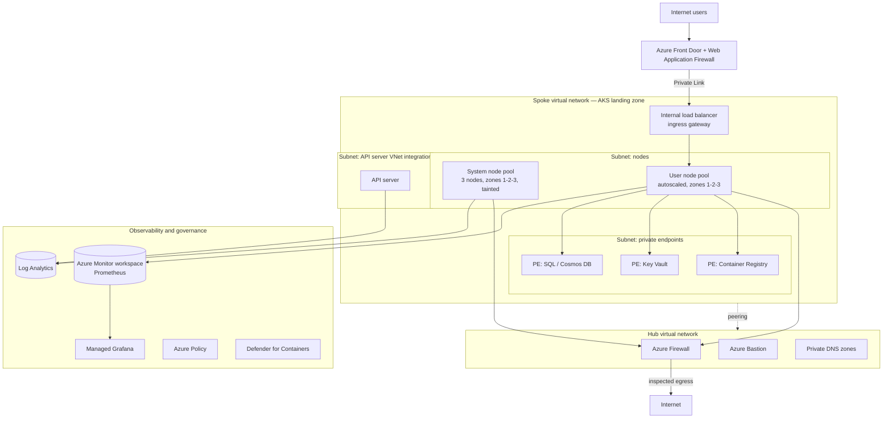

### 17.1 Design decisions in this baseline

| Area | Decision | Reason |
|------|----------|--------|
| Cluster mode | Standard | Full control over node topology and networking for a regulated environment. Use Automatic where that control is not required. |
| Tier | Standard or Premium | Uptime SLA; Premium if LTS is needed. |
| Network model | Azure CNI Overlay powered by Cilium | Conserves virtual network addresses, scales to 5,000 nodes, network policy built in. |
| API server | Private cluster with virtual network integration | No public API endpoint. |
| Egress | `userDefinedRouting` through Azure Firewall | All outbound traffic inspected and logged. |
| Ingress | Internal load balancer, fronted by Azure Front Door over Private Link | No public IP addresses in the cluster subnet. WAF at the edge. |
| Identity | Managed identity, Entra ID, Azure RBAC, local accounts disabled, workload identity | No secrets, unified governance. |
| Secrets | Key Vault via private endpoint, Secrets Store CSI driver | Secrets never live in the cluster. |
| Node OS | Azure Linux | Minimal, Microsoft-maintained. |
| Node pools | Tainted system pool + user pools per workload class, all three zones | Isolation and zone resilience. |
| Scaling | Cluster autoscaler or NAP, plus HPA and KEDA | Elasticity at both layers. |
| Upgrades | `stable` channel, `NodeImage` OS channel, maintenance windows | Patched without manual toil. |
| Governance | Azure Policy in `Deny`, deployment safeguards at `Enforcement` | Guardrails enforced at admission. |
| Observability | Managed Prometheus, Container insights, control plane logs with `kube-audit-admin` | Full picture without runaway cost. |
| Deployment | Bicep or Terraform for infrastructure, Flux or Argo CD for workloads | Reproducible, reviewable. |

### 17.2 Multi-tenancy patterns

| Pattern | Isolation | Cost | Use when |
|---------|-----------|------|----------|
| **Namespace per tenant** | Weakest. Shared nodes, shared control plane. | Lowest | Internal teams that trust each other. Needs RBAC, resource quota, network policy, and pod security enforcement. |
| **Node pool per tenant** | Medium. Compute isolated via taints and labels. | Medium | Different compliance or performance needs, same trust domain. |
| **Cluster per tenant** | Strongest. | Highest | External customers, strict regulatory boundaries, wildly different lifecycles. Use Fleet Manager to operate at scale. |

Namespace-level controls when sharing a cluster:

```yaml
apiVersion: v1
kind: ResourceQuota
metadata:
  name: team-quota
  namespace: team-a
spec:
  hard:
    requests.cpu: "50"
    requests.memory: 100Gi
    limits.cpu: "100"
    limits.memory: 200Gi
    persistentvolumeclaims: "20"
    services.loadbalancers: "2"
    count/deployments.apps: "50"
---
apiVersion: v1
kind: LimitRange
metadata:
  name: team-limits
  namespace: team-a
spec:
  limits:
    - type: Container
      default:        { cpu: 500m, memory: 512Mi }   # applied if not specified
      defaultRequest: { cpu: 100m, memory: 128Mi }
      max:            { cpu: "4",  memory: 8Gi }
```

---

## 18. Cheat sheets

### 18.1 Azure CLI

```bash
# ---------- Cluster lifecycle ----------
az aks create -g RG -n NAME [options]
az aks list -o table
az aks show -g RG -n NAME
az aks update -g RG -n NAME [options]
az aks delete -g RG -n NAME --yes
az aks stop  -g RG -n NAME              # stop paying for nodes (non-prod)
az aks start -g RG -n NAME
az aks get-credentials -g RG -n NAME [--admin] [--overwrite-existing]

# ---------- Node pools ----------
az aks nodepool list -g RG --cluster-name NAME -o table
az aks nodepool add -g RG --cluster-name NAME -n POOL --node-count 3
az aks nodepool scale -g RG --cluster-name NAME -n POOL --node-count 5
az aks nodepool update -g RG --cluster-name NAME -n POOL --enable-cluster-autoscaler --min-count 1 --max-count 10
az aks nodepool upgrade -g RG --cluster-name NAME -n POOL --node-image-only
az aks nodepool delete -g RG --cluster-name NAME -n POOL

# ---------- Versions and upgrades ----------
az aks get-versions -l LOCATION -o table
az aks get-upgrades -g RG -n NAME -o table
az aks upgrade -g RG -n NAME --kubernetes-version 1.35.2
az aks nodepool get-upgrades -g RG --cluster-name NAME -n POOL

# ---------- Add-ons and features ----------
az aks enable-addons -a monitoring,azure-policy,azure-keyvault-secrets-provider -g RG -n NAME
az aks disable-addons -a monitoring -g RG -n NAME
az aks update -g RG -n NAME --enable-keda --enable-vpa --enable-defender
az aks approuting enable -g RG -n NAME
az aks mesh enable -g RG -n NAME
az aks update -g RG -n NAME --node-provisioning-mode Auto

# ---------- Registry ----------
az aks update -g RG -n NAME --attach-acr ACRNAME
az aks check-acr -g RG -n NAME --acr ACRNAME.azurecr.io

# ---------- Diagnostics ----------
az aks kollect -g RG -n NAME
az aks kanalyze -g RG -n NAME
az aks operation-abort -g RG -n NAME
```

### 18.2 kubectl

```bash
# ---------- Context ----------
kubectl config get-contexts
kubectl config use-context CLUSTER
kubectl config set-context --current --namespace=payments

# ---------- Read ----------
kubectl get all -n NS
kubectl get pods -A -o wide --sort-by=.status.startTime
kubectl get pod POD -o yaml
kubectl get pod POD -o jsonpath='{.spec.containers[*].image}'
kubectl get nodes -L agentpool,topology.kubernetes.io/zone
kubectl api-resources
kubectl explain deployment.spec.strategy

# ---------- Write ----------
kubectl apply -f manifest.yaml
kubectl apply -k ./overlays/prod          # Kustomize
kubectl delete -f manifest.yaml
kubectl scale deployment/web --replicas=5
kubectl set image deployment/web web=acr.azurecr.io/web:v2
kubectl edit deployment web
kubectl annotate deployment web kubernetes.io/change-cause="release 2.1"

# ---------- Rollouts ----------
kubectl rollout restart deployment/web
kubectl rollout status deployment/web
kubectl rollout undo deployment/web

# ---------- Node operations ----------
kubectl cordon NODE                       # stop new pods landing here
kubectl drain NODE --ignore-daemonsets --delete-emptydir-data
kubectl uncordon NODE
kubectl taint node NODE key=value:NoSchedule

# ---------- Debug ----------
kubectl logs POD -c CONTAINER --previous --timestamps
kubectl exec -it POD -- sh
kubectl port-forward svc/SVC 8080:80
kubectl top pods --sort-by=cpu
kubectl get events --sort-by='.lastTimestamp' -A
kubectl describe node NODE

# ---------- Output tricks ----------
kubectl get pods -o custom-columns='NAME:.metadata.name,NODE:.spec.nodeName,STATUS:.status.phase'
kubectl get pods --field-selector status.phase=Pending -A
kubectl get pods -l 'app in (web,api)' -A
```

### 18.3 Decision tables

**Which network plugin?**

| Requirement | Choice |
|-------------|--------|
| Default, conserve IP addresses, scale | Azure CNI Overlay + Cilium |
| On-premises must reach pod IP addresses directly | Azure CNI Pod Subnet |
| You need a specific third-party CNI | Bring your own CNI |
| Anything currently on kubenet | Migrate to Azure CNI Overlay before March 2028 |

**Which outbound type?**

| Requirement | Choice |
|-------------|--------|
| Simple, small cluster | `loadBalancer` |
| Avoid SNAT exhaustion | `managedNATGateway` |
| Control the egress public IP addresses | `userAssignedNATGateway` |
| Egress must be inspected and logged | `userDefinedRouting` + Azure Firewall |

**Which ingress?**

| Requirement | Choice |
|-------------|--------|
| Standard HTTP ingress, managed | Application routing add-on (Gateway API) |
| Already running a service mesh | Istio add-on ingress gateway |
| Rate limiting, body size limits, `EnvoyFilter` control | Istio add-on |
| Proxy outside the cluster with integrated WAF | Application Gateway for Containers |
| Non-HTTP protocol | Service type `LoadBalancer` |

**Which storage?**

| Requirement | Choice |
|-------------|--------|
| Single writer, best performance | Azure Disk (`managed-csi-premium`) |
| Many pods write the same volume | Azure Files |
| Large unstructured data or Data Lake | Azure Blob (NFS or BlobFuse) |
| Extreme throughput or HPC | Azure NetApp Files or Managed Lustre |
| Local NVMe orchestration | Azure Container Storage |

**Which autoscaler?**

| Requirement | Choice |
|-------------|--------|
| Scale replicas on CPU or memory | HPA |
| Scale on a queue, event, or external metric | KEDA |
| Scale to zero | KEDA |
| Right-size requests | VPA |
| Add nodes to existing pools | Cluster autoscaler |
| Choose VM sizes automatically and bin-pack | Node autoprovisioning |

### 18.4 Glossary

| Term | Expansion and meaning |
|------|----------------------|
| **ACNS** | Advanced Container Networking Services. Observability and security layer on Cilium. |
| **ACR** | Azure Container Registry. |
| **AGC** | Application Gateway for Containers. Managed Layer 7 load balancer implementing the Gateway API. |
| **AGIC** | Application Gateway Ingress Controller. Older. Migrate to AGC. |
| **AKS** | Azure Kubernetes Service. |
| **CIDR** | Classless Inter-Domain Routing. IP range notation such as `10.0.0.0/16`. |
| **CNCF** | Cloud Native Computing Foundation. |
| **CNI** | Container Network Interface. The plugin standard for pod networking. |
| **CRD** | Custom Resource Definition. Extends the Kubernetes API. |
| **CSI** | Container Storage Interface. The plugin standard for storage. |
| **eBPF** | extended Berkeley Packet Filter. Kernel technology Cilium uses for fast networking and policy. |
| **FIPS** | Federal Information Processing Standards. |
| **FQDN** | Fully Qualified Domain Name. |
| **GitOps** | Managing cluster state from a Git repository as the source of truth. |
| **HPA** | Horizontal Pod Autoscaler. |
| **IPAM** | IP Address Management. |
| **KAITO** | Kubernetes AI Toolchain Operator. |
| **KEDA** | Kubernetes Event Driven Autoscaling. |
| **KMS** | Key Management Service. Used for etcd encryption with customer keys. |
| **KQL** | Kusto Query Language. Used in Log Analytics. |
| **LRS / ZRS / GRS** | Locally / Zone / Geo Redundant Storage. |
| **LTS** | Long-Term Support. |
| **MFA** | Multi-Factor Authentication. |
| **MIG** | Multi-Instance GPU. Partitioning one physical GPU. |
| **MSAL** | Microsoft Authentication Library. |
| **NAP** | Node Autoprovisioning. AKS's managed Karpenter. |
| **NPM** | Network Policy Manager. Azure's iptables network policy engine. |
| **OCI** | Open Container Initiative. |
| **OIDC** | OpenID Connect. |
| **OSM** | Open Service Mesh. Retiring 30 September 2027. |
| **PDB** | PodDisruptionBudget. |
| **PromQL** | Prometheus Query Language. |
| **PV / PVC** | PersistentVolume / PersistentVolumeClaim. |
| **RBAC** | Role-Based Access Control. |
| **SNAT** | Source Network Address Translation. |
| **UDR** | User Defined Routing. |
| **VPA** | Vertical Pod Autoscaler. |
| **WAF** | Web Application Firewall. |
| **vLLM** | A high-throughput inference engine for serving language models. |

---

## 19. Gotchas, retirements, and traps

### 19.1 Retirement calendar

| Item | Date | Action |
|------|------|--------|
| Microsoft Entra pod-managed identity add-on | Ended September 2025 | Migrate to workload identity. Urgent if still in use. |
| Azure Linux 2.0 | Ended 30 November 2025; node images removed from 31 October 2026 | Upgrade node pools to Azure Linux 3.0. After images are removed you cannot scale affected pools. |
| Open Service Mesh add-on | 30 September 2027 | Migrate to the Istio add-on. |
| kubenet networking | 31 March 2028 | Migrate to Azure CNI Overlay. |
| In-tree storage drivers | Already removed (Kubernetes 1.26) | Use `disk.csi.azure.com` and `file.csi.azure.com`. |
| Pod Security Policy | Removed in Kubernetes 1.25 | Use Pod Security Admission and Azure Policy. |
| Dockershim | Removed in Kubernetes 1.24 | `containerd` is the runtime. Do not mount the Docker socket. |
| AGIC | Available but in transition | Plan a move to Application Gateway for Containers. |

### 19.2 Decisions that cannot be changed later

Get these right the first time. Changing them means rebuilding the cluster.

- Network plugin and plugin mode (overlay versus flat).
- Service CIDR and DNS service IP.
- Pod CIDR (for overlay).
- Private cluster versus public.
- The node subnet.
- Availability zones on an existing node pool.
- The OIDC issuer, once enabled, cannot be disabled.
- The node resource group name.
- Cluster mode — you cannot convert a Standard cluster into an Automatic cluster in place.

Things you **can** change: tier (Free / Standard / Premium), Kubernetes version, node pool count and size, add-ons, autoscaling, upgrade channels, RBAC mode, authorized IP ranges.

### 19.3 The traps that bite most often

1. **No resource requests.** The scheduler assumes zero and overpacks nodes. Everything gets unpredictable. Set requests on every container.
2. **Memory limit equal to memory request but too low.** Container gets OOMKilled at exit code 137 under normal load.
3. **`minAvailable` equal to `replicas` in a PDB.** The node pool can never be drained. Upgrades hang forever.
4. **No PDB at all.** An upgrade takes every replica down at once.
5. **Workload identity label on the wrong object.** `azure.workload.identity/use: "true"` must be on the **pod template**, not the Deployment.
6. **Service CIDR overlapping the on-premises `10.0.0.0/8` space.** Silent routing failures that take days to diagnose.
7. **`volumeBindingMode: Immediate` in a multi-zone cluster.** Disk is created in zone 1, pod is scheduled to zone 3, pod never starts.
8. **`ReadWriteOnce` disk shared by a 3-replica Deployment.** Two pods stick in `ContainerCreating`.
9. **Enabling `kube-audit`.** Log Analytics bill exceeds the compute bill. Use `kube-audit-admin`.
10. **Editing the `coredns` ConfigMap.** AKS overwrites it. Use `coredns-custom`.
11. **Modifying resources in the node resource group by hand.** AKS reconciles them away or the cluster breaks.
12. **Using `:latest` image tags.** Rollbacks become impossible and node restarts silently pull a different image.
13. **Forgetting the Istio add-on is not auto-upgraded.** Eventually it blocks cluster auto-upgrade.
14. **SNAT port exhaustion under load.** Intermittent, hard to attribute, and the fix is infrastructure not code.
15. **Leaving a KAITO GPU node pool running after deleting the workspace.** Deleting the workspace does not delete the nodes.
16. **Terraform fighting the autoscaler.** Add `ignore_changes` on `node_count` and `kubernetes_version`.
17. **Cluster on Free tier in production.** No uptime SLA, 1,000 node cap.
18. **No maintenance window with auto-upgrade on.** Upgrades start at the worst possible moment.

---

## 20. Weekend study plan

### Saturday

| Block | Time | What |
|-------|------|------|
| 1 | 09:00–10:30 | Sections 1 and 2. Containers, Kubernetes objects, what AKS is, Automatic versus Standard, pricing tiers. |
| 2 | 10:30–12:00 | **Lab 1** (section 4). Build the cluster. Deploy the sample. Break it on purpose — delete a pod, scale to zero, set a bad image tag, and watch what happens. |
| 3 | 13:00–15:00 | Section 5, networking. The heaviest section. Draw your own address plan on paper. Deploy the application routing add-on and expose the sample application over HTTP. |
| 4 | 15:00–17:00 | Section 6, identity. Do the workload identity lab end to end. This is the single most valuable practical skill in the guide. |
| 5 | 19:00–20:30 | Section 7, storage, and section 8, scaling. Attach a persistent volume claim. Add an HPA and load-test it with a busy loop. |

### Sunday

| Block | Time | What |
|-------|------|------|
| 6 | 09:00–10:30 | Section 9, upgrades. Upgrade your lab cluster's node pool. Add a PDB that blocks it and watch the upgrade stall. Fix it. |
| 7 | 10:30–12:00 | Section 10, observability. Enable managed Prometheus and Container insights. Run the KQL and PromQL queries. Build a Grafana panel. |
| 8 | 13:00–15:00 | Section 11, security, and section 12, reliability. Apply a default-deny network policy. Apply an Azure Policy in `Audit` mode and see what fails. |
| 9 | 15:00–16:30 | Section 16, infrastructure as code. Rebuild your lab cluster from the Bicep or Terraform template. This proves you understood the options. |
| 10 | 16:30–18:00 | Sections 13, 14, 17, 19. Cost, GPU and AI, the baseline architecture, and the gotcha list. Read the gotcha list twice. |

### Self-test — if you can answer these you are ready

1. What two resource groups appear when you create a cluster, and what is in each?
2. Why would you choose Azure CNI Overlay over Azure CNI Pod Subnet, and when would you not?
3. Name the three separate identity problems in AKS and the Azure feature that solves each.
4. A pod is `Pending`. List five possible causes and the command you run for each.
5. What is the difference between a resource request and a resource limit, and which does HPA use?
6. Why does `volumeBindingMode: WaitForFirstConsumer` matter in a multi-zone cluster?
7. What blocks a cluster autoscaler scale-down? Name four things.
8. How long is a Kubernetes minor version supported in AKS, and how do you extend it?
9. What does `--disable-local-accounts` actually remove, and why does it matter?
10. Your upgrade has been stuck on one node pool for two hours. What do you check first?
11. What is the difference between the cluster autoscaler and node autoprovisioning?
12. Name three things you cannot change after cluster creation.
13. Why is enabling `kube-audit` a cost problem, and what do you use instead?
14. Which two labels or annotations does workload identity require, and where does each go?
15. When does AKS Automatic not fit, and what do you use instead?

### Where to go next

| Resource | Why |
|----------|-----|
| [AKS documentation](https://learn.microsoft.com/azure/aks/) | The authoritative reference. |
| [AKS baseline reference architecture](https://learn.microsoft.com/azure/architecture/reference-architectures/containers/aks/baseline-aks) | The production blueprint. |
| [Well-Architected Framework: AKS service guide](https://learn.microsoft.com/azure/well-architected/service-guides/azure-kubernetes-service) | Design review checklist across all five pillars. |
| [AKS release notes](https://github.com/Azure/AKS/releases) | Weekly. What changed and what is retiring. |
| [AKS release tracker](https://releases.aks.azure.com/webpage/index.html) | Which versions and node images are live in which region right now. |
| [Cloud Adoption Framework: AKS landing zone](https://learn.microsoft.com/azure/cloud-adoption-framework/scenarios/app-platform/aks/) | Enterprise-scale design areas. |
| [Kubernetes documentation](https://kubernetes.io/docs/) | For anything that is Kubernetes rather than Azure. |
| Certification: **AZ-104** then **CKA** then **AZ-305** | Azure administration, Kubernetes administration, Azure solutions architecture. |

---

*End of notes. Cross-check anything version-specific or date-specific against Microsoft Learn before you rely on it in a design document.*
