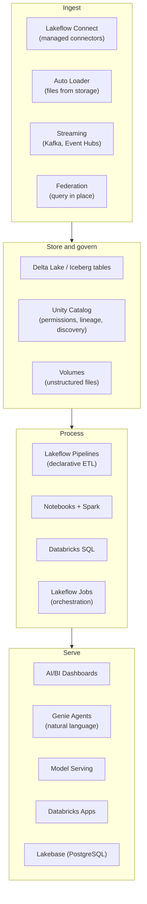
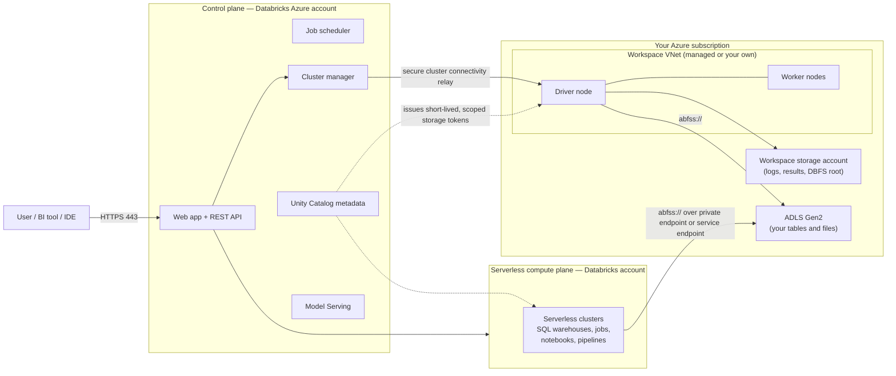
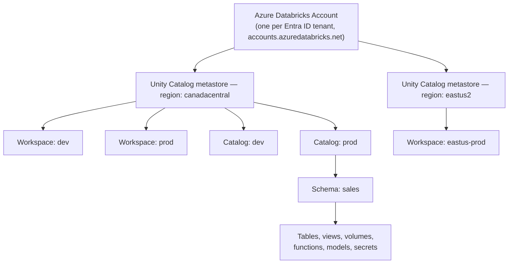
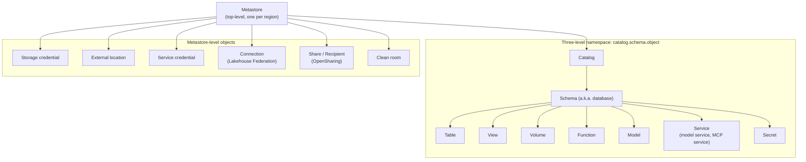
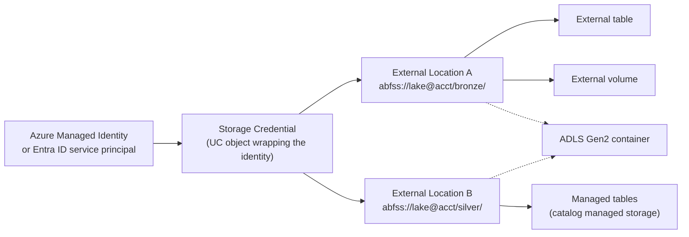
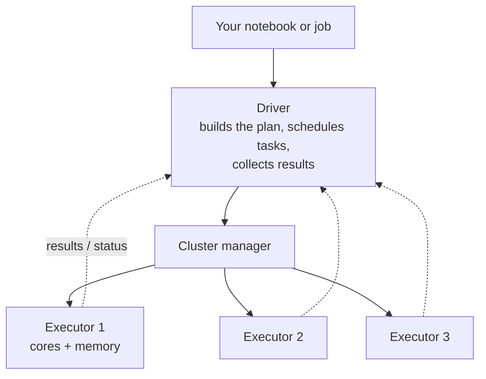
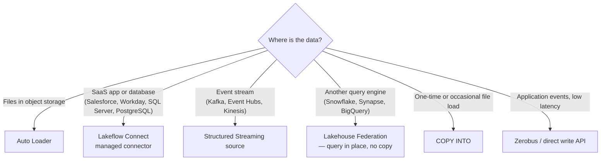
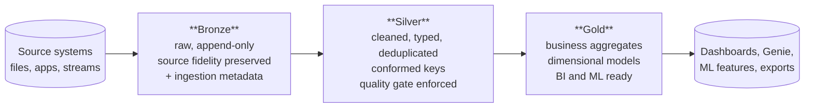
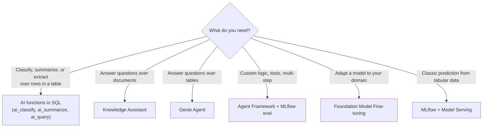
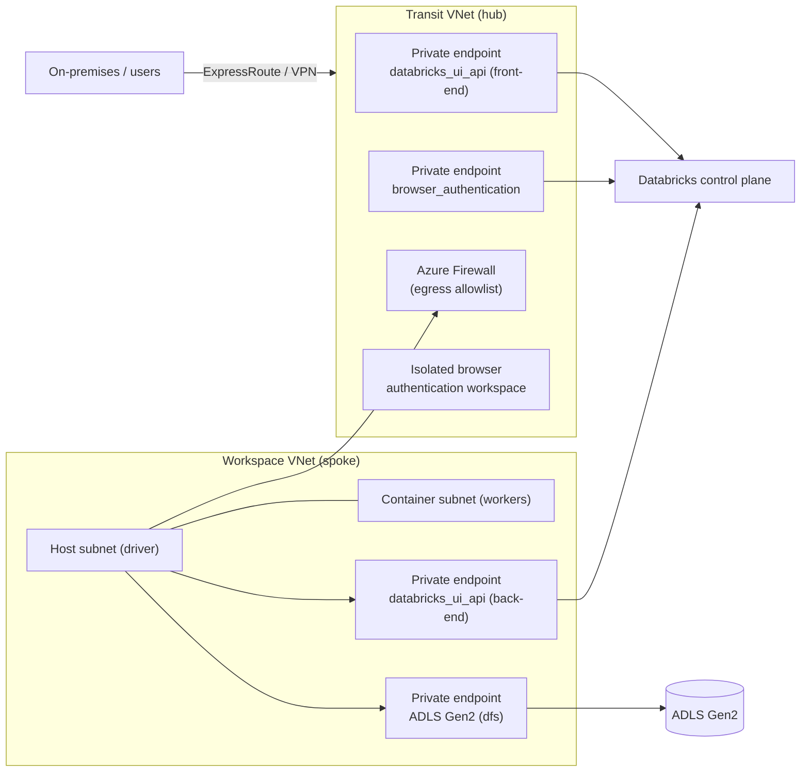

# Azure Databricks — Zero to Hero

**A single-file study reference. Written for someone who starts at zero and wants working expertise in a weekend.**

Last verified against Microsoft Learn documentation: September 2026.

---

## How to use this document

Read it in order the first time. After that, use it as a lookup.

Every section follows the same shape:
1. What the thing is, in plain words.
2. Why it exists (what problem it solves).
3. How it works (diagram where useful).
4. Code you can paste and run.
5. Gotchas that cost people time.

**Acronyms are spelled out the first time they appear in each major part.** There is also a glossary at the end.

### Suggested weekend plan

| Block | Hours | Parts | Outcome |
|---|---|---|---|
| Sat morning | 3 | 1–4 | You understand the platform, its architecture, and compute. You can create a workspace and run a notebook. |
| Sat afternoon | 4 | 5–8 | You understand Unity Catalog, Delta Lake, and Spark. You can build a medallion pipeline by hand. |
| Sat evening | 2 | 9–10 | You can ingest data with Auto Loader and build a declarative pipeline. |
| Sun morning | 3 | 11–14 | Orchestration, SQL/BI, AI/ML, networking and security. |
| Sun afternoon | 3 | 15–18 | DevOps, performance, cost, monitoring. |
| Sun evening | 2 | 19–22 | Azure integration, gotchas, self-test. |

---

## Naming changes you must know first

Databricks renamed a lot of products between 2024 and 2026. Blogs, courses, and old documentation use the old names. Both names still appear in the product. Learn this table before anything else or you will be confused all weekend.

| Current name | Former name | What it is |
|---|---|---|
| Lakeflow Jobs | Workflows, Jobs | Orchestration |
| Lakeflow Spark Declarative Pipelines (SDP), "Lakeflow pipelines" | Delta Live Tables (DLT) | Declarative ETL framework |
| Lakeflow Connect | (new) | Managed ingestion connectors |
| Lakeflow Designer | (new) | Drag-and-drop pipeline builder |
| Declarative Automation Bundles | Databricks Asset Bundles (DAB) | Infrastructure-as-code for Databricks objects |
| Standard access mode | Shared access mode | Multi-user cluster isolation |
| Dedicated access mode | Single user access mode | Single-principal cluster |
| Databricks AI Search | Mosaic AI Vector Search | Vector and hybrid search index |
| Genie Agents | Genie Spaces | Natural-language data Q&A |
| Genie Code | Databricks Assistant | AI coding help in notebooks and SQL editor |
| Genie One | (new) | Business-user consumption surface |
| OpenSharing | Delta Sharing | Open protocol for sharing data across organizations |
| Lakebase | (new) | Managed PostgreSQL (OLTP) inside Databricks |

Note: the billing SKU codes and event-log schemas still say `DLT`. That is expected and not a bug.

---

# Part 1 — What Azure Databricks is

## 1.1 The one-paragraph version

Azure Databricks is a managed data and artificial intelligence (AI) platform sold as a first-party Azure service. It runs Apache Spark, plus a large amount of proprietary software on top. You use it to ingest data, transform it, store it as tables in Azure Data Lake Storage, query it with SQL, build dashboards, and train and serve machine learning models. Databricks manages the software; the compute virtual machines (VMs) run either in your Azure subscription or in Databricks' own subscription, depending on which compute type you pick.

## 1.2 The problem it solves

Before the lakehouse, most organizations ran two stacks:

- **A data lake.** Cheap object storage full of Parquet, CSV, and JSON files. Good for scale and machine learning. Bad at transactions, updates, schema enforcement, and concurrent writes. No real governance.
- **A data warehouse.** Reliable, transactional, governed, fast for business intelligence (BI). Expensive. Closed formats. Bad at unstructured data and machine learning.

Teams copied data between the two. That created cost, latency, and two versions of the truth.

**The lakehouse** puts warehouse behaviour on top of lake storage. The two pieces that make it work:

- **Delta Lake** — a storage format that adds transactions, schema enforcement, and versioning to Parquet files in object storage.
- **Unity Catalog** — a governance layer that gives you one permission model across tables, files, models, and dashboards, across all workspaces in a region.

## 1.3 What is "first-party Azure service"

Azure Databricks is not a marketplace listing. It is an Azure resource type (`Microsoft.Databricks/workspaces`). That means:

- You create it in the Azure portal, Azure Resource Manager (ARM) templates, Bicep, or Terraform.
- It uses Microsoft Entra ID (formerly Azure Active Directory) for identity.
- It appears on your Azure bill.
- Azure support can take tickets on it.
- It integrates natively with Azure Data Lake Storage Gen2, Azure Key Vault, Azure Private Link, and Microsoft Purview.

Databricks on Amazon Web Services (AWS) and Google Cloud is the same product, but identity, networking, and billing differ. This document is Azure-specific where it matters.

## 1.4 The product surface, at a glance



## 1.5 Pricing model in one minute

You pay two bills for the same workload:

1. **Databricks Units (DBUs)** — a unit of processing capacity, billed per second of use. The DBU rate depends on the workload type (all-purpose, jobs, SQL serverless, pipelines), the pricing tier, the VM size, and whether Photon is on.
2. **Azure infrastructure** — the VMs, managed disks, public IP addresses, and storage that the compute uses. For serverless compute, this is folded into the DBU rate and you do not see separate VM charges.

Tiers: **Standard**, **Premium**, and (for some regions) higher. Premium is required for most security features, including Unity Catalog fine-grained controls, Private Link, and role-based access on jobs and clusters. In practice, assume Premium for anything real.

---

# Part 2 — Architecture

This is the most important part of the document. Almost every security, networking, and cost question comes back to the control plane / compute plane split.

## 2.1 Control plane and compute plane

Azure Databricks runs out of two planes.

**Control plane** — the backend services Databricks manages, in the Databricks Azure account (not yours). It holds:
- The web application and REST application programming interfaces (APIs).
- Notebook source and revision history.
- Job definitions, schedules, and run metadata.
- Cluster management services that start, stop, and resize compute.
- Unity Catalog metadata (not your table data).
- Model Serving endpoints.

**Compute plane** — where your data is actually processed. Two flavours:

| | Classic compute plane | Serverless compute plane |
|---|---|---|
| Where the VMs live | Your Azure subscription, in your virtual network (VNet) | Databricks' Azure account |
| Who manages them | You (size, type, autoscaling, libraries) | Databricks |
| Network control | Full. Network security groups (NSGs), routes, firewalls, private endpoints | Limited. Uses network connectivity configurations (NCCs) |
| Start-up time | 3–7 minutes typically | Seconds |
| Isolation | Your subscription and VNet | Databricks-managed boundary per workspace |
| Use when | You need custom networking, specific VM types, Spark RDD API, or R | Almost everything else |

Both planes for a workspace are in the same Azure region.

### The diagram



### Read this diagram twice

The key facts it encodes:

1. **Your data does not flow through the control plane.** Compute reads storage directly. The control plane sends instructions and receives metadata and small query results.
2. **Unity Catalog does not hold your data either.** It holds metadata and it issues short-lived, down-scoped credentials so that compute can read a specific path.
3. **With secure cluster connectivity on, the connection is outbound only.** Clusters call out to a relay in the control plane. Your VNet needs no inbound ports open and cluster nodes get no public IP addresses. This is the default and recommended setting.

## 2.2 Classic versus serverless workspaces

There are now two workspace shapes.

**Classic workspace** (shown as **Hybrid workspace** in the Azure portal). Has an associated **workspace storage account** in your subscription. That account holds workspace system data: job run logs, command results, notebook revisions, and the legacy Databricks File System (DBFS) root.

**Serverless workspace.** Workspace storage lives in Databricks-managed default storage. You still connect your own Azure Data Lake Storage Gen2 (ADLS Gen2) accounts for your actual data.

For enterprise and regulated work, classic/hybrid is still the common choice because it gives you the VNet.

## 2.3 The object hierarchy

Three levels of scope. Get these clear or permissions will confuse you all weekend.



Rules that follow from this:

- **One metastore per region per account.** You cannot have two metastores in the same region in the same account.
- **A workspace attaches to exactly one metastore** — the one in its region.
- **Many workspaces can share one metastore.** That is how dev and prod workspaces see the same catalogs.
- **Catalogs are regional by consequence**, because metastores are.
- **Cross-region sharing** is done with OpenSharing (formerly Delta Sharing), not by attaching a workspace to a foreign metastore.

## 2.4 Reliability notes

- The control plane is stateless services backed by databases replicated across availability zones in supported regions.
- **Running clusters keep processing jobs even if the control plane has an interruption.** You lose the UI and scheduling, not the in-flight work.
- Workspace availability depends on control plane availability.
- Do not store data on the DBFS root. Disable it if you can. It is legacy and has weak access controls.

## 2.5 Network reference architectures

Three common shapes, from least to most locked down.

| Pattern | Description | Fits |
|---|---|---|
| **Default / managed VNet** | Databricks creates and manages the VNet. Outbound to internet via Azure default egress. | Proof of concept, non-sensitive data |
| **VNet injection** | You create the VNet and two subnets. Databricks deploys into them. You control NSGs, routes, firewalls, and can use private endpoints to storage. | Most enterprise deployments |
| **VNet injection + Private Link (front-end and back-end) + no public egress** | All traffic on the Microsoft backbone. Hub-and-spoke with a transit VNet. Egress through Azure Firewall with an allowlist. | Regulated, FedRAMP-style, sovereign |

Details are in Part 14.

---

# Part 3 — Getting set up

## 3.1 The account console

There are two administrative surfaces and people mix them up constantly.

| Surface | URL | You manage here |
|---|---|---|
| **Account console** | `accounts.azuredatabricks.net` | Metastores, account-level users and groups, account admins, budgets, usage dashboards, network connectivity configurations, audit log delivery |
| **Workspace** | `adb-<id>.<n>.azuredatabricks.net` | Notebooks, clusters, jobs, pipelines, dashboards, workspace-level permissions, secrets |

Account admin and workspace admin are different roles. An account admin is not automatically a workspace admin.

## 3.2 Create a workspace with the Azure command-line interface (CLI)

```bash
# Resource group
az group create --name rg-dbx-lab --location canadacentral

# Workspace, Premium tier, Databricks-managed VNet
az databricks workspace create \
  --resource-group rg-dbx-lab \
  --name dbx-lab-ws \
  --location canadacentral \
  --sku premium
```

## 3.3 Create a workspace with VNet injection (Terraform)

This is the shape you will actually use at work. Two delegated subnets are required: one for the driver ("public" or host subnet) and one for the workers ("private" or container subnet). The names are historical; with secure cluster connectivity enabled, neither subnet needs public addresses.

```hcl
terraform {
  required_providers {
    azurerm    = { source = "hashicorp/azurerm", version = "~> 4.0" }
    databricks = { source = "databricks/databricks" }
  }
}

provider "azurerm" {
  features {}
}

resource "azurerm_resource_group" "rg" {
  name     = "rg-dbx-prod"
  location = "canadacentral"
}

resource "azurerm_virtual_network" "vnet" {
  name                = "vnet-dbx-prod"
  location            = azurerm_resource_group.rg.location
  resource_group_name = azurerm_resource_group.rg.name
  address_space       = ["10.20.0.0/20"]
}

resource "azurerm_network_security_group" "nsg" {
  name                = "nsg-dbx-prod"
  location            = azurerm_resource_group.rg.location
  resource_group_name = azurerm_resource_group.rg.name
}

# Host (driver) subnet
resource "azurerm_subnet" "host" {
  name                 = "snet-dbx-host"
  resource_group_name  = azurerm_resource_group.rg.name
  virtual_network_name = azurerm_virtual_network.vnet.name
  address_prefixes     = ["10.20.0.0/22"]

  delegation {
    name = "dbx-host"
    service_delegation {
      name = "Microsoft.Databricks/workspaces"
      actions = [
        "Microsoft.Network/virtualNetworks/subnets/join/action",
        "Microsoft.Network/virtualNetworks/subnets/prepareNetworkPolicies/action",
        "Microsoft.Network/virtualNetworks/subnets/unprepareNetworkPolicies/action",
      ]
    }
  }
}

# Container (worker) subnet
resource "azurerm_subnet" "container" {
  name                 = "snet-dbx-container"
  resource_group_name  = azurerm_resource_group.rg.name
  virtual_network_name = azurerm_virtual_network.vnet.name
  address_prefixes     = ["10.20.4.0/22"]

  delegation {
    name = "dbx-container"
    service_delegation {
      name = "Microsoft.Databricks/workspaces"
      actions = [
        "Microsoft.Network/virtualNetworks/subnets/join/action",
        "Microsoft.Network/virtualNetworks/subnets/prepareNetworkPolicies/action",
        "Microsoft.Network/virtualNetworks/subnets/unprepareNetworkPolicies/action",
      ]
    }
  }
}

resource "azurerm_subnet_network_security_group_association" "host" {
  subnet_id                 = azurerm_subnet.host.id
  network_security_group_id = azurerm_network_security_group.nsg.id
}

resource "azurerm_subnet_network_security_group_association" "container" {
  subnet_id                 = azurerm_subnet.container.id
  network_security_group_id = azurerm_network_security_group.nsg.id
}

resource "azurerm_databricks_workspace" "ws" {
  name                          = "dbx-prod-ws"
  resource_group_name           = azurerm_resource_group.rg.name
  location                      = azurerm_resource_group.rg.location
  sku                           = "premium"
  managed_resource_group_name   = "rg-dbx-prod-managed"
  public_network_access_enabled = false   # front-end Private Link only

  custom_parameters {
    virtual_network_id                                   = azurerm_virtual_network.vnet.id
    public_subnet_name                                   = azurerm_subnet.host.name
    private_subnet_name                                  = azurerm_subnet.container.name
    public_subnet_network_security_group_association_id  = azurerm_subnet_network_security_group_association.host.id
    private_subnet_network_security_group_association_id = azurerm_subnet_network_security_group_association.container.id
    no_public_ip                                         = true   # secure cluster connectivity
  }

  depends_on = [
    azurerm_subnet_network_security_group_association.host,
    azurerm_subnet_network_security_group_association.container,
  ]
}
```

**Sizing note.** Each cluster node consumes two private IP addresses (one in each subnet). Size your subnets for peak concurrent nodes across all clusters in the workspace, and remember Azure reserves five addresses per subnet. A `/22` gives roughly 1019 usable addresses, so about 500 nodes. You cannot resize these subnets after the workspace exists without redeploying, so err large.

## 3.4 Identity and access

Identity comes from Microsoft Entra ID. Three principal types:

| Principal | What it is | Use for |
|---|---|---|
| **User** | A human, synced from Entra ID | Interactive work |
| **Group** | An Entra ID group or a Databricks account group | All permission grants. Never grant to individuals. |
| **Service principal** | A non-human identity | Jobs, pipelines, CI/CD, applications |

Best practice sequence:
1. Configure **SCIM provisioning** (System for Cross-domain Identity Management) from Entra ID to the Databricks *account*, not to individual workspaces.
2. Create account-level groups that mirror your Entra ID groups.
3. Assign groups to workspaces.
4. Grant Unity Catalog privileges to groups only.

Run production jobs as a **service principal**, never as a person. If a person leaves and their account is disabled, their jobs stop.

## 3.5 The Databricks CLI

Install it, then authenticate. The CLI is how you will do most real work.

```bash
# Install (macOS/Linux)
curl -fsSL https://raw.githubusercontent.com/databricks/setup-cli/main/install.sh | sh

# Or with Homebrew
brew tap databricks/tap && brew install databricks

# Authenticate interactively (OAuth, opens a browser)
databricks auth login --host https://adb-1234567890.11.azuredatabricks.net

# Verify
databricks current-user me
databricks clusters list
databricks catalogs list
```

Configuration lives in `~/.databrickscfg`:

```ini
[DEFAULT]
host       = https://adb-1234567890.11.azuredatabricks.net
auth_type  = databricks-cli

[prod]
host          = https://adb-9876543210.7.azuredatabricks.net
azure_client_id     = <entra-app-id>
azure_client_secret = <secret>
azure_tenant_id     = <tenant-id>
```

Use a profile with `--profile prod` or the `DATABRICKS_CONFIG_PROFILE` environment variable.

## 3.6 Authentication methods, ranked

1. **OAuth user-to-machine (U2M)** — interactive, for humans at a terminal. Best default.
2. **OAuth machine-to-machine (M2M)** — service principal with a client secret or federated credential. Best for CI/CD.
3. **Microsoft Entra ID token** — service principal token obtained from Entra ID.
4. **Personal access token (PAT)** — a long-lived string. Works everywhere, leaks easily. Avoid. Disable PAT creation at the workspace level if your security posture allows.

---

# Part 4 — Compute

Compute is where most of your money goes and where most performance problems start. Learn it properly.

## 4.1 The four kinds of compute

| Type | What it runs | Billing SKU | Lives |
|---|---|---|---|
| **All-purpose compute** | Interactive notebooks, ad-hoc analysis, shared team clusters | All-Purpose (highest DBU rate) | Classic or serverless |
| **Jobs compute** | Scheduled and triggered jobs | Jobs (cheaper than all-purpose) | Classic or serverless |
| **Pipelines compute** | Lakeflow declarative pipelines | DLT SKUs | Classic or serverless |
| **SQL warehouse** | SQL queries, dashboards, BI tools | SQL (serverless / pro / classic) | Serverless or classic |

**Rule of thumb:** never run a scheduled job on an all-purpose cluster. It costs roughly two to four times more per DBU for the same work.

## 4.2 Serverless versus classic — how to choose

Default to serverless. Fall back to classic only for a specific reason.

Use **classic** when you need:
- The Resilient Distributed Dataset (RDD) API, or R language support.
- Specific VM stock-keeping units (SKUs), for example GPU types or memory-optimized families not offered serverless.
- Custom container images, init scripts, or JAR (Java ARchive) libraries with unusual dependencies.
- Direct network control: a route to on-premises, a specific firewall, or a legacy Hive metastore.
- Spark configuration options serverless does not expose.

Use **serverless** for everything else. Start-up is seconds, not minutes. There is no idle cost. It scales automatically.

**Serverless requirements:** the workspace must be Unity Catalog enabled and in a supported region.

**Serverless cost guard:** serverless notebooks have a default execution timeout of 2.5 hours. You can change it with `spark.databricks.execution.timeout`.

## 4.3 SQL warehouse types

| Type | Photon | Predictive input/output (IO) | Intelligent workload management | Start-up | Use for |
|---|---|---|---|---|---|
| **Serverless** | Yes | Yes | Yes | 2–6 seconds | Default. BI, extract-transform-load (ETL), exploration |
| **Pro** | Yes | Yes | No | Minutes | When serverless is unavailable in your region, or you need custom networking such as Lakehouse Federation to a private source |
| **Classic** | Yes | No | No | Minutes | Entry level. Avoid unless forced |

There is also **Lakehouse Real-Time** (beta), a serverless warehouse type for sub-second, high-concurrency read queries.

**T-shirt sizes** (2X-Small through 4X-Large) set cluster size. **Scaling** sets minimum and maximum clusters for concurrency. Size up for slow single queries. Scale out for many concurrent users.

## 4.4 Access modes

For classic all-purpose and jobs compute:

| Mode | Formerly | Behaviour |
|---|---|---|
| **Standard** | Shared | Multiple users can attach and run concurrently. User code runs in full isolation via **Lakeguard**, with no access to lower-level resources. Cheaper because the cluster is shared. |
| **Dedicated** | Single user | Assigned to one user or one group. Only they can attach. Needed for some libraries and for machine learning runtimes. |

Prefer Standard. Use Dedicated only when a feature requires it.

**Lakeguard** is the sandbox that makes Standard mode safe. It enforces Unity Catalog permissions on the cluster itself, so one user's Python code cannot read another user's credentials or bypass table grants.

## 4.5 Databricks Runtime

The Databricks Runtime (DBR) is the image on each node: a tuned Spark build, Delta Lake, Python, Scala, Java, R, and hundreds of libraries.

Variants:
- **Standard DBR** — general purpose.
- **DBR ML** — adds PyTorch, TensorFlow, scikit-learn, XGBoost, MLflow, and more.
- **DBR ML with GPU** — adds CUDA drivers.

Versioning: `<major>.<minor>` — for example `16.4 LTS`, `17.3 LTS`, `18.x`.

**LTS** means Long Term Support: roughly three years of support. **Use an LTS version in production.** Non-LTS versions get about six months.

Check the runtime release notes for the exact current LTS list before you standardize; versions move.

## 4.6 Photon

Photon is a query engine written in C++ that replaces parts of Spark's Java-based execution. It is vectorized, meaning it processes columns in batches using single instruction multiple data (SIMD) CPU instructions rather than row by row.

- It speeds up SQL and DataFrame operations: scans, filters, joins, aggregations, and writes.
- It does **not** speed up: user-defined functions (UDFs) in Python, RDD operations, or most machine learning training.
- It carries a higher DBU rate — but usually finishes fast enough to be cheaper overall for SQL and ETL.
- It is always on for SQL warehouses. It is a toggle on classic clusters.

**Test it.** Run your workload both ways and compare total cost, not runtime.

## 4.7 Cluster sizing

Start here and measure.

| Workload | Shape |
|---|---|
| Small ETL, light transforms | Single node, or 1 driver + 2 workers, general purpose (Dsv5 family) |
| Large shuffles, joins, aggregations | Memory-optimized (Esv5), fewer larger nodes beats many small ones |
| Machine learning training | GPU nodes (NC, ND families), often single node for a single model |
| Streaming | Smaller nodes, fixed size, no autoscaling |
| Interactive exploration | Serverless |

Principles:
- **Fewer, bigger nodes** reduce shuffle network traffic. Prefer 4 × 32-core nodes over 16 × 8-core nodes for shuffle-heavy work.
- **Autoscaling helps variable workloads** and hurts short jobs — scale-up takes minutes. Turn it off for streaming and for jobs under ten minutes.
- **Auto-termination is non-negotiable.** Set it to 10–30 minutes on every all-purpose cluster. Forgotten clusters are the single most common source of surprise bills.
- **Spot instances** cut cost 60–80 percent. Use them for workers on fault-tolerant batch jobs. Never for the driver. Never for streaming with tight service level agreements (SLAs).

## 4.8 Cluster policies

A cluster policy is a JSON document that constrains what users can create. Admins use them to enforce cost and security rules.

```json
{
  "spark_version": {
    "type": "regex",
    "pattern": "1[6-9]\\.[0-9]+\\.x-scala2\\.12",
    "hidden": false
  },
  "node_type_id": {
    "type": "allowlist",
    "values": ["Standard_D4ds_v5", "Standard_D8ds_v5", "Standard_E8ds_v5"],
    "defaultValue": "Standard_D4ds_v5"
  },
  "autotermination_minutes": {
    "type": "range",
    "minValue": 10,
    "maxValue": 60,
    "defaultValue": 20
  },
  "num_workers": {
    "type": "range",
    "minValue": 1,
    "maxValue": 8
  },
  "data_security_mode": {
    "type": "fixed",
    "value": "USER_ISOLATION"
  },
  "custom_tags.cost_center": {
    "type": "fixed",
    "value": "CDO-ARCH-1042"
  },
  "custom_tags.owner": {
    "type": "unlimited",
    "isOptional": false
  },
  "azure_attributes.availability": {
    "type": "fixed",
    "value": "SPOT_WITH_FALLBACK_AZURE"
  }
}
```

Policy field types: `fixed`, `forbidden`, `allowlist`, `blocklist`, `regex`, `range`, `unlimited`. Add `"hidden": true` to remove a field from the user interface entirely.

**Every organization should have at least four policies:** interactive-small, interactive-large, jobs, and machine-learning.

## 4.9 Instance pools

A pool keeps a set of idle VMs warm so clusters start in seconds instead of minutes.

- You pay Azure VM cost for idle instances, but **no DBUs** while idle.
- Useful when many short jobs start through the day.
- Less relevant now that serverless exists. Consider serverless first.

## 4.10 Compute quick reference

```bash
# List clusters
databricks clusters list --output json | jq '.[] | {name: .cluster_name, state, id: .cluster_id}'

# Create from a JSON spec
databricks clusters create --json @cluster.json

# Start / restart / terminate
databricks clusters start   --cluster-id 0919-123456-abcd1234
databricks clusters restart --cluster-id 0919-123456-abcd1234
databricks clusters delete  --cluster-id 0919-123456-abcd1234   # "delete" = terminate

# Permanently remove
databricks clusters permanent-delete --cluster-id 0919-123456-abcd1234

# Events (why did it scale / fail?)
databricks clusters events --cluster-id 0919-123456-abcd1234
```

Example `cluster.json`:

```json
{
  "cluster_name": "etl-standard",
  "spark_version": "17.3.x-scala2.13",
  "node_type_id": "Standard_D8ds_v5",
  "driver_node_type_id": "Standard_D8ds_v5",
  "autoscale": { "min_workers": 2, "max_workers": 8 },
  "autotermination_minutes": 20,
  "data_security_mode": "USER_ISOLATION",
  "runtime_engine": "PHOTON",
  "azure_attributes": {
    "availability": "SPOT_WITH_FALLBACK_AZURE",
    "first_on_demand": 1,
    "spot_bid_max_price": -1
  },
  "custom_tags": {
    "cost_center": "CDO-ARCH-1042",
    "env": "prod",
    "owner": "data-platform"
  },
  "spark_conf": {
    "spark.sql.shuffle.partitions": "auto"
  }
}
```

**Reserved ports.** Do not bind services on the driver to: 1023, 6059–6062, 7071, 7077, 10000, 15001, 15002, 36423, 38841, 39909, 40000, 40001, 41063. Port 6062 is used by `ipywidgets` and can be changed.

---

# Part 5 — Storage and files

## 5.1 Azure Data Lake Storage Gen2

ADLS Gen2 is the only Azure storage type Unity Catalog supports. It is Azure Blob Storage with **hierarchical namespace (HNS)** enabled, which gives real directories and atomic renames. Both matter enormously for Spark write performance.

**Always enable hierarchical namespace.** Without it, directory renames become copy-then-delete operations and your writes get slow and non-atomic.

The Uniform Resource Identifier (URI) scheme is `abfss` — Azure Blob File System Secure:

```
abfss://<container>@<storage-account>.dfs.core.windows.net/<path>
```

Example:
```
abfss://lakehouse@stprodlake01.dfs.core.windows.net/bronze/orders/
```

Do not use the older `wasbs://` scheme. It is the Blob endpoint and lacks hierarchical namespace features.

## 5.2 Recommended storage layout

```
Storage account: stprodlake01
├── container: metastore        <- Unity Catalog metastore-level managed storage
├── container: lakehouse
│   ├── managed/                <- catalog-level managed storage
│   │   ├── bronze/
│   │   ├── silver/
│   │   └── gold/
│   └── external/               <- external tables where truly needed
├── container: landing          <- raw file drop zone, mapped to a UC volume
└── container: checkpoints      <- streaming checkpoints (keep out of table dirs)
```

One storage account per environment, or per catalog if you need hard blast-radius separation. Separate accounts also separate the storage throughput limits, which matters at scale.

## 5.3 Databricks File System (DBFS)

DBFS is a legacy abstraction that made object storage look like a local filesystem at `/dbfs/`.

**DBFS root is deprecated. Do not use it.**
- It has no fine-grained access control. Any workspace user can read anything on it.
- It is a shared blast radius.
- Databricks recommends disabling it on new workspaces.

You will still see `dbfs:/` paths in old tutorials and in `/databricks-datasets/` sample data. Treat them as read-only curiosities.

## 5.4 Unity Catalog volumes — the replacement

A **volume** is a governed container for non-tabular files inside Unity Catalog. It sits in the three-level namespace: `catalog.schema.volume`.

Paths look like:
```
/Volumes/<catalog>/<schema>/<volume>/<path>
```

Two kinds:
- **Managed volume** — Unity Catalog controls the storage location and lifecycle. Dropping the volume deletes the files.
- **External volume** — points at an existing path in an external location. Dropping the volume leaves the files.

```sql
-- Managed volume
CREATE VOLUME prod.landing.raw_files
  COMMENT 'Raw vendor drops before ingestion';

-- External volume over an existing path
CREATE EXTERNAL VOLUME prod.landing.vendor_sftp
  LOCATION 'abfss://landing@stprodlake01.dfs.core.windows.net/vendor-sftp/'
  COMMENT 'SFTP landing zone, written by the file transfer service';

GRANT READ VOLUME  ON VOLUME prod.landing.raw_files TO `data-engineers`;
GRANT WRITE VOLUME ON VOLUME prod.landing.raw_files TO `ingest-sp`;
```

Use volumes from any language:

```python
# Python, plain file I/O works
with open("/Volumes/prod/landing/raw_files/config.yaml") as f:
    cfg = f.read()

# Spark reads
df = spark.read.json("/Volumes/prod/landing/raw_files/events/")

# List files
import os
print(os.listdir("/Volumes/prod/landing/raw_files/"))
```

```sql
-- SQL
LIST '/Volumes/prod/landing/raw_files/';
SELECT * FROM read_files('/Volumes/prod/landing/raw_files/events/', format => 'json') LIMIT 10;
```

**Land raw files in a volume, not in a bare storage path.** That extends lineage and access control all the way back to the landing zone.

## 5.5 Streaming checkpoints — where to put them

Checkpoints track what a stream has already processed. Rules:

- One checkpoint per stream per target. Never share.
- Store them in a Unity Catalog-governed location.
- **Do not nest a checkpoint inside the table's own directory.** Unity Catalog forbids it.
- Deleting a checkpoint restarts the stream from scratch. Treat checkpoints as production state.

---

# Part 6 — Unity Catalog

Unity Catalog (UC) is the governance layer. If you learn one thing deeply this weekend, make it this.

## 6.1 What problem it solves

Before Unity Catalog, each workspace had its own **Hive metastore**. Table definitions were workspace-scoped. Permissions were enforced by the cluster, so a user with a permissive cluster could bypass them. Sharing meant copying. Lineage did not exist.

Unity Catalog fixes all of that with one metadata and permission service per region, enforced by the compute layer regardless of which workspace you are in.

## 6.2 The object model



Every one of these is a **securable object** — something you can grant permissions on.

## 6.3 The three-level namespace

```sql
SELECT * FROM prod.sales.orders;
--            ^     ^     ^
--            |     |     +-- table / view / volume / function / model
--            |     +-------- schema (Databricks also accepts "database")
--            +-------------- catalog
```

Set a working context so you can use short names:

```sql
USE CATALOG prod;
USE SCHEMA sales;
SELECT * FROM orders;
```

The legacy Hive metastore shows up as a catalog named `hive_metastore`:

```sql
SELECT * FROM hive_metastore.sales.sales_raw;
```

`INFORMATION_SCHEMA` is a reserved, auto-provided schema in every catalog. It holds read-only metadata views.

## 6.4 How storage access actually works

This is the single most useful diagram in Unity Catalog.



- A **storage credential** wraps an Azure managed identity or service principal. Prefer a **managed identity**: it can reach storage accounts protected by network rules, which service principals cannot, and there is no secret to rotate.
- An **external location** is a path plus a storage credential.
- Grant `CREATE EXTERNAL TABLE`, `READ FILES`, `WRITE FILES` on external locations. Grant access to the storage credential only to the small group who create external locations.
- When a query runs, Unity Catalog checks your grants and then hands the compute a **short-lived, down-scoped token** for exactly the path needed.

Create them:

```sql
-- Storage credential from an Azure managed identity (Databricks Access Connector)
CREATE STORAGE CREDENTIAL `sc-prod-lake`
  WITH AZURE_MANAGED_IDENTITY (
    ACCESS_CONNECTOR_ID = '/subscriptions/<sub-id>/resourceGroups/rg-dbx-prod/providers/Microsoft.Databricks/accessConnectors/ac-prod-lake'
  )
  COMMENT 'Managed identity for the production lake storage account';

-- External location
CREATE EXTERNAL LOCATION `el-prod-bronze`
  URL 'abfss://lakehouse@stprodlake01.dfs.core.windows.net/bronze'
  WITH (STORAGE CREDENTIAL `sc-prod-lake`)
  COMMENT 'Bronze layer';

GRANT READ FILES, WRITE FILES, CREATE EXTERNAL TABLE
  ON EXTERNAL LOCATION `el-prod-bronze` TO `data-engineers`;
```

On the Azure side you must grant the Access Connector's managed identity the **Storage Blob Data Contributor** role on the storage account or container.

## 6.5 Managed, external, and foreign tables

| Type | Unity Catalog manages | Dropping the table | Use when |
|---|---|---|---|
| **Managed** | Governance **and** file lifecycle, layout, optimization | Deletes the data | Default for everything new |
| **External** | Governance only | Leaves the data | Registering existing data in place; path-based access from non-Databricks tools; formats managed tables do not support such as CSV or JSON |
| **Foreign** | Read-only reference through Lakehouse Federation | N/A | Querying a live external system such as SQL Server, Snowflake, PostgreSQL, or an AWS Glue catalog |

**Prefer managed tables.** You get predictive optimization, automatic liquid clustering, and automated storage lifecycle management. External tables get none of that automatically.

```sql
-- Managed (no LOCATION clause)
CREATE TABLE prod.silver.orders (
  order_id      BIGINT,
  customer_id   BIGINT,
  order_ts      TIMESTAMP,
  amount        DECIMAL(18,2),
  status        STRING
)
CLUSTER BY AUTO
COMMENT 'Cleaned orders';

-- External
CREATE TABLE prod.bronze.legacy_orders
USING DELTA
LOCATION 'abfss://lakehouse@stprodlake01.dfs.core.windows.net/bronze/legacy_orders';

-- Foreign: connect to an external database first
CREATE CONNECTION sqlserver_erp TYPE SQLSERVER
  OPTIONS (host 'erp.database.windows.net', port '1433',
           user secret('prod.default.erp_user'),
           password secret('prod.default.erp_pass'));

CREATE FOREIGN CATALOG erp USING CONNECTION sqlserver_erp
  OPTIONS (database 'ERPDB');

SELECT * FROM erp.dbo.customers;
```

## 6.6 Privileges

**Usage privileges gate everything.** To touch `prod.sales.orders` you need all three:
- `USE CATALOG` on `prod`
- `USE SCHEMA` on `prod.sales`
- `SELECT` on `prod.sales.orders`

A `SELECT` grant alone does nothing without the two usage grants. This trips up everyone.

Core privileges:

| Privilege | Applies to | Grants |
|---|---|---|
| `USE CATALOG` | Catalog | Ability to reference anything inside |
| `USE SCHEMA` | Schema | Ability to reference anything inside |
| `SELECT` | Table, view, function, model | Read |
| `MODIFY` | Table | Insert, update, delete, merge |
| `CREATE TABLE`, `CREATE SCHEMA`, `CREATE FUNCTION`, `CREATE VOLUME`, `CREATE MODEL` | Container | Create that object type |
| `READ VOLUME`, `WRITE VOLUME` | Volume | File read / write |
| `EXECUTE` | Function | Run a user-defined function |
| `READ FILES`, `WRITE FILES` | External location | Direct path access (discouraged; use volumes) |
| `CREATE EXTERNAL TABLE` | External location | Register a table over that path |
| `BROWSE` | Catalog only | Discover and view metadata without data access |
| `READ METADATA` | Most objects | See grants, policies, view and function definitions, credential names. Sensitive — grant sparingly to auditors and SREs |
| `MANAGE` | Most objects | Full control short of ownership |
| `ALL PRIVILEGES` | Any | Everything |

**Inheritance flows down.** `GRANT SELECT ON CATALOG prod` gives read on every current and future table in it. Powerful and easy to over-grant.

**Ownership** is separate from privileges. The owner can always grant, alter, and drop. Set owners to **groups**, never individuals, or you will orphan objects when people leave.

```sql
-- Standard read grant
GRANT USE CATALOG ON CATALOG prod             TO `analysts`;
GRANT USE SCHEMA  ON SCHEMA  prod.sales       TO `analysts`;
GRANT SELECT      ON TABLE   prod.sales.orders TO `analysts`;

-- Discovery for everyone
GRANT BROWSE ON CATALOG prod TO `account users`;

-- Ownership to a group
ALTER TABLE prod.sales.orders OWNER TO `data-platform-owners`;

-- Inspect
SHOW GRANTS ON TABLE prod.sales.orders;
SHOW GRANTS `analysts` ON CATALOG prod;
```

## 6.7 Fine-grained access control

Four mechanisms that work together:

| Mechanism | Controls | Defined with | Use for |
|---|---|---|---|
| **Privileges** | Who can reach what | `GRANT` / `REVOKE`, ownership | Baseline access |
| **Attribute-based access control (ABAC)** | What data is visible, driven by tags | Policies + governed tags + UDFs | Centralized, scalable rules. **Databricks' current recommendation.** |
| **Row filters and column masks** | What data is visible in one table | UDFs attached to the table | Table-specific logic, or before you adopt ABAC |
| **Workspace bindings** | Where a catalog can be accessed from | Workspace assignment | Stop prod catalogs appearing in dev workspaces |

### Row filter and column mask (table-level)

```sql
-- Row filter: users only see their own region
CREATE OR REPLACE FUNCTION prod.security.region_filter(region STRING)
RETURN is_account_group_member('global-admins') OR region = current_user_region();

ALTER TABLE prod.sales.orders SET ROW FILTER prod.security.region_filter ON (region);

-- Column mask: hide email unless the caller is in the PII group
CREATE OR REPLACE FUNCTION prod.security.mask_email(email STRING)
RETURN CASE
  WHEN is_account_group_member('pii-readers') THEN email
  ELSE regexp_replace(email, '^[^@]+', '****')
END;

ALTER TABLE prod.sales.customers
  ALTER COLUMN email SET MASK prod.security.mask_email;
```

Useful context functions inside these UDFs: `current_user()`, `is_account_group_member('<group>')`, `session_user()`.

### Attribute-based access control

ABAC attaches policies at the metastore, catalog, schema, or table level. Policies target **governed tags**. Any object carrying a targeted tag is protected automatically — including tables created tomorrow.

This is the difference that matters: with row filters you attach logic per table and it does not follow new tables. With ABAC you tag a column `pii` once, and one policy masks it everywhere in the catalog, forever.

ABAC also supports `GRANT` policies (dynamic privilege grants) and `DENY` policies (beta).

### Workspace-catalog binding

```sql
-- Restrict a catalog to specific workspaces (done in Catalog Explorer or the API)
-- Binding beats grants: an explicit SELECT does not work from an unbound workspace.
```

Bind `prod` catalogs to production workspaces only. This is the cheapest, strongest guardrail against accidental production access from a development notebook.

## 6.8 Lineage

Unity Catalog captures lineage automatically for anything run on Unity Catalog-enabled compute:

- **Table lineage** — which tables fed which tables.
- **Column lineage** — which source columns fed which target columns.
- Extends to notebooks, jobs, pipelines, dashboards, queries, and models.

You get it for free. Use it for impact analysis before schema changes, and for audit evidence.

Query it programmatically through system tables (`system.access.table_lineage`, `system.access.column_lineage`) or the lineage REST API.

## 6.9 System tables

System tables are a Databricks-hosted analytical store of your account's operational data, in the `system` catalog. They are the backbone of monitoring, cost control, and audit.

| Table | Contents |
|---|---|
| `system.billing.usage` | Every billable usage record: DBUs, SKU, tags, identity, workload metadata |
| `system.billing.list_prices` | List prices per SKU over time |
| `system.access.audit` | Audit log of user and system actions |
| `system.access.table_lineage` | Table-to-table lineage events |
| `system.access.column_lineage` | Column-level lineage |
| `system.compute.clusters` | Cluster definitions and changes |
| `system.compute.node_timeline` | Per-node utilization over time |
| `system.lakeflow.jobs`, `system.lakeflow.job_run_timeline`, `system.lakeflow.job_task_run_timeline` | Job and task run history |
| `system.query.history` | SQL query history |
| `system.storage.predictive_optimization_operations_history` | What predictive optimization did and what it cost |
| `system.information_schema` | Standard metadata views (behaves differently from the rest) |

Requires Unity Catalog. Some schemas must be enabled by an account admin.

## 6.10 Catalog design patterns

| Pattern | Example | Fits |
|---|---|---|
| **Environment-based** | `dev`, `staging`, `prod` | Most organizations. Default choice. |
| **Domain-based** | `sales`, `finance`, `engineering` | Data mesh, federated ownership |
| **Hybrid** | `sales_dev`, `sales_prod`, `finance_prod` | Both isolation and clear ownership |
| **Lifecycle** | `raw`, `curated`, `analytics` | Medallion at the catalog level |

Guidance:
- Keep it to roughly 3–10 catalogs per metastore. More becomes administrative noise.
- Give each catalog its own managed storage location for physical isolation.
- Give teams sandbox schemas they own, inside a shared sandbox catalog.
- Document purpose and owner in the catalog `COMMENT`.
- Use one consistent naming convention and write it down.

```sql
CREATE CATALOG IF NOT EXISTS prod
  MANAGED LOCATION 'abfss://lakehouse@stprodlake01.dfs.core.windows.net/managed/prod'
  COMMENT 'Production data. Owner: data-platform-owners. Bound to prod workspaces only.';

CREATE SCHEMA IF NOT EXISTS prod.bronze COMMENT 'Raw ingested data, append only';
CREATE SCHEMA IF NOT EXISTS prod.silver COMMENT 'Cleaned, conformed, deduplicated';
CREATE SCHEMA IF NOT EXISTS prod.gold   COMMENT 'Business aggregates and marts';
```

---

# Part 7 — Delta Lake

## 7.1 What it is

Delta Lake is an open storage format. A Delta table is:

1. A directory of **Parquet data files**.
2. A `_delta_log/` subdirectory containing an ordered **transaction log** of JSON commit files, plus periodic Parquet **checkpoints**.

That is the whole trick. The log, not the file listing, defines the table.

```
prod_silver_orders/
├── part-00000-....snappy.parquet
├── part-00001-....snappy.parquet
├── part-00002-....snappy.parquet
└── _delta_log/
    ├── 00000000000000000000.json      <- commit 0: CREATE + add files
    ├── 00000000000000000001.json      <- commit 1: add files
    ├── 00000000000000000002.json      <- commit 2: remove + add (an UPDATE)
    ├── ...
    ├── 00000000000000000010.checkpoint.parquet
    └── _last_checkpoint
```

## 7.2 How the transaction log gives you ACID

ACID means Atomicity, Consistency, Isolation, Durability.

- **Atomicity.** A write is not visible until its commit JSON file lands. If the job dies halfway, orphan Parquet files exist but no commit references them, so readers never see them.
- **Consistency.** Schema is recorded in the log and enforced on write.
- **Isolation.** Readers get **snapshot isolation**. A reader resolves the table state at one log version and reads only the files listed there. A concurrent writer adding version 43 does not disturb a reader on version 42.
- **Durability.** Everything is in cloud object storage, which is replicated.

**Concurrency control is optimistic.** Two writers both read version 42, both compute their changes, both try to write version 43. Only one file named `...043.json` can be created. The loser detects the conflict, checks whether the other commit touched the same files, and retries if it can.

This is why **liquid clustering matters for concurrent writes**: it enables row-level concurrency, so two writers touching different rows no longer conflict.

## 7.3 Reading and writing

```python
# Write
(df.write
   .format("delta")
   .mode("overwrite")          # append | overwrite | ignore | error
   .saveAsTable("prod.silver.orders"))

# Read
df = spark.read.table("prod.silver.orders")

# Read a path (external table or raw location)
df = spark.read.format("delta").load("abfss://lakehouse@acct.dfs.core.windows.net/bronze/orders")
```

```sql
CREATE OR REPLACE TABLE prod.silver.orders AS
SELECT * FROM prod.bronze.orders_raw WHERE order_id IS NOT NULL;

INSERT INTO prod.silver.orders SELECT * FROM staging_orders;
```

## 7.4 Time travel

Every commit is a version you can query.

```sql
-- By version
SELECT * FROM prod.silver.orders VERSION AS OF 42;
SELECT * FROM prod.silver.orders@v42;

-- By timestamp
SELECT * FROM prod.silver.orders TIMESTAMP AS OF '2026-09-15T08:00:00';

-- See the history
DESCRIBE HISTORY prod.silver.orders;

-- Restore
RESTORE TABLE prod.silver.orders TO VERSION AS OF 41;
```

```python
spark.read.option("versionAsOf", 42).table("prod.silver.orders")
spark.read.option("timestampAsOf", "2026-09-15T08:00:00").table("prod.silver.orders")
```

**How far back can you go?** Governed by `delta.deletedFileRetentionDuration` (default 7 days) and log retention `delta.logRetentionDuration` (default 30 days). Once `VACUUM` removes the data files, the version is unreadable even if the log entry survives.

```sql
ALTER TABLE prod.silver.orders
  SET TBLPROPERTIES ('delta.deletedFileRetentionDuration' = '30 days');
```

Set this **before** enabling predictive optimization if you need long time travel.

## 7.5 MERGE — upserts and slowly changing dimensions

`MERGE` is the workhorse of silver-layer processing.

```sql
MERGE INTO prod.silver.customers AS target
USING (
  SELECT * FROM (
    SELECT *, ROW_NUMBER() OVER (PARTITION BY customer_id ORDER BY updated_at DESC) AS rn
    FROM prod.bronze.customers_cdc
  ) WHERE rn = 1                      -- deduplicate the source first. Always.
) AS source
ON target.customer_id = source.customer_id

WHEN MATCHED AND source.op = 'DELETE' THEN DELETE

WHEN MATCHED AND source.updated_at > target.updated_at THEN
  UPDATE SET *

WHEN NOT MATCHED AND source.op <> 'DELETE' THEN
  INSERT *;
```

**The number one MERGE bug:** duplicate keys in the source. Delta raises an error if one target row matches multiple source rows. Deduplicate with `ROW_NUMBER()` first, every time.

Python equivalent:

```python
from delta.tables import DeltaTable

target = DeltaTable.forName(spark, "prod.silver.customers")

(target.alias("t")
  .merge(source_df.alias("s"), "t.customer_id = s.customer_id")
  .whenMatchedDelete(condition="s.op = 'DELETE'")
  .whenMatchedUpdateAll(condition="s.updated_at > t.updated_at")
  .whenNotMatchedInsertAll(condition="s.op <> 'DELETE'")
  .execute())
```

### Slowly changing dimension type 2 by hand

```sql
MERGE INTO prod.silver.dim_customer AS t
USING (
  -- rows that need a new version, plus a null-key row to force the insert branch
  SELECT NULL AS merge_key, s.* FROM source s
  JOIN prod.silver.dim_customer t
    ON s.customer_id = t.customer_id AND t.is_current = true
  WHERE s.hash_diff <> t.hash_diff
  UNION ALL
  SELECT s.customer_id AS merge_key, s.* FROM source s
) AS staged
ON t.customer_id = staged.merge_key AND t.is_current = true

WHEN MATCHED AND t.hash_diff <> staged.hash_diff THEN
  UPDATE SET t.is_current = false, t.valid_to = staged.effective_ts

WHEN NOT MATCHED THEN
  INSERT (customer_id, name, email, hash_diff, valid_from, valid_to, is_current)
  VALUES (staged.customer_id, staged.name, staged.email, staged.hash_diff,
          staged.effective_ts, TIMESTAMP '9999-12-31', true);
```

You almost never need to write this. Lakeflow pipelines `AUTO CDC` does it declaratively (Part 10). Learn the manual version once so you understand what the declarative version does.

## 7.6 Liquid clustering — the modern layout strategy

Liquid clustering replaces both **partitioning** and **Z-ORDER**.

Why it is better:
- You can change clustering keys at any time **without rewriting the table**.
- It is skew resistant. Partitioning by an uneven column creates tiny and huge partitions; clustering does not.
- It is incremental. Each run reorganizes only the new or changed data.
- It enables **row-level concurrency**, which cuts write conflicts.
- No small-file explosion from over-partitioning.

```sql
-- Let Databricks pick and maintain the keys (recommended)
CREATE TABLE prod.silver.events (...) CLUSTER BY AUTO;

-- Or choose them yourself
CREATE TABLE prod.silver.events (...) CLUSTER BY (event_date, region);

-- Change keys later
ALTER TABLE prod.silver.events CLUSTER BY (customer_id);

-- Apply clustering to data written before clustering was enabled
OPTIMIZE prod.silver.events FULL;

-- Convert an existing partitioned table (DBR 18.1+)
ALTER TABLE prod.silver.events REPLACE PARTITIONED BY WITH CLUSTER BY AUTO;
```

Python in a pipeline:

```python
from pyspark import pipelines as dp

@dp.table(cluster_by_auto=True)
def events():
    return (spark.readStream.format("cloudFiles")
              .option("cloudFiles.format", "parquet")
              .load("/Volumes/prod/landing/raw_files/events"))
```

**When clustering helps most:** high-cardinality filter columns, skewed data, fast-growing tables, concurrent writes, changing access patterns.

**When partitioning is still defensible:** a table over roughly a terabyte where one low-cardinality column (usually a date) is in almost every query, and you need to isolate concurrent writers to disjoint partitions. Even then, try clustering first.

**Never partition a table smaller than about a terabyte.** The classic anti-pattern is partitioning a 5 GB table by day, producing 3,650 directories of 1 MB files. Query planning alone will dominate runtime.

## 7.7 Predictive optimization

Predictive optimization automatically runs `OPTIMIZE`, `VACUUM`, and `ANALYZE` on **Unity Catalog managed tables** (Delta and Iceberg).

- It identifies tables that would benefit and queues the work.
- It collects statistics on write.
- It triggers incremental clustering for clustered tables.
- With `CLUSTER BY AUTO`, it also **chooses** the clustering keys based on your real query workload.

Enabled by default for accounts created on or after 11 November 2024. Older accounts are being enabled gradually.

Two warnings:
1. `OPTIMIZE` run by predictive optimization does **not** run `ZORDER`. Z-ordered files are skipped. This is another reason to move to liquid clustering.
2. It respects `delta.deletedFileRetentionDuration` for `VACUUM`, default 7 days, with a 7-day minimum floor. Raise that property first if you need longer time travel.

Check what it did and what it cost:

```sql
SELECT * FROM system.storage.predictive_optimization_operations_history
ORDER BY start_time DESC LIMIT 50;
```

## 7.8 Manual maintenance (external tables, or when you need control)

```sql
-- Compact small files
OPTIMIZE prod.bronze.orders;

-- Compact only recent data
OPTIMIZE prod.bronze.orders WHERE order_date >= current_date() - INTERVAL 7 DAYS;

-- Legacy: colocate by columns. Prefer CLUSTER BY.
OPTIMIZE prod.bronze.orders ZORDER BY (customer_id);

-- Remove files no longer referenced, after the retention window
VACUUM prod.bronze.orders;                      -- default 7 days
VACUUM prod.bronze.orders RETAIN 168 HOURS;
VACUUM prod.bronze.orders DRY RUN;              -- list what would go

-- Statistics
ANALYZE TABLE prod.bronze.orders COMPUTE STATISTICS FOR ALL COLUMNS;
```

**`VACUUM` does not delete `_delta_log` files.** Log cleanup follows checkpoint and log retention separately.

**Never set `VACUUM` retention below 7 days** without understanding the consequences. A concurrent long-running reader can have its files deleted underneath it.

## 7.9 Deletion vectors

Without deletion vectors, deleting one row from a Parquet file rewrites the whole file. With them, Delta writes a small bitmap marking the deleted row, and the file stays put.

- Makes `DELETE`, `UPDATE`, and `MERGE` far faster.
- Readers apply the bitmap at read time.
- Files still referenced by a deletion vector cannot be vacuumed, so storage does not shrink immediately.
- `OPTIMIZE` purges deletion vectors for files where more than about 5 percent of records are marked.
- For a compliance-driven hard delete, force the rewrite:

```sql
REORG TABLE prod.silver.customers APPLY (PURGE);
VACUUM prod.silver.customers RETAIN 0 HOURS;   -- requires disabling the safety check
```

This matters for "right to be forgotten" requests. A `DELETE` alone leaves the bytes on disk until purge plus vacuum.

## 7.10 Change Data Feed

Change Data Feed (CDF) makes a Delta table emit row-level change events so downstream consumers can process only what changed.

```sql
ALTER TABLE prod.silver.orders
  SET TBLPROPERTIES (delta.enableChangeDataFeed = true);

-- Read the changes
SELECT * FROM table_changes('prod.silver.orders', 42);                 -- from version 42
SELECT * FROM table_changes('prod.silver.orders', '2026-09-15', '2026-09-18');
```

Adds three columns: `_change_type` (`insert`, `update_preimage`, `update_postimage`, `delete`), `_commit_version`, `_commit_timestamp`.

```python
(spark.readStream
   .option("readChangeFeed", "true")
   .option("startingVersion", 42)
   .table("prod.silver.orders"))
```

## 7.11 Schema enforcement and evolution

Delta rejects writes whose schema does not match. That is a feature.

To allow additive changes:

```sql
-- DBR 18.1+
INSERT INTO prod.silver.orders WITH SCHEMA EVOLUTION SELECT * FROM staging;
```

```python
(df.write.option("mergeSchema", "true").mode("append").saveAsTable("prod.silver.orders"))
```

For `MERGE`, enable `spark.databricks.delta.schema.autoMerge.enabled`.

**Column mapping** lets you rename and drop columns without rewriting data:

```sql
ALTER TABLE prod.silver.orders SET TBLPROPERTIES (
  'delta.columnMapping.mode' = 'name',
  'delta.minReaderVersion'   = '2',
  'delta.minWriterVersion'   = '5'
);
ALTER TABLE prod.silver.orders RENAME COLUMN amt TO amount;
ALTER TABLE prod.silver.orders DROP COLUMN legacy_flag;
```

## 7.12 Constraints and quality

```sql
ALTER TABLE prod.silver.orders ADD CONSTRAINT amount_positive CHECK (amount > 0);
ALTER TABLE prod.silver.orders ALTER COLUMN order_id SET NOT NULL;

-- Informational only (not enforced, but used by the optimizer and by BI tools)
ALTER TABLE prod.silver.orders ADD CONSTRAINT pk_orders PRIMARY KEY (order_id);
ALTER TABLE prod.gold.order_facts ADD CONSTRAINT fk_cust
  FOREIGN KEY (customer_id) REFERENCES prod.silver.customers(customer_id);
```

`CHECK` and `NOT NULL` are enforced — a violating write fails. Primary and foreign keys are informational; Databricks does not enforce uniqueness or referential integrity.

## 7.13 Inspecting a table

```sql
DESCRIBE TABLE        prod.silver.orders;   -- columns
DESCRIBE TABLE EXTENDED prod.silver.orders; -- plus properties, location, owner
DESCRIBE DETAIL       prod.silver.orders;   -- file count, size, clustering keys, format
DESCRIBE HISTORY      prod.silver.orders;   -- commits

SHOW TBLPROPERTIES prod.silver.orders;
SHOW CREATE TABLE  prod.silver.orders;
```

`DESCRIBE DETAIL` is the first thing to run when a table is slow. Look at `numFiles` and `sizeInBytes`. Average file size under roughly 16 MB means you have a small-file problem.

## 7.14 Apache Iceberg

Databricks supports Apache Iceberg as an alternative open table format.

- **Managed Iceberg tables** — Unity Catalog manages them the same way it manages Delta tables, including predictive optimization and liquid clustering (Iceberg v3 features need DBR 18.0+).
- **Iceberg reads on Delta tables** — expose a Delta table so external Iceberg clients can read it. Iceberg metadata accumulates in a `metadata/` directory and only `VACUUM` cleans it.
- **Foreign Iceberg catalogs** — read Iceberg tables managed elsewhere, for example in AWS Glue.

**Choose Delta by default.** Choose Iceberg when an external system requires it.

---

# Part 8 — Apache Spark, enough to be effective

You do not need to be a Spark internals expert. You do need this.

## 8.1 Execution model



Vocabulary:

| Term | Meaning |
|---|---|
| **Driver** | One JVM. Holds the SparkSession, plans queries, tracks tasks. Single point of failure. |
| **Executor** | A worker JVM. Runs tasks, holds cached data. |
| **Job** | Everything triggered by one action. |
| **Stage** | A set of tasks that need no shuffle between them. A shuffle creates a stage boundary. |
| **Task** | Work on one partition, on one core. The smallest unit. |
| **Partition** | A chunk of the data. Parallelism equals the number of partitions, capped by total cores. |
| **Shuffle** | Moving data across the network to regroup it by key. Expensive. |

## 8.2 Lazy evaluation

Transformations build a plan and run nothing. Actions run the plan.

```python
df = spark.read.table("prod.bronze.orders")   # nothing happens
df2 = df.filter("amount > 100")               # nothing happens
df3 = df2.groupBy("region").sum("amount")     # nothing happens

df3.show()          # ACTION -> everything above now runs
df3.count()         # ACTION -> it all runs AGAIN
df3.write.saveAsTable("...")  # ACTION -> and AGAIN
```

**The most common performance mistake for beginners:** calling `.count()` or `.display()` repeatedly on an expensive chain. Each call re-executes everything.

Actions: `show`, `display`, `count`, `collect`, `take`, `first`, `write`, `save`, `toPandas`, `foreach`.

## 8.3 Narrow and wide transformations

**Narrow** — each output partition depends on one input partition. No network movement. Cheap.
`select`, `filter`, `withColumn`, `drop`, `map`, `union`

**Wide** — output partitions depend on many input partitions. Requires a shuffle. Expensive.
`groupBy`, `join`, `distinct`, `orderBy`, `repartition`, `window`

**Optimization work is almost always about reducing or improving shuffles.**

## 8.4 The DataFrame API

```python
from pyspark.sql import functions as F
from pyspark.sql.window import Window

df = spark.read.table("prod.bronze.orders")

# Select and compute
result = (df
  .filter(F.col("order_date") >= "2026-01-01")
  .withColumn("amount_cad", F.col("amount") * F.lit(1.36))
  .withColumn("order_month", F.date_trunc("month", F.col("order_date")))
  .select("order_id", "customer_id", "order_month", "amount_cad"))

# Aggregate
monthly = (result
  .groupBy("order_month", "customer_id")
  .agg(
     F.sum("amount_cad").alias("total"),
     F.count("*").alias("order_count"),
     F.avg("amount_cad").alias("avg_order"),
     F.countDistinct("order_id").alias("distinct_orders"),
  ))

# Join
customers = spark.read.table("prod.silver.customers")
enriched = monthly.join(customers, on="customer_id", how="left")

# Window function: rank customers by spend within each month
w = Window.partitionBy("order_month").orderBy(F.desc("total"))
ranked = enriched.withColumn("rank", F.dense_rank().over(w)).filter("rank <= 10")

ranked.write.mode("overwrite").saveAsTable("prod.gold.top_customers_monthly")
```

Useful functions to memorize:

```python
F.col, F.lit, F.when, F.coalesce, F.expr
F.to_date, F.to_timestamp, F.date_trunc, F.date_add, F.datediff, F.current_date
F.concat, F.concat_ws, F.split, F.regexp_replace, F.regexp_extract, F.trim, F.upper, F.lower
F.explode, F.from_json, F.to_json, F.get_json_object, F.schema_of_json
F.sum, F.avg, F.min, F.max, F.count, F.countDistinct, F.collect_list, F.collect_set
F.row_number, F.rank, F.dense_rank, F.lag, F.lead, F.first, F.last
F.approx_count_distinct     # far cheaper than countDistinct at scale
```

## 8.5 Adaptive Query Execution

Adaptive Query Execution (AQE) re-plans the query at runtime using actual statistics from completed stages. It is on by default.

It does three things:
1. **Coalesces shuffle partitions.** If you asked for 200 partitions but the data only needs 12, it merges them.
2. **Switches join strategies.** If a side turns out small enough at runtime, it converts a sort-merge join to a broadcast hash join.
3. **Handles skewed joins.** It detects oversized partitions and splits them.

```python
spark.conf.set("spark.sql.adaptive.enabled", "true")                          # default true
spark.conf.set("spark.sql.adaptive.coalescePartitions.enabled", "true")
spark.conf.set("spark.sql.adaptive.skewJoin.enabled", "true")
spark.conf.set("spark.sql.shuffle.partitions", "auto")                        # let AQE decide
```

Do not hand-tune `spark.sql.shuffle.partitions` to a fixed number unless you have measured a reason. `auto` is usually right.

## 8.6 Join strategies

| Strategy | When Spark picks it | Cost |
|---|---|---|
| **Broadcast hash join** | One side fits in memory (default threshold about 10 MB, AQE raises this at runtime) | Cheapest. No shuffle of the big side. |
| **Sort-merge join** | Both sides large | Shuffles both sides. The default for big-to-big. |
| **Shuffle hash join** | One side moderately smaller | Shuffles both, builds a hash table. |
| **Broadcast nested loop** | No join key (cross join, inequality join) | Worst. Avoid. |

Force a broadcast when you know the dimension is small:

```python
from pyspark.sql.functions import broadcast
result = large_fact.join(broadcast(small_dim), on="dim_id", how="left")
```

```sql
SELECT /*+ BROADCAST(d) */ *
FROM fact f JOIN dim d ON f.dim_id = d.dim_id;
```

Raise the automatic threshold if your dimensions are 50–200 MB and you have memory:

```python
spark.conf.set("spark.sql.autoBroadcastJoinThreshold", 200 * 1024 * 1024)
```

## 8.7 Data skew

Skew means one key has far more rows than others. One task runs for an hour while 199 finish in seconds.

**How to spot it:** in the Spark UI, look at the stage's task duration distribution. If the maximum is many times the median, you have skew.

Fixes, in order of preference:
1. **Turn on AQE skew join handling.** Usually enough. It is on by default.
2. **Filter out the skewed key** if it is junk — nulls and default sentinel values like `-1` or `'UNKNOWN'` are the usual culprits.
3. **Salting.** Add a random suffix to the hot key on both sides to spread it.

```python
from pyspark.sql import functions as F

SALT = 16
fact_salted = large.withColumn("salt", (F.rand() * SALT).cast("int"))
dim_salted = (small
  .withColumn("salt", F.explode(F.array([F.lit(i) for i in range(SALT)]))))

result = fact_salted.join(dim_salted, on=["join_key", "salt"], how="left").drop("salt")
```

## 8.8 Caching — use sparingly

```python
df.cache()          # lazy; materializes on the next action
df.persist()        # same, with a chosen storage level
df.unpersist()      # release
```

**Databricks recommends against Spark caching for Delta tables.** Reasons:
- You lose file skipping from filters applied after the cache.
- Cached data can go stale if the table is written through a different identifier.
- The Delta cache (an automatic SSD cache on the worker) already handles the common case.

Cache only when: you reuse the same non-trivial DataFrame three or more times in one session, and it fits comfortably in memory.

## 8.9 User-defined functions — the performance cliff

| Kind | Speed | Use |
|---|---|---|
| Built-in SQL / DataFrame functions | Fastest. Photon-accelerated. | Always try first |
| SQL UDF (`CREATE FUNCTION ... RETURN`) | Fast. Inlined by the optimizer. | Reusable business logic |
| Pandas UDF (vectorized) | Moderate. Arrow-based, batched. | When you truly need Python |
| Python UDF (row-at-a-time) | **10–100× slower.** Serializes every row to a Python process. Disables Photon. | Last resort |

```python
# Bad
from pyspark.sql.types import DoubleType
@F.udf(DoubleType())
def to_cad(x):
    return x * 1.36

# Good
df.withColumn("amount_cad", F.col("amount") * F.lit(1.36))

# If you must use Python, vectorize it
import pandas as pd
@F.pandas_udf("double")
def to_cad_vec(s: pd.Series) -> pd.Series:
    return s * 1.36
```

SQL UDFs are first-class Unity Catalog objects:

```sql
CREATE OR REPLACE FUNCTION prod.silver.net_amount(gross DECIMAL(18,2), tax_rate DOUBLE)
RETURNS DECIMAL(18,2)
RETURN gross * (1 - tax_rate);

GRANT EXECUTE ON FUNCTION prod.silver.net_amount TO `analysts`;
```

## 8.10 Reading the Spark UI

Open it from the cluster page or from a notebook cell's "Spark Jobs" expander.

The four things to look at, in order:

1. **Stages tab → task duration distribution.** Max far above median means skew.
2. **SQL / DataFrame tab → the query plan.** Look for `Exchange` (shuffle) nodes and how much data each moves. Look for the join type actually chosen.
3. **Stages tab → shuffle read and write sizes.** Gigabytes of shuffle on a small query means something is wrong with your join or grouping.
4. **Executors tab → spill.** "Spill (disk)" greater than zero means memory pressure. Either shrink the working set or use bigger nodes.

Also check the **Storage** tab if you cached anything, and **Executors** for garbage collection time. Garbage collection over roughly 10 percent of task time means the executor memory setup needs attention.

---

# Part 9 — Ingestion

## 9.1 Choosing an ingestion method



## 9.2 Auto Loader

Auto Loader incrementally processes new files as they land in cloud storage. It is the default answer for file ingestion.

Key ideas:
- Format string is `cloudFiles`; the real format goes in `cloudFiles.format`.
- It keeps its own record of processed files in a RocksDB key-value store in the checkpoint, so it never re-reads a file and never needs a file listing scan of the whole directory.
- Two discovery modes: **directory listing** (default, simple) and **file notification** (uses Azure Event Grid and Queue Storage, scales to millions of files).

```python
checkpoint = "abfss://checkpoints@stprodlake01.dfs.core.windows.net/bronze/events"

(spark.readStream
   .format("cloudFiles")
   .option("cloudFiles.format", "json")
   .option("cloudFiles.schemaLocation", checkpoint)      # enables inference + evolution
   .option("cloudFiles.inferColumnTypes", "true")
   .load("/Volumes/prod/landing/raw_files/events/")
 .writeStream
   .option("checkpointLocation", checkpoint)
   .option("mergeSchema", "true")
   .trigger(availableNow=True)                           # batch-like: process all, then stop
   .toTable("prod.bronze.events"))
```

SQL, inside a pipeline or a streaming table:

```sql
CREATE OR REFRESH STREAMING TABLE prod.bronze.events
CLUSTER BY AUTO
AS SELECT *, _metadata.file_path AS source_file, current_timestamp() AS ingested_at
FROM STREAM read_files(
  '/Volumes/prod/landing/raw_files/events/',
  format => 'json',
  inferColumnTypes => true
);
```

When you use `read_files` inside a Lakeflow pipeline, Databricks manages the checkpoint and schema location for you.

### Schema evolution modes

| Mode | Behaviour when a new column appears |
|---|---|
| `addNewColumns` (default when no schema supplied) | Adds the column to the stored schema, then **fails the stream** with `UnknownFieldException`. Restart resumes with the new schema. |
| `addNewColumnsWithTypeWidening` | Same, and also widens compatible types such as `int` to `long`. Incompatible changes go to the rescued data column. |
| `rescue` | Never evolves. All new columns land in the rescued data column. Stream never fails on schema change. |
| `failOnNewColumns` | Fails and will not restart until you update the schema or remove the offending file. |
| `none` (default when a schema is supplied) | Ignores new columns silently unless `rescuedDataColumn` is set. |

**The default failing the stream is deliberate.** Run Auto Loader streams under Lakeflow Jobs with automatic retries so the restart is invisible.

### Rescued data column

```python
.option("cloudFiles.schemaEvolutionMode", "rescue")
.option("rescuedDataColumn", "_rescued_data")
```

`_rescued_data` is a JSON string holding every field that did not fit the schema, plus its source file path. **Always turn this on.** Then alert on it:

```sql
SELECT count(*) FROM prod.bronze.events WHERE _rescued_data IS NOT NULL;
```

Non-null values mean your source changed and you are silently losing fields.

### Schema hints

Fix the types you know, infer the rest:

```python
.option("cloudFiles.schemaHints", "order_id long, amount double, order_ts timestamp")
```

### Variant type for chaotic schemas

When the schema is genuinely unpredictable:

```python
.option("singleVariantColumn", "data")
```

You get schema-on-read at query time. Slower to query than real columns, but it never breaks.

### Other useful options

```python
.option("cloudFiles.useNotifications", "true")      # Event Grid + Queue Storage
.option("cloudFiles.maxFilesPerTrigger", 1000)      # throttle a backlog
.option("cloudFiles.maxBytesPerTrigger", "10g")
.option("cloudFiles.includeExistingFiles", "false") # start from now, ignore history
.option("cloudFiles.allowOverwrites", "true")       # reprocess a file if it is rewritten
.option("cloudFiles.backfillInterval", "1 day")     # safety net for notification mode
.option("pathGlobFilter", "*.json")
```

### Trigger modes

| Trigger | Behaviour | Use for |
|---|---|---|
| `availableNow=True` | Process everything available, then stop | Scheduled batch. **The most common choice.** Cheapest. |
| `processingTime="5 minutes"` | Micro-batch every 5 minutes, cluster stays up | Near-real-time |
| `continuous` | Always on, lowest latency | Rare. Sub-second requirements only |
| (no trigger) | Micro-batch as fast as possible | Development only |

**Use `availableNow` unless you have a real latency requirement.** A stream triggered hourly costs a fraction of an always-on stream and gives you the same exactly-once guarantees.

### Monitoring Auto Loader

```sql
-- How many files are still waiting?
SELECT * FROM cloud_files_state('abfss://checkpoints@.../bronze/events');
```

Alert on: `numFilesOutstanding` trending up (backlog), no progress events for N minutes (stalled stream), `commit_time - create_time` above your SLA (latency), any non-null `_rescued_data` (schema drift).

## 9.3 COPY INTO

Idempotent bulk file load into an existing table. Simpler than Auto Loader, less scalable.

```sql
COPY INTO prod.bronze.orders
FROM '/Volumes/prod/landing/raw_files/orders/'
FILEFORMAT = CSV
FORMAT_OPTIONS ('header' = 'true', 'inferSchema' = 'true', 'mergeSchema' = 'true')
COPY_OPTIONS ('mergeSchema' = 'true');
```

It tracks loaded files, so re-running skips them. Use it for a few thousand files or fewer, or for a one-time historical backfill. Beyond that, use Auto Loader.

## 9.4 Lakeflow Connect

Managed, fully declarative connectors for software-as-a-service (SaaS) applications and databases. Databricks handles the incremental read, change data capture, schema drift, and the target tables.

Covers sources such as Salesforce, Workday, ServiceNow, Google Analytics, SQL Server, PostgreSQL, MySQL, Oracle, and SharePoint. The list grows; check the current documentation.

Cost shows up in `system.billing.usage` with `billing_origin_product = 'LAKEFLOW_CONNECT'`.

```sql
SELECT usage_date, SUM(usage_quantity) AS dbus
FROM system.billing.usage
WHERE billing_origin_product = 'LAKEFLOW_CONNECT'
  AND usage_date >= current_date() - 30
GROUP BY usage_date ORDER BY usage_date;
```

## 9.5 Streaming from Azure Event Hubs and Kafka

Event Hubs exposes a Kafka-compatible endpoint, so use the Kafka source.

```python
eh_namespace = "evhns-prod"
eh_topic     = "orders"
conn_str     = dbutils.secrets.get("prod-scope", "eventhub-conn-str")

eh_sasl = (
  'kafkashaded.org.apache.kafka.common.security.plain.PlainLoginModule required '
  f'username="$ConnectionString" password="{conn_str}";'
)

raw = (spark.readStream
  .format("kafka")
  .option("kafka.bootstrap.servers", f"{eh_namespace}.servicebus.windows.net:9093")
  .option("subscribe", eh_topic)
  .option("kafka.sasl.mechanism", "PLAIN")
  .option("kafka.security.protocol", "SASL_SSL")
  .option("kafka.sasl.jaas.config", eh_sasl)
  .option("startingOffsets", "latest")        # or "earliest"
  .option("maxOffsetsPerTrigger", 100000)     # backpressure
  .load())

from pyspark.sql import functions as F
from pyspark.sql.types import StructType, StringType, DoubleType, TimestampType

schema = (StructType()
  .add("order_id", StringType())
  .add("customer_id", StringType())
  .add("amount", DoubleType())
  .add("event_ts", TimestampType()))

parsed = (raw
  .select(F.from_json(F.col("value").cast("string"), schema).alias("d"),
          F.col("timestamp").alias("kafka_ts"))
  .select("d.*", "kafka_ts"))

(parsed.writeStream
  .option("checkpointLocation", "abfss://checkpoints@.../bronze/orders_stream")
  .trigger(processingTime="1 minute")
  .toTable("prod.bronze.orders_stream"))
```

**Watermarks** bound how long the engine waits for late data. Without one, stateful operations grow state forever and eventually fail.

```python
windowed = (parsed
  .withWatermark("event_ts", "15 minutes")
  .groupBy(F.window("event_ts", "5 minutes"), "customer_id")
  .agg(F.sum("amount").alias("total")))
```

## 9.6 Lakehouse Federation

Query an external system in place, with Unity Catalog governance, no copy.

```sql
CREATE CONNECTION pg_prod TYPE POSTGRESQL
OPTIONS (
  host 'pg-prod.postgres.database.azure.com',
  port '5432',
  user secret('prod.default.pg_user'),
  password secret('prod.default.pg_pass')
);

CREATE FOREIGN CATALOG pg USING CONNECTION pg_prod OPTIONS (database 'appdb');

SELECT * FROM pg.public.customers WHERE created_at > current_date() - 7;
```

Good for exploration, small lookups, and avoiding a copy you do not need. Bad for large scans — you are limited by the source system and the network. Do not build production pipelines on federated scans of huge tables.

## 9.7 Idempotency and exactly-once

For Delta-to-Delta streaming, Databricks commits the input offsets and the output data in the same transaction. That gives **exactly-once** semantics by default.

That guarantee stops at the edges:
- A custom sink.
- A non-Delta target.
- An unverified custom source.

At those edges, treat the write as **at-least-once** and make it idempotent yourself — usually by upserting on a key with `MERGE`.

For batch writes, use `foreachBatch` with a transaction identifier:

```python
def upsert_batch(batch_df, batch_id):
    batch_df.createOrReplaceTempView("updates")
    batch_df.sparkSession.sql("""
      MERGE INTO prod.silver.orders t
      USING updates s ON t.order_id = s.order_id
      WHEN MATCHED THEN UPDATE SET *
      WHEN NOT MATCHED THEN INSERT *
    """)

(stream.writeStream
  .foreachBatch(upsert_batch)
  .option("checkpointLocation", checkpoint)
  .trigger(availableNow=True)
  .start())
```

---

# Part 10 — Transformation: the medallion architecture and Lakeflow pipelines

## 10.1 Medallion architecture

Three layers. Each one has a job.



| Layer | Rules |
|---|---|
| **Bronze** | Append only. Never transform beyond adding metadata (`source_file`, `ingested_at`, `_rescued_data`). Keep the original values including bad ones. This is your replay source: if silver logic has a bug, you rebuild from bronze without re-reading the source system. |
| **Silver** | Cast types. Deduplicate. Standardize keys and codes. Handle late-arriving and changed records (change data capture, slowly changing dimensions). **Enforce data quality here.** Everything downstream can then trust the data without re-checking. |
| **Gold** | Joins and aggregations for consumption. Star schemas, wide marts, feature tables, metric views. Optimize for how people query, not for storage tidiness. |

The quality gate belongs at the **bronze-to-silver boundary**. Put it anywhere else and either bad data leaks downstream or every consumer re-implements the same checks.

## 10.2 Lakeflow pipelines — what they are

Lakeflow Spark Declarative Pipelines (formerly Delta Live Tables) let you declare **what** the tables should contain. The framework handles orchestration, dependency resolution, checkpoints, cluster lifecycle, retries, incremental refresh, and data quality reporting.

You write table definitions. You do not write `writeStream`, checkpoint paths, or task ordering.

### The three dataset types

| Type | Semantics | Use for |
|---|---|---|
| **Streaming table** | Incremental. Each source row is processed once. Backed by a Delta table with streaming support. | Ingestion, append-only bronze and silver |
| **Materialized view** | Batch. Results always consistent with sources. Refreshes incrementally where the query allows, otherwise recomputes fully. Same result either way. | Joins and aggregations where correctness beats latency. Gold layer. |
| **View** (`temporary_view`) | Not persisted. Exists only inside the pipeline run. | Intermediate logic you do not want to publish |

**Choosing between streaming table and materialized view:** if a dimension can change and you need the join result to reflect that change, use a materialized view — it recomputes. If you only ever append and never need to revisit old rows, use a streaming table — it is far cheaper.

### Other concepts

- **Flow** — the thing that processes data into a target. Uses the same DataFrame API as Spark. A flow writes to a streaming table or a sink with streaming semantics, or to a materialized view with batch semantics.
- **Sink** — an external target: Kafka, Event Hubs, a Unity Catalog external table, or a custom Python sink.
- **Expectation** — a data quality constraint evaluated on every row of every run, with pass and fail counts reported.

## 10.3 Python pipeline — modern syntax

```python
from pyspark import pipelines as dp
from pyspark.sql import functions as F

# ---------- BRONZE ----------
@dp.table(
    name="bronze_orders",
    comment="Raw orders, append only, source fidelity preserved",
    cluster_by_auto=True,
    table_properties={"quality": "bronze", "pipelines.reset.allowed": "false"},
)
def bronze_orders():
    return (
        spark.readStream.format("cloudFiles")
        .option("cloudFiles.format", "json")
        .option("cloudFiles.inferColumnTypes", "true")
        .option("cloudFiles.schemaEvolutionMode", "addNewColumnsWithTypeWidening")
        .option("rescuedDataColumn", "_rescued_data")
        .load("/Volumes/prod/landing/raw_files/orders/")
        .select(
            "*",
            F.col("_metadata.file_path").alias("_source_file"),
            F.current_timestamp().alias("_ingested_at"),
        )
    )

# ---------- SILVER ----------
@dp.table(
    name="silver_orders",
    comment="Cleaned, typed, validated orders",
    cluster_by=["order_date", "customer_id"],
)
@dp.expect_or_drop("valid_order_id", "order_id IS NOT NULL")
@dp.expect_or_drop("positive_amount", "amount > 0")
@dp.expect("no_rescued_data", "_rescued_data IS NULL")          # warn only
@dp.expect_or_fail("known_currency", "currency IN ('CAD','USD','EUR','GBP')")
def silver_orders():
    return (
        spark.readStream.table("bronze_orders")
        .select(
            F.col("order_id").cast("bigint").alias("order_id"),
            F.col("customer_id").cast("bigint").alias("customer_id"),
            F.to_timestamp("order_ts").alias("order_ts"),
            F.to_date("order_ts").alias("order_date"),
            F.col("amount").cast("decimal(18,2)").alias("amount"),
            F.upper(F.trim("currency")).alias("currency"),
            F.upper(F.trim("status")).alias("status"),
            F.col("_rescued_data"),
        )
    )

# ---------- GOLD ----------
@dp.materialized_view(
    name="gold_daily_revenue",
    comment="Daily revenue by currency and status",
)
def gold_daily_revenue():
    return (
        spark.read.table("silver_orders")
        .groupBy("order_date", "currency", "status")
        .agg(
            F.sum("amount").alias("revenue"),
            F.count("*").alias("order_count"),
            F.approx_count_distinct("customer_id").alias("customers"),
        )
    )

# ---------- INTERNAL VIEW ----------
@dp.temporary_view(name="high_value")
def high_value():
    return spark.read.table("silver_orders").filter("amount > 10000")
```

### Legacy syntax (still works)

You will see this everywhere in older material:

```python
import dlt

@dlt.table
@dlt.expect_or_drop("valid", "id IS NOT NULL")
def my_table():
    return spark.readStream.table("LIVE.upstream")
```

Mapping to the new names:

| Old | New |
|---|---|
| `import dlt` | `from pyspark import pipelines as dp` |
| `@dlt.table` | `@dp.table` (streaming tables) |
| — | `@dp.materialized_view` (new, explicit) |
| `@dlt.view` | `@dp.temporary_view` |
| `LIVE.table_name` | plain `table_name` |

Old code keeps working. No migration is required. New code should use the new names.

## 10.4 SQL pipeline

```sql
-- BRONZE
CREATE OR REFRESH STREAMING TABLE bronze_orders
CLUSTER BY AUTO
COMMENT 'Raw orders'
AS SELECT *,
          _metadata.file_path AS _source_file,
          current_timestamp()  AS _ingested_at
   FROM STREAM read_files(
     '/Volumes/prod/landing/raw_files/orders/',
     format => 'json',
     inferColumnTypes => true,
     rescuedDataColumn => '_rescued_data'
   );

-- SILVER with expectations
CREATE OR REFRESH STREAMING TABLE silver_orders (
  CONSTRAINT valid_order_id  EXPECT (order_id IS NOT NULL) ON VIOLATION DROP ROW,
  CONSTRAINT positive_amount EXPECT (amount > 0)           ON VIOLATION DROP ROW,
  CONSTRAINT known_currency  EXPECT (currency IN ('CAD','USD','EUR')) ON VIOLATION FAIL UPDATE,
  CONSTRAINT no_rescued      EXPECT (_rescued_data IS NULL)
)
CLUSTER BY (order_date, customer_id)
AS SELECT
     CAST(order_id    AS BIGINT)        AS order_id,
     CAST(customer_id AS BIGINT)        AS customer_id,
     to_timestamp(order_ts)             AS order_ts,
     to_date(order_ts)                  AS order_date,
     CAST(amount AS DECIMAL(18,2))      AS amount,
     upper(trim(currency))              AS currency,
     _rescued_data
   FROM STREAM bronze_orders;

-- GOLD
CREATE OR REFRESH MATERIALIZED VIEW gold_daily_revenue
AS SELECT order_date, currency,
          sum(amount)                      AS revenue,
          count(*)                         AS order_count,
          approx_count_distinct(customer_id) AS customers
   FROM silver_orders
   GROUP BY order_date, currency;
```

## 10.5 Expectations — the three behaviours

| Decorator / clause | On violation | When to use |
|---|---|---|
| `@dp.expect(...)` / `EXPECT (...)` | Keep the row. Record the failure. | Monitoring. Most constraints start here. |
| `@dp.expect_or_drop(...)` / `ON VIOLATION DROP ROW` | Drop the row. Record the failure. | Rows that are useless downstream |
| `@dp.expect_or_fail(...)` / `ON VIOLATION FAIL UPDATE` | Stop the pipeline run. | Violations that mean something is badly wrong upstream |

Start with warn-only for a new constraint. Watch the fail counts for a week. Then tighten to drop or fail once you know the real rate.

Query the results:

```sql
SELECT
  timestamp,
  details:flow_progress.data_quality.expectations
FROM event_log(TABLE(prod.pipelines.my_pipeline))
WHERE event_type = 'flow_progress'
ORDER BY timestamp DESC;
```

## 10.6 Change data capture with AUTO CDC

This replaces hand-written `MERGE` for both SCD type 1 and type 2.

```python
from pyspark import pipelines as dp

dp.create_streaming_table("silver_customers")

dp.create_auto_cdc_flow(
    target="silver_customers",
    source="bronze_customers_cdc",
    keys=["customer_id"],
    sequence_by=F.col("updated_at"),        # how to order changes
    apply_as_deletes=F.expr("op = 'DELETE'"),
    apply_as_truncates=F.expr("op = 'TRUNCATE'"),
    except_column_list=["op", "updated_at", "_rescued_data"],
    stored_as_scd_type=2,                   # 1 = overwrite, 2 = keep history
    track_history_except_column_list=["last_login_at"],  # ignore noisy columns
)
```

```sql
CREATE OR REFRESH STREAMING TABLE silver_customers;

CREATE FLOW customers_cdc AS AUTO CDC INTO silver_customers
FROM STREAM bronze_customers_cdc
KEYS (customer_id)
APPLY AS DELETE WHEN op = 'DELETE'
SEQUENCE BY updated_at
COLUMNS * EXCEPT (op, updated_at)
STORED AS SCD TYPE 2;
```

With SCD type 2 the framework adds `__START_AT` and `__END_AT` columns and manages them.

There is also `create_auto_cdc_from_snapshot_flow()` for when your source gives you full snapshots rather than a change feed. The framework computes the differences for you.

## 10.7 Pipeline settings that matter

| Setting | Guidance |
|---|---|
| **Serverless** | Yes, unless you need a feature it does not support or you are on the legacy Hive metastore |
| **Triggered vs continuous** | Triggered runs once and stops — cheapest, the right default. Continuous stays up for low latency. |
| **Development vs production mode** | Development reuses the cluster between runs and disables retries, so iteration is fast. Production terminates the cluster and retries on failure. |
| **Target catalog and schema** | Always Unity Catalog. Sets the governance boundary. |
| **Configuration** | Key-value pairs available in code as `spark.conf.get("my.param")`. Use for environment-specific paths. |
| **Performance mode** | Performance-optimized starts faster and costs more; standard is cheaper with slower start. Pick per pipeline. |

## 10.8 Standalone pipelines versus full pipelines

You can create a single materialized view or streaming table straight from a SQL warehouse or a serverless notebook. Databricks creates and manages a hidden pipeline for it. These show on the **Jobs & Pipelines** page with type `MV/ST`. Full pipelines show as `ETL`.

| Use standalone when | Use a full pipeline when |
|---|---|
| One dataset accelerates a query or does a single transform | Multi-stage pipeline with intermediate datasets and managed dependencies |
| You work from the SQL editor or a notebook | You author tables and flows in Python |
| You schedule with `SCHEDULE`, `TRIGGER ON UPDATE`, or a SQL task | You need sinks, `AUTO CDC` from snapshots, or pipeline-wide triggered/continuous execution |

```sql
-- Standalone streaming table with its own schedule
CREATE OR REFRESH STREAMING TABLE prod.bronze.clicks
SCHEDULE EVERY 1 HOUR
AS SELECT * FROM STREAM read_files('/Volumes/prod/landing/raw_files/clicks/', format => 'json');
```

## 10.9 Pipeline best practices

1. **Use liquid clustering, not partitioning.** `CLUSTER BY AUTO` on every table unless you have a measured reason otherwise.
2. **Run the pipeline as a service principal**, set up before anything else. Do not let a production pipeline depend on a person's account.
3. **Land raw files in a Unity Catalog volume**, not a bare path, so lineage reaches the landing zone.
4. **Prefer Parquet or Avro from sources you control.** They carry schema and compress better, which speeds up ingestion.
5. **Put the quality gate at bronze-to-silver.**
6. **Watermark every streaming join and aggregation.** Without one, state grows without bound.
7. **Keep pipelines scoped to one unit of work** you would schedule or validate independently. Split large ones with "move tables between pipelines".
8. **Avoid non-deterministic functions** (`current_timestamp()`, `rand()`) in materialized views. They break idempotency because the view recomputes.

---

# Part 11 — Orchestration with Lakeflow Jobs

## 11.1 Concepts

Three things: **jobs**, **tasks**, **triggers**.

- **Job** — the unit you schedule. Contains one or more tasks arranged as a directed acyclic graph (DAG). Carries parameters, notifications, Git settings, permissions, and the trigger.
- **Task** — one unit of work. Many types.
- **Trigger** — what starts the job. Time-based, file-arrival, table-update, or continuous.

## 11.2 Task types

| Task type | Runs |
|---|---|
| Notebook | A Databricks notebook |
| Python script | A `.py` file |
| Python wheel | An entry point in a packaged wheel |
| SQL | A query, a legacy dashboard, an alert, or a file |
| Pipeline | A Lakeflow pipeline |
| Dashboard | Refreshes an AI/BI dashboard and optionally emails subscribers |
| JAR | A Scala or Java main class |
| Spark Submit | Legacy `spark-submit` |
| dbt | A dbt Core or dbt platform job |
| Run job | Another Databricks job (composition) |
| If/else condition | Control flow branch |
| For each | Loop over a list, running a nested task per item |

## 11.3 A multi-task job in YAML

```yaml
resources:
  jobs:
    daily_sales_etl:
      name: "Daily sales ETL"
      description: "Ingest, transform, validate, publish"

      # Run as a service principal, not a person
      run_as:
        service_principal_name: "sp-prod-etl"

      tags:
        cost_center: "CDO-ARCH-1042"
        env: "prod"

      schedule:
        quartz_cron_expression: "0 0 6 * * ?"   # 06:00 every day
        timezone_id: "America/Toronto"
        pause_status: UNPAUSED

      email_notifications:
        on_failure: ["data-platform-oncall@example.com"]
        on_duration_warning_threshold_exceeded: ["data-platform@example.com"]

      health:
        rules:
          - metric: RUN_DURATION_SECONDS
            op: GREATER_THAN
            value: 3600

      max_concurrent_runs: 1
      timeout_seconds: 10800

      parameters:
        - name: run_date
          default: "{{job.start_time.iso_date}}"
        - name: catalog
          default: "prod"

      tasks:
        - task_key: ingest
          pipeline_task:
            pipeline_id: ${resources.pipelines.bronze_ingest.id}

        - task_key: transform
          depends_on: [{ task_key: ingest }]
          notebook_task:
            notebook_path: ../src/transform_silver.py
            base_parameters:
              run_date: "{{job.parameters.run_date}}"
              catalog: "{{job.parameters.catalog}}"
          # Serverless: just omit the compute block
          max_retries: 2
          min_retry_interval_millis: 60000
          retry_on_timeout: true

        - task_key: quality_check
          depends_on: [{ task_key: transform }]
          sql_task:
            warehouse_id: ${var.warehouse_id}
            file:
              path: ../sql/quality_checks.sql

        - task_key: check_row_count
          depends_on: [{ task_key: quality_check }]
          condition_task:
            op: GREATER_THAN
            left: "{{tasks.quality_check.output.rows}}"
            right: "0"

        - task_key: publish_gold
          depends_on: [{ task_key: check_row_count, outcome: "true" }]
          notebook_task:
            notebook_path: ../src/publish_gold.py

        - task_key: alert_empty
          depends_on: [{ task_key: check_row_count, outcome: "false" }]
          notebook_task:
            notebook_path: ../src/alert_empty_load.py

        - task_key: refresh_dashboard
          depends_on: [{ task_key: publish_gold }]
          dashboard_task:
            dashboard_id: ${var.exec_dashboard_id}
            warehouse_id: ${var.warehouse_id}
            subscription:
              subscribers:
                - user_name: "cfo@example.com"
```

## 11.4 Triggers

```yaml
# Cron
schedule:
  quartz_cron_expression: "0 30 */4 * * ?"
  timezone_id: "America/Toronto"

# File arrival — runs when new files land
trigger:
  file_arrival:
    url: "/Volumes/prod/landing/raw_files/orders/"
    min_time_between_triggers_seconds: 300
    wait_after_last_change_seconds: 60

# Table update — runs when an upstream table changes
trigger:
  table_update:
    table_names: ["prod.silver.orders", "prod.silver.customers"]
    condition: ALL_UPDATED
    min_time_between_triggers_seconds: 600

# Continuous — restarts as soon as a run finishes
continuous:
  pause_status: UNPAUSED
```

Quartz cron has six or seven fields: `second minute hour day-of-month month day-of-week [year]`. It is not standard Unix cron. `0 0 6 * * ?` is 06:00 daily.

## 11.5 Passing values between tasks

```python
# In an upstream task
dbutils.jobs.taskValues.set(key="row_count", value=df.count())
dbutils.jobs.taskValues.set(key="max_date", value=str(max_date))

# In a downstream task
rows = dbutils.jobs.taskValues.get(taskKey="transform", key="row_count", default=0)
```

Reference in YAML: `{{tasks.transform.values.row_count}}`.

Useful dynamic value references:

| Reference | Value |
|---|---|
| `{{job.id}}`, `{{job.name}}` | Job identity |
| `{{job.run_id}}`, `{{job.start_time.iso_date}}`, `{{job.start_time.iso_datetime}}` | Run identity and timing |
| `{{task.name}}`, `{{task.run_id}}` | Task identity |
| `{{job.trigger.type}}`, `{{job.trigger.file_arrival.location}}` | What started it |
| `{{job.parameters.<name>}}` | A job parameter |
| `{{tasks.<key>.values.<name>}}` | A task value |

## 11.6 For-each loops

```yaml
- task_key: process_all_regions
  for_each_task:
    inputs: '["ca-central", "us-east", "eu-west", "apac"]'
    concurrency: 4
    task:
      task_key: process_region
      notebook_task:
        notebook_path: ../src/process_region.py
        base_parameters:
          region: "{{input}}"
```

`inputs` can be a JSON array literal or a task value from an upstream task, which lets you build the list dynamically.

## 11.7 Repair and rerun

When a job fails partway, do not rerun the whole thing. Use **Repair run**: it reruns only the failed task and everything downstream of it, keeping the successful upstream results.

```bash
databricks jobs repair-run --json '{
  "run_id": 987654321,
  "rerun_tasks": ["transform", "publish_gold"]
}'
```

## 11.8 External orchestrators

**Apache Airflow.** Use the `apache-airflow-providers-databricks` package.

```python
from airflow import DAG
from airflow.providers.databricks.operators.databricks import DatabricksRunNowOperator
from datetime import datetime

with DAG("databricks_daily", start_date=datetime(2026, 1, 1),
         schedule="0 6 * * *", catchup=False) as dag:

    run_etl = DatabricksRunNowOperator(
        task_id="run_sales_etl",
        databricks_conn_id="databricks_default",
        job_id=987654321,
        notebook_params={"run_date": "{{ ds }}"},
    )
```

Prefer `DatabricksRunNowOperator` over `DatabricksSubmitRunOperator`. It references an existing job, so the definition lives in one place and the run shows up in the Databricks Jobs user interface.

**Azure Data Factory.** Built-in activities for notebook, Python, and JAR. Use it when Databricks is one step in a larger Azure pipeline that also moves data with copy activities or calls other Azure services.

**Rule:** keep intra-Databricks dependencies inside Lakeflow Jobs. Use the external orchestrator only for cross-system coordination. Do not rebuild your DAG in two places.

---

# Part 12 — Databricks SQL, dashboards, and Genie

## 12.1 Databricks SQL

Databricks SQL is the data warehouse side of the platform: SQL warehouses, a SQL editor, query history, alerts, and dashboards.

It speaks ANSI SQL with Delta and Databricks extensions. Any tool that can connect over Java Database Connectivity (JDBC) or Open Database Connectivity (ODBC) works — Power BI, Tableau, Looker, DBeaver, dbt.

## 12.2 SQL you will use constantly

```sql
-- Window functions
SELECT
  customer_id, order_date, amount,
  SUM(amount)   OVER (PARTITION BY customer_id ORDER BY order_date
                      ROWS BETWEEN UNBOUNDED PRECEDING AND CURRENT ROW) AS running_total,
  LAG(amount, 1) OVER (PARTITION BY customer_id ORDER BY order_date)     AS prev_amount,
  DENSE_RANK()   OVER (PARTITION BY date_trunc('month', order_date)
                       ORDER BY amount DESC)                             AS rank_in_month
FROM prod.silver.orders;

-- QUALIFY: filter on a window result without a subquery
SELECT * FROM prod.silver.orders
QUALIFY ROW_NUMBER() OVER (PARTITION BY customer_id ORDER BY order_date DESC) = 1;

-- Semi-structured access
SELECT
  payload:user.id::bigint      AS user_id,
  payload:user.email::string   AS email,
  payload:items[0].sku::string AS first_sku
FROM prod.bronze.raw_events;

-- Explode an array
SELECT order_id, item.sku, item.qty
FROM prod.bronze.orders
LATERAL VIEW EXPLODE(items) t AS item;

-- Pivot
SELECT * FROM (SELECT region, quarter, revenue FROM prod.gold.sales)
PIVOT (SUM(revenue) FOR quarter IN ('Q1','Q2','Q3','Q4'));

-- Named parameters (dashboards, alerts, SQL tasks)
SELECT * FROM prod.silver.orders
WHERE order_date BETWEEN :start_date AND :end_date
  AND region = :region;

-- Higher-order functions on arrays
SELECT transform(items, x -> x.qty * x.price) AS line_totals,
       aggregate(items, 0.0, (acc, x) -> acc + x.qty * x.price) AS order_total
FROM prod.bronze.orders;
```

## 12.3 Metric views

A metric view is a governed semantic layer object. You define dimensions and measures once in YAML, and dashboards, Genie, and ad-hoc queries all use the same definitions. This stops the classic problem where three dashboards report three different revenue numbers.

Metric views support semantic metadata, which helps Genie and AI/BI interpret the data correctly.

## 12.4 AI/BI dashboards

The current dashboard product. Low-code, AI-assisted authoring.

Building blocks:
- **Datasets** — SQL queries, tables, views, or metric views. They inherit Unity Catalog permissions and travel with the dashboard on import and export.
- **Widgets** — visualizations, filters, text.
- **Pages** — multiple tabs in one dashboard.
- **Filters and parameters** — global, page-level, and widget-level. Supports cross-filtering and drill-through.
- **Custom calculations** — calculated measures and dimensions defined on the dashboard, without changing the source dataset.

Sharing:
- **Workspace sharing** — normal object permissions.
- **Account-level sharing** — publish so any registered account user can view, even without workspace access.
- **Embedding** — iframe into an external site. Admins control which domains are allowed.
- **Embedded credentials** — the dashboard runs with the publisher's credentials, so viewers do not need underlying table grants. Use carefully; it bypasses per-viewer row-level security.

Dashboards can be managed as code with bundles, refreshed by a job's Dashboard task, and version-controlled in Git.

## 12.5 Genie Agents

A Genie Agent (formerly Genie Space) lets business users ask questions of data in plain language. Genie generates SQL, runs it on a SQL warehouse, and returns results and visualizations.

Safety properties worth knowing:
- **Generated queries are always read-only.**
- The user must have `SELECT` on every Unity Catalog object in the space. Genie does not bypass permissions.
- Authors cannot add tables they themselves lack permission on.

To set one up you need: the Databricks SQL entitlement, `CAN USE` on a pro or serverless SQL warehouse, and `SELECT` on the data.

What makes a Genie Agent actually work:
1. **Good column comments.** Genie reads them. A column named `amt` with no comment will be guessed at.
2. **Instructions.** Plain-language notes: "revenue means `net_amount`, not `gross_amount`"; "always exclude rows where `status = 'TEST'`".
3. **Trusted assets.** Example SQL queries and certified functions Genie can reuse. Genie matches user prompts against these.
4. **Benchmark questions.** A test set with known-good answers, used to measure quality over time.
5. **Few tables.** Point it at a small set of well-modelled gold tables or metric views, not at raw bronze.

**Genie One** is the consumption surface for business users: one place to see dashboards, ask questions, and use Databricks Apps, without navigating workspace concepts.

**Genie Code** (formerly Databricks Assistant) is the AI help inside notebooks and the SQL editor — code generation, explanation, and debugging.

## 12.6 Alerts

```sql
-- Query behind the alert
SELECT count(*) AS failed_rows
FROM prod.silver.orders
WHERE _rescued_data IS NOT NULL
  AND _ingested_at >= current_timestamp() - INTERVAL 1 HOUR;
```

Configure: run every 15 minutes, trigger when `failed_rows > 0`, notify a destination (email, Slack, Microsoft Teams, PagerDuty, or a webhook).

Alerts are the cheapest data-quality monitoring you can set up. Build them on system tables and on your own quality columns.

## 12.7 Connecting Power BI

Two connection modes:

| Mode | Behaviour | Use when |
|---|---|---|
| **DirectQuery** | Every visual interaction sends SQL to the warehouse | Large data, need freshness, want Unity Catalog row-level security enforced per viewer |
| **Import** | Data is copied into the Power BI model | Small-to-medium data, need the fastest interaction, offline model features |

Use the **Azure Databricks** connector (not the generic Spark connector). Enable **Microsoft Entra ID single sign-on** so each Power BI viewer's identity flows to Databricks and Unity Catalog permissions apply per person. Without single sign-on, everything runs as one service identity and your row filters do nothing.

The **Publish to Power BI** action in Catalog Explorer generates a semantic model from a Unity Catalog table or schema.

## 12.8 Databricks Apps

Databricks Apps host small Python web applications (Streamlit, Dash, Gradio, Flask, Shiny, Node.js) inside the workspace, with Unity Catalog governance and the workspace identity model.

Apps declare **resources** — a SQL warehouse, a job, a serving endpoint, a secret — and the app's service principal is granted the permission level you choose (`Can view`, `Can manage run`, `Can manage`). Resource identifiers are exposed to the app as environment variables.

Use them for internal tools: a data-entry front end, an approval workflow, a model-scoring interface.

---

# Part 13 — AI and machine learning

## 13.1 The landscape

Databricks calls its AI stack **Mosaic AI**. It spans classic machine learning and generative AI.

| Layer | Components |
|---|---|
| **Data for AI** | Unity Catalog tables, feature tables, online feature stores, Databricks AI Search indexes |
| **Develop** | Notebooks, DBR ML, AutoML, AI Runtime for deep learning, AI Playground |
| **Track** | MLflow experiments, runs, traces |
| **Register and govern** | MLflow Model Registry in Unity Catalog |
| **Serve** | Model Serving endpoints, Foundation Model APIs, batch inference, `ai_query` |
| **Build agents** | Agent Framework, Knowledge Assistant, Genie agents in multi-agent systems |
| **Evaluate and monitor** | MLflow for generative AI: tracing, evaluation, monitoring |
| **Govern models** | AI Gateway / Unity Gateway — rate limits, guardrails, usage tracking, payload logging |

## 13.2 MLflow

MLflow is the tracking and lifecycle layer. Four pieces:

1. **Tracking** — log parameters, metrics, artifacts, and code versions for each run.
2. **Models** — a standard packaging format with flavours (sklearn, PyTorch, transformers, pyfunc).
3. **Model Registry in Unity Catalog** — versioned models as first-class governed objects at `catalog.schema.model`.
4. **Projects** — reproducible run definitions.

```python
import mlflow
import mlflow.sklearn
from sklearn.ensemble import RandomForestClassifier
from sklearn.metrics import roc_auc_score

mlflow.set_registry_uri("databricks-uc")           # register into Unity Catalog
mlflow.set_experiment("/Users/me@example.com/churn")

with mlflow.start_run(run_name="rf-baseline") as run:
    params = {"n_estimators": 300, "max_depth": 12, "random_state": 42}
    mlflow.log_params(params)

    model = RandomForestClassifier(**params).fit(X_train, y_train)

    auc = roc_auc_score(y_val, model.predict_proba(X_val)[:, 1])
    mlflow.log_metric("val_auc", auc)

    mlflow.sklearn.log_model(
        sk_model=model,
        artifact_path="model",
        input_example=X_train.head(5),
        registered_model_name="prod.ml.churn_classifier",
    )
```

Autologging removes most of the boilerplate:

```python
mlflow.autolog()     # works for sklearn, xgboost, lightgbm, pytorch, tensorflow, and more
```

Manage versions and aliases:

```python
from mlflow import MlflowClient
client = MlflowClient()

client.set_registered_model_alias("prod.ml.churn_classifier", "champion", version=7)
client.set_registered_model_alias("prod.ml.churn_classifier", "challenger", version=8)

model = mlflow.pyfunc.load_model("models:/prod.ml.churn_classifier@champion")
```

Aliases (`champion`, `challenger`) replaced the old stage names (`Staging`, `Production`) when the registry moved into Unity Catalog. Aliases are mutable pointers; versions are immutable.

Models in Unity Catalog inherit access control, lineage, and cross-workspace discovery.

## 13.3 Feature engineering

Feature tables are ordinary Unity Catalog Delta tables with a primary key, plus lineage that connects features to models.

```python
from databricks.feature_engineering import FeatureEngineeringClient, FeatureLookup

fe = FeatureEngineeringClient()

fe.create_table(
    name="prod.ml.customer_features",
    primary_keys=["customer_id"],
    timestamp_keys=["as_of_date"],       # point-in-time correctness
    df=features_df,
    description="Rolling customer behaviour features",
)

training_set = fe.create_training_set(
    df=labels_df,
    feature_lookups=[
        FeatureLookup(
            table_name="prod.ml.customer_features",
            feature_names=["orders_30d", "revenue_90d", "days_since_last_order"],
            lookup_key="customer_id",
            timestamp_lookup_key="event_ts",
        )
    ],
    label="churned",
)
```

**Timestamp keys prevent training-serving skew.** Without them you leak future information into training and your offline metrics lie.

For real-time serving, publish to an **online feature store** so the serving endpoint can look up features with low latency.

## 13.4 Model Serving

Model Serving gives each model a scalable REST endpoint managed in the control plane.

```python
from databricks.sdk import WorkspaceClient
from databricks.sdk.service.serving import EndpointCoreConfigInput, ServedEntityInput

w = WorkspaceClient()

w.serving_endpoints.create(
    name="churn-classifier",
    config=EndpointCoreConfigInput(
        served_entities=[
            ServedEntityInput(
                entity_name="prod.ml.churn_classifier",
                entity_version="7",
                workload_size="Small",
                scale_to_zero_enabled=True,
            )
        ]
    ),
)
```

Query it:

```bash
curl -X POST https://adb-123.11.azuredatabricks.net/serving-endpoints/churn-classifier/invocations \
  -H "Authorization: Bearer $DATABRICKS_TOKEN" \
  -H "Content-Type: application/json" \
  -d '{"dataframe_records": [{"orders_30d": 5, "revenue_90d": 1250.00, "days_since_last_order": 12}]}'
```

**Scale to zero** means no cost when idle, at the price of a cold start on the first request. Fine for internal tools; not for customer-facing low-latency paths.

**Traffic splitting** across served entities gives you A/B tests and gradual rollouts.

## 13.5 Batch inference

For large-scale scoring, do not call the REST endpoint in a loop. Use one of these.

```python
# Spark UDF from a registered model
import mlflow
predict = mlflow.pyfunc.spark_udf(spark, "models:/prod.ml.churn_classifier@champion")
scored = df.withColumn("churn_prob", predict(*df.columns))
scored.write.mode("overwrite").saveAsTable("prod.gold.churn_scores")
```

```sql
-- ai_query: call any serving endpoint, including foundation models, from SQL
SELECT customer_id,
       ai_query('churn-classifier', struct(orders_30d, revenue_90d, days_since_last_order)) AS churn_prob
FROM prod.gold.customer_features;
```

## 13.6 Foundation models and AI functions

Foundation Model APIs serve large language models directly from the workspace — Meta Llama, Anthropic Claude, OpenAI GPT models, and Databricks-hosted open models. Two billing modes: pay-per-token and provisioned throughput.

Built-in SQL AI functions for quick work:

```sql
SELECT
  review_id,
  ai_analyze_sentiment(review_text)                                  AS sentiment,
  ai_classify(review_text, ARRAY('shipping','quality','price','support')) AS topic,
  ai_summarize(review_text, 50)                                      AS summary,
  ai_extract(review_text, ARRAY('product_name','defect'))            AS entities,
  ai_translate(review_text, 'fr')                                    AS french
FROM prod.silver.reviews;

-- Free-form prompt against any endpoint
SELECT ai_query(
  'databricks-meta-llama-3-3-70b-instruct',
  'Summarize this support ticket in one sentence: ' || ticket_body
) AS summary
FROM prod.silver.tickets;
```

These are the fastest way to get value from a language model over data you already have. No agent framework needed.

## 13.7 Databricks AI Search

Formerly Mosaic AI Vector Search. Stores and queries embedding vectors, and keeps the index in sync with a Delta table automatically.

- **Hybrid search** combines vector similarity with keyword matching, so you get both exact term matches and semantic matches.
- **Reranking** with the built-in `databricks_reranker` improves retrieval quality noticeably for a one-line change. It reranks about 50 results in under a second. Good for retrieval-augmented generation (RAG) agents where language-model generation dominates latency. Not suitable above roughly 5 queries per second or for sub-100-millisecond search bars.

```python
from databricks.vector_search.client import VectorSearchClient

vsc = VectorSearchClient()

vsc.create_delta_sync_index(
    endpoint_name="prod-vs-endpoint",
    index_name="prod.ml.docs_index",
    source_table_name="prod.silver.documents",
    pipeline_type="TRIGGERED",                  # or CONTINUOUS
    primary_key="doc_id",
    embedding_source_column="content",
    embedding_model_endpoint_name="databricks-gte-large-en",
)

index = vsc.get_index("prod-vs-endpoint", "prod.ml.docs_index")
results = index.similarity_search(
    query_text="how do I rotate a storage credential",
    columns=["doc_id", "title", "content"],
    num_results=10,
    query_type="HYBRID",
    reranker={"model": "databricks_reranker",
              "parameters": {"columns_to_rerank": ["content"]}},
)
```

## 13.8 Agents

- **Knowledge Assistant** (part of Agent Bricks) — the fastest path to a domain question-answering chatbot. Point it at documents, it builds and optimizes the agent, and it deploys to a Model Serving endpoint for you.
- **Agent Framework** — Python framework for production agents: retrieval-augmented generation, tool calling, multi-agent systems. Tools can be Unity Catalog SQL functions, Python functions, vector indexes, or Genie agents.
- **Structured retrieval tools** — expose a SQL query or a Genie agent as a tool so an agent can answer questions about tables, not just documents.
- **MLflow for generative AI** — tracing (see every step of a request), evaluation (scored against a test set using language-model judges and custom metrics), and production monitoring.
- **AI Gateway / Unity Gateway** — the governance layer in front of serving endpoints: rate limits (including token-based), usage tracking, payload logging, and safety guardrails.

Query a deployed agent:

```bash
curl -X POST https://<host>/serving-endpoints/chat/completions \
  -H "Authorization: Bearer $TOKEN" \
  -H "Content-Type: application/json" \
  -d '{"model": "my-agent", "messages": [{"role":"user","content":"What is our refund policy?"}], "stream": true}'
```

## 13.9 A practical generative-AI decision tree



Start at the top. Most requests that arrive as "we need an agent" are answered by an AI function or a Genie agent.

---

# Part 14 — Networking and security

## 14.1 The security model in layers

| Layer | Controls |
|---|---|
| **Identity** | Microsoft Entra ID, SCIM provisioning, single sign-on, conditional access, multi-factor authentication |
| **Workspace access** | IP access lists, front-end Private Link, workspace permissions |
| **Data access** | Unity Catalog privileges, ABAC policies, row filters, column masks, workspace-catalog binding |
| **Compute isolation** | Access modes, Lakeguard, cluster policies |
| **Network** | VNet injection, secure cluster connectivity, back-end Private Link, network connectivity configurations, egress firewall |
| **Encryption** | Transport Layer Security in transit; customer-managed keys for managed disks, managed services, and DBFS root |
| **Audit** | Audit log delivery, `system.access.audit`, Microsoft Purview integration |

## 14.2 Secure cluster connectivity

Enable it. It is the default on new workspaces.

With it on:
- Cluster nodes have **no public IP addresses**.
- Your VNet has **no inbound ports open**.
- Clusters make an outbound connection to a relay in the control plane and the control plane sends instructions back over that established connection.

This removes an entire class of exposure and simplifies NSG rules.

## 14.3 Private Link

Two independent halves. You can deploy either, or both.

| Direction | What it secures | Private endpoint sub-resource |
|---|---|---|
| **Front-end** | User and BI-tool traffic from your network to the workspace web application and REST API | `databricks_ui_api` |
| **Back-end** | Classic compute plane traffic from your clusters to the control plane, including the secure cluster connectivity relay | `databricks_ui_api` in the workspace VNet |
| **Browser authentication** | Single sign-on redirect during login | `browser_authentication` |

Requirements: Premium plan, VNet injection, permission to create private endpoints and manage Azure DNS.

Recommended shape:
- Hub-and-spoke topology. A **transit VNet** is the hub: it carries user traffic, on-premises connectivity, shared services, and the outbound internet route.
- A **workspace VNet** per workspace, holding the workspace and its classic private endpoints.
- A dedicated subnet in the workspace VNet for private endpoints.
- Private DNS zones managed by Azure DNS.



**Resilience tip from Microsoft's guidance:** create a separate, isolated workspace inside the transit VNet purely to host the `browser_authentication` private endpoint. That way deleting another workspace does not break single sign-on for everyone.

## 14.4 Serverless networking

Serverless compute runs in Databricks' account, so VNet injection does not apply. Control it with **network connectivity configurations (NCCs)**, created at the account level and attached to workspaces.

An NCC gives you:
- **Stable outbound IP addresses** you can allowlist on a source system's firewall.
- **Private endpoint rules** so serverless compute reaches your ADLS Gen2, Azure SQL, or other Azure resources over Private Link rather than public endpoints.

If your security policy says "no public network access to our storage", you need an NCC with private endpoint rules before serverless compute can read that storage.

## 14.5 Egress control

By default clusters can reach the internet. For regulated workloads, route all outbound traffic through Azure Firewall with a user-defined route, then allowlist only:

- The Databricks control plane addresses for your region.
- The secure cluster connectivity relay.
- The workspace storage account.
- The Databricks metastore endpoint (for the legacy Hive metastore, where still used).
- The Azure log-blob storage endpoint.
- Package repositories you actually need: PyPI, Maven Central, CRAN. Or better, host an internal mirror and block the public ones.

Databricks publishes the required IP addresses and fully qualified domain names per region. Check the current list before you build the rules; they change.

## 14.6 Encryption

| Scope | Option |
|---|---|
| In transit | Transport Layer Security 1.2 or higher everywhere. Optional encryption between cluster worker nodes. |
| Managed disks | Customer-managed keys (CMK) from Azure Key Vault for the VM disks in the classic compute plane |
| Managed services | Customer-managed keys for control-plane-stored data: notebooks, secrets, query history |
| DBFS root / workspace storage | Customer-managed keys |
| Your data in ADLS Gen2 | Azure Storage encryption, with your own key in Key Vault if required |

Customer-managed keys require Premium. Plan key rotation before you turn them on; rotating a key that a running workspace depends on is disruptive.

## 14.7 Secrets

Two options. Prefer Unity Catalog secrets for new work.

**Unity Catalog secrets** — governed securables in the three-level namespace (`catalog.schema.secret`), with their own privileges.

```sql
GRANT CREATE SECRET, USE SCHEMA ON SCHEMA prod.security TO `platform-admins`;
GRANT READ SECRET ON SECRET prod.security.erp_password TO `etl-sp`;
```

Privileges: `CREATE SECRET`, `READ SECRET` (retrieve the value), `WRITE SECRET` (update it), `REFERENCE SECRET` (let a Unity Catalog object use it without exposing the value to the user). That last one is the good pattern: a connection object can use a secret that the connection's users can never read.

**Workspace secret scopes** — the older mechanism. Two kinds: Databricks-backed and Azure Key Vault-backed.

```bash
# Key Vault-backed scope
databricks secrets create-scope prod-scope \
  --scope-backend-type AZURE_KEYVAULT \
  --resource-id "/subscriptions/<sub>/resourceGroups/rg/providers/Microsoft.KeyVault/vaults/kv-prod" \
  --dns-name "https://kv-prod.vault.azure.net/"

databricks secrets list-scopes
databricks secrets list-secrets prod-scope
```

```python
pwd = dbutils.secrets.get(scope="prod-scope", key="erp-password")
print(pwd)        # prints [REDACTED] — Databricks redacts secret values in output
```

**Never put a credential in a notebook, a cluster environment variable in plain text, or a Git-tracked config file.** Databricks redacts secrets retrieved through `dbutils.secrets`, but only those.

## 14.8 Audit logging

Two paths:
1. **`system.access.audit`** — queryable Delta table. Easiest. Use this by default.
2. **Audit log delivery** — configure in the account console to write JSON to a storage account, for long retention or for shipping to a security information and event management (SIEM) system.

```sql
-- Who read a sensitive table in the last week?
SELECT event_time, user_identity.email, action_name,
       request_params.full_name_arg AS object
FROM system.access.audit
WHERE service_name = 'unityCatalog'
  AND action_name IN ('getTable','generateTemporaryTableCredential')
  AND request_params.full_name_arg = 'prod.sales.customers'
  AND event_date >= current_date() - 7
ORDER BY event_time DESC;

-- Permission changes
SELECT event_time, user_identity.email, action_name, request_params
FROM system.access.audit
WHERE action_name LIKE '%Permission%' OR action_name LIKE '%Grant%'
  AND event_date >= current_date() - 30;
```

## 14.9 Compliance and sovereignty notes

For regulated programs — FedRAMP, Canadian Centre for Cyber Security (CCCS) Protected B, European Union sovereign requirements — the levers are:

- Workspace region selection, and remembering that **both the classic and serverless compute planes for a workspace are in the same region**.
- VNet injection plus front-end and back-end Private Link plus no public egress.
- Customer-managed keys for all three scopes.
- Unity Catalog with workspace-catalog binding so production data cannot be reached from a development workspace.
- Compliance security profile on the workspace, where available for your region and tier. It enforces a hardened image, enhanced monitoring, and automatic cluster restart on a fixed cadence.
- Audit log delivery to immutable storage.
- No personal access tokens; OAuth service principals only.

Serverless compute is the usual sticking point in these programs, because it removes your VNet. Network connectivity configurations with private endpoint rules are the answer, but confirm the feature is available in the region and that your control framework accepts it before designing around it.

---

# Part 15 — Development workflow and CI/CD

## 15.1 Git folders

Databricks Git folders (formerly Repos) clone a Git repository into the workspace. You branch, commit, pull, and push from the user interface or the API.

Supported providers: GitHub, GitLab, Azure DevOps, Bitbucket, and generic Git over HTTPS.

Use them for interactive development. Do **not** use a Git folder as your production deployment mechanism — use bundles.

## 15.2 Notebooks as source files

Databricks notebooks can be stored as `.py`, `.sql`, `.scala`, or `.r` source files rather than `.ipynb`. Cell boundaries are marked with a magic comment:

```python
# Databricks notebook source
# MAGIC %md
# MAGIC # Silver transform

# COMMAND ----------

from pyspark.sql import functions as F
df = spark.read.table("prod.bronze.orders")

# COMMAND ----------

display(df.limit(10))
```

**Store notebooks as source files.** They diff cleanly in pull requests. `.ipynb` files include output and metadata, which makes every diff unreadable.

## 15.3 Declarative Automation Bundles

Bundles (formerly Databricks Asset Bundles) are infrastructure-as-code for Databricks. One YAML-defined unit holds source files, resource definitions, tests, and per-environment settings.

Bundles can define: jobs, pipelines, clusters, cluster policies, dashboards, alerts, apps, model serving endpoints, MLflow experiments and registered models, Unity Catalog catalogs and schemas, volumes, database instances, and more.

### Project layout

```
my-project/
├── databricks.yml                 # required, exactly one, at the root
├── resources/
│   ├── ingest.pipeline.yml
│   ├── daily_etl.job.yml
│   └── exec.dashboard.yml
├── src/
│   ├── pipelines/bronze.py
│   ├── pipelines/silver.py
│   └── notebooks/publish_gold.py
├── tests/
│   ├── test_transforms.py
│   └── conftest.py
├── .github/workflows/deploy.yml
└── README.md
```

### `databricks.yml`

```yaml
bundle:
  name: sales-lakehouse

include:
  - resources/*.yml

variables:
  catalog:
    description: "Target Unity Catalog catalog"
    default: dev
  warehouse_id:
    description: "SQL warehouse for SQL tasks"
    default: "abc123def456"
  notification_email:
    default: "data-platform@example.com"

targets:
  dev:
    mode: development          # prefixes names with [dev <user>], pauses schedules, single-user clusters
    default: true
    workspace:
      host: https://adb-1111111111.11.azuredatabricks.net
      root_path: ~/.bundle/${bundle.name}/${bundle.target}
    variables:
      catalog: dev

  staging:
    mode: production
    workspace:
      host: https://adb-2222222222.7.azuredatabricks.net
      root_path: /Shared/.bundle/${bundle.name}/${bundle.target}
    variables:
      catalog: staging
    run_as:
      service_principal_name: "sp-staging-deploy"
    permissions:
      - level: CAN_VIEW
        group_name: data-analysts

  prod:
    mode: production
    workspace:
      host: https://adb-3333333333.3.azuredatabricks.net
      root_path: /Shared/.bundle/${bundle.name}/${bundle.target}
    variables:
      catalog: prod
      warehouse_id: "xyz789ghi012"
    run_as:
      service_principal_name: "sp-prod-deploy"
    permissions:
      - level: CAN_MANAGE
        group_name: data-platform-owners
      - level: CAN_VIEW
        group_name: data-analysts
```

`mode: development` is the important convenience: it prefixes every resource name with `[dev your.name]`, pauses all schedules, and marks resources as development-only. Several people can deploy the same bundle to the same workspace without colliding.

### A resource file

```yaml
# resources/ingest.pipeline.yml
resources:
  pipelines:
    bronze_ingest:
      name: "[${bundle.target}] bronze ingest"
      catalog: ${var.catalog}
      schema: bronze
      serverless: true
      continuous: false
      development: ${bundle.target == "dev"}
      photon: true
      libraries:
        - file:
            path: ../src/pipelines/bronze.py
        - file:
            path: ../src/pipelines/silver.py
      configuration:
        landing_path: "/Volumes/${var.catalog}/landing/raw_files"
      notifications:
        - email_recipients: ["${var.notification_email}"]
          alerts: ["on-update-failure", "on-flow-failure"]
```

### Commands

```bash
databricks bundle validate                    # check syntax and unknown properties
databricks bundle validate -t prod

databricks bundle deploy                      # deploy to the default target
databricks bundle deploy -t prod

databricks bundle run daily_sales_etl         # run a job
databricks bundle run -t prod bronze_ingest

databricks bundle summary                     # what is deployed, with URLs
databricks bundle destroy -t dev              # tear down

databricks bundle generate job --existing-job-id 987654321   # reverse-engineer YAML
databricks bundle deployment bind job my_job 987654321       # adopt an existing resource

databricks bundle schema > bundle_config_schema.json         # for editor autocomplete
```

Add the schema comment at the top of `databricks.yml` for autocomplete and validation in Visual Studio Code, PyCharm, or IntelliJ:

```yaml
# yaml-language-server: $schema=bundle_config_schema.json
```

### Initialize from a template

```bash
databricks bundle init                            # pick from built-in templates
databricks bundle init default-python
databricks bundle init https://github.com/myorg/my-bundle-template
```

Custom templates are how you set organizational standards: default permissions, service principals, tags, cluster policies, and CI/CD configuration baked into every new project.

## 15.4 CI/CD with GitHub Actions

```yaml
name: Deploy bundle

on:
  push:
    branches: [main]
  pull_request:
    branches: [main]

permissions:
  id-token: write        # OIDC federation to Entra ID
  contents: read

jobs:
  test:
    runs-on: ubuntu-latest
    steps:
      - uses: actions/checkout@v4
      - uses: actions/setup-python@v5
        with: { python-version: "3.11" }
      - run: pip install -r requirements-dev.txt
      - run: pytest tests/ -v --junitxml=results.xml
      - uses: actions/upload-artifact@v4
        if: always()
        with: { name: test-results, path: results.xml }

  validate:
    needs: test
    runs-on: ubuntu-latest
    steps:
      - uses: actions/checkout@v4
      - uses: databricks/setup-cli@main
      - run: databricks bundle validate -t staging
        env:
          DATABRICKS_HOST:      ${{ vars.STAGING_HOST }}
          DATABRICKS_CLIENT_ID: ${{ vars.STAGING_SP_ID }}
          ARM_CLIENT_ID:        ${{ vars.STAGING_SP_ID }}
          ARM_TENANT_ID:        ${{ vars.TENANT_ID }}

  deploy-staging:
    needs: validate
    if: github.ref == 'refs/heads/main'
    runs-on: ubuntu-latest
    environment: staging
    steps:
      - uses: actions/checkout@v4
      - uses: databricks/setup-cli@main
      - run: databricks bundle deploy -t staging
        env:
          DATABRICKS_HOST:      ${{ vars.STAGING_HOST }}
          DATABRICKS_CLIENT_ID: ${{ vars.STAGING_SP_ID }}
      - name: Integration test
        run: databricks bundle run -t staging daily_sales_etl --refresh-all

  deploy-prod:
    needs: deploy-staging
    runs-on: ubuntu-latest
    environment: production      # require manual approval here
    steps:
      - uses: actions/checkout@v4
      - uses: databricks/setup-cli@main
      - run: databricks bundle deploy -t prod
        env:
          DATABRICKS_HOST:      ${{ vars.PROD_HOST }}
          DATABRICKS_CLIENT_ID: ${{ vars.PROD_SP_ID }}
```

Use **OpenID Connect (OIDC) federation** from GitHub to Entra ID so the pipeline holds no long-lived secret. The same pattern works in Azure DevOps with a workload identity federation service connection.

## 15.5 Testing

Keep business logic in plain Python functions that take and return DataFrames. Then unit-test them without a cluster.

```python
# src/transforms.py
from pyspark.sql import DataFrame, functions as F

def clean_orders(df: DataFrame) -> DataFrame:
    return (df
      .filter(F.col("order_id").isNotNull())
      .withColumn("amount", F.col("amount").cast("decimal(18,2)"))
      .withColumn("currency", F.upper(F.trim(F.col("currency"))))
      .dropDuplicates(["order_id"]))
```

```python
# tests/conftest.py
import pytest
from pyspark.sql import SparkSession

@pytest.fixture(scope="session")
def spark():
    return (SparkSession.builder
            .master("local[2]")
            .appName("tests")
            .config("spark.sql.shuffle.partitions", "2")
            .getOrCreate())
```

```python
# tests/test_transforms.py
from src.transforms import clean_orders

def test_clean_orders_drops_null_ids(spark):
    df = spark.createDataFrame(
        [(1, "10.00", " cad "), (None, "20.00", "usd"), (1, "10.00", "CAD")],
        "order_id long, amount string, currency string")
    out = clean_orders(df)
    assert out.count() == 1
    row = out.collect()[0]
    assert row.currency == "CAD"
    assert str(row.amount) == "10.00"
```

Use **Databricks Connect** to run local code against a remote serverless cluster when you need real Unity Catalog data:

```python
from databricks.connect import DatabricksSession
spark = DatabricksSession.builder.serverless().getOrCreate()
df = spark.read.table("dev.silver.orders")
```

## 15.6 Terraform for platform resources

Use Terraform for what lives **outside** or **around** the workspace: the workspace itself, VNets, private endpoints, storage accounts, Unity Catalog metastores, catalogs, external locations, storage credentials, account groups, and cluster policies.

Use bundles for what lives **inside** the workspace as project code: jobs, pipelines, notebooks, dashboards.

```hcl
provider "databricks" {
  alias      = "account"
  host       = "https://accounts.azuredatabricks.net"
  account_id = var.databricks_account_id
}

provider "databricks" {
  alias = "workspace"
  host  = azurerm_databricks_workspace.ws.workspace_url
}

resource "databricks_metastore" "this" {
  provider      = databricks.account
  name          = "metastore-canadacentral"
  region        = "canadacentral"
  storage_root  = "abfss://metastore@stprodlake01.dfs.core.windows.net/"
  force_destroy = false
}

resource "databricks_metastore_assignment" "prod" {
  provider     = databricks.account
  workspace_id = azurerm_databricks_workspace.ws.workspace_id
  metastore_id = databricks_metastore.this.id
}

resource "databricks_storage_credential" "lake" {
  provider = databricks.workspace
  name     = "sc-prod-lake"
  azure_managed_identity {
    access_connector_id = azurerm_databricks_access_connector.ac.id
  }
}

resource "databricks_external_location" "bronze" {
  provider        = databricks.workspace
  name            = "el-prod-bronze"
  url             = "abfss://lakehouse@stprodlake01.dfs.core.windows.net/bronze"
  credential_name = databricks_storage_credential.lake.name
}

resource "databricks_catalog" "prod" {
  provider     = databricks.workspace
  metastore_id = databricks_metastore.this.id
  name         = "prod"
  storage_root = "abfss://lakehouse@stprodlake01.dfs.core.windows.net/managed/prod"
  comment      = "Production. Owner: data-platform-owners."
  isolation_mode = "ISOLATED"        # enables workspace binding
}

resource "databricks_grants" "prod_catalog" {
  provider = databricks.workspace
  catalog  = databricks_catalog.prod.name
  grant {
    principal  = "data-engineers"
    privileges = ["USE_CATALOG", "USE_SCHEMA", "CREATE_SCHEMA", "SELECT", "MODIFY"]
  }
  grant {
    principal  = "data-analysts"
    privileges = ["USE_CATALOG", "USE_SCHEMA", "SELECT"]
  }
  grant {
    principal  = "account users"
    privileges = ["BROWSE"]
  }
}
```

**Store Terraform state remotely** in an Azure Storage account with a lock, and never let two people apply from laptops.

## 15.7 Branching and promotion

Use **trunk-based development**: short-lived feature branches, frequent merges to `main`, `main` always deployable.

| Environment | Trigger | Target catalog | Compute |
|---|---|---|---|
| Local / dev folder | Developer runs manually | `dev` | Serverless, or a small shared cluster |
| Staging | Merge to `main` | `staging` | Same shape as production, smaller |
| Production | Manual approval after staging tests pass | `prod` | Production sizing |

**Promote code, not data.** The same bundle deploys to all three; only the target catalog and compute sizing change. Never hand-edit a production job.

**Version your artifacts.** Upload wheels and JARs with the Git commit hash in the name so you can trace exactly what ran and roll back precisely.

---

# Part 16 — Performance tuning playbook

Work through this in order. Do not skip to step 6.

## Step 1 — Read the right plan

```sql
EXPLAIN FORMATTED SELECT ...;
EXPLAIN COST     SELECT ...;   -- includes statistics-based estimates
```

Look for:
- `Exchange` nodes — every one is a shuffle.
- Join strategy chosen: `BroadcastHashJoin`, `SortMergeJoin`, `BroadcastNestedLoopJoin` (bad).
- `Scan` nodes: how many files, how many bytes, and whether filters got pushed down.
- `PhotonResultStage` — Photon engaged. If it is missing on a SQL query, something forced a fallback, usually a Python UDF.

## Step 2 — Fix the file layout

```sql
DESCRIBE DETAIL prod.silver.orders;
```

- `numFiles` high and `sizeInBytes` modest means small files. Run `OPTIMIZE`, or enable predictive optimization.
- Target average file size is roughly 128 MB to 1 GB.
- If the table is partitioned with many small partitions, migrate to liquid clustering.

## Step 3 — Cut the data read

The fastest operation is the one that does not happen.

- **Filter early.** Push predicates as far up the chain as possible.
- **Select only the columns you need.** Parquet is columnar; `SELECT *` reads every column from disk.
- **Cluster on the columns you filter on.** `CLUSTER BY AUTO` lets Databricks learn them from your query history.
- Check data skipping worked: in the Spark UI scan node, compare "files read" to "files pruned".

## Step 4 — Fix the joins

- Broadcast small dimensions. Verify the plan actually chose `BroadcastHashJoin`.
- Filter before joining, not after.
- Join on the same key type. A `string` joined to a `bigint` forces a cast that kills pushdown.
- Avoid joining on expressions (`ON upper(a.k) = upper(b.k)`). Materialize the transformed key as a column instead.
- Keep statistics fresh — predictive optimization runs `ANALYZE`, or do it yourself.

## Step 5 — Fix skew

- AQE skew handling is on by default. Confirm it.
- Check the task duration distribution in the Spark UI.
- Filter out junk keys (`NULL`, `-1`, `'UNKNOWN'`) before the join.
- Salt the hot key as a last resort.

## Step 6 — Fix the code

- Replace Python UDFs with built-in functions. This is often a 10× win on its own.
- If Python is unavoidable, use Pandas (vectorized) UDFs.
- Remove unnecessary `.count()` and `.display()` calls from the middle of chains.
- Avoid `collect()` on anything large — it pulls the whole dataset to the driver and will kill it.
- Do not loop over a list running one Spark query per item. Build one DataFrame with a column for the item and process it all at once.

## Step 7 — Fix the compute

- Turn Photon on for SQL and DataFrame ETL. Measure total cost, not runtime.
- Fewer, bigger nodes for shuffle-heavy work.
- Memory-optimized VMs when you see disk spill.
- Turn autoscaling off for short jobs and streaming.
- Check the Executors tab: garbage collection over roughly 10 percent of task time, or non-zero disk spill, both mean memory pressure.

## Quick diagnostic table

| Symptom | Likely cause | Action |
|---|---|---|
| Job is slow, low CPU everywhere | Too few partitions, or one task per file with tiny files | `OPTIMIZE`; check `spark.sql.shuffle.partitions` is `auto` |
| One task runs far longer than the rest | Skew | AQE skew join; filter junk keys; salt |
| "Spill (disk)" in the Spark UI | Not enough executor memory for the working set | Bigger nodes, or reduce the shuffle volume |
| Out of memory on the driver | `collect()`, `toPandas()`, or a giant broadcast | Do not pull data to the driver; lower the broadcast threshold |
| Query fast in dev, slow in prod | Stale statistics, or different data volume and skew | `ANALYZE`; check `DESCRIBE DETAIL` on both |
| Photon not engaging | Python UDF, RDD operation, or an unsupported expression | Find it in the plan and replace it |
| Streaming backlog growing | Source outpacing the trigger, or too few partitions | Raise `maxFilesPerTrigger` / `maxOffsetsPerTrigger`; scale compute |
| Writes conflicting | Concurrent writers hitting the same files | Liquid clustering for row-level concurrency; or partition writers to disjoint ranges |
| `MERGE` is slow | No clustering on the join key, or full table rewrite | `CLUSTER BY` the merge key; enable deletion vectors |

---

# Part 17 — Cost management

## 17.1 Where the money goes

| Driver | Typical share | Control |
|---|---|---|
| All-purpose clusters left running | Often the largest single line | Auto-termination, cluster policies, serverless |
| Jobs on all-purpose compute | Large and invisible | Move to jobs compute or serverless |
| Oversized SQL warehouses | Large | Right-size, set auto-stop, use serverless |
| Photon on workloads it does not help | Moderate | Measure; turn off for Python UDF and machine-learning work |
| Over-partitioned tables | Moderate | Liquid clustering |
| Always-on streams that could be triggered | Moderate | `trigger(availableNow=True)` |
| Storage and time travel retention | Small but grows | Tune `deletedFileRetentionDuration`; let `VACUUM` run |

## 17.2 Tagging

Tags are `key:value` pairs on compute resources. They propagate to `system.billing.usage` **and** to the underlying Azure resources, so they show up in Azure Cost Management too.

Taggable: workspace (via the Azure portal), instance pools, all-purpose and jobs compute, SQL warehouses, database instances, Lakebase projects.

**Enforce tags with cluster policies** so users cannot create untagged compute:

```json
{
  "custom_tags.cost_center": { "type": "fixed", "value": "CDO-ARCH-1042" },
  "custom_tags.owner":       { "type": "unlimited", "isOptional": false },
  "custom_tags.env":         { "type": "allowlist", "values": ["dev","staging","prod"] }
}
```

**Serverless is different.** You cannot tag a serverless cluster directly. Use **serverless usage policies**: assign a policy to a user or group, and their serverless usage inherits that policy's tags. This covers serverless notebooks, jobs, pipelines, and model serving endpoints.

## 17.3 Budgets

Create budgets in the account console. Scope account-wide, or filter by workspace, tag, or SKU. Set email notifications at thresholds so you find out before the invoice does.

## 17.4 Cost queries

```sql
-- Monthly spend by product
SELECT billing_origin_product, usage_date, SUM(usage_quantity) AS dbus
FROM system.billing.usage
WHERE month(usage_date) = month(now()) AND year(usage_date) = year(now())
GROUP BY billing_origin_product, usage_date
ORDER BY usage_date;

-- Most expensive jobs
SELECT usage_metadata.job_id      AS job_id,
       usage_metadata.job_name    AS job_name,
       SUM(usage_quantity)        AS dbus
FROM system.billing.usage
WHERE usage_metadata.job_id IS NOT NULL
  AND usage_date >= current_date() - 30
GROUP BY 1, 2
ORDER BY dbus DESC
LIMIT 25;

-- Cost by cost centre tag
SELECT custom_tags['cost_center'] AS cost_center,
       sku_name, usage_unit, SUM(usage_quantity) AS dbus
FROM system.billing.usage
WHERE usage_date >= current_date() - 30
GROUP BY 1, 2, 3
ORDER BY dbus DESC;

-- Actual dollars: join usage to list prices
SELECT u.usage_date,
       u.sku_name,
       SUM(u.usage_quantity * p.pricing.effective_list.default) AS estimated_cost
FROM system.billing.usage u
JOIN system.billing.list_prices p
  ON u.sku_name = p.sku_name
 AND u.usage_end_time >= p.price_start_time
 AND (p.price_end_time IS NULL OR u.usage_end_time < p.price_end_time)
WHERE u.usage_date >= current_date() - 30
GROUP BY 1, 2
ORDER BY estimated_cost DESC;

-- Who is burning all-purpose DBUs?
SELECT identity_metadata.run_as AS principal,
       SUM(usage_quantity) AS dbus
FROM system.billing.usage
WHERE billing_origin_product = 'ALL_PURPOSE'
  AND usage_date >= current_date() - 7
GROUP BY 1
ORDER BY dbus DESC;

-- Serverless usage by user
SELECT identity_metadata.run_as,
       usage_metadata.job_name,
       usage_metadata.notebook_path,
       SUM(usage_quantity) AS dbus
FROM system.billing.usage
WHERE sku_name LIKE '%SERVERLESS%'
  AND usage_date >= current_date() - 7
GROUP BY 1, 2, 3
ORDER BY dbus DESC;
```

Querying system tables and using the cost dashboards costs nothing extra.

## 17.5 The prebuilt usage dashboard

Account admins can import a customizable cost monitoring AI/BI dashboard into any Unity Catalog-enabled workspace. It covers top spenders, trends, and breakdowns by SKU and tag. Start there rather than building from scratch.

## 17.6 A cost checklist

- [ ] Auto-termination set on every all-purpose cluster, 30 minutes or less.
- [ ] No production job runs on all-purpose compute.
- [ ] Cluster policies enforce tags, VM allowlists, and maximum worker counts.
- [ ] Serverless usage policies assigned so serverless spend is attributable.
- [ ] SQL warehouses have auto-stop set, sized from measured concurrency not from a guess.
- [ ] Streaming jobs use `availableNow` unless latency requires otherwise.
- [ ] Spot instances on fault-tolerant batch workers.
- [ ] Predictive optimization enabled; no partitioned small tables left.
- [ ] `delta.deletedFileRetentionDuration` set deliberately, not by accident.
- [ ] Budgets with email alerts configured.
- [ ] A monthly cost review that someone actually attends.

---

# Part 18 — Monitoring and observability

## 18.1 What to watch

| Area | Source | Watch for |
|---|---|---|
| Job reliability | `system.lakeflow.job_run_timeline` | Failure rate, duration drift, retry counts |
| Data freshness | Table history, pipeline event log | Time since last successful update |
| Data quality | Pipeline expectations, `_rescued_data` | Failed-row counts, non-null rescued data |
| Streaming health | `cloud_files_state()`, stream progress events | Backlog, stalled streams, input-to-commit latency |
| Cost | `system.billing.usage` | Day-over-day spikes, untagged usage |
| Compute | `system.compute.node_timeline` | Utilization, idle clusters |
| Query performance | `system.query.history` | Slow queries, queue time |
| Security | `system.access.audit` | Permission changes, unusual access patterns |
| Lineage | `system.access.table_lineage` | Impact analysis before schema changes |

## 18.2 Useful queries

```sql
-- Job failures in the last 7 days
SELECT j.name, r.run_id, r.result_state, r.period_start_time,
       (unix_timestamp(r.period_end_time) - unix_timestamp(r.period_start_time)) / 60 AS minutes
FROM system.lakeflow.job_run_timeline r
JOIN system.lakeflow.jobs j ON r.job_id = j.job_id
WHERE r.result_state <> 'SUCCEEDED'
  AND r.period_start_time >= current_timestamp() - INTERVAL 7 DAYS
ORDER BY r.period_start_time DESC;

-- Table freshness: when did each gold table last change?
SELECT table_catalog, table_schema, table_name, last_altered
FROM system.information_schema.tables
WHERE table_catalog = 'prod' AND table_schema = 'gold'
ORDER BY last_altered;

-- Pipeline expectation failures
SELECT timestamp,
       details:flow_progress.output_dataset            AS dataset,
       details:flow_progress.data_quality.expectations AS expectations
FROM event_log(TABLE(prod.pipelines.sales_pipeline))
WHERE event_type = 'flow_progress'
  AND details:flow_progress.data_quality IS NOT NULL
ORDER BY timestamp DESC LIMIT 100;

-- Slowest queries
SELECT statement_text, executed_by, total_duration_ms, read_bytes, rows_produced
FROM system.query.history
WHERE start_time >= current_timestamp() - INTERVAL 1 DAY
ORDER BY total_duration_ms DESC LIMIT 20;

-- Clusters that ran but did almost nothing
SELECT c.cluster_name, c.owned_by,
       SUM(n.cpu_user_percent) / COUNT(*) AS avg_cpu
FROM system.compute.node_timeline n
JOIN system.compute.clusters c ON n.cluster_id = c.cluster_id
WHERE n.start_time >= current_timestamp() - INTERVAL 7 DAYS
GROUP BY 1, 2
HAVING avg_cpu < 10
ORDER BY avg_cpu;
```

## 18.3 Data quality monitoring

Unity Catalog data quality monitoring (formerly Lakehouse Monitoring) profiles a table over time and produces metric tables plus a generated dashboard.

Three profile types:
- **Snapshot** — statistics for the whole table each run.
- **Time series** — statistics per time window, using a timestamp column.
- **Inference** — for model outputs. Tracks prediction drift, and model quality once ground-truth labels arrive.

It runs on serverless infrastructure. Use it on gold tables and on model scoring tables where silent drift is the risk.

## 18.4 Alert design

Alert on these, and try not to alert on much else:

1. **Job failed** — every production job, with a notification destination people read.
2. **Job ran too long** — a health rule on `RUN_DURATION_SECONDS`. Catches hangs that never fail.
3. **Table is stale** — no successful update within the expected window.
4. **Quality gate breached** — expectation failure rate above your threshold.
5. **Schema drift** — `_rescued_data` non-null.
6. **Streaming backlog** — `numFilesOutstanding` trending up over several batches.
7. **Cost spike** — daily DBUs above a rolling baseline.

Route them to a real channel: Microsoft Teams, Slack, PagerDuty, or a webhook. An alert that only lands in an unread mailbox is not monitoring.

---

# Part 19 — Integration with the rest of Azure

## 19.1 The integration map

| Azure service | How it fits | Notes |
|---|---|---|
| **ADLS Gen2** | Primary storage for all data | Hierarchical namespace required. Access via Unity Catalog external locations. |
| **Microsoft Entra ID** | Identity for everything | SCIM provisioning to the account, single sign-on, conditional access |
| **Azure Key Vault** | Secret backing store | Key Vault-backed secret scopes, and customer-managed keys |
| **Azure Data Factory** | Orchestration and data movement | Notebook, Python, and JAR activities; copy activity for source extraction |
| **Azure Event Hubs** | Streaming ingestion | Kafka-compatible endpoint |
| **Azure SQL / Synapse / PostgreSQL / Cosmos DB** | Sources and sinks | JDBC connectors, or Lakehouse Federation for query-in-place |
| **Power BI** | BI consumption | Native connector, Entra ID single sign-on, DirectQuery or Import |
| **Microsoft Purview** | Enterprise catalog and classification | Scans Unity Catalog metadata for organization-wide discovery |
| **Microsoft Fabric** | Adjacent analytics platform | OneLake shortcuts can read Delta tables written by Databricks |
| **Azure Monitor / Log Analytics** | Central logging | Diagnostic settings forward workspace logs |
| **Azure Private Link / Firewall / Virtual WAN** | Network controls | Covered in Part 14 |
| **Azure Machine Learning** | Alternative ML platform | Can coexist; MLflow is the common thread |

## 19.2 Databricks and Microsoft Fabric

A question you will be asked. The honest answer:

- Both are lakehouse platforms. Both use Delta Lake as the table format. There is genuine overlap.
- **Fabric** is a software-as-a-service suite with capacity-based pricing, deeply tied to Power BI and the Microsoft 365 experience. Strong for organizations already standardized on Microsoft tooling and for business-led analytics.
- **Databricks** is a platform-as-a-service with per-second consumption pricing, deeper engineering controls, a stronger Spark and machine-learning story, multi-cloud portability, and a more mature governance model in Unity Catalog.
- **They interoperate.** OneLake shortcuts can point at Delta tables in ADLS Gen2 written by Databricks. Power BI reads from Databricks directly. Many organizations run both: Databricks for engineering and AI, Fabric and Power BI for business consumption.

Do not frame this as a winner-takes-all choice in an architecture review. Frame it as: which workloads, which teams, which governance boundary, and what is the total cost of running one versus two.

## 19.3 Azure Data Factory patterns

Common, and reasonable:
- Copy activity extracts from on-premises or SaaS sources into ADLS Gen2.
- A Databricks notebook activity triggers the transform.
- Data Factory handles cross-system dependencies and integration runtime connectivity to on-premises.

Anti-pattern: rebuilding the entire Databricks DAG as Data Factory activities. You end up maintaining two orchestration graphs. Keep the Databricks-internal dependencies in Lakeflow Jobs and call the job from Data Factory as one step.

## 19.4 Microsoft Purview

Purview scans Unity Catalog and pulls metadata into the enterprise catalog. Use it when you need one catalog spanning Databricks plus SQL Server, Power BI, Snowflake, and file shares.

Unity Catalog remains the enforcement point. Purview is discovery and classification across the estate; it does not replace Unity Catalog grants.

## 19.5 Lakebase

Lakebase is managed PostgreSQL inside Databricks, for online transaction processing (OLTP) workloads that sit next to analytics.

Why it matters architecturally: it closes the loop. An application writes to Postgres. **Lakebase Change Data Feed** streams every change into a Delta table in Unity Catalog. Pipelines consume that feed to keep analytical tables current. Results flow back to the application through a synced table or a serving endpoint.

```sql
-- Materialized view over the Lakebase change history
CREATE OR REFRESH MATERIALIZED VIEW prod.gold.inventory_levels AS
SELECT item_id, SUM(quantity_delta) AS on_hand
FROM prod.silver.inventory_adjustments
GROUP BY item_id;
```

---

# Part 20 — Gotchas

These are the things that waste days.

## Unity Catalog

1. **`SELECT` without `USE CATALOG` and `USE SCHEMA` does nothing.** The error message says permission denied and people go looking at the table grant. Check the usage grants first.
2. **Catalog inheritance is broad.** `GRANT SELECT ON CATALOG prod TO analysts` gives read on every table that will ever exist there. Grant at the schema level unless you mean it.
3. **You cannot move a table between catalogs with `ALTER`.** You create a new one and copy. Plan your catalog design before you load terabytes.
4. **One metastore per region per account.** If someone already created one in your region, you attach to it; you do not create a second.
5. **Workspace binding beats grants.** If a catalog is not bound to your workspace, an explicit `SELECT` grant still fails. This confuses people badly. Check bindings.
6. **Owners should be groups.** An individual owner who leaves the company leaves objects nobody can alter without admin intervention.

## Delta and tables

7. **Over-partitioning.** The single most common Delta performance mistake. Do not partition anything under about a terabyte. Use liquid clustering.
8. **`VACUUM` with short retention breaks time travel and concurrent readers.** Never go below 7 days without understanding exactly what depends on it.
9. **Predictive optimization does not run `ZORDER`.** If your tables are Z-ordered, predictive optimization skips those files. Migrate to `CLUSTER BY`.
10. **`MERGE` fails on duplicate source keys.** Deduplicate with `ROW_NUMBER()` first. Every single time.
11. **`DELETE` does not remove bytes.** With deletion vectors, rows are marked, not erased. For a compliance hard delete you need `REORG ... APPLY (PURGE)` and then `VACUUM`.
12. **Primary and foreign keys are informational.** Databricks does not enforce uniqueness or referential integrity. If you need uniqueness, check for it.
13. **`CREATE OR REPLACE TABLE`, not `DROP` then `CREATE`,** when recreating a table in the same location. Dropping and recreating can leave the metastore and storage inconsistent.

## Compute

14. **Jobs on all-purpose clusters.** Costs two to four times more. Check your job definitions today.
15. **Forgotten clusters.** The most common surprise bill. Auto-termination on everything.
16. **Autoscaling on short jobs.** Scale-up takes minutes; the job finishes before the cluster is right-sized. Use a fixed size.
17. **Spot instances on the driver.** Losing the driver kills the job. Use on-demand for the driver, spot for workers.
18. **Subnets sized too small.** Each node uses two private IP addresses. You cannot resize after deployment without redeploying the workspace. Err large.

## Spark

19. **Python UDFs.** 10–100× slower and they disable Photon. Check the plan for `PhotonResultStage`.
20. **Repeated actions on the same chain.** Each `.count()` re-executes everything above it.
21. **`collect()` and `toPandas()` on large data.** Kills the driver with an out-of-memory error.
22. **Looping over a list running one query per item.** Build one DataFrame and process it once.
23. **Hand-tuning `spark.sql.shuffle.partitions`.** Use `auto` and let AQE decide unless you have measured a reason.

## Streaming

24. **Shared checkpoints.** One checkpoint per stream per target. Never share.
25. **Deleting a checkpoint.** Restarts from scratch. Treat checkpoints as production state with the same care as data.
26. **Missing watermarks.** Stateful operations without a watermark grow state until the job dies.
27. **Auto Loader default schema mode fails the stream.** That is intentional. Run it under a job with retries.
28. **Ignoring `_rescued_data`.** Silent data loss. Alert on it.

## Security and operations

29. **Personal access tokens in scripts.** Use OAuth service principals.
30. **Jobs running as a person.** They break when that person leaves. Use service principals.
31. **Secrets in notebooks or plain-text cluster environment variables.** Use secret scopes or Unity Catalog secrets.
32. **Dashboards published with embedded credentials.** They bypass per-viewer row-level security. Know when you are doing it.
33. **Power BI without Entra ID single sign-on.** Everything runs as one identity and your row filters do nothing.
34. **DBFS root for real data.** No fine-grained access control. Use volumes.

---

# Part 21 — End-to-end lab

Build this yourself. It takes about 90 minutes and touches most of what matters.

## Goal

Ingest raw order files, clean them, aggregate them, and publish a dashboard — with quality checks, orchestration, and infrastructure-as-code.

## Step 1 — Set up governance

```sql
CREATE CATALOG IF NOT EXISTS lab
  COMMENT 'Weekend lab';

CREATE SCHEMA IF NOT EXISTS lab.landing;
CREATE SCHEMA IF NOT EXISTS lab.bronze;
CREATE SCHEMA IF NOT EXISTS lab.silver;
CREATE SCHEMA IF NOT EXISTS lab.gold;

CREATE VOLUME IF NOT EXISTS lab.landing.raw;
```

## Step 2 — Generate sample data

```python
import json, random, datetime, os

base = "/Volumes/lab/landing/raw/orders"
os.makedirs(base, exist_ok=True)

random.seed(42)
statuses   = ["PLACED", "SHIPPED", "DELIVERED", "CANCELLED"]
currencies = ["CAD", "USD", "EUR"]

for day in range(7):
    d = datetime.date(2026, 9, 1) + datetime.timedelta(days=day)
    rows = []
    for i in range(2000):
        rows.append({
            "order_id":    day * 10000 + i,
            "customer_id": random.randint(1, 500),
            "order_ts":    f"{d}T{random.randint(0,23):02d}:{random.randint(0,59):02d}:00",
            "amount":      round(random.uniform(-20, 5000), 2),   # some negatives, on purpose
            "currency":    random.choice(currencies + ["  cad  "]),
            "status":      random.choice(statuses),
        })
    # inject some bad rows
    rows.append({"order_id": None, "customer_id": 1, "order_ts": str(d),
                 "amount": 10.0, "currency": "CAD", "status": "PLACED"})

    with open(f"{base}/orders_{d}.json", "w") as f:
        for r in rows:
            f.write(json.dumps(r) + "\n")

print("written")
```

## Step 3 — Build the pipeline

Create a notebook with this content and attach it to a Lakeflow pipeline targeting catalog `lab`, schema `bronze`.

```python
from pyspark import pipelines as dp
from pyspark.sql import functions as F

@dp.table(name="bronze_orders", cluster_by_auto=True,
          comment="Raw orders, append only")
def bronze_orders():
    return (spark.readStream.format("cloudFiles")
        .option("cloudFiles.format", "json")
        .option("cloudFiles.inferColumnTypes", "true")
        .option("rescuedDataColumn", "_rescued_data")
        .load("/Volumes/lab/landing/raw/orders/")
        .select("*",
                F.col("_metadata.file_path").alias("_source_file"),
                F.current_timestamp().alias("_ingested_at")))

@dp.table(name="silver_orders", cluster_by=["order_date"],
          comment="Cleaned and validated orders")
@dp.expect_or_drop("valid_order_id",  "order_id IS NOT NULL")
@dp.expect_or_drop("positive_amount", "amount > 0")
@dp.expect("no_rescued_data",         "_rescued_data IS NULL")
def silver_orders():
    return (spark.readStream.table("bronze_orders")
        .select(
            F.col("order_id").cast("bigint").alias("order_id"),
            F.col("customer_id").cast("bigint").alias("customer_id"),
            F.to_timestamp("order_ts").alias("order_ts"),
            F.to_date("order_ts").alias("order_date"),
            F.col("amount").cast("decimal(18,2)").alias("amount"),
            F.upper(F.trim("currency")).alias("currency"),
            F.upper(F.trim("status")).alias("status"),
            F.col("_rescued_data")))

@dp.materialized_view(name="gold_daily_revenue",
                      comment="Daily revenue by currency")
def gold_daily_revenue():
    return (spark.read.table("silver_orders")
        .filter("status <> 'CANCELLED'")
        .groupBy("order_date", "currency")
        .agg(F.sum("amount").alias("revenue"),
             F.count("*").alias("order_count"),
             F.approx_count_distinct("customer_id").alias("customers")))
```

Run it. Watch the graph build. Then open the pipeline's data quality tab and look at how many rows each expectation dropped.

## Step 4 — Check the results

```sql
SELECT * FROM lab.bronze.gold_daily_revenue ORDER BY order_date;

-- How much did the quality gate remove?
SELECT (SELECT count(*) FROM lab.bronze.bronze_orders) AS bronze_rows,
       (SELECT count(*) FROM lab.bronze.silver_orders) AS silver_rows;

-- Layout
DESCRIBE DETAIL lab.bronze.silver_orders;

-- History
DESCRIBE HISTORY lab.bronze.silver_orders;
```

## Step 5 — Add a job

Create a job with two tasks: the pipeline, then a SQL task that runs a validation query. Schedule it daily. Add a failure email. Run it manually once.

## Step 6 — Add a dashboard

Create an AI/BI dashboard with a dataset over `gold_daily_revenue`. Add a line chart of revenue by date, a bar chart by currency, and a counter for total revenue. Publish it. Open the companion Genie agent and ask "which currency grew fastest last week".

## Step 7 — Put it in a bundle

```bash
mkdir lab-bundle && cd lab-bundle
databricks bundle init default-python
# move your pipeline notebook into src/, define the pipeline and job in resources/
databricks bundle validate
databricks bundle deploy -t dev
databricks bundle run lab_etl
```

## Step 8 — Break it and fix it

1. Add a file with a new column. Watch Auto Loader fail, then restart and pick up the new schema.
2. Add a file where every `amount` is negative. Watch the expectation drop them and the count appear in the quality tab.
3. Change `expect_or_drop` to `expect_or_fail` on `positive_amount` and watch the pipeline stop.
4. Query `system.billing.usage` filtered to the last hour and find what this lab cost you.

That last step is the most useful habit in this whole document.

---

# Part 22 — Reference

## 22.1 Self-test

Answer these without looking. If you can, you are in good shape.

**Architecture**
1. Where does the control plane run, and what does it hold?
2. Name three things that change when you switch from classic to serverless compute.
3. With secure cluster connectivity on, which direction does the connection go, and why does that matter?
4. Your workspace is in Canada Central. Where does its serverless compute run?

**Unity Catalog**
5. Write the three grants needed for a user to read `prod.sales.orders`.
6. What is the difference between a storage credential and an external location?
7. When does a managed table beat an external table, and when is the reverse true?
8. A user has `SELECT` on a table but still gets permission denied. Name three possible causes.
9. What does ABAC give you that a row filter does not?

**Delta**
10. What physically happens when you `UPDATE` one row in a Delta table, with and without deletion vectors?
11. Why does liquid clustering reduce write conflicts?
12. You need 90-day time travel. What must you set, and when?
13. What breaks if you run `VACUUM ... RETAIN 1 HOURS`?

**Spark**
14. Which of these shuffles: `filter`, `withColumn`, `groupBy`, `union`, `distinct`?
15. Your job has 200 tasks; 199 finish in 10 seconds and one runs 40 minutes. What is happening and what are three fixes?
16. Why is a Python UDF slow, and what two things would you try instead?

**Pipelines and jobs**
17. Streaming table or materialized view for a join against a dimension that changes? Why?
18. What do `expect`, `expect_or_drop`, and `expect_or_fail` each do?
19. Where should the data quality gate sit in a medallion architecture, and why there?
20. A job's third task failed. How do you rerun only what is needed?

**Operations**
21. Which system table tells you what a job cost?
22. How do you attribute serverless spend to a team?
23. Name the five alerts you would set up on day one.

## 22.2 Glossary

| Term | Meaning |
|---|---|
| **ABAC** | Attribute-based access control. Tag-driven policies that filter and mask data. |
| **ACID** | Atomicity, Consistency, Isolation, Durability. Transaction guarantees. |
| **ADLS Gen2** | Azure Data Lake Storage Gen2. Blob storage with hierarchical namespace. |
| **AQE** | Adaptive Query Execution. Runtime re-planning using real statistics. |
| **Auto Loader** | Incremental file ingestion using the `cloudFiles` source. |
| **Bundle** | Declarative Automation Bundle. Infrastructure-as-code for Databricks objects. |
| **CDC** | Change data capture. Processing inserts, updates, and deletes from a source. |
| **CDF** | Change Data Feed. Row-level change events emitted by a Delta table. |
| **CMK** | Customer-managed key. Encryption key you control in Azure Key Vault. |
| **Control plane** | Databricks-managed backend: web app, APIs, schedulers, metadata. |
| **Compute plane** | Where data is processed. Classic (your subscription) or serverless (Databricks'). |
| **DAG** | Directed acyclic graph. The shape of a job's task dependencies. |
| **DBFS** | Databricks File System. Legacy filesystem abstraction. Deprecated root. |
| **DBR** | Databricks Runtime. The node image: Spark, Delta, libraries. |
| **DBU** | Databricks Unit. Billing unit of processing capacity, per second. |
| **Delta Lake** | Open table format: Parquet plus a transaction log. |
| **Deletion vector** | Bitmap marking deleted rows without rewriting the data file. |
| **Expectation** | A data quality constraint in a Lakeflow pipeline. |
| **Genie Agent** | Natural-language question answering over governed data. |
| **HNS** | Hierarchical namespace. Real directories in ADLS Gen2. Always enable it. |
| **Lakeflow Connect** | Managed ingestion connectors for SaaS and databases. |
| **Lakeflow Jobs** | Orchestration. Formerly Workflows. |
| **Lakeflow pipelines / SDP** | Declarative ETL framework. Formerly Delta Live Tables. |
| **Lakeguard** | Sandbox enforcing isolation on standard access mode compute. |
| **Lakebase** | Managed PostgreSQL for transactional workloads inside Databricks. |
| **Liquid clustering** | Self-tuning data layout. Replaces partitioning and Z-ORDER. |
| **LTS** | Long Term Support. A runtime version supported for about three years. |
| **Materialized view** | A pipeline dataset with cached, consistent results; refreshes incrementally or recomputes. |
| **Medallion** | Bronze / silver / gold layering pattern. |
| **Metastore** | Top-level Unity Catalog container. One per region per account. |
| **MLflow** | Open-source machine learning lifecycle platform. Tracking, models, registry. |
| **NCC** | Network connectivity configuration. Networking controls for serverless compute. |
| **OpenSharing** | Open protocol for sharing data across organizations. Formerly Delta Sharing. |
| **Photon** | Vectorized C++ query engine. Accelerates SQL and DataFrame work. |
| **Predictive optimization** | Automatic `OPTIMIZE`, `VACUUM`, `ANALYZE` on Unity Catalog managed tables. |
| **Rescued data column** | `_rescued_data`. Holds fields that did not fit the schema. |
| **SCD** | Slowly changing dimension. Type 1 overwrites; type 2 keeps history. |
| **SCIM** | System for Cross-domain Identity Management. Identity provisioning protocol. |
| **Secure cluster connectivity** | Outbound-only cluster networking. No public IPs, no inbound ports. |
| **Serverless** | Compute provisioned and managed by Databricks in its own account. |
| **Streaming table** | A pipeline dataset processed incrementally, once per source row. |
| **Unity Catalog** | Governance layer: permissions, lineage, discovery, across workspaces. |
| **VNet injection** | Deploying a workspace into a virtual network you created and control. |
| **Volume** | Governed container for non-tabular files at `/Volumes/catalog/schema/volume`. |
| **Watermark** | Bound on how long a stream waits for late data. Required for stateful streaming. |
| **Workspace** | The environment holding notebooks, jobs, clusters, and dashboards. |
| **Z-ORDER** | Legacy multi-column data colocation. Superseded by liquid clustering. |

## 22.3 CLI cheat sheet

```bash
# Auth
databricks auth login --host https://adb-xxx.azuredatabricks.net
databricks auth profiles
databricks current-user me

# Unity Catalog
databricks catalogs list
databricks schemas list <catalog>
databricks tables list <catalog> <schema>
databricks external-locations list
databricks storage-credentials list
databricks grants get TABLE prod.sales.orders

# Workspace files
databricks workspace list /Users/me@example.com
databricks workspace import-dir ./notebooks /Users/me@example.com/notebooks
databricks workspace export-dir /Users/me@example.com/notebooks ./notebooks

# Volumes and files
databricks fs ls dbfs:/
databricks fs cp local.csv dbfs:/Volumes/prod/landing/raw/local.csv

# Compute
databricks clusters list
databricks clusters create --json @cluster.json
databricks clusters events --cluster-id <id>
databricks cluster-policies list

# Jobs
databricks jobs list
databricks jobs get <job-id>
databricks jobs run-now <job-id>
databricks jobs list-runs --job-id <job-id> --limit 10
databricks jobs repair-run --json '{"run_id": 123, "rerun_tasks": ["transform"]}'

# Pipelines
databricks pipelines list-pipelines
databricks pipelines start-update <pipeline-id>
databricks pipelines start-update <pipeline-id> --full-refresh

# Warehouses
databricks warehouses list
databricks warehouses start <id>

# Secrets
databricks secrets list-scopes
databricks secrets list-secrets <scope>
databricks secrets put-secret <scope> <key>

# Bundles
databricks bundle init
databricks bundle validate -t prod
databricks bundle deploy -t prod
databricks bundle run -t prod <resource-key>
databricks bundle summary -t prod
databricks bundle destroy -t dev

# Raw API access
databricks api get /api/2.1/unity-catalog/catalogs
databricks api post /api/2.1/jobs/run-now --json '{"job_id": 123}'
```

## 22.4 SQL cheat sheet

```sql
-- Context
USE CATALOG prod; USE SCHEMA silver;
SELECT current_catalog(), current_schema(), current_user();

-- Explore
SHOW CATALOGS; SHOW SCHEMAS; SHOW TABLES; SHOW VOLUMES; SHOW FUNCTIONS;
DESCRIBE TABLE EXTENDED orders;
DESCRIBE DETAIL orders;
DESCRIBE HISTORY orders;
SHOW CREATE TABLE orders;
SHOW TBLPROPERTIES orders;
SHOW GRANTS ON TABLE orders;

-- Create
CREATE TABLE t (id BIGINT, ts TIMESTAMP) CLUSTER BY AUTO;
CREATE OR REPLACE TABLE t AS SELECT * FROM src;
CREATE OR REFRESH STREAMING TABLE st AS SELECT * FROM STREAM read_files('/Volumes/...', format => 'json');
CREATE OR REFRESH MATERIALIZED VIEW mv AS SELECT k, sum(v) FROM t GROUP BY k;

-- Modify
ALTER TABLE t ADD COLUMN region STRING;
ALTER TABLE t RENAME COLUMN amt TO amount;
ALTER TABLE t CLUSTER BY (region, ts);
ALTER TABLE t SET TBLPROPERTIES ('delta.deletedFileRetentionDuration' = '30 days');
ALTER TABLE t ADD CONSTRAINT pos CHECK (amount > 0);
ALTER TABLE t OWNER TO `data-platform-owners`;

-- Maintain
OPTIMIZE t;
OPTIMIZE t FULL;
VACUUM t RETAIN 168 HOURS;
VACUUM t DRY RUN;
ANALYZE TABLE t COMPUTE STATISTICS FOR ALL COLUMNS;
REORG TABLE t APPLY (PURGE);

-- Time travel
SELECT * FROM t VERSION AS OF 42;
SELECT * FROM t TIMESTAMP AS OF '2026-09-15';
RESTORE TABLE t TO VERSION AS OF 41;

-- Change feed
SELECT * FROM table_changes('t', 42);

-- Grants
GRANT USE CATALOG ON CATALOG prod TO `analysts`;
GRANT USE SCHEMA ON SCHEMA prod.silver TO `analysts`;
GRANT SELECT ON TABLE prod.silver.orders TO `analysts`;
REVOKE SELECT ON TABLE prod.silver.orders FROM `analysts`;

-- Files
LIST '/Volumes/prod/landing/raw/';
SELECT * FROM read_files('/Volumes/prod/landing/raw/', format => 'json') LIMIT 10;
COPY INTO t FROM '/Volumes/prod/landing/raw/' FILEFORMAT = CSV
  FORMAT_OPTIONS ('header'='true');
```

## 22.5 Python cheat sheet

```python
from pyspark.sql import functions as F, Window

# Read / write
spark.read.table("prod.silver.orders")
spark.read.format("delta").load("abfss://...")
spark.read.format("cloudFiles").option("cloudFiles.format","json").load(path)
df.write.mode("overwrite").saveAsTable("prod.gold.t")
df.writeStream.option("checkpointLocation", cp).trigger(availableNow=True).toTable("prod.bronze.t")

# Inspect
df.printSchema(); df.explain(True); df.count(); display(df)

# Transform
df.filter("amount > 0").select("a","b").withColumn("c", F.col("a")*2).drop("b")
df.groupBy("k").agg(F.sum("v").alias("total"), F.approx_count_distinct("id"))
df.join(other, on="k", how="left")
df.join(F.broadcast(small), on="k")
df.dropDuplicates(["id"]).orderBy(F.desc("ts"))
df.withColumn("rn", F.row_number().over(Window.partitionBy("k").orderBy(F.desc("ts"))))

# Delta
from delta.tables import DeltaTable
dt = DeltaTable.forName(spark, "prod.silver.orders")
dt.optimize().executeCompaction()
dt.vacuum(168)
dt.history(10).show()

# Utilities
dbutils.fs.ls("/Volumes/prod/landing/raw/")
dbutils.secrets.get("scope","key")
dbutils.widgets.text("run_date","2026-09-19")
dbutils.notebook.run("./other", 600, {"p":"v"})
dbutils.jobs.taskValues.set(key="rows", value=df.count())

# Config
spark.conf.set("spark.sql.shuffle.partitions", "auto")
spark.conf.get("spark.databricks.clusterUsageTags.clusterName")
```

## 22.6 Where to go for details

When this document is not enough, these are the pages worth bookmarking:

| Topic | Path on learn.microsoft.com |
|---|---|
| High-level architecture | `/azure/databricks/getting-started/high-level-architecture` |
| Network reference architectures | `/azure/databricks/security/network/deployment-architecture/` |
| Unity Catalog | `/azure/databricks/data-governance/unity-catalog/` |
| Securable objects reference | `/azure/databricks/data-governance/unity-catalog/securable-objects` |
| Privileges reference | `/azure/databricks/data-governance/unity-catalog/access-control/privileges-reference` |
| Delta Lake best practices | `/azure/databricks/delta/best-practices` |
| Liquid clustering | `/azure/databricks/tables/clustering` |
| Predictive optimization | `/azure/databricks/optimizations/predictive-optimization` |
| Auto Loader | `/azure/databricks/ingestion/cloud-object-storage/auto-loader/` |
| Lakeflow pipelines | `/azure/databricks/ldp/` |
| Lakeflow Jobs | `/azure/databricks/jobs/` |
| Compute selection | `/azure/databricks/compute/choose-compute` |
| Bundles | `/azure/databricks/dev-tools/bundles/` |
| System tables reference | `/azure/databricks/admin/system-tables/` |
| Cost management | `/azure/databricks/admin/usage/` |
| Well-architected framework | `/azure/databricks/lakehouse-architecture/` |
| Reference architectures (download) | `/azure/databricks/lakehouse-architecture/reference` |
| Release notes (check what changed) | `/azure/databricks/release-notes/product/` |
| Glossary | `/azure/databricks/resources/glossary` |

Two habits worth keeping:
1. **Read the release notes monthly.** This platform changes fast and names change with it.
2. **When a document says a feature is in Public Preview or Beta, check the region support page before you design around it.**

---

*End of notes.*
