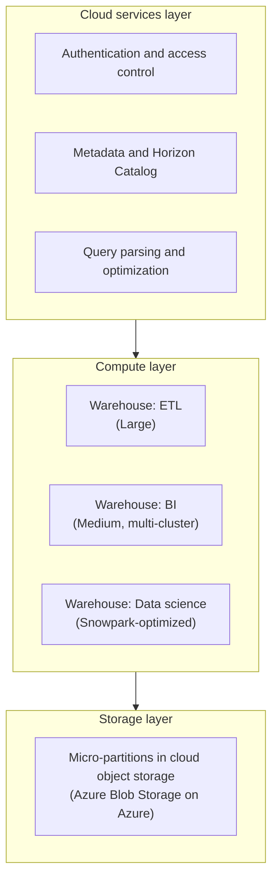
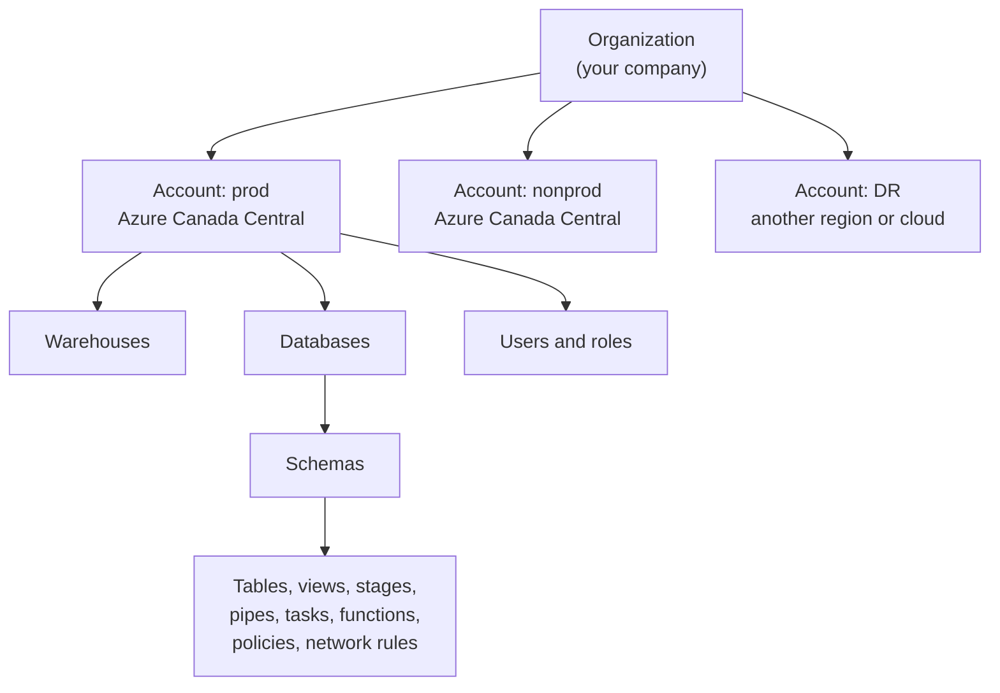
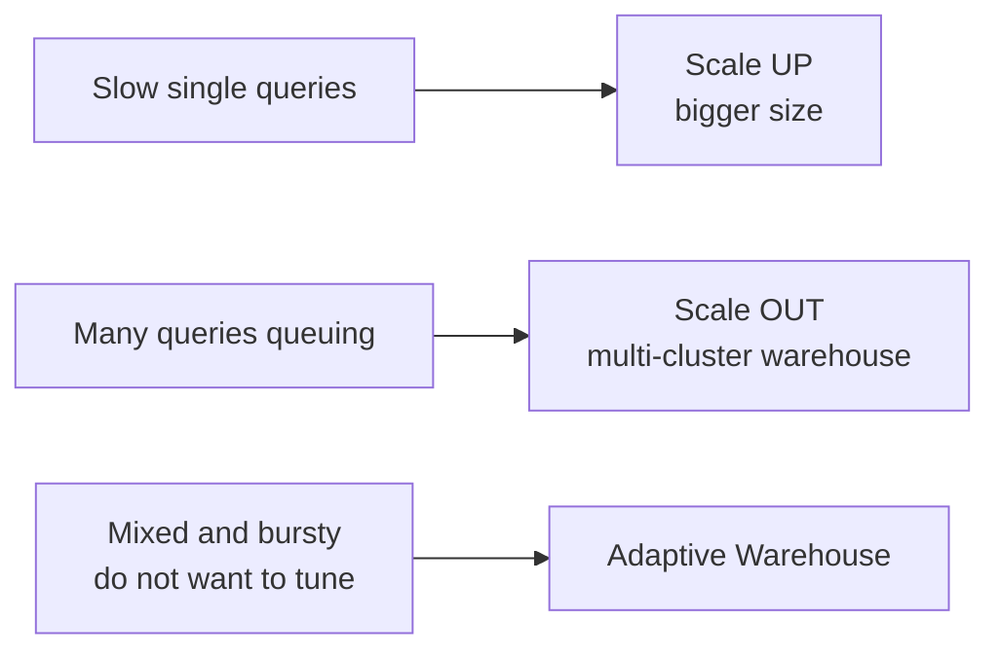
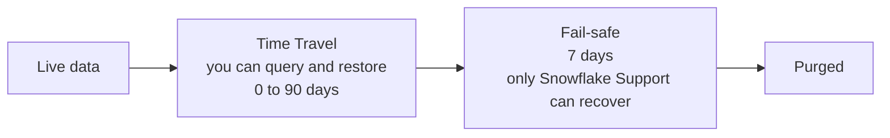
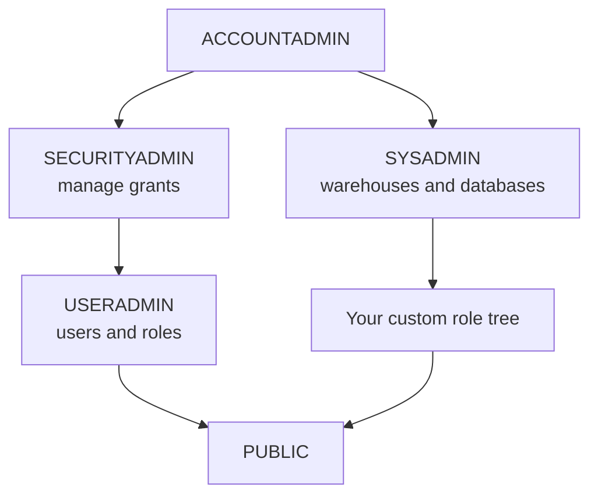
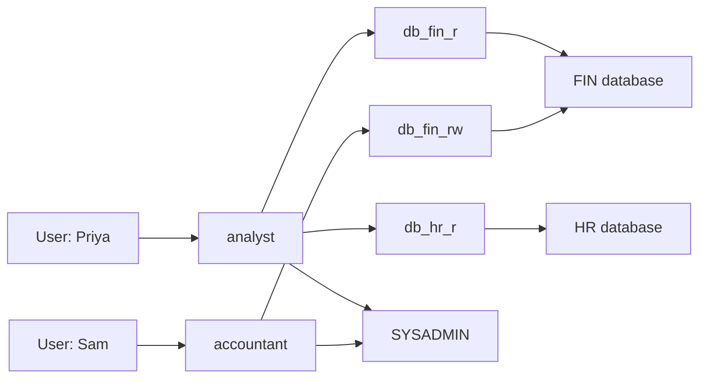
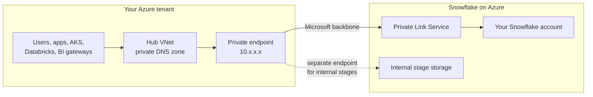
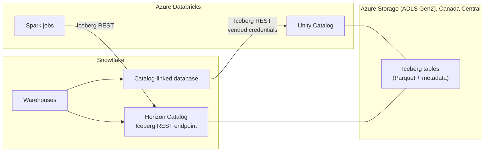
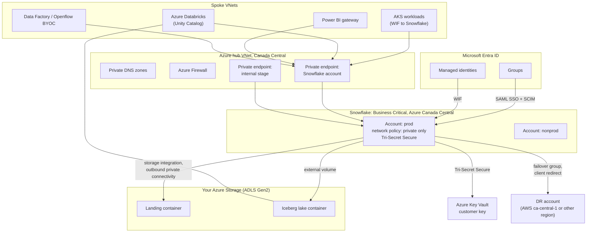

# Snowflake on Azure — Zero to Hero

**A single-file study reference. Written for someone who starts at zero and wants working expertise in a weekend.**

Verified against the official Snowflake documentation (docs.snowflake.com) in September 2026.

Snowflake changes fast. Features, names, defaults, and region availability move every month. Anything marked **Check before you commit** is time-sensitive. Confirm it in the release notes before you put it in a design.

---

## How to use this document

Read it in order the first time. After that, use it as a lookup.

Every section follows the same shape:

1. What the thing is, in plain words.
2. Why it exists (the problem it solves).
3. How it works (a diagram where useful).
4. Code you can paste and run.
5. Decisions an architect has to make.
6. Gotchas that cost people time.

Acronyms are spelled out the first time they appear in each part. There is a glossary at the end.

This guide leans toward **platform architecture on Azure**. It gives more space to identity, networking, governance, cost, disaster recovery, and running Snowflake for many teams. It gives less space to SQL tuning and data modelling.

### Suggested weekend plan

| Block | Hours | Parts | Outcome |
|---|---|---|---|
| Sat morning | 3 | 1–4 | You understand the architecture, accounts, editions, and regions. You have a trial account and have run queries. |
| Sat afternoon | 4 | 5–9 | You understand compute, storage, identity, networking, and encryption. You can design a secure account on Azure. |
| Sat evening | 2 | 10–11 | Governance and data pipelines. |
| Sun morning | 3 | 12–15 | Iceberg, coexistence with Databricks, AI and ML, applications. |
| Sun afternoon | 3 | 16–21 | Sharing, disaster recovery, cost, observability, DevOps, and the platform operating model. |
| Sun evening | 2 | 22–26 | Reference architecture, gotchas, interview bridge, self-test. |

### Table of contents

| # | Part |
|---|---|
| 1 | Names and recent changes you must know first |
| 2 | What Snowflake is |
| 3 | Organizations, accounts, editions, and regions |
| 4 | Lab 1 — your first account |
| 5 | Compute: virtual warehouses |
| 6 | Storage and table types |
| 7 | Identity and access |
| 8 | Networking and private connectivity on Azure |
| 9 | Encryption and key management |
| 10 | Governance with Snowflake Horizon |
| 11 | Loading data and building pipelines |
| 12 | Apache Iceberg and open table formats |
| 13 | Snowflake and Databricks together |
| 14 | AI and ML: Cortex and Snowflake ML |
| 15 | Applications: Streamlit, containers, and native apps |
| 16 | Data sharing and collaboration |
| 17 | Business continuity and disaster recovery |
| 18 | Cost management |
| 19 | Monitoring and observability |
| 20 | DevOps and infrastructure as code |
| 21 | Running Snowflake as a platform for many teams |
| 22 | Reference architecture on Azure |
| 23 | Gotchas |
| 24 | Interview bridge |
| 25 | Self-test |
| 26 | Cheat sheet and glossary |

---

# Part 1 — Names and recent changes you must know first

Blogs, courses, and older documentation use old names and old defaults. Learn this table first.

| You will see | Current name or state | Notes |
|---|---|---|
| SnowSQL | **Snowflake CLI** (`snow`) | SnowSQL still exists. Snowflake CLI is the developer-focused tool for new work. |
| Enterprise for Sensitive Data (ESD) | **Business Critical Edition** | Same edition, old name. |
| Cortex LLM functions, `COMPLETE`, Cortex AISQL | **Cortex AI Functions**, such as `AI_COMPLETE`, `AI_CLASSIFY`, `AI_FILTER` | Older functions still work. New work should use the `AI_` functions. |
| Polaris Catalog | **Apache Polaris** (open source) and **Snowflake Open Catalog** (managed service). Polaris is also built into **Horizon Catalog**. | Horizon now exposes an Iceberg REST endpoint for external engines. |
| Standard warehouse | **Gen1** and **Gen2** standard warehouses | Gen2 runs on faster hardware. See Part 5 for the default. |
| — | **Adaptive Warehouses** (Adaptive Compute) | New. Snowflake picks size and scaling for you. Enterprise Edition and above, select regions. |
| — | **Interactive warehouses** | For very low-latency dashboards and applications. |
| schemachange, custom scripts | **DCM Projects** (Database Change Management) | Declarative objects-as-code, with plan and deploy. |
| `TYPE = LEGACY_SERVICE` users | **Being removed** | Service users can no longer use passwords. See Part 7. |
| Password-only human logins | **Being removed** | Multi-factor authentication (MFA) is required for all human password users. See Part 7. |
| — | **Openflow** | Managed data integration built on Apache NiFi. |
| — | **Snowpark Container Services (SPCS)** | Run containers inside Snowflake. |
| — | **Snowflake Intelligence** | A chat interface for business users on top of Cortex Agents. |
| — | **Workload identity federation (WIF)** | Secretless authentication for workloads, including from AKS (Azure Kubernetes Service). |

**Check before you commit:** the Strong Authentication rollout (Part 7) is enforcing in August to October 2026. Any account you touch now is affected.

---

# Part 2 — What Snowflake is

## 2.1 In plain words

Snowflake is a managed data platform. You load data. You query it with SQL (Structured Query Language) or Python. Snowflake runs the servers, storage, upgrades, and tuning.

You cannot install Snowflake on your own servers. It only runs on AWS (Amazon Web Services), Microsoft Azure, and Google Cloud. You pick a cloud and a region when you create an account.

## 2.2 The three layers

Snowflake separates storage from compute. This is the most important idea in the product.

| Layer | What it does | What you pay for |
|---|---|---|
| **Storage** | Holds your data in a compressed, columnar format in cloud object storage. | Terabytes stored per month. |
| **Compute** | Virtual warehouses run your queries. Each warehouse is an independent cluster. | Credits per second while running. |
| **Cloud services** | Sign-in, security, metadata, query planning, and optimization. | Usually small. Billed only above 10% of daily compute. |



## 2.3 Why the separation matters

- **Workload isolation.** An ETL (extract, transform, load) job on one warehouse does not slow down dashboards on another. They share data but not compute.
- **Elastic cost.** Warehouses suspend when idle. You stop paying when nothing runs.
- **One copy of data.** Many teams query the same tables without copying them.

## 2.4 What it is not

- It is not a transactional database for high-volume application writes. Hybrid tables cover some of this, with limits.
- It is not a Spark cluster. It can run Spark code through Snowpark Connect, but its core engine is its own.
- It is not something you patch or upgrade. Snowflake releases weekly. You can test releases early on Enterprise Edition and above.

## 2.5 Ways to connect

| Tool | Use it for |
|---|---|
| **Snowsight** | The web interface. Worksheets, notebooks, dashboards, admin. |
| **Snowflake CLI** (`snow`) | Scripting, CI/CD (continuous integration and delivery), deploying apps and projects. |
| **Drivers** | JDBC, ODBC, Python, Go, .NET, Node.js. Used by applications and BI (business intelligence) tools. |
| **REST APIs** | SQL API, resource APIs, Cortex APIs. |
| **Python APIs** | Manage objects from Python code. |
| **Terraform provider** | Infrastructure as code. See Part 20. |

---

# Part 3 — Organizations, accounts, editions, and regions

## 3.1 The object hierarchy



- **Organization.** The top level. It groups all your accounts. It holds billing and cross-account usage views.
- **Account.** The main boundary. Each account lives in **one region on one cloud**. Users, roles, warehouses, and databases live inside an account.
- **Database and schema.** Containers for objects. Most objects live in a schema.

**Account identifier.** The preferred form is `<orgname>-<accountname>`. The older form is an account locator, such as `xy12345.canada-central.azure`. Use the organization form in new configuration.

## 3.2 Editions

The edition sets features and the price per credit. You can change edition later.

| Capability | Standard | Enterprise | Business Critical | VPS (Virtual Private Snowflake) |
|---|:---:|:---:|:---:|:---:|
| Core SQL, warehouses, Snowpipe, dynamic tables, Iceberg tables | ✓ | ✓ | ✓ | ✓ |
| Time Travel up to 1 day | ✓ | ✓ | ✓ | ✓ |
| Time Travel up to 90 days | | ✓ | ✓ | ✓ |
| Multi-cluster warehouses | | ✓ | ✓ | ✓ |
| Column masking and row access policies | | ✓ | ✓ | ✓ |
| Data classification, access history | | ✓ | ✓ | ✓ |
| Adaptive Warehouses | | ✓ | ✓ | ✓ |
| **Private connectivity (Azure Private Link)** | | | ✓ | ✓ |
| **Tri-Secret Secure (customer-managed keys)** | | | ✓ | ✓ |
| **Failover and failback, client redirect** | | | ✓ | ✓ |
| Replication of users, roles, warehouses, integrations | | | ✓ | ✓ |
| PCI DSS, HIPAA, FedRAMP support | | | ✓ | ✓ |
| Fully separate environment, dedicated metadata store | | | | ✓ |

**The architect's rule for a regulated financial firm:** Business Critical is the realistic minimum. Private Link, customer-managed keys, and failover all require it.

## 3.3 On Demand and Capacity

- **On Demand.** Pay as you go. No commitment.
- **Capacity.** A pre-paid commitment at a discount. Most large companies buy capacity.

## 3.4 Azure regions — the Canadian picture

Each account lives in one region. Data stays in that region unless you copy, share, or replicate it.

As of September 2026, Snowflake lists these commercial regions in Canada:

| Cloud | Region ID | Name | Notes from the docs |
|---|---|---|---|
| Azure | `canadacentral` | Canada Central (Toronto) | Assessed for CCCS (Canadian Centre for Cyber Security) Medium profile, formerly Protected B / Medium / Medium. |
| AWS | `ca-central-1` | Canada (Central) | Also assessed for the CCCS Medium profile. |

**There is no Snowflake region on Azure Canada East.** This matters for disaster recovery design. See Part 17.

**Check before you commit:** region lists change. Run `SHOW REGIONS;` as an organization administrator to see what your organization can use.

## 3.5 Decisions

| Decision | Options | Guidance |
|---|---|---|
| How many accounts? | One account with many databases, or many accounts. | Separate **production and non-production** accounts at minimum. Accounts are the strongest isolation boundary. |
| Which edition? | Standard, Enterprise, Business Critical, VPS. | Business Critical for regulated data on Azure. |
| Which region? | Any supported region. | Put the account where the data must live, and near its main consumers. |
| Same cloud as the rest of the estate? | Azure, AWS, or Google Cloud. | Same cloud avoids egress charges and simplifies Private Link. |

---

# Part 4 — Lab 1: your first account

Sign up for a 30-day trial. Pick **Enterprise** or **Business Critical** so you can try policies. Pick **Microsoft Azure** and **Canada Central**.

Open a SQL worksheet in Snowsight and run each block.

## 4.1 Look around

```sql
SELECT CURRENT_ORGANIZATION_NAME(), CURRENT_ACCOUNT_NAME(),
       CURRENT_REGION(), CURRENT_ROLE(), CURRENT_WAREHOUSE();

SHOW WAREHOUSES;
SHOW DATABASES;

-- Sample data ships with every account
SELECT * FROM SNOWFLAKE_SAMPLE_DATA.TPCH_SF1.CUSTOMER LIMIT 10;
```

## 4.2 Build a small, properly governed setup

```sql
-- 1. Roles: never build as ACCOUNTADMIN
USE ROLE USERADMIN;
CREATE ROLE IF NOT EXISTS lab_admin;
CREATE ROLE IF NOT EXISTS lab_reader;

USE ROLE SECURITYADMIN;
GRANT ROLE lab_reader TO ROLE lab_admin;   -- admin inherits reader
GRANT ROLE lab_admin  TO ROLE SYSADMIN;    -- keep the hierarchy under SYSADMIN
GRANT ROLE lab_admin  TO USER <your_user>;

-- 2. Warehouse with sensible defaults
USE ROLE SYSADMIN;
CREATE WAREHOUSE IF NOT EXISTS lab_wh
  WAREHOUSE_SIZE = XSMALL
  AUTO_SUSPEND = 60          -- seconds of idle before it stops
  AUTO_RESUME = TRUE
  INITIALLY_SUSPENDED = TRUE;
GRANT USAGE ON WAREHOUSE lab_wh TO ROLE lab_reader;
GRANT OPERATE ON WAREHOUSE lab_wh TO ROLE lab_admin;

-- 3. Database and schema
CREATE DATABASE IF NOT EXISTS lab_db;
CREATE SCHEMA IF NOT EXISTS lab_db.sales WITH MANAGED ACCESS;
GRANT OWNERSHIP ON DATABASE lab_db TO ROLE lab_admin COPY CURRENT GRANTS;
GRANT OWNERSHIP ON SCHEMA lab_db.sales TO ROLE lab_admin COPY CURRENT GRANTS;

-- 4. Reader access, including tables that do not exist yet
USE ROLE lab_admin;
GRANT USAGE ON DATABASE lab_db TO ROLE lab_reader;
GRANT USAGE ON SCHEMA lab_db.sales TO ROLE lab_reader;
GRANT SELECT ON FUTURE TABLES IN SCHEMA lab_db.sales TO ROLE lab_reader;

-- 5. Load some data
USE WAREHOUSE lab_wh;
CREATE TABLE lab_db.sales.orders AS
  SELECT * FROM SNOWFLAKE_SAMPLE_DATA.TPCH_SF1.ORDERS;

SELECT o_orderpriority, COUNT(*) AS orders, SUM(o_totalprice) AS revenue
FROM lab_db.sales.orders
GROUP BY 1 ORDER BY 3 DESC;
```

## 4.3 Try the features that feel like magic

```sql
-- Zero-copy clone: instant, no extra storage until data changes
CREATE TABLE lab_db.sales.orders_dev CLONE lab_db.sales.orders;

-- Time Travel: query the past
DELETE FROM lab_db.sales.orders_dev WHERE o_orderpriority = '1-URGENT';
SELECT COUNT(*) FROM lab_db.sales.orders_dev AT (OFFSET => -60*5);  -- 5 minutes ago

-- Undrop
DROP TABLE lab_db.sales.orders_dev;
UNDROP TABLE lab_db.sales.orders_dev;

-- Result cache: run the same query twice; the second is instant and free
SELECT COUNT(*) FROM lab_db.sales.orders;
SELECT COUNT(*) FROM lab_db.sales.orders;
```

## 4.4 Clean up

```sql
USE ROLE SYSADMIN;
DROP DATABASE lab_db;
DROP WAREHOUSE lab_wh;
```

---

# Part 5 — Compute: virtual warehouses

## 5.1 What a warehouse is

A **virtual warehouse** is a cluster of compute. It runs queries, loads data, and runs Snowpark code. Each warehouse is independent. One warehouse never slows down another.

A warehouse is not storage. The word "warehouse" confuses people coming from other products. In Snowflake, a warehouse is only compute.

## 5.2 Warehouse types

| Type | Use it for | Notes |
|---|---|---|
| **Standard (Gen1)** | The original warehouse. | Still supported. |
| **Standard (Gen2)** | Most analytics and data engineering. | Faster hardware and engine improvements. Query Acceleration is on by default for new Gen2 warehouses. |
| **Snowpark-optimized** | Memory-heavy Python, Java, or ML (machine learning) work on one node. | More memory per node. |
| **Adaptive** | Mixed workloads where you do not want to tune size or scaling. | Snowflake sizes each query. Billed per query. Enterprise and above, select regions (Azure Canada Central is listed). |
| **Interactive** | Very low-latency dashboards and applications. | Separate type. |

**Check before you commit:** the Gen2 docs say new standard warehouses default to Gen2 where Gen2 is available. Another docs page still says Gen2 is not the default. Always set `GENERATION = '2'` explicitly, and confirm with `SHOW WAREHOUSES` (column `resource_constraint`).

## 5.3 Sizes and credits (Gen1 standard)

Each size step doubles compute and credits.

| Size | Credits per hour |
|---|---|
| X-Small | 1 |
| Small | 2 |
| Medium | 4 |
| Large | 8 |
| X-Large | 16 |
| 2X-Large | 32 |
| 3X-Large | 64 |
| 4X-Large | 128 |
| 5X-Large | 256 |
| 6X-Large | 512 |

Gen2 credit rates are in the Snowflake Service Consumption Table. They are higher per hour, but queries usually finish faster. Test with your own workload.

**Billing rule:** per second, with a **60-second minimum** each time a warehouse starts. A warehouse that starts, runs a 2-second query, and suspends is billed for 60 seconds.

## 5.4 Scale up versus scale out



- **Scale up** (bigger size) for complex queries that are slow.
- **Scale out** (more clusters) for concurrency, such as many dashboard users at 9 a.m.
- Bigger is not faster for small queries or for loading a few files.

## 5.5 Code

```sql
-- Gen2 standard warehouse for ETL
CREATE WAREHOUSE etl_wh
  GENERATION = '2'
  WAREHOUSE_SIZE = LARGE
  AUTO_SUSPEND = 60
  AUTO_RESUME = TRUE
  INITIALLY_SUSPENDED = TRUE
  STATEMENT_TIMEOUT_IN_SECONDS = 3600       -- kill runaway queries
  STATEMENT_QUEUED_TIMEOUT_IN_SECONDS = 600
  COMMENT = 'ETL for finance data products';

-- Multi-cluster warehouse for BI (Enterprise Edition)
CREATE WAREHOUSE bi_wh
  GENERATION = '2'
  WAREHOUSE_SIZE = MEDIUM
  MIN_CLUSTER_COUNT = 1
  MAX_CLUSTER_COUNT = 4
  SCALING_POLICY = STANDARD                  -- ECONOMY waits longer before adding clusters
  AUTO_SUSPEND = 300;

-- Adaptive Warehouse
CREATE ADAPTIVE WAREHOUSE mixed_wh
  WITH MAX_QUERY_PERFORMANCE_LEVEL = LARGE   -- ceiling for any single query
       QUERY_THROUGHPUT_MULTIPLIER = 2;       -- how much total work can run at once

-- Convert an existing warehouse, online
ALTER WAREHOUSE bi_wh SET WAREHOUSE_TYPE = 'ADAPTIVE';

-- Resize at any time; running queries finish on the old size
ALTER WAREHOUSE etl_wh SET WAREHOUSE_SIZE = XLARGE;
```

## 5.6 Serverless compute

Some features do not use your warehouses. Snowflake runs them on its own compute and bills them separately:

Snowpipe, automatic clustering, materialized view refresh, search optimization, serverless tasks, replication, Cortex AI functions, and more.

**This matters for cost control.** Resource monitors only control warehouses. Use **budgets** for serverless and AI spend. See Part 18.

## 5.7 Caches

| Cache | Where | Behaviour |
|---|---|---|
| **Result cache** | Cloud services | Same query, same data, same role: result returned instantly with no warehouse. Kept 24 hours. |
| **Local disk cache** | Warehouse SSD | Data read recently stays on the warehouse. Lost when the warehouse suspends. |
| **Metadata** | Cloud services | `COUNT(*)`, `MIN`, `MAX` on whole tables often need no warehouse. |

**Trade-off:** a very short `AUTO_SUSPEND` saves idle credits but throws away the local cache. For BI warehouses, 5 to 10 minutes is often cheaper overall.

## 5.8 Decisions

| Decision | Guidance |
|---|---|
| One big shared warehouse or many small ones? | One warehouse per **workload and cost owner**. For example, `finance_etl_wh`, `finance_bi_wh`. It makes chargeback and tuning simple. |
| Standard or Adaptive? | Adaptive when you want fewer knobs. Standard Gen2 when you need direct control or predictable reporting. |
| Auto-suspend value? | 60 seconds for ETL. 300 to 600 seconds for BI. |

---

# Part 6 — Storage and table types

## 6.1 Micro-partitions

When you load data, Snowflake splits it into **micro-partitions**. Each holds roughly 50 to 500 MB of uncompressed data in columnar format. Snowflake stores the minimum and maximum of each column for each micro-partition.

When you filter, Snowflake skips micro-partitions that cannot match. This is called **pruning**. Good pruning is the biggest factor in query speed.

You do not create indexes or partitions by hand for normal tables.

## 6.2 Clustering

Data is naturally clustered in load order. If you mostly filter on a different column, pruning gets worse over time.

For very large tables (multi-terabyte) you can define a **clustering key**. Snowflake then re-clusters in the background, billed as serverless compute.

```sql
ALTER TABLE prod.gold.trades CLUSTER BY (trade_date, desk_id);
SELECT SYSTEM$CLUSTERING_INFORMATION('prod.gold.trades');
```

Do not cluster small tables. The maintenance cost exceeds the benefit.

## 6.3 Table types

| Type | Time Travel | Fail-safe | Use it for |
|---|---|---|---|
| **Permanent** | 0–1 day (Standard), up to 90 (Enterprise+) | 7 days | Production data. The default. |
| **Transient** | 0–1 day | None | Staging data you can reload. Cheaper storage. |
| **Temporary** | 0–1 day | None | Session scratch space. Dropped at session end. |
| **Iceberg** | Yes | Depends on catalog | Open format data in your own storage. See Part 12. |
| **Hybrid** | Limited | — | Low-latency single-row reads and writes with enforced keys. Check region availability. Not replicated. |
| **Dynamic** | Yes | Yes | Tables defined by a query that refresh themselves. See Part 11. |
| **External** | — | — | Read-only view over files in a data lake. Iceberg tables are usually a better choice now. |

## 6.4 Continuous data protection



- **Time Travel.** Query or restore data as it was at a past time. Set with `DATA_RETENTION_TIME_IN_DAYS`.
- **Fail-safe.** Seven more days where only Snowflake Support can recover data. Not a backup you control.
- **Backups.** A newer feature. Backup sets and backup policies for databases, schemas, and tables. Retention lock and legal hold need Business Critical. Use these for immutable, compliance-grade backups.

```sql
ALTER DATABASE prod SET DATA_RETENTION_TIME_IN_DAYS = 30;

SELECT * FROM prod.gold.positions AT (TIMESTAMP => '2026-09-20 17:00:00'::TIMESTAMP_LTZ);
CREATE TABLE prod.gold.positions_restored CLONE prod.gold.positions
  BEFORE (STATEMENT => '<query_id_of_bad_update>');
```

**Cost trade-off:** long Time Travel on tables that change a lot stores many old versions. Storage cost can double or more. Keep long retention for data that changes slowly.

## 6.5 Zero-copy cloning

`CLONE` creates a new object that points at the same micro-partitions. It is instant. You pay only for data that changes afterwards.

Uses: fast dev and test environments, safe experiments, point-in-time copies before a risky change.

**Gotcha:** a cloned table gets **no grants** from the source table. A cloned schema or database keeps grants on the objects inside it.

---

# Part 7 — Identity and access

This is the second-largest design area after networking.

## 7.1 The access model

Snowflake uses **RBAC** (role-based access control). Privileges go to roles. Roles go to users or to other roles.

- A user can hold many roles. One is the **primary role** for the session. Secondary roles can add privileges.
- Every object has one **owner role**. The owner has full control.
- To read a table you need `USAGE` on its database, `USAGE` on its schema, and `SELECT` on the table. Missing any one of these gives a "does not exist or not authorized" error.

## 7.2 System roles



Rules from the Snowflake best-practice guide:

- Give `ACCOUNTADMIN` to very few people. At least two, so they can recover each other. All must use MFA.
- Never make `ACCOUNTADMIN` anyone's default role.
- Do not create objects as `ACCOUNTADMIN`. Do not run automation as `ACCOUNTADMIN`.
- Grant the top of every custom role tree to `SYSADMIN`. Otherwise even administrators cannot manage those objects.

## 7.3 Access roles and functional roles

This is the standard enterprise pattern.

- **Access roles** hold privileges on objects. For example, `db_fin_r` (read) and `db_fin_rw` (read-write).
- **Functional roles** match job functions. For example, `analyst` or `data_engineer`. They receive access roles.
- Users receive functional roles only.



```sql
USE ROLE USERADMIN;
CREATE ROLE db_fin_r;  CREATE ROLE db_fin_rw;  CREATE ROLE analyst;

USE ROLE SECURITYADMIN;
GRANT USAGE ON DATABASE fin TO ROLE db_fin_r;
GRANT USAGE ON ALL SCHEMAS IN DATABASE fin TO ROLE db_fin_r;
GRANT SELECT ON ALL TABLES IN DATABASE fin TO ROLE db_fin_r;
GRANT SELECT ON FUTURE TABLES IN DATABASE fin TO ROLE db_fin_r;

GRANT ROLE db_fin_r TO ROLE analyst;
GRANT ROLE analyst TO ROLE SYSADMIN;
```

**Database roles** are the same idea, scoped inside one database. Database owners can manage them without account-level rights. They are also the way to share only part of a database. Database roles cannot be activated directly; grant them to an account role.

```sql
CREATE DATABASE ROLE fin.reader;
GRANT USAGE ON SCHEMA fin.gold TO DATABASE ROLE fin.reader;
GRANT SELECT ON ALL TABLES IN SCHEMA fin.gold TO DATABASE ROLE fin.reader;
GRANT DATABASE ROLE fin.reader TO ROLE analyst;
```

## 7.4 Managed access schemas

In a normal schema, object owners can grant access to anyone. In a **managed access schema**, only the schema owner or a role with `MANAGE GRANTS` can grant. Use managed access schemas for all production data. It stops grant sprawl.

```sql
CREATE SCHEMA fin.gold WITH MANAGED ACCESS;
```

## 7.5 Authentication for people

Use **SSO** (single sign-on) with Microsoft Entra ID through SAML 2.0 (Security Assertion Markup Language). Use **SCIM** (System for Cross-domain Identity Management) so Entra ID creates, updates, and removes users and roles automatically.

```sql
-- SCIM provisioning from Microsoft Entra ID
USE ROLE ACCOUNTADMIN;
CREATE ROLE IF NOT EXISTS aad_provisioner;
GRANT CREATE USER ON ACCOUNT TO ROLE aad_provisioner;
GRANT CREATE ROLE ON ACCOUNT TO ROLE aad_provisioner;
GRANT ROLE aad_provisioner TO ROLE ACCOUNTADMIN;

CREATE SECURITY INTEGRATION aad_scim
  TYPE = SCIM
  SCIM_CLIENT = 'AZURE'
  RUN_AS_ROLE = 'AAD_PROVISIONER';

SELECT SYSTEM$GENERATE_SCIM_ACCESS_TOKEN('AAD_SCIM');  -- paste into Entra ID
```

SCIM can also set **cost attribution tags** on users as they are provisioned. See Part 18.

## 7.6 The strong authentication rollout (time-sensitive)

Snowflake is removing single-factor passwords. From the official timeline:

| Estimated dates | Change |
|---|---|
| Sept 2025 – Jan 2026 | MFA required for all human password users in Snowsight. |
| May – Jul 2026 | New human users need MFA everywhere. New non-human users must be `TYPE = SERVICE`. `LEGACY_SERVICE` can no longer be created. |
| **Aug – Oct 2026** | **All** human password users need MFA everywhere. All `LEGACY_SERVICE` users are converted to `SERVICE` and **can no longer use passwords.** |

**What this means for a platform team right now:** any pipeline, BI tool, or script that logs in with a user name and password will break. Move them to key-pair, OAuth, programmatic access tokens, or workload identity federation.

## 7.7 Authentication for workloads

User types:

- `TYPE = PERSON` — a human.
- `TYPE = SERVICE` — an application. Cannot use a password.
- `TYPE = SERVICE_AGENT` — an AI agent workload.

| Method | How it works | Use when |
|---|---|---|
| **Key-pair** | The workload signs a JWT (JSON Web Token) with a private key. Snowflake holds the public key. | Simple and widely supported. You must store and rotate the private key. |
| **Programmatic access token (PAT)** | A long string the workload presents. Can be limited to one role and an expiry. | Tools that only accept a token. |
| **External OAuth** | Entra ID issues the token. | Applications that already use Entra ID OAuth. |
| **Workload identity federation (WIF)** | The workload proves its cloud identity (Azure managed identity, AKS service account, GitHub Actions OIDC). No stored secret. | The preferred option. No secrets to leak or rotate. |

```sql
-- Key-pair
CREATE USER etl_svc TYPE = SERVICE DEFAULT_ROLE = etl_role
  RSA_PUBLIC_KEY = 'MIIBIjANBgkqh...';

-- WIF: an Azure managed identity (VM, Function, App Service)
CREATE USER app_svc
  WORKLOAD_IDENTITY = (
    TYPE = AZURE
    ISSUER = 'https://login.microsoftonline.com/<tenant_id>/v2.0'
    SUBJECT = '<managed_identity_object_id>'
  )
  TYPE = SERVICE
  DEFAULT_ROLE = app_role;

-- WIF: a pod on AKS, using the cluster OIDC issuer and a Kubernetes service account
CREATE USER aks_svc
  WORKLOAD_IDENTITY = (
    TYPE = OIDC
    ISSUER = 'https://<region>.oic.prod-aks.azure.com/<tenant_id>/<uuid>/'
    SUBJECT = 'system:serviceaccount:<namespace>:<service_account>'
  )
  TYPE = SERVICE;

-- Only accept WIF tokens from your own Entra tenant
CREATE AUTHENTICATION POLICY wif_only_our_tenant
  WORKLOAD_IDENTITY_POLICY = (
    ALLOWED_PROVIDERS = (AZURE)
    ALLOWED_AZURE_ISSUERS = ('https://login.microsoftonline.com/<tenant_id>/v2.0')
  );
```

```python
# Python connector with WIF from an Azure workload
import snowflake.connector
conn = snowflake.connector.connect(
    account="<org>-<account>",
    authenticator="WORKLOAD_IDENTITY",
    workload_identity_provider="AZURE",
)
```

For the AKS case, the pod mounts a projected service account token with audience `snowflakecomputing.com`, then connects with `workload_identity_provider='OIDC'` and `token_file_path`. Enable the OIDC issuer on the AKS cluster first.

**WIF gotchas from the docs:**

- A one-time Entra tenant admin consent to the Snowflake Entra ID app is required.
- Azure does not support identity impersonation chains for WIF. Plan for one Snowflake service user per managed identity, or group workloads behind shared identities.
- Azure workloads in Azure sovereign clouds (Azure US Gov, Azure China) are not supported.
- Snowflake caches issuer signing keys for up to 60 minutes. Keep old keys published during rotation.

## 7.8 Auditing access

```sql
-- Who logged in, how, and from where (last 7 days)
SELECT user_name, first_authentication_factor, second_authentication_factor,
       client_ip, reported_client_type, is_success, event_timestamp
FROM SNOWFLAKE.ACCOUNT_USAGE.LOGIN_HISTORY
WHERE event_timestamp > DATEADD(day, -7, CURRENT_TIMESTAMP())
ORDER BY event_timestamp DESC;

-- Users still on passwords without MFA (check column names in your account)
SELECT name, type, has_password, has_mfa, has_rsa_public_key
FROM SNOWFLAKE.ACCOUNT_USAGE.USERS
WHERE deleted_on IS NULL AND has_password AND NOT has_mfa;

-- Direct grants to users (should be rare)
SELECT * FROM SNOWFLAKE.ACCOUNT_USAGE.GRANTS_TO_ROLES WHERE granted_to = 'USER';
```

---

# Part 8 — Networking and private connectivity on Azure

## 8.1 The default

By default, a Snowflake account has a public endpoint on the internet, protected by TLS (Transport Layer Security) and authentication. For regulated data you usually want:

1. Private access from your Azure virtual networks only.
2. Public access blocked.
3. Private access from Snowflake out to your storage and services.

Private connectivity requires **Business Critical Edition or higher**.

## 8.2 Inbound: Azure Private Link



High-level steps from the docs:

1. In Snowflake, run `SYSTEM$GET_PRIVATELINK_CONFIG()` and note `privatelink-pls-id`.
2. In Azure, create a private endpoint that connects to that resource ID or alias.
3. Get the endpoint resource ID and an Azure access token (Reader on the subscription is enough).
4. In Snowflake, authorize it with `SYSTEM$AUTHORIZE_PRIVATELINK(<endpoint_id>, <token>)`.
5. Update DNS so the account URL and OCSP (Online Certificate Status Protocol) URL resolve to the private IP. Use an Azure Private DNS zone and forwarders from on-premises.
6. Test with **SnowCD** (Snowflake Connectivity Diagnostic tool) and `SYSTEM$ALLOWLIST_PRIVATELINK()`.
7. Connect using the privatelink account URL.

```sql
USE ROLE ACCOUNTADMIN;
SELECT SYSTEM$GET_PRIVATELINK_CONFIG();
SELECT SYSTEM$AUTHORIZE_PRIVATELINK(
  '/subscriptions/<sub>/resourcegroups/<rg>/providers/microsoft.network/privateendpoints/<pe_name>',
  '<azure_access_token>');
SELECT SYSTEM$GET_PRIVATELINK();   -- "Account is authorized for PrivateLink."
```

Notes:

- Snowflake recommends **pinning** private endpoints so only approved endpoints can reach the account.
- Snowsight over Private Link needs its own DNS entries from `SYSTEM$GET_PRIVATELINK_CONFIG()`.
- Managed private endpoints from Azure Data Factory or Synapse need a different, support-assisted process.
- **Internal stages** (Snowflake-managed storage for file uploads) need their own private endpoint on Azure.

## 8.3 Network rules and network policies

A **network rule** is a list of network identifiers. A **network policy** uses network rules to allow or block traffic.

Supported inbound identifiers include IPv4 ranges, Azure private endpoint **LinkIDs**, AWS VPC endpoint IDs, and Snowpark Container Services compute pools.

```sql
USE ROLE SECURITYADMIN;
CREATE DATABASE IF NOT EXISTS security_db;
CREATE SCHEMA IF NOT EXISTS security_db.network;

-- Allow only our Azure private endpoint
SELECT SYSTEM$GET_PRIVATELINK_AUTHORIZED_ENDPOINTS();   -- gives the LinkID

CREATE NETWORK RULE security_db.network.corp_private_endpoint
  TYPE = AZURELINKID MODE = INGRESS
  VALUE_LIST = ('<link_id>');

-- Allow one SaaS tool by its Snowflake-managed rule
-- (Snowflake keeps these IP lists up to date)
SHOW NETWORK RULES IN SNOWFLAKE.NETWORK_SECURITY;

CREATE NETWORK POLICY corp_only
  ALLOWED_NETWORK_RULE_LIST = ('security_db.network.corp_private_endpoint');

-- Test on one user first, then the account
ALTER USER test_user SET NETWORK_POLICY = corp_only;
ALTER ACCOUNT SET NETWORK_POLICY = corp_only;
```

**Tuple syntax** lets one rule combine a private endpoint with specific source subnets: `{<link_id>:10.10.0.0/16}`. Use it when many business units share one private endpoint and you need to tell them apart.

**Gotcha:** on Azure you cannot use a network rule to restrict the internal stage. You can only block all public access to it.

## 8.4 Outbound connectivity

Snowflake also connects **out** to your resources:

| Outbound need | Snowflake object |
|---|---|
| Read and write files in your Azure Storage | Storage integration, plus an external stage |
| Iceberg tables in your Azure Storage | External volume |
| Call an API from a UDF (user-defined function) or procedure | External access integration, plus an `EGRESS` network rule |
| Keys in Azure Key Vault (Tri-Secret Secure) | Private connectivity to the key management service |

Business Critical supports **outbound private connectivity** to external stages, external volumes, and Key Vault. Use it so Snowflake reaches your storage without the public internet.

```sql
-- Storage integration for Azure Blob Storage or ADLS Gen2
CREATE STORAGE INTEGRATION azure_landing_int
  TYPE = EXTERNAL_STAGE
  STORAGE_PROVIDER = 'AZURE'
  ENABLED = TRUE
  AZURE_TENANT_ID = '<tenant_id>'
  STORAGE_ALLOWED_LOCATIONS = ('azure://<account>.blob.core.windows.net/landing/');

DESC STORAGE INTEGRATION azure_landing_int;  -- gives the consent URL and app name
-- In Azure: consent, then grant the Snowflake app "Storage Blob Data Contributor"
-- (or Reader) on the container.

CREATE STAGE prod.raw.landing_stage
  STORAGE_INTEGRATION = azure_landing_int
  URL = 'azure://<account>.blob.core.windows.net/landing/';
```

---

# Part 9 — Encryption and key management

## 9.1 Always on

All data is encrypted at rest and in transit. You cannot turn this off. Snowflake uses a hierarchical key model: a root key, account master keys, table master keys, and file keys. Snowflake rotates keys regularly.

**Periodic rekeying** (Enterprise and above) re-encrypts data older than one year with new keys.

## 9.2 Tri-Secret Secure

**Tri-Secret Secure** combines a Snowflake-managed key with **your own key** in Azure Key Vault to form a composite master key. It needs Business Critical.

- If you revoke your key, Snowflake cannot decrypt your data. This is your "kill switch".
- It supports sovereignty arguments: the provider alone cannot read your data.
- Private connectivity to Key Vault is supported.
- Replicated data in a target account is encrypted with the target account's keys. Enable Tri-Secret Secure in the target account separately. It is not on by default.

**Operational warning:** if the Key Vault key is deleted or access breaks, the account stops working. Treat the key as a critical dependency with its own monitoring, access controls, and recovery plan.

---

# Part 10 — Governance with Snowflake Horizon

**Snowflake Horizon** is the name for the built-in governance, security, and catalog features. It is not a separate product to install.

## 10.1 The building blocks

| Feature | What it does | Edition |
|---|---|---|
| **Object tags** | Key-value labels on objects and columns, such as `pii = 'email'` or `cost_center = 'finance'`. | All (some features Enterprise+) |
| **Masking policies** | Change what a column returns based on who is asking. | Enterprise+ |
| **Tag-based masking** | Attach a masking policy to a tag. Every column with that tag is masked. | Enterprise+ |
| **Row access policies** | Filter which rows a user can see. | Enterprise+ |
| **Aggregation and projection policies** | Force aggregation, or block a column from being selected. | Enterprise+ |
| **Classification** | Scans data and suggests sensitive-data tags. | Enterprise+ |
| **Access history** | Records which columns each query read and wrote. | Enterprise+ |
| **Data quality (data metric functions)** | Scheduled checks such as null counts and freshness. | Enterprise+ |
| **Lineage** | Shows upstream and downstream objects in Snowsight. | — |

## 10.2 Masking and row access

```sql
-- A central governance database, owned by a governance role
USE ROLE governance_admin;
CREATE DATABASE IF NOT EXISTS governance;
CREATE SCHEMA IF NOT EXISTS governance.policies;

-- Masking policy
CREATE OR REPLACE MASKING POLICY governance.policies.mask_string
  AS (val STRING) RETURNS STRING ->
  CASE
    WHEN IS_ROLE_IN_SESSION('PII_READER') THEN val
    ELSE '***MASKED***'
  END;

-- Tag-based masking: every column tagged pii gets masked
CREATE TAG IF NOT EXISTS governance.policies.pii
  ALLOWED_VALUES 'name', 'email', 'sin', 'account_number';
ALTER TAG governance.policies.pii SET MASKING POLICY governance.policies.mask_string;

ALTER TABLE prod.gold.members MODIFY COLUMN email
  SET TAG governance.policies.pii = 'email';

-- Row access policy driven by a mapping table
CREATE OR REPLACE ROW ACCESS POLICY governance.policies.region_rap
  AS (region STRING) RETURNS BOOLEAN ->
  IS_ROLE_IN_SESSION('GLOBAL_READER')
  OR EXISTS (
    SELECT 1 FROM governance.policies.role_region_map m
    WHERE IS_ROLE_IN_SESSION(m.role_name) AND m.region = region
  );

ALTER TABLE prod.gold.positions ADD ROW ACCESS POLICY governance.policies.region_rap ON (region);
```

**Pattern:** tag once, protect everywhere. Tag-based masking scales far better than attaching a policy to each column.

**Gotcha:** `CURRENT_ROLE()` only checks the primary role. `IS_ROLE_IN_SESSION()` also checks inherited and secondary roles. Use `IS_ROLE_IN_SESSION()` in policies.

## 10.3 Classification and access history

```sql
-- Find columns that look sensitive
CALL SYSTEM$CLASSIFY('prod.gold.members', {'auto_tag': true});

-- Who read the SIN column in the last 30 days
SELECT ah.query_start_time, ah.user_name, obj.value:objectName::STRING AS object_name
FROM SNOWFLAKE.ACCOUNT_USAGE.ACCESS_HISTORY ah,
     LATERAL FLATTEN(ah.base_objects_accessed) obj,
     LATERAL FLATTEN(obj.value:columns) col
WHERE col.value:columnName::STRING = 'SIN'
  AND ah.query_start_time > DATEADD(day, -30, CURRENT_TIMESTAMP());
```

**Check before you commit:** classification syntax has changed over time (profiles, automatic classification). Confirm the current form in the docs.

## 10.4 Policies also protect Iceberg tables read by other engines

Masking and row access policies can be enforced when external engines such as Apache Spark read Snowflake-managed Iceberg tables through Horizon Catalog. See Part 12. This is an important point in a multi-engine estate.

## 10.5 Microsoft Purview

Purview can scan Snowflake and pull metadata into an enterprise catalog. Treat Purview as **discovery and classification across the estate**. Snowflake Horizon stays the **enforcement point** for Snowflake data.

---

# Part 11 — Loading data and building pipelines

## 11.1 Options at a glance

| Method | Latency | Use it for |
|---|---|---|
| `COPY INTO` | Batch | Bulk loads from files on a schedule. |
| **Snowpipe** | About a minute | Load files as soon as they land in storage. Event-driven. |
| **Snowpipe Streaming** | Seconds | Row-level streaming through SDKs or REST, no files. |
| **Kafka connector** | Seconds | Kafka topics into tables. |
| **Openflow** | Varies | Managed connectors (SaaS apps, databases, SharePoint, and more), built on Apache NiFi. Runs in Snowflake or in your own cloud. |
| Partner ETL tools | Varies | Fivetran, Informatica, Azure Data Factory, and others. |

## 11.2 Stages and COPY

A **stage** is a pointer to files. **Internal stages** live in Snowflake storage. **External stages** point to your Azure Storage.

```sql
CREATE FILE FORMAT prod.raw.parquet_ff TYPE = PARQUET;

COPY INTO prod.raw.trades
  FROM @prod.raw.landing_stage/trades/
  FILE_FORMAT = (FORMAT_NAME = prod.raw.parquet_ff)
  MATCH_BY_COLUMN_NAME = CASE_INSENSITIVE
  ON_ERROR = ABORT_STATEMENT;
```

**Loading tip from the docs:** load performance depends more on the **number and size of files** than on warehouse size. Aim for compressed files of roughly 100 to 250 MB. A Small or Medium warehouse is enough unless you load thousands of files at once.

## 11.3 Snowpipe on Azure

Snowpipe on Azure uses **Event Grid** to put a message on a **storage queue** when a file lands. Snowflake reads the queue and loads the file.

```sql
CREATE NOTIFICATION INTEGRATION azure_landing_events
  ENABLED = TRUE
  TYPE = QUEUE
  NOTIFICATION_PROVIDER = AZURE_STORAGE_QUEUE
  AZURE_STORAGE_QUEUE_PRIMARY_URI = 'https://<account>.queue.core.windows.net/<queue>'
  AZURE_TENANT_ID = '<tenant_id>';

CREATE PIPE prod.raw.trades_pipe
  AUTO_INGEST = TRUE
  INTEGRATION = 'AZURE_LANDING_EVENTS'
  AS COPY INTO prod.raw.trades
     FROM @prod.raw.landing_stage/trades/
     FILE_FORMAT = (FORMAT_NAME = prod.raw.parquet_ff)
     MATCH_BY_COLUMN_NAME = CASE_INSENSITIVE;

SELECT SYSTEM$PIPE_STATUS('prod.raw.trades_pipe');
```

## 11.4 Transformations

| Tool | What it is | When to use |
|---|---|---|
| **Dynamic tables** | A table defined by a query plus a freshness target (`TARGET_LAG`). Snowflake keeps it up to date, incrementally where possible. | The default for new declarative pipelines. |
| **Streams and tasks** | A stream records changes to a table. A task runs SQL on a schedule or when a stream has data. | Fine-grained, procedural control. |
| **dbt Projects on Snowflake** | Run dbt inside Snowflake. | Teams already using dbt. |
| **Snowpark** | Python, Java, or Scala code that runs inside Snowflake. | Logic that is awkward in SQL. |

```sql
-- Bronze → silver → gold with dynamic tables
CREATE OR REPLACE DYNAMIC TABLE prod.silver.trades_clean
  TARGET_LAG = '5 minutes'
  WAREHOUSE = etl_wh
  AS
  SELECT trade_id, desk_id, instrument_id, trade_ts::TIMESTAMP_NTZ AS trade_ts,
         quantity, price, quantity * price AS notional
  FROM prod.raw.trades
  WHERE trade_id IS NOT NULL;

CREATE OR REPLACE DYNAMIC TABLE prod.gold.desk_exposure
  TARGET_LAG = DOWNSTREAM          -- refresh only when something downstream needs it
  WAREHOUSE = etl_wh
  AS
  SELECT desk_id, DATE_TRUNC('hour', trade_ts) AS hour, SUM(notional) AS exposure
  FROM prod.silver.trades_clean
  GROUP BY 1, 2;

-- Streams and tasks
CREATE STREAM prod.raw.trades_stream ON TABLE prod.raw.trades;

CREATE TASK prod.raw.apply_trades
  WAREHOUSE = etl_wh
  SCHEDULE = '5 MINUTE'
  WHEN SYSTEM$STREAM_HAS_DATA('prod.raw.trades_stream')
  AS
  INSERT INTO prod.silver.trades_audit SELECT * FROM prod.raw.trades_stream;

ALTER TASK prod.raw.apply_trades RESUME;   -- tasks are created suspended
```

## 11.5 Decisions

| Decision | Guidance |
|---|---|
| Batch or streaming? | Match the business freshness need. Real-time costs more. Streaming for trading and risk. Batch for most reporting. |
| Snowpipe or Snowpipe Streaming? | Files already landing in storage: Snowpipe. Events from applications or Kafka: Snowpipe Streaming. |
| Dynamic tables or streams and tasks? | Dynamic tables by default. Streams and tasks for complex procedural logic. |
| Where do transformations live? | In one place per data product. Do not split the same pipeline across Snowflake tasks and Data Factory activities. |

---

# Part 12 — Apache Iceberg and open table formats

## 12.1 Why it matters

**Apache Iceberg** is an open table format. Data sits as Parquet files in **your** storage, with Iceberg metadata files beside it. Many engines can read and write the same table: Snowflake, Spark, Databricks, Trino, Flink, DuckDB.

For a platform architect this answers two questions:

1. How do Snowflake and Databricks share data without copying it?
2. How do we avoid lock-in to one engine?

## 12.2 Two kinds of Iceberg table in Snowflake

| | Snowflake-managed | Externally managed |
|---|---|---|
| Catalog | Snowflake (Horizon) | Another catalog: Databricks Unity Catalog, AWS Glue, Snowflake Open Catalog, or any Iceberg REST catalog |
| Snowflake can write | Yes | Yes, through a writable catalog-linked database |
| Other engines can write | Yes, through the Horizon Iceberg REST endpoint | Yes, through their own catalog |
| Replication and failover | Supported (needs external volume replication) | Not the same way |
| Snowflake features | Nearly full | Some limits |

## 12.3 Snowflake-managed Iceberg table on Azure

```sql
-- External volume: where the files live
CREATE EXTERNAL VOLUME azure_lake_ev
  STORAGE_LOCATIONS = ((
    NAME = 'canada-central-lake'
    STORAGE_PROVIDER = 'AZURE'
    STORAGE_BASE_URL = 'azure://<account>.blob.core.windows.net/lake/'
    AZURE_TENANT_ID = '<tenant_id>'
  ));

DESC EXTERNAL VOLUME azure_lake_ev;   -- consent URL; then grant the Snowflake app access in Azure

CREATE ICEBERG TABLE prod.gold.positions_ice (
    position_id STRING, desk_id STRING, as_of DATE, market_value NUMBER(38,2)
  )
  CATALOG = 'SNOWFLAKE'
  EXTERNAL_VOLUME = 'azure_lake_ev'
  BASE_LOCATION = 'gold/positions/';
```

## 12.4 Other engines reading Snowflake tables: the Horizon Iceberg REST endpoint

Horizon Catalog includes Apache Polaris and exposes the standard **Iceberg REST catalog API** at:

```
https://<org>-<account>.snowflakecomputing.com/polaris/api/catalog
```

- External engines use existing Snowflake users, roles, and policies.
- Credentials are **vended**: the engine gets short-lived storage credentials from Snowflake.
- Masking and row access policies can be enforced for Spark.
- Authenticate with External OAuth, key-pair, PAT, or WIF.
- Read and write are both generally available for Snowflake-managed Iceberg v2 and v3 tables.
- **Billing** is planned at 0.5 credits per million API calls, starting in the second half of 2026. **Check before you commit.**

Supported engines listed in the docs include Spark, Flink, Trino, Dremio, DuckDB, PyIceberg, StarRocks, and Doris. The docs list **Databricks Unity Catalog federation** to Horizon as "not announced", and Microsoft Fabric as "in development". Spark code running on Databricks can still use the REST endpoint directly.

## 12.5 Snowflake reading and writing Databricks tables: catalog-linked databases

A **catalog-linked database** is a Snowflake database connected to an external Iceberg REST catalog, such as a Unity Catalog catalog. Snowflake syncs every 30 seconds by default and shows the remote schemas and tables.

```sql
-- 1. Catalog integration to Unity Catalog, with vended credentials
CREATE OR REPLACE CATALOG INTEGRATION unity_sales_int
  CATALOG_SOURCE = ICEBERG_REST
  TABLE_FORMAT = ICEBERG
  REST_CONFIG = (
    CATALOG_URI = 'https://adb-<id>.<n>.azuredatabricks.net/api/2.1/unity-catalog/iceberg-rest'
    CATALOG_NAME = 'sales'
    ACCESS_DELEGATION_MODE = VENDED_CREDENTIALS
  )
  REST_AUTHENTICATION = (
    TYPE = OAUTH
    OAUTH_TOKEN_URI = 'https://adb-<id>.<n>.azuredatabricks.net/oidc/v1/token'
    OAUTH_CLIENT_ID = '<service_principal_application_id>'
    OAUTH_CLIENT_SECRET = '<oauth_secret>'
    OAUTH_ALLOWED_SCOPES = ('all-apis')
  )
  ENABLED = TRUE;

SELECT SYSTEM$VERIFY_CATALOG_INTEGRATION('unity_sales_int');

-- 2. Catalog-linked database (writable by default)
CREATE DATABASE unity_sales
  LINKED_CATALOG = (
    CATALOG = 'unity_sales_int'
    BLOCKED_NAMESPACES = ('information_schema')
  );

SELECT SYSTEM$CATALOG_LINK_STATUS('unity_sales');

-- 3. Query and write from Snowflake
SELECT * FROM unity_sales.customers.customer_accounts LIMIT 20;
```

On the Databricks side you must: enable **external data access** on the metastore, and grant the service principal `USE CATALOG`, `USE SCHEMA`, `SELECT`, `EXTERNAL USE SCHEMA`, and, for writes, `MODIFY` and `CREATE TABLE`.

**Gotchas:**

- Tables must be Iceberg, or Delta tables exposed as Iceberg. Plain Delta tables are not visible this way.
- A writable catalog-linked database **propagates drops** to Unity Catalog. Consider `ALLOWED_WRITE_OPERATIONS` to limit it.
- Use `ALLOWED_NAMESPACES` to limit what syncs.

---

# Part 13 — Snowflake and Databricks together

Many enterprises run both. Interviewers will ask how you would govern them together. Here is a practical position.

## 13.1 Decide by workload, not by winner

| Workload | Usual best fit | Reason |
|---|---|---|
| SQL analytics, BI serving, finance reporting | Snowflake | Simple operations, strong concurrency, predictable SQL performance. |
| Large-scale data engineering in Spark, streaming in Spark | Databricks | Native Spark, notebooks, flexible compute. |
| ML model training, feature engineering at scale | Databricks, or Snowflake ML for data already in Snowflake | Depends where the data and team skills are. |
| Governed data sharing with partners | Snowflake sharing or Delta Sharing | Depends on the consumer. |
| Generative AI over governed data | Either. Snowflake Cortex or Databricks Mosaic AI | Pick the platform where the data already lives, to avoid copies. |

Frame it in an interview as: which workloads, which teams, which governance boundary, and the total cost of running one platform versus two.

## 13.2 Integration patterns



| Pattern | Owner of the table | How the other side reads |
|---|---|---|
| **A. Unity Catalog owns the table** | Databricks | Snowflake uses a catalog-linked database with vended credentials. |
| **B. Snowflake owns the table** | Snowflake | Spark (including on Databricks) uses the Horizon Iceberg REST endpoint. |
| **C. Share, do not link** | Either | Snowflake secure sharing or Delta Sharing for read-only consumers. |
| **D. Copy** | Both | Last resort. Creates two versions of the truth. |

**The rule to state:** every table has **one owning catalog**. The owner handles writes, schema changes, and maintenance. Other engines read through open APIs.

## 13.3 Common platform controls across both

| Control | Snowflake | Databricks | Shared approach |
|---|---|---|---|
| Identity | Entra ID SSO + SCIM | Entra ID SSO + SCIM | One set of Entra ID groups mapped to roles on both sides. |
| Network | Private Link, network policies | Private Link, VNet injection | Same hub VNet, same private DNS pattern. |
| Keys | Tri-Secret Secure (Key Vault) | Customer-managed keys (Key Vault) | One key management standard. |
| Governance | Horizon tags and policies | Unity Catalog tags and policies | One tagging standard. Purview for the estate view. |
| Cost | Object tags, query tags, budgets | Tags, system tables, budget policies | One `cost_center` tag, one showback report. |
| IaC | Terraform, DCM Projects | Terraform, Asset Bundles | One Terraform pipeline for platform objects. |

---

# Part 14 — AI and ML: Cortex and Snowflake ML

## 14.1 The map

| Capability | What it does |
|---|---|
| **Cortex AI Functions** | SQL functions that call LLMs (large language models): `AI_COMPLETE`, `AI_CLASSIFY`, `AI_FILTER`, `AI_EXTRACT`, `AI_AGG`, `AI_SUMMARIZE_AGG`, `AI_TRANSLATE`, `AI_REDACT`, `AI_EMBED`, `AI_TRANSCRIBE`, and more. |
| **Cortex Search** | Managed hybrid search (vector plus keyword) over text. The retrieval part of RAG (retrieval-augmented generation). |
| **Cortex Analyst** | Turns natural-language questions into SQL, using a **semantic view** that describes your business metrics. |
| **Cortex Agents** | A managed agent platform. Plans, calls tools (Analyst, Search, code execution, custom procedures, MCP servers, web search), and answers. |
| **Snowflake Intelligence** | A chat interface for business users, built on agents. |
| **Snowflake ML** | Feature Store, Model Registry, notebooks, distributed training, model serving. |
| **Snowpark Container Services** | Run your own models or apps in containers, including on GPUs. |

## 14.2 Examples

```sql
-- Access to Cortex
GRANT DATABASE ROLE SNOWFLAKE.CORTEX_USER TO ROLE analyst;

-- Restrict which models the account may use
ALTER ACCOUNT SET CORTEX_MODELS_ALLOWLIST = 'claude-sonnet-4-6,llama3.3-70b';

-- LLM completion
SELECT AI_COMPLETE('claude-sonnet-4-6',
  'Summarize this complaint in one sentence: ' || complaint_text)
FROM prod.gold.member_complaints LIMIT 10;

-- Classification and filtering in SQL
SELECT ticket_id,
       AI_CLASSIFY(body, ['pension estimate', 'address change', 'tax slip', 'other']) AS category
FROM prod.gold.tickets;

SELECT * FROM prod.gold.tickets
WHERE AI_FILTER(PROMPT('Does this message mention a missed payment? {0}', body));

-- Cortex Search service over documents
CREATE OR REPLACE CORTEX SEARCH SERVICE prod.ai.policy_search
  ON chunk_text
  ATTRIBUTES doc_type, effective_date
  WAREHOUSE = ai_wh
  TARGET_LAG = '1 hour'
  AS SELECT chunk_text, doc_type, effective_date, doc_url
     FROM prod.ai.policy_chunks;

-- Semantic view for Cortex Analyst
CREATE OR REPLACE SEMANTIC VIEW prod.ai.exposure_sv
  TABLES ( exposure AS prod.gold.desk_exposure PRIMARY KEY (desk_id, hour) )
  DIMENSIONS ( exposure.desk AS desk_id, exposure.hour_bucket AS hour )
  METRICS ( exposure.total_exposure AS SUM(exposure) );
```

**Check before you commit:** semantic view and agent syntax is new and changing. Confirm against the current reference.

## 14.3 Data residency and cross-region inference — critical for Canada

Many models are **not hosted in every region**. To use them, Snowflake routes the prompt and response to another region. This is **cross-region inference**, controlled by one account parameter:

```sql
SHOW PARAMETERS LIKE 'CORTEX_ENABLED_CROSS_REGION' IN ACCOUNT;
ALTER ACCOUNT SET CORTEX_ENABLED_CROSS_REGION = 'DISABLED';   -- home region only
```

| Value | Meaning |
|---|---|
| `ANY_REGION` | Any region, any cloud. Default for **new organizations** created after March 9, 2026. |
| `AWS_GLOBAL`, `AZURE_GLOBAL`, `GCP_GLOBAL` | Stay on one cloud, any geography. |
| `AWS_US`, `AWS_EU`, `AWS_APJ`, `AWS_JP`, `AWS_AU`, `AZURE_US`, `AZURE_EU`, `GCP_US` | Stay on one cloud and one geography. |
| `DISABLED` | Home region only. |

What the docs say about data handling:

- Stored data stays in your account region. Only the prompt and response travel.
- Nothing is persisted in the processing region.
- Same-cloud traffic stays on the provider backbone. Cross-cloud traffic uses mutual TLS over the public internet.
- No egress charges. Credits are billed in your home region.

**The Canadian architecture point:**

- There is **no Canada-only routing option**. The closest Azure option is `AZURE_US`.
- If Canadian residency is strict, you set `DISABLED`. You then only get models and functions hosted in Azure Canada Central. In the regional tables I checked, Azure Canada Central is not listed for native LLM hosting. **Check with `SHOW CORTEX BASE MODELS` and the regional availability page before you promise anything.**
- **Cortex Agents** models all run through cross-region inference. With `DISABLED`, agents may have no usable models. With `AZURE_US`, the docs list mainly OpenAI models. Anthropic models appear under AWS and cross-cloud scopes.
- A new organization defaults to `ANY_REGION`. **Set this parameter explicitly** on day one if residency matters.

This is a strong interview talking point for a Canadian pension plan. It links AI enablement directly to the sovereignty question.

## 14.4 AI cost and control

- Cortex AI functions are billed per token as serverless credits. Resource monitors do not stop them. Use **budgets** and **per-user AI quotas**.
- Set an **orchestration budget** on each agent to cap a single run.
- Use a model allowlist.
- Grant `SNOWFLAKE.CORTEX_USER` only to roles that need it. Revoke it from `PUBLIC` if it is granted there.

## 14.5 Snowflake ML in one paragraph

Data scientists work in Snowflake Notebooks or their own IDE (integrated development environment) using Snowpark. The **Feature Store** manages features. The **Model Registry** stores versioned models and serves them from warehouses or containers. Training runs on warehouses or on the Container Runtime with GPUs (graphics processing units). Models and datasets can replicate for disaster recovery. Online feature tables cannot be replicated or cloned.

---

# Part 15 — Applications: Streamlit, containers, and native apps

| Feature | What it is | Platform concern |
|---|---|---|
| **Streamlit in Snowflake** | Python web apps that run inside Snowflake, with Snowflake roles. | Easy for teams to build internal tools. Govern who can create apps. |
| **Snowpark Container Services (SPCS)** | Run any container image on Snowflake-managed compute pools, including GPUs. Images live in a Snowflake image registry. | Compute pools cost money while running. Egress needs external access integrations. |
| **Native App Framework** | Package data, code, and apps to share with other Snowflake accounts. | Mostly for vendors and cross-business-unit products. |
| **Snowflake Notebooks and Workspaces** | Notebooks and a file-based editor inside Snowsight, with Git integration. | Notebooks use a default multi-cluster X-Small warehouse, `SYSTEM$STREAMLIT_NOTEBOOK_WH`. `PUBLIC` has `USAGE` on it by default. Review that. |

```sql
-- SPCS basics
CREATE COMPUTE POOL app_pool
  MIN_NODES = 1 MAX_NODES = 3
  INSTANCE_FAMILY = CPU_X64_S
  AUTO_SUSPEND_SECS = 600;

CREATE IMAGE REPOSITORY prod.apps.images;
SHOW IMAGE REPOSITORIES;   -- gives the registry URL to docker push to
```

**Check before you commit:** SPCS instance family names differ by cloud. The docs have a page listing Azure instance families.

---

# Part 16 — Data sharing and collaboration

## 16.1 Secure data sharing

A provider account shares database objects with a consumer account. **No data is copied.** The consumer queries live data with its own warehouse.

- Same region: share directly.
- Other regions or clouds: replicate first, or use **listings with auto-fulfillment**, which handle the replication.
- Use **secure views** and **database roles** to share only what you intend.

```sql
CREATE SHARE finance_share;
GRANT USAGE ON DATABASE prod TO SHARE finance_share;
GRANT USAGE ON SCHEMA prod.shared TO SHARE finance_share;
GRANT SELECT ON VIEW prod.shared.fund_performance_v TO SHARE finance_share;
ALTER SHARE finance_share ADD ACCOUNTS = <org>.<consumer_account>;
```

## 16.2 Other collaboration features

- **Listings.** Private listings inside your organization or to partners. Public listings on the Snowflake Marketplace.
- **Data clean rooms.** Two parties analyze combined data without seeing each other's raw rows.
- **Reader accounts.** For consumers who do not have Snowflake. You pay their compute.

**Architect's note:** internal sharing between business-unit accounts is a clean way to give each unit its own account and cost boundary, while still sharing golden data products.

---

# Part 17 — Business continuity and disaster recovery

## 17.1 What is built in, and what is not

| Failure | Protection | Your action |
|---|---|---|
| A disk or server fails | Built in. Storage is replicated inside the region by the cloud provider. | None. |
| An availability zone fails | Built in. Snowflake runs across zones in a region. | None. |
| **A whole region fails** | **Not automatic.** You need a second account in another region with replication and failover. | Design and test it. |
| Someone deletes or corrupts data | Time Travel, Fail-safe, backups. | Set retention. Consider backups with retention lock. |
| Ransomware or insider deletes backups | Backups with retention lock and legal hold (Business Critical). | Configure them. |

## 17.2 Replication and failover

- A **replication group** copies a set of objects to target accounts on a schedule. Targets are read-only.
- A **failover group** is a replication group that can be **promoted** in the target account. After promotion it is read-write. Failover groups need Business Critical in both accounts.
- **Client redirect** gives one connection URL that you point at whichever account is primary. Applications do not change their connection strings.

What can replicate (Business Critical for most): databases, shares, users, roles and grants, warehouses, resource monitors, network policies, account parameters, security integrations (SAML, SCIM, OAuth), storage and API integrations, and Snowflake-managed Iceberg tables with their external volumes.

What does **not** replicate: external tables, hybrid tables, event tables, temporary tables, inbound shares, and online feature tables. Databases created from shares cannot be replicated.

```sql
-- In the primary account
CREATE FAILOVER GROUP prod_fg
  OBJECT_TYPES = USERS, ROLES, WAREHOUSES, RESOURCE MONITORS, DATABASES,
                 INTEGRATIONS, NETWORK POLICIES, ACCOUNT PARAMETERS
  ALLOWED_DATABASES = prod, governance, security_db
  ALLOWED_INTEGRATION_TYPES = SECURITY INTEGRATIONS, STORAGE INTEGRATIONS
  ALLOWED_ACCOUNTS = <org>.prod_dr
  REPLICATION_SCHEDULE = '10 MINUTE';

CREATE CONNECTION prod_conn;
ALTER CONNECTION prod_conn ENABLE FAILOVER TO ACCOUNTS <org>.prod_dr;

-- In the DR account
CREATE FAILOVER GROUP prod_fg AS REPLICA OF <org>.prod_primary.prod_fg;
CREATE CONNECTION prod_conn AS REPLICA OF <org>.prod_primary.prod_conn;

-- Failover (run in the DR account)
ALTER FAILOVER GROUP prod_fg SUSPEND;   -- stop scheduled refresh first for a graceful failover
ALTER FAILOVER GROUP prod_fg PRIMARY;
ALTER CONNECTION prod_conn PRIMARY;
```

Points from the docs:

- Warehouses replicate in a suspended state.
- A secondary failover group cannot be promoted while a refresh is running.
- If you use **Gen2** warehouses, the DR region must also support Gen2, or they may not resume after failover. Test it.
- MFA users must enroll again in each target account.
- Storage integrations need a new trust relationship in the target cloud storage.
- The REPLICATE and FAILOVER privileges themselves are not replicated.

## 17.3 The Canadian design question

Snowflake on Azure has **one Canadian region: Canada Central**. There is no Snowflake region on Azure Canada East. So you have three real options:

| Option | DR target | Keeps data in Canada? | Stays on Azure? | Notes |
|---|---|---|---|---|
| 1. Cross-cloud in Canada | AWS `ca-central-1` | Yes | No | Replication across clouds is supported. Adds an AWS footprint, networking, and keys to manage. |
| 2. Same cloud, other country | An Azure US region | No | Yes | Simpler operations. May fail residency rules. |
| 3. No regional DR | Rely on zone resilience plus backups | Yes | Yes | Accept the risk of a full regional outage. Document the RTO and RPO. |

**RTO** is recovery time objective: how long you can be down. **RPO** is recovery point objective: how much data you can lose. A 10-minute replication schedule gives an RPO of roughly 10 minutes plus refresh time.

Option 1 is interesting for a sovereignty strategy. It also reduces dependence on a single cloud provider. State the trade-off clearly in an interview: better continuity, higher operational complexity and cost.

**Check before you commit:** confirm current region availability with Snowflake. Regions get added.

## 17.4 Test it

A DR plan you have never run is a guess. Schedule failover tests at least twice a year. Measure the real RTO. Check that every integration, pipeline, and BI tool works in the DR account.

---

# Part 18 — Cost management

## 18.1 What you pay for

| Line item | Driver | Notes |
|---|---|---|
| **Warehouse compute** | Credits per second, 60-second minimum per start | Usually the biggest item. |
| **Serverless compute** | Snowpipe, clustering, dynamic tables, tasks, replication, search optimization, and more | Easy to forget. |
| **AI services** | Tokens for Cortex functions, Analyst, agents; Cortex Search index size and time | Can grow fast. |
| **Cloud services** | Only the part above 10% of daily warehouse compute | Watch for many tiny metadata queries. |
| **Storage** | Average terabytes per month, including Time Travel and Fail-safe | Long retention on busy tables adds up. |
| **Data transfer** | Egress to other regions or clouds | Replication and cross-region sharing. |

## 18.2 Resource monitors and budgets

| Tool | Covers | Can stop spending? |
|---|---|---|
| **Resource monitor** | Warehouses only (plus their cloud services) | Yes. Suspend or suspend immediately. Adaptive Warehouses are disabled instead. |
| **Budget** | Warehouses, serverless features, AI services | Alerts. Per-user AI quotas can block users. |

```sql
-- Resource monitor with notify, suspend, and a hard stop
USE ROLE ACCOUNTADMIN;
CREATE OR REPLACE RESOURCE MONITOR finance_rm WITH CREDIT_QUOTA = 1000
  FREQUENCY = MONTHLY START_TIMESTAMP = IMMEDIATELY
  TRIGGERS ON 75 PERCENT DO NOTIFY
           ON 90 PERCENT DO SUSPEND
           ON 100 PERCENT DO SUSPEND_IMMEDIATE;
ALTER WAREHOUSE finance_etl_wh SET RESOURCE_MONITOR = finance_rm;

-- Account-level spending limit on the root budget
CALL SNOWFLAKE.LOCAL.ACCOUNT_ROOT_BUDGET!SET_SPENDING_LIMIT(20000);

-- A custom budget for one team, tracking everything tagged cost_center = finance
CREATE SNOWFLAKE.CORE.BUDGET governance.budgets.finance_budget();
CALL governance.budgets.finance_budget!SET_SPENDING_LIMIT(1500);
```

Resource monitor rules from the docs:

- Only `ACCOUNTADMIN` can create them.
- Each warehouse can belong to only one warehouse-level monitor, plus the account monitor.
- They reset at 12:00 a.m. UTC.
- They are not precise. Leave a buffer, such as suspend at 90%.
- Notifications are off by default. Enable them.

## 18.3 Chargeback and showback

The recommended approach from Snowflake:

- Put a `cost_center` **object tag** on warehouses and users.
- Use **query tags** when one application runs queries for many teams.
- Join tags with the usage views.

```sql
-- Create and apply tags
CREATE TAG governance.tags.cost_center
  ALLOWED_VALUES 'finance', 'investments', 'member_services', 'platform';
ALTER WAREHOUSE finance_etl_wh SET TAG governance.tags.cost_center = 'finance';
ALTER USER jsmith SET TAG governance.tags.cost_center = 'finance';

-- Dedicated warehouses: credits by cost center, last month
SELECT COALESCE(t.tag_value, 'untagged') AS cost_center,
       SUM(m.credits_used_compute) AS credits
FROM SNOWFLAKE.ACCOUNT_USAGE.WAREHOUSE_METERING_HISTORY m
LEFT JOIN SNOWFLAKE.ACCOUNT_USAGE.TAG_REFERENCES t
  ON m.warehouse_id = t.object_id AND t.domain = 'WAREHOUSE'
WHERE m.start_time >= DATE_TRUNC('MONTH', DATEADD(MONTH, -1, CURRENT_DATE))
  AND m.start_time <  DATE_TRUNC('MONTH', CURRENT_DATE)
GROUP BY 1 ORDER BY 2 DESC;

-- Shared warehouses: credits by the department of the user (idle time excluded)
SELECT t.tag_value AS cost_center, SUM(q.credits_attributed_compute) AS credits
FROM SNOWFLAKE.ACCOUNT_USAGE.QUERY_ATTRIBUTION_HISTORY q
JOIN SNOWFLAKE.ACCOUNT_USAGE.TAG_REFERENCES t
  ON t.domain = 'USER' AND t.object_name = q.user_name
WHERE q.start_time >= DATEADD(MONTH, -1, CURRENT_DATE)
GROUP BY 1 ORDER BY 2 DESC;

-- Applications: set a query tag per request
ALTER SESSION SET QUERY_TAG = 'COST_CENTER=member_services;APP=portal';

-- Most expensive recurring queries this month
SELECT query_parameterized_hash, COUNT(*) AS runs, SUM(credits_attributed_compute) AS credits
FROM SNOWFLAKE.ACCOUNT_USAGE.QUERY_ATTRIBUTION_HISTORY
WHERE start_time >= DATE_TRUNC('MONTH', CURRENT_DATE)
GROUP BY 1 ORDER BY 3 DESC LIMIT 20;
```

Important details:

- `QUERY_ATTRIBUTION_HISTORY` excludes **idle time**, storage, cloud services, serverless, and AI costs. Spread idle time in proportion to usage if you need the full warehouse bill.
- For many accounts, create tags in one key account and **replicate** the tag database to the others.
- SCIM from Entra ID can set user tags automatically at provisioning time.

## 18.4 Optimization playbook

1. **Auto-suspend** on every warehouse. Find warehouses that never suspend.
2. **Right-size.** Look at queuing and spilling in `WAREHOUSE_LOAD_HISTORY` and `QUERY_HISTORY`. Spilling to remote storage means the warehouse is too small. Low utilization means it is too big.
3. **Separate workloads** so each warehouse can be sized for one job.
4. **Statement timeouts** to stop runaway queries.
5. **Fix pruning** before buying bigger warehouses. Check partitions scanned versus total.
6. **Review serverless costs** monthly: clustering, materialized views, search optimization, dynamic table lag.
7. **Tune Time Travel** on large, busy tables. Use transient tables for staging.
8. **Try Gen2 or Adaptive** warehouses and measure credits per workload, not credits per hour.
9. **Govern AI** with budgets, model allowlists, and per-user quotas.
10. **Buy capacity** once usage is stable.

```sql
-- Warehouses with no auto-suspend or a very long one
SHOW WAREHOUSES;
SELECT "name", "size", "auto_suspend"
FROM TABLE(RESULT_SCAN(LAST_QUERY_ID()))
WHERE "auto_suspend" IS NULL OR "auto_suspend" > 600;

-- Queries that spilled to remote storage in the last 7 days
SELECT query_id, warehouse_name, warehouse_size,
       bytes_spilled_to_remote_storage / POWER(1024,3) AS gb_spilled_remote
FROM SNOWFLAKE.ACCOUNT_USAGE.QUERY_HISTORY
WHERE start_time > DATEADD(day, -7, CURRENT_TIMESTAMP())
  AND bytes_spilled_to_remote_storage > 0
ORDER BY bytes_spilled_to_remote_storage DESC LIMIT 20;
```

---

# Part 19 — Monitoring and observability

## 19.1 Where the data is

| Source | Latency | Retention | Scope |
|---|---|---|---|
| `SNOWFLAKE.ACCOUNT_USAGE` views | Minutes to hours | 365 days | One account, including dropped objects |
| `SNOWFLAKE.ORGANIZATION_USAGE` views | Up to about a day | 365 days | All accounts in the organization |
| `INFORMATION_SCHEMA` table functions | Near real time | 7 to 14 days, depending on the function | One database |
| **Event tables** | Near real time | You control | Logs, traces, and metrics from your UDFs, procedures, apps, and containers |

Key `ACCOUNT_USAGE` views: `QUERY_HISTORY`, `LOGIN_HISTORY`, `ACCESS_HISTORY`, `WAREHOUSE_METERING_HISTORY`, `WAREHOUSE_LOAD_HISTORY`, `METERING_DAILY_HISTORY`, `STORAGE_USAGE`, `TASK_HISTORY`, `COPY_HISTORY`, `PIPE_USAGE_HISTORY`, `GRANTS_TO_ROLES`, `GRANTS_TO_USERS`, `TAG_REFERENCES`, `QUERY_ATTRIBUTION_HISTORY`.

To let a monitoring role read them:

```sql
GRANT DATABASE ROLE SNOWFLAKE.USAGE_VIEWER TO ROLE platform_monitor;
GRANT DATABASE ROLE SNOWFLAKE.GOVERNANCE_VIEWER TO ROLE platform_monitor;
```

## 19.2 Alerts inside Snowflake

```sql
CREATE NOTIFICATION INTEGRATION platform_email
  TYPE = EMAIL ENABLED = TRUE
  ALLOWED_RECIPIENTS = ('platform-oncall@example.com');

CREATE OR REPLACE ALERT governance.alerts.failed_tasks
  WAREHOUSE = monitor_wh
  SCHEDULE = '15 MINUTE'
  IF (EXISTS (
    SELECT 1 FROM TABLE(INFORMATION_SCHEMA.TASK_HISTORY(
      SCHEDULED_TIME_RANGE_START => DATEADD(minute, -15, CURRENT_TIMESTAMP())))
    WHERE state = 'FAILED'))
  THEN CALL SYSTEM$SEND_EMAIL('platform_email', 'platform-oncall@example.com',
                              'Snowflake task failure', 'At least one task failed in the last 15 minutes.');

ALTER ALERT governance.alerts.failed_tasks RESUME;
```

## 19.3 Sending data to your tools

- Pull usage views on a schedule into Azure Monitor, Log Analytics, Splunk, or Datadog.
- Many observability vendors have native Snowflake integrations.
- Notification integrations can send to Azure Event Grid, email, or webhooks.

## 19.4 What a platform team should watch

| Signal | View |
|---|---|
| Credit burn by warehouse and cost center | `WAREHOUSE_METERING_HISTORY` plus `TAG_REFERENCES` |
| Queuing and spilling | `WAREHOUSE_LOAD_HISTORY`, `QUERY_HISTORY` |
| Failed logins, password logins without MFA | `LOGIN_HISTORY` |
| New `ACCOUNTADMIN` grants | `GRANTS_TO_USERS` |
| Failed tasks, pipes, dynamic table refreshes | `TASK_HISTORY`, `COPY_HISTORY`, dynamic table refresh history |
| Replication lag | Replication group refresh history |
| AI spend | Cortex usage views and budgets |

---

# Part 20 — DevOps and infrastructure as code

## 20.1 Who owns what

A clean split works well:

| Layer | Examples | Tool |
|---|---|---|
| **Account platform** | Accounts, network policies, security integrations, warehouses, resource monitors, roles, databases | **Terraform** |
| **Data product objects** | Schemas, tables, dynamic tables, views, grants inside a product | **DCM Projects**, dbt, or Terraform |
| **Application code** | Streamlit apps, Snowpark procedures, containers | **Snowflake CLI** in CI/CD |

## 20.2 Terraform

The official provider is published by Snowflake on the Terraform Registry.

```hcl
terraform {
  required_providers {
    snowflake = {
      source  = "snowflakedb/snowflake"
      version = ">= 1.0"      # Check before you commit: pin to the current release
    }
  }
}

provider "snowflake" {
  organization_name = var.org
  account_name      = var.account
  user              = "TF_SVC"
  authenticator     = "SNOWFLAKE_JWT"          # key-pair
  private_key       = var.private_key          # from Key Vault via the pipeline
  role              = "PLATFORM_ADMIN"
}

resource "snowflake_warehouse" "finance_etl" {
  name           = "FINANCE_ETL_WH"
  warehouse_size = "LARGE"
  auto_suspend   = 60
  auto_resume    = true
  comment        = "Managed by Terraform"
}

resource "snowflake_account_role" "finance_engineer" {
  name = "FINANCE_ENGINEER"
}

resource "snowflake_grant_privileges_to_account_role" "wh_usage" {
  account_role_name = snowflake_account_role.finance_engineer.name
  privileges        = ["USAGE", "OPERATE"]
  on_account_object {
    object_type = "WAREHOUSE"
    object_name = snowflake_warehouse.finance_etl.name
  }
}
```

**Check before you commit:** the provider had breaking changes across major versions, and it moved from the Snowflake-Labs namespace. Some resources are marked preview and must be enabled explicitly. Read the migration guide before upgrading. Resource names in this example follow the v1+ naming.

## 20.3 DCM Projects

**DCM Projects** (Database Change Management) are Snowflake's native, declarative objects-as-code. You write `DEFINE` statements. Snowflake computes the difference and applies it with a **plan then deploy** flow, like Terraform.

- Jinja templating for variables, loops, and macros.
- One project object per environment.
- Integrates with Git, Snowflake CLI, and CI/CD.
- No extra licence cost. Plan and deploy mostly use cloud services compute.
- Limits: up to 10,000 entities per project and 10 MB total. Split large projects by business unit.

This is ideal for a **tenant onboarding golden path**:

```sql
-- definitions.sql

DEFINE DATABASE {{team}}_DB;
DEFINE ROLE {{team}}_ADMIN;
DEFINE ROLE {{team}}_READER;
DEFINE WAREHOUSE {{team}}_WH WITH warehouse_size = '{{wh_size}}' auto_suspend = 60;

GRANT OWNERSHIP ON DATABASE {{team}}_DB TO ROLE {{team}}_ADMIN;
GRANT OWNERSHIP ON WAREHOUSE {{team}}_WH TO ROLE {{team}}_ADMIN;
GRANT ROLE {{team}}_READER TO ROLE {{team}}_ADMIN;
GRANT ROLE {{team}}_ADMIN TO ROLE SYSADMIN;

```

```sql
EXECUTE DCM PROJECT platform.dcm.team_infra PLAN
  USING (teams => ['FINANCE', 'INVESTMENTS', 'MEMBER_SERVICES'], wh_size => 'MEDIUM')
  FROM ...;   -- see the DCM docs for the source options
```

Add a team to the list, run plan, review, deploy. That is self-service onboarding.

## 20.4 Snowflake CLI in a pipeline

Snowflake CLI has an **Azure DevOps extension**, a GitLab component, and works in GitHub Actions.

```yaml
# Azure DevOps pipeline (sketch)
trigger: [ main ]
pool: { vmImage: ubuntu-latest }
steps:
  - task: AzureKeyVault@2
    inputs: { azureSubscription: 'platform-sc', KeyVaultName: 'kv-platform', SecretsFilter: 'sf-deploy-key' }
  - script: |
      pip install snowflake-cli
      echo "$(sf-deploy-key)" > key.p8
      snow sql -q "SELECT CURRENT_USER()" --temporary-connection \
        --account "$SF_ACCOUNT" --user DEPLOY_SVC \
        --authenticator SNOWFLAKE_JWT --private-key-file key.p8
      snow sql -f migrations/release.sql --temporary-connection \
        --account "$SF_ACCOUNT" --user DEPLOY_SVC \
        --authenticator SNOWFLAKE_JWT --private-key-file key.p8
    displayName: Deploy to Snowflake
```

**Better:** use workload identity federation so the pipeline holds no key. For GitHub Actions, create a service user with `TYPE = OIDC`, issuer `https://token.actions.githubusercontent.com`, and a custom `sub` claim so one user serves all environments. **Check before you commit:** confirm WIF support in your Snowflake CLI version.

## 20.5 Environments

| Pattern | How | When |
|---|---|---|
| Separate accounts | `prod`, `nonprod` accounts | Strong isolation. Regulated data. The usual choice. |
| Separate databases in one account | `FIN_DEV`, `FIN_TEST`, `FIN_PROD` | Smaller setups. Cheaper to run. |
| Zero-copy clones for testing | Clone prod into a test database per pull request | Fast realistic tests. A clone holds real data, so give it the same access controls as production. |

---

# Part 21 — Running Snowflake as a platform for many teams

This is the part that matters most for a platform architecture role.

## 21.1 Account topology

| Pattern | Description | Pros | Cons |
|---|---|---|---|
| **Single account** | One account, databases per team | Simple. Easy sharing. | Weak isolation. One blast radius. Hard to give teams admin rights. |
| **Environment accounts** | `prod`, `nonprod`, `sandbox` | Clear change control. Standard for regulated firms. | Promotion across accounts needs CI/CD. |
| **Business-unit accounts** | One account per business unit and environment | Strong isolation and cost boundaries. Teams can self-administer. | More accounts to govern. Sharing needed between them. |
| **Hub and spoke** | A central governed data account shares golden data products to consumer accounts | Clean ownership of shared data. | Needs a data product operating model. |

A sensible starting point for a large regulated firm: **environment accounts first**, with databases and warehouses per team inside each. Move to business-unit accounts only when isolation or autonomy truly needs it.

## 21.2 The platform team's product

Treat the Snowflake platform as a product with a catalog of self-service offerings.

| Offering | How it is delivered |
|---|---|
| New team or data product onboarding | DCM Project or Terraform module: database, schemas, roles, warehouses, tags, budget, resource monitor. Triggered from a pull request or an IDP (internal developer platform) form. |
| Access requests | Entra ID groups mapped to Snowflake functional roles through SCIM. No manual grants. |
| New pipeline | Template repo: Snowpipe or dynamic tables, dbt, CI/CD pipeline, alerts. |
| AI enablement | Pre-approved model allowlist, Cortex roles, semantic view template, agent template with budget. |
| Cost visibility | Standard showback dashboard by `cost_center` tag. |
| Private connectivity for a new VNet | Standard Private Link pattern and DNS change, owned by the network team. |

## 21.3 Guardrails, not gates

| Guardrail | Implementation |
|---|---|
| Nobody works as `ACCOUNTADMIN` day to day | Break-glass process, MFA, alerts on use. |
| All production schemas are managed access | Enforced in the onboarding template. Checked by a scheduled query. |
| Every warehouse has auto-suspend, a timeout, a monitor, and a cost tag | Template plus a nightly compliance query. |
| Sensitive columns are tagged and masked | Classification plus tag-based masking. |
| No password users | Authentication policies. Reports from `LOGIN_HISTORY`. |
| Public access blocked | Account network policy that allows only private endpoints and approved SaaS rules. |
| Cross-region AI routing is an explicit decision | `CORTEX_ENABLED_CROSS_REGION` set and monitored. |

## 21.4 Measures

Self-service rate for onboarding, lead time to a new data product, percentage of warehouses compliant with standards, credits per workload, percentage of spend tagged, number of password logins, failed pipeline rate, and DR test results.

---

# Part 22 — Reference architecture on Azure



Design summary:

| Area | Choice |
|---|---|
| Edition | Business Critical |
| Accounts | Prod and non-prod in Azure Canada Central. DR account chosen per Part 17. |
| Identity | Entra ID SAML SSO for people. SCIM for users and groups. WIF for workloads. No passwords. |
| Network | Azure Private Link for the account and internal stages. Account network policy allows only private endpoint LinkIDs and approved SaaS rules. |
| Outbound | Storage integrations and external volumes with outbound private connectivity. External access integrations with egress network rules. |
| Keys | Tri-Secret Secure with Azure Key Vault. |
| Governance | Central governance database. Tag-based masking. Row access policies. Managed access schemas. |
| Open data | Iceberg on ADLS. One owning catalog per table. Horizon REST endpoint and catalog-linked databases for Databricks. |
| AI | Model allowlist. Explicit `CORTEX_ENABLED_CROSS_REGION`. Budgets and per-user quotas. |
| Cost | Warehouse per workload and owner. `cost_center` tags. Resource monitors and budgets. Monthly showback. |
| IaC | Terraform for platform objects. DCM Projects for team onboarding. Snowflake CLI in Azure DevOps or GitHub Actions. |
| DR | Failover group plus client redirect. Tested twice a year. |

---

# Part 23 — Gotchas

## Access control

1. **"Object does not exist or not authorized"** usually means a missing `USAGE` on the database or schema, not a missing table grant.
2. **Objects created by a custom role that is not granted to SYSADMIN** cannot be managed even by administrators.
3. **Cloned tables lose their grants.** Cloned schemas and databases keep grants on child objects.
4. **`CURRENT_ROLE()` in policies misses inherited and secondary roles.** Use `IS_ROLE_IN_SESSION()`.
5. **Future grants** at database level and schema level do not combine the way people expect. Schema-level future grants take precedence. Pick one level and be consistent.
6. **Only the user who ran a query can see its results.** Not even `ACCOUNTADMIN` can see another user's result set.

## Authentication

7. **Password service users stop working** once Phase 3 of the strong authentication rollout reaches your account (August to October 2026).
8. **MFA users must enroll again** in each replicated target account.
9. **WIF on Azure has no impersonation chains.** Plan the number of service users.

## Compute and cost

10. **60-second minimum** per warehouse start. Many tiny scheduled jobs on separate warehouses waste credits.
11. **Resource monitors do not cover serverless or AI spend.** Use budgets.
12. **Resource monitor notifications are off by default.**
13. **Gen2 default is documented inconsistently.** Set `GENERATION` explicitly.
14. **Converting a warehouse while running bills both old and new compute** until old queries finish.
15. **`QUERY_ATTRIBUTION_HISTORY` excludes idle time.** Showback will not add up to the bill unless you spread idle time.
16. **Long Time Travel on high-churn tables** can double storage cost.

## Networking

17. **DNS is the usual Private Link failure.** Both the account URL and the OCSP URL must resolve to the private IP.
18. **Internal stages need their own private endpoint** on Azure.
19. **You cannot restrict the Azure internal stage with a network rule.** Only block public access entirely.
20. **Apply a network policy to one test user first.** Applying a bad policy at account level can lock everyone out.

## Data and replication

21. **External tables, hybrid tables, and event tables do not replicate.**
22. **Warehouses replicate suspended.** DR runbooks must resume them.
23. **Iceberg replication requires external volume replication.**
24. **A writable catalog-linked database propagates drops** to the remote catalog.
25. **Snowflake on Azure has one Canadian region.** In-country DR on Azure alone is not possible today.

## AI

26. **New organizations default to `ANY_REGION` cross-region inference.** Set it explicitly if residency matters.
27. **There is no Canada-only cross-region option.**
28. **Cortex Agents rely on cross-region inference.** Check which models your chosen scope allows before you design an agent use case.
29. **`SNOWFLAKE.CORTEX_USER`** may be granted broadly. Review who has it.

---

# Part 24 — Interview bridge

Short answers you can expand in an interview. Each links Snowflake detail to a platform decision.

**"How would you set up Snowflake securely on Azure for regulated data?"**
Business Critical. Private Link for the account and internal stages, with public access blocked by a network policy. Entra ID SSO and SCIM for people. Workload identity federation for workloads, so there are no stored secrets. Tri-Secret Secure with Azure Key Vault. Managed access schemas and tag-based masking. Separate prod and non-prod accounts.

**"How do you control Snowflake cost across many teams?"**
One warehouse per workload and owner. Auto-suspend, timeouts, and a resource monitor on each. `cost_center` tags on warehouses and users, query tags for shared apps. Budgets for serverless and AI spend. A monthly showback report. Then optimization: right-size from spilling and queuing data, fix pruning, try Gen2 or Adaptive, buy capacity.

**"Databricks and Snowflake: how do they fit together?"**
Decide by workload. One owning catalog per table. Iceberg on ADLS as the shared format. Snowflake reads Unity Catalog tables through a catalog-linked database. Spark reads Snowflake-managed tables through the Horizon Iceberg REST endpoint. Common identity, network, key, and tagging standards on both.

**"What is your DR approach?"**
Zones are covered by default. Regional DR needs a second account with a failover group and client redirect. In Canada on Azure there is only one Snowflake region, so the choice is AWS Canada, an Azure region outside Canada, or accepting regional risk. Test failover twice a year and measure RTO.

**"How would you enable AI on Snowflake safely?"**
Decide the cross-region inference setting first, because it drives which models exist for you. Model allowlist. Cortex roles only for approved groups. Semantic views as the governed layer for Cortex Analyst. Agents with orchestration budgets and per-user quotas. Evaluations and monitoring before rollout.

**"How would you make Snowflake self-service?"**
A golden path for onboarding using DCM Projects or Terraform. Access through Entra ID groups and SCIM. Standard pipeline templates. Guardrails checked automatically, not by review meetings. Measure self-service rate and lead time.

---

# Part 25 — Self-test

Answer without looking. Then check the part in brackets.

1. What are the three layers of Snowflake, and which one do you pay for per second? *(2)*
2. Which edition do you need for Azure Private Link, Tri-Secret Secure, and failover? *(3)*
3. How many Snowflake regions are there on Azure in Canada? What does that mean for DR? *(3, 17)*
4. When do you scale up, and when do you scale out? *(5)*
5. What is the minimum billing time each time a warehouse starts? *(5)*
6. What is the difference between Time Travel and Fail-safe? *(6)*
7. Name three privileges needed to read one table. *(7)*
8. What is the difference between an access role and a functional role? *(7)*
9. What happens to `LEGACY_SERVICE` users in Phase 3 of the strong authentication rollout? *(7)*
10. How does a pod on AKS authenticate to Snowflake without a secret? *(7)*
11. Which two URLs must resolve to the private IP for Private Link to work? *(8)*
12. Why use tag-based masking instead of column masking? *(10)*
13. What Azure services does Snowpipe auto-ingest use? *(11)*
14. When would you pick a dynamic table over streams and tasks? *(11)*
15. What is a catalog-linked database? *(12)*
16. What is the Horizon Iceberg REST endpoint used for? *(12)*
17. What does `CORTEX_ENABLED_CROSS_REGION = 'DISABLED'` do, and why does it matter in Canada? *(14)*
18. Name three things that do not replicate. *(17)*
19. What does a resource monitor not cover, and what do you use instead? *(18)*
20. Why might showback from `QUERY_ATTRIBUTION_HISTORY` not match the bill? *(18)*
21. What is a DCM Project, and how would you use it for onboarding? *(20)*
22. Name four guardrails a platform team should enforce automatically. *(21)*

---

# Part 26 — Cheat sheet and glossary

## 26.1 SQL cheat sheet

```sql
-- Context
USE ROLE <role>; USE WAREHOUSE <wh>; USE DATABASE <db>; USE SCHEMA <schema>;
SELECT CURRENT_ROLE(), CURRENT_WAREHOUSE(), CURRENT_DATABASE(), CURRENT_SCHEMA();

-- Discovery
SHOW WAREHOUSES; SHOW DATABASES; SHOW SCHEMAS IN DATABASE <db>;
SHOW GRANTS TO ROLE <role>; SHOW GRANTS ON TABLE <t>; SHOW GRANTS TO USER <u>;
SHOW PARAMETERS IN ACCOUNT;
SHOW NETWORK POLICIES; SHOW INTEGRATIONS; SHOW RESOURCE MONITORS;
SHOW REPLICATION GROUPS; SHOW FAILOVER GROUPS; SHOW CONNECTIONS;

-- Warehouses
ALTER WAREHOUSE <wh> SET WAREHOUSE_SIZE = MEDIUM;
ALTER WAREHOUSE <wh> SUSPEND; ALTER WAREHOUSE <wh> RESUME;

-- Recovery
UNDROP TABLE <t>; UNDROP SCHEMA <s>; UNDROP DATABASE <d>;
CREATE TABLE <t_copy> CLONE <t> AT (OFFSET => -3600);

-- Query diagnostics
SELECT * FROM TABLE(INFORMATION_SCHEMA.QUERY_HISTORY()) ORDER BY start_time DESC LIMIT 20;
SELECT SYSTEM$CLUSTERING_INFORMATION('<table>');
SELECT SYSTEM$ALLOWLIST_PRIVATELINK();
```

## 26.2 Snowflake CLI cheat sheet

```bash
pip install snowflake-cli
snow connection add                      # interactive setup
snow connection test -c <conn>
snow sql -c <conn> -q "SELECT CURRENT_VERSION()"
snow sql -c <conn> -f script.sql
snow stage copy ./files @my_stage -c <conn>
snow streamlit deploy -c <conn>
snow spcs image-registry login -c <conn>
snow dcm --help                          # DCM Project commands
```

## 26.3 Glossary

| Term | Meaning |
|---|---|
| **Account** | The main isolation boundary. Lives in one region on one cloud. |
| **ACCOUNT_USAGE** | Schema in the SNOWFLAKE database with 365 days of account metadata and usage. |
| **Adaptive Warehouse** | A warehouse where Snowflake sizes and scales each query. Billed per query. |
| **BCDR** | Business continuity and disaster recovery. |
| **Business Critical** | Edition needed for Private Link, Tri-Secret Secure, and failover. |
| **Catalog-linked database** | A Snowflake database synced to an external Iceberg REST catalog. |
| **Client redirect** | A connection object that lets clients follow the primary account after failover. |
| **Clustering key** | Columns Snowflake uses to organize micro-partitions for better pruning. |
| **Cortex** | Snowflake's AI services: AI functions, Search, Analyst, Agents. |
| **Credit** | The unit of compute billing. |
| **DCM Projects** | Database Change Management. Declarative objects-as-code with plan and deploy. |
| **Dynamic table** | A table defined by a query that refreshes to meet a target lag. |
| **External volume** | Account object that points Snowflake to your storage for Iceberg tables. |
| **Fail-safe** | Seven days after Time Travel where only Snowflake Support can recover data. |
| **Failover group** | A replication group that can be promoted to primary in another account. |
| **Gen2** | Second-generation standard warehouse on faster hardware. |
| **Horizon** | Snowflake's built-in governance, security, and catalog features. |
| **Iceberg** | Apache Iceberg, an open table format over Parquet files. |
| **Managed access schema** | A schema where only the owner or MANAGE GRANTS can grant privileges. |
| **Micro-partition** | Snowflake's internal unit of storage, with column metadata used for pruning. |
| **Network policy** | Allows or blocks inbound traffic, using network rules. |
| **Network rule** | A list of IP ranges, private endpoint IDs, or domains. |
| **OCSP** | Online Certificate Status Protocol. Its URL must also resolve privately with Private Link. |
| **Openflow** | Managed data integration service built on Apache NiFi. |
| **PAT** | Programmatic access token. |
| **Pruning** | Skipping micro-partitions that cannot match a filter. |
| **RBAC** | Role-based access control. |
| **Resource monitor** | Tracks and can suspend warehouses at credit thresholds. |
| **SCIM** | System for Cross-domain Identity Management. Automated user provisioning from Entra ID. |
| **Semantic view** | Schema object that defines business metrics and dimensions for Cortex Analyst. |
| **Snowpark** | Libraries and runtimes to run Python, Java, and Scala inside Snowflake. |
| **Snowpipe** | Event-driven, continuous loading of files. |
| **SPCS** | Snowpark Container Services. Containers on Snowflake-managed compute. |
| **Stage** | A pointer to files, internal or in your cloud storage. |
| **Storage integration** | Account object that holds trust with your cloud storage. |
| **Time Travel** | Query or restore data as it was in the past, up to 90 days. |
| **Tri-Secret Secure** | Composite encryption key using your key in Azure Key Vault. |
| **VPS** | Virtual Private Snowflake. A fully separate Snowflake environment. |
| **Warehouse** | A compute cluster. Not storage. |
| **WIF** | Workload identity federation. Secretless workload authentication using cloud identity. |

---

## Sources

All facts in this guide were checked against docs.snowflake.com in September 2026, including these pages: key concepts and architecture, editions, supported cloud regions, overview of warehouses, Gen2 warehouses, Adaptive Compute, resource monitors, attributing cost, access control best practices, deprecation of single-factor password sign-ins, workload identity federation, Azure Private Link, network rules, replication and failover introduction, catalog-linked databases with Unity Catalog, Horizon Iceberg REST access, cross-region inference, Cortex AI Functions regional availability, Cortex Agents, and DCM Projects.

Items marked **Check before you commit** change often. Re-check them before you use them in a design or a customer conversation.
